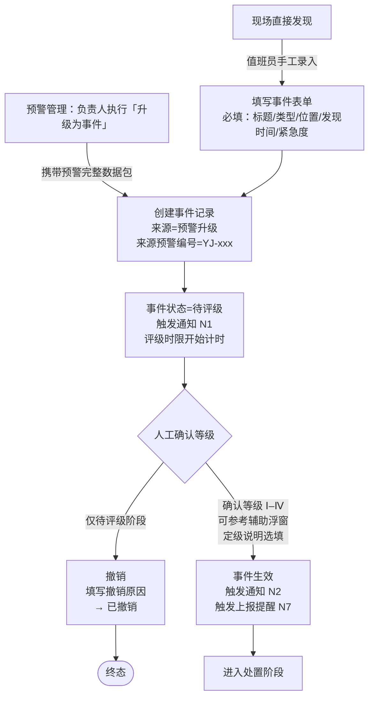
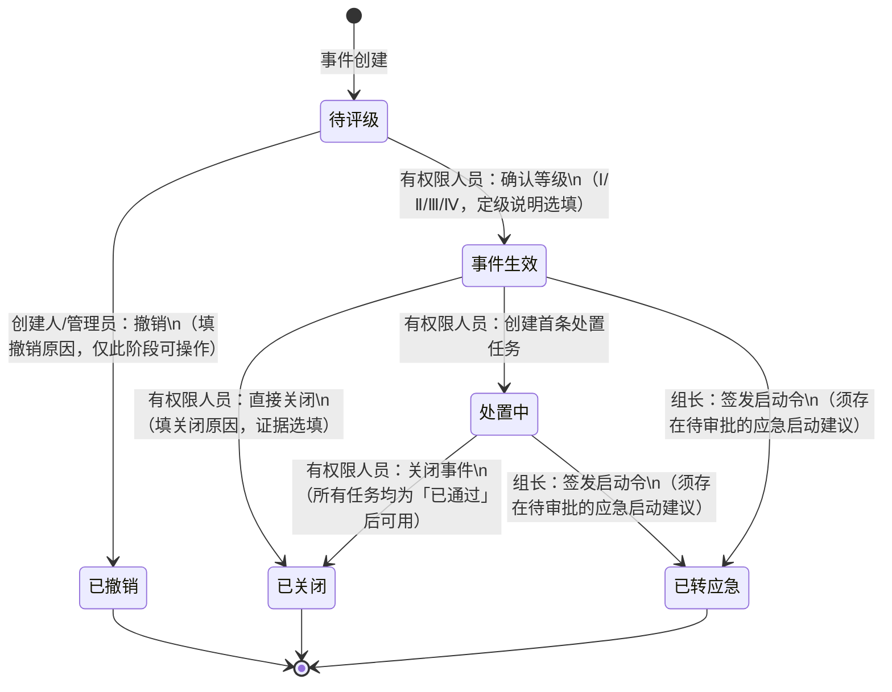
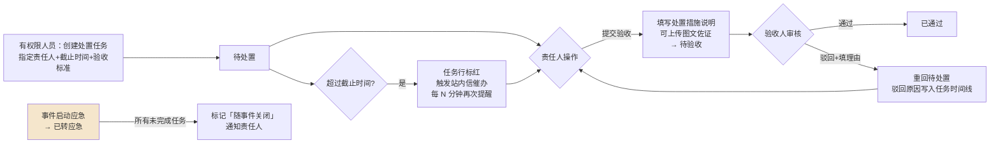
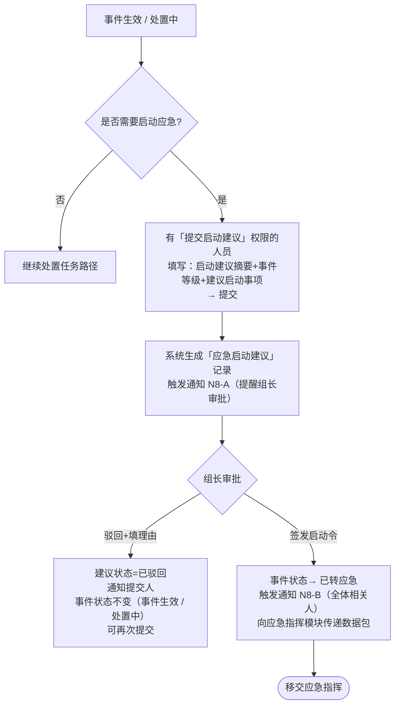
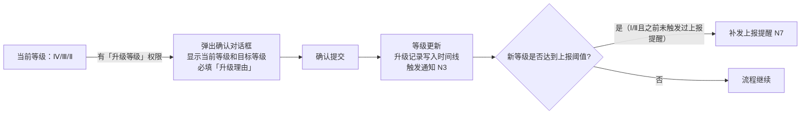

# PRD — 事件管理 · 工作台

| 项 | 内容 |
|---|---|
| 文档版本 | V1.0 |
| 编制日期 | 2026-09-27 |
| 所属产品 | 中石油尼日尔公司上游油田项目 — 数智安防应急指挥中心（平台） |
| 所属端 | PC 后台（主）；大屏端事件区复用同一套详情组件，详见 `PRD-大屏-事件感知处置-事件.md` |
| 所属模块 | 业务应用 → 事件管理 → 事件工作台 |
| 页面架构 | 双层结构：列表页（PageContainer + PanelCard）+ 详情页（全屏工作区） |
| 上游依据 | `应急指挥中心 (1).xmind`、`Downloads/预警-事件-应急整体流程.drawio.xml`、2026-09-27 设计访谈 Q1–Q24 完整决策记录 |
| 状态 | 待评审 |

---

## 1. 文档元数据与边界

### 1.1 需求背景

预警管理模块负责多源威胁线索的汇聚与核实，但核实后确认为真实威胁的预警需要一个结构化的后续处置流程。当前现场缺乏统一的事件台账与处置跟踪手段，威胁处置过程口头传达为主，留痕不足，具体问题如下：

| 现状问题 | 业务影响 |
|---|---|
| 预警升级为事件后无系统联动，口头通知存在信息失真 | 事件处置过程中信息不对称，责任边界模糊 |
| 事件等级依靠个人经验判断，无参考标准 | 同类事件等级认定不一致，上报路由混乱 |
| 整改任务口头派发，无执行跟踪和验收记录 | 整改落地率低，复盘无据可查 |
| 应急启动缺乏标准化审批流程，组长签发无留痕 | 启动决策无法追溯，合规风险高 |

本模块的定位：**事件的统一汇聚、等级确认、处置跟踪和应急移交中台**，将来自预警升级和现场直接发现的事件统一纳管，通过结构化的处置任务、审批链和上报提醒，确保每一个真实威胁都有迹可查、有人负责、有闭环结果。

### 1.2 核心指标

| 指标 | 定义 | 目标值 |
|---|---|---|
| 事件评级及时率 | 创建后 N 分钟内完成等级确认的事件比例（N 在类型配置中设置） | ≥ 90%（初始值，待运营积累后校准） |
| 处置任务按期完成率 | 在截止时间前完成验收的任务数 ÷ 总任务数 | ≥ 80% |
| 应急上报及时率 | Ⅰ/Ⅱ 级事件在 T+30 分钟内标记上报完成的比例 | ≥ 95% |
| 预警→事件字段传递完整性 | 升级时关键字段（位置、类型、证据、时间线）完整传递比例 | 100% |

### 1.3 与既有模块的依赖关系

| 关联模块 | 关系方向 | 具体内容 |
|---|---|---|
| 预警管理 – 预警工作台 | 本模块**读取** | 预警升级时传递完整数据包（见附录 A.3），预警状态变更为「已升级」 |
| 人员管理 – 人员台账 | 本模块**读取** | 获取可选的处置任务责任人列表（平台内用户） |
| 系统管理 – 消息中心 | 本模块**写入** | 9 个通知节点触发站内信，详见 §3.6 |
| 事件类型配置 | 本模块**依赖** | 事件类型字典、等级分级标准参考内容、推荐响应措施、时限、上报负责人配置，详见 `PRD-事件管理-事件类型配置.md` |
| 应急指挥模块 | 本模块**写出** | 应急启动令签发后传递事件完整数据包，接口契约见附录 A.4 |
| 大屏 – 事件感知处置 | 本模块**提供数据** | 大屏事件区实时读取事件列表和 KPI，详见 `PRD-大屏-事件感知处置-事件.md` |
| SOS 独立接警池 | 平行模块 | SOS 不走事件流程，事件详情可挂关联 SOS 编号 |
| 统计分析 | 本模块**提供数据** | 结构化字段支撑事件类统计，页面待后续 PRD 设计 |

### 1.4 权限边界（红线）

| 编号 | 边界 |
|---|---|
| PB-01 | 事件一旦进入终态（已关闭 / 已撤销 / 已转应急）**不可回退、不可修改** |
| PB-02 | 事件等级**只能向上升级**（Ⅳ→Ⅲ→Ⅱ→Ⅰ），降级须关闭当前事件另开新条 |
| PB-03 | 处置任务**驳回后须填理由**，不允许空驳回；驳回后任务重回「待处置」，不新建任务条目 |
| PB-04 | 应急启动为**两步审批**（提交建议 + 签发启动令），平台记录每步操作人和时间戳；允许将两个权限点授予同一角色 |
| PB-05 | 预警升级来源字段**只读不可修改**，事件侧只能补充字段，不能覆盖预警数据 |
| PB-06 | 上报完成标记由**人工操作**，系统只做提醒和记录，不自动发送任何外部通信 |

### 1.5 本期范围（In Scope）

| 编号 | 能力 |
|---|---|
| IS-01 | 两种事件创建入口：来自预警升级（携带预警数据包）、现场直接录入 |
| IS-02 | 完整的事件状态机（6 个状态：待评级 / 事件生效 / 处置中 / 已关闭 / 已转应急 / 已撤销）；「待处置 / 待验收」为处置任务状态，不是事件状态 |
| IS-03 | 等级辅助判定参考浮窗（多 Tab，按事件类型分 Tab 展示四级分级描述），人工确认并留痕 |
| IS-04 | 事件等级单向升级，每次升级必填变更理由，记录时间线 |
| IS-05 | 并行处置任务（任务状态：待处置→待验收→已通过，支持驳回循环；应急签发时未完成任务标记「随事件关闭」），支持外部联系人（仅留痕） |
| IS-06 | 两步应急启动审批链（提交启动建议 → 签发启动令），签发后移交应急指挥模块 |
| IS-07 | 上报提醒：Ⅰ/Ⅱ 级事件生效后 T+10 分钟未标记完成则站内信提醒，T+30 分钟截止；Ⅲ/Ⅳ 级 T+24h 截止 |
| IS-08 | 全屏事件详情页：三栏布局（基本信息+来源预警 / 态势地图+处置任务看板 / 5 Tab 右侧面板） |
| IS-09 | 9 个通知节点，接收人在事件类型配置中按类型设置，支持创建时手动覆盖上报负责人 |
| IS-10 | 事件列表导出为 Excel，单次最多 5000 条 |

### 1.6 本期范围外（Out of Scope）

| 编号 | 内容 | 说明 |
|---|---|---|
| OS-01 | 应急指挥模块页面 | 接口契约见附录 A.4，应急指挥 PRD 另行设计 |
| OS-02 | App 端事件详情页面 | 本 PRD 只定义处置任务数据契约 |
| OS-03 | 事件统计分析页面 | 字段设计支撑统计，页面另行规划 |
| OS-04 | 外部上报通道（邮件/打印模板） | 写入 TBD，待客户提供模板后实现 |
| OS-05 | 事件与 SOS 的深度关联 | 本期只挂编号，深度联动待 SOS 模块设计完成 |
| OS-06 | BPM 工作流引擎 | 本期平台自建轻量任务链，不接 BPM |

---

## 2. 业务概念与术语

| 术语 | 精确定义 | 反例（避免误解） |
|---|---|---|
| **事件** | 经核实确认为真实威胁的安防情况，由预警升级而来或现场直接发现后录入。是需要立即或尽快处置的安防情况。 | 事件不是预警；未经确认的线索是预警 |
| **事件等级** | 按影响范围和响应资源划分的四个等级（Ⅰ–Ⅳ），Ⅰ 级最严重。等级由「等级辅助判定」参考浮窗辅助，人工在「待评级」阶段确认。 | 等级确认后只能升级不能降级；降级须关闭重开 |
| **等级辅助判定** | 事件详情页的一个参考浮窗，按事件类型分 Tab 展示各类型的四级分级描述（涵盖影响范围、人员风险、所需响应资源三个维度），供值班员对照自行判断。内容在事件类型配置中维护。 | 不是算法自动计算；不产生建议等级；定级说明选填 |
| **处置任务** | 针对特定事件创建的执行任务，指定责任人、截止时间和验收标准。一个事件可并行创建多条处置任务，各自独立跟踪。 | 处置任务是事件的子项，不是独立的工单系统；任务关闭不等于事件关闭 |
| **外部联系人** | 处置任务责任人的补充选项，填写姓名和联系方式。外部联系人无平台账号，无法收到系统通知，仅作处置记录留痕。 | 平台用户（内部人员）优先，外部联系人作为例外情况 |
| **应急启动建议** | 事件生效后由有权限人员提交的启动应急响应申请，包含事件摘要、等级、建议启动事项。须经组长审批后才能生效。 | 不等于已启动应急；仅是发起申请 |
| **启动令** | 组长审批签发的应急启动指令，签发后事件状态变为「已转应急」，平台向应急指挥模块传递数据包。 | 启动令签发是不可逆操作，签发前须在平台内确认 |
| **上报提醒** | 按事件等级和时限自动触发的站内信通知，提醒上报负责人在规定时间内完成向上级的上报并在平台中标记完成。平台不承担外部通信。 | 上报本身由人工完成（电话/邮件），平台只做提醒和记录 |
| **处置中** | 事件下已创建至少一条处置任务后的事件状态。任务各自的进度（待处置 / 待验收 / 已通过）由任务自身状态表达，事件层只展示汇总进度，如「3/5 已通过」。 | 处置中不等于任务全部完成；任务全部通过后事件仍需人工关闭 |
| **直接关闭** | 在「事件生效」阶段，现场威胁已即时消除时可用的快速关闭路径，无需创建处置任务。须填写关闭原因，证据选填。 | 不适用于需要整改跟踪或风险尚未消除的场景 |
| **已撤销** | 在「待评级」阶段发现事件为误录或重复录入时的唯一撤销终态。仅待评级可撤销，后续状态不可撤销。 | 已撤销不是物理删除，事件记录永久保留 |

---

## 3. 核心流程与状态机

### 3.1 事件创建流程



### 3.2 事件状态机



**状态规则补充：**

| 规则 | 说明 |
|---|---|
| 并行任务与事件状态 | 事件在「事件生效」状态下创建首条任务后进入「处置中」；处置中可继续新增任务，新增任务不重置其他任务进度。任务状态（待处置 / 待验收 / 已通过 / 随事件关闭）只存在于任务上，事件层展示汇总进度「已通过数 / 任务总数」 |
| 多任务关闭条件 | 事件所有处置任务均为「已通过」后，「关闭事件」按钮才可用，由人工操作关闭，系统不自动关闭 |
| 应急建议唯一性 | 同一事件同一时刻最多存在一条「待审批」的应急启动建议；存在待审批建议时隐藏「提交应急建议」按钮，仅向有 P-10 权限的人员显示「签发启动令」和「驳回建议」。建议被驳回后，可再次提交 |
| 等级升级留痕 | 每次等级升级（如 Ⅲ→Ⅱ）必须填写变更理由，自动写入事件时间线，记录操作人和时间戳 |
| 终态不可逆 | 已撤销、已关闭、已转应急三个终态不可回退，不可修改 |
| 撤销仅限待评级 | 事件生效后不提供撤销操作；事件生效阶段走「直接关闭」，处置中阶段走「关闭事件」，均须填写原因留痕 |
| 应急与处置任务并存 | 启动应急不要求先关闭处置任务；签发启动令后事件直接进入「已转应急」终态，处置任务自动标记为「随事件关闭」 |

### 3.3 处置任务流程



**同一事件的多条并行任务：**
- 每条任务独立跟踪状态，互不影响
- 验收人可以是任务发起人，也可以是被授权的其他角色
- 任务创建后，若发起人需修改截止时间或验收标准，须在「待处置」阶段操作，提交验收后锁定

### 3.4 应急启动审批流程



**两步审批权限设计说明：**

> 设计采用「提交建议」和「签发启动令」两个独立权限点，而非合并为一步，是出于以下考虑：在油田现场，安保部值班员（具备研判能力）与应急领导小组组长（最终决策人）通常是不同岗位。两步拆分确保：①决策责任清晰，组长签发有明确留痕；②权限分配灵活，可将两个权限点授予同一角色以简化小型团队的操作，而不必修改流程逻辑。

### 3.5 等级升级流程



### 3.6 通知节点

| 编号 | 触发时机 | 接收人 | 消息正文模板（示例） |
|---|---|---|---|
| N1 | 新事件创建（来自预警升级或直接录入） | 值班负责人 + 事件类型配置的接收人 | `【新事件】{事件编号} {标题} 已创建，请及时评级` |
| N2 | 等级确认完成（事件生效） | 事件创建人 + 配置接收人 | `【事件生效】{事件编号} 等级已确认为 {等级}，请安排处置` |
| N3 | 事件等级升级 | 事件负责人 + 组长 | `【等级变更】{事件编号} 等级由 {旧等级} 升至 {新等级}，原因：{理由}` |
| N4 | 处置任务下发 | 被指定的责任人 | `【处置任务】您被指定为「{任务标题}」责任人，截止时间：{时间}` |
| N5 | 处置任务提交验收 | 任务发起人 | `【待验收】{任务标题} 已提交验收，请查看并确认` |
| N6 | 处置任务驳回 | 任务责任人 | `【任务驳回】{任务标题} 验收未通过，原因：{理由}，请重新处置` |
| N7 | 上报提醒（事件生效后 T+10min 未标记完成） | 上报负责人（按事件类型配置，可被手动覆盖） | `【上报提醒】{事件编号} {等级} 事件需在 {截止时间} 前完成上报，请尽快处理` |
| N8-A | 应急启动建议提交 | 组长 | `【待审批】{事件编号} 已提交应急启动建议，请及时签发` |
| N8-B | 应急启动令签发 | 全体配置相关人员 | `【应急启动】{事件编号} 应急响应已由 {组长姓名} 签发启动` |
| N9 | 事件关闭（已关闭 / 已撤销） | 事件相关操作人 | `【事件关闭】{事件编号} 已关闭，原因：{关闭原因}` |

---

## 4. 核心功能矩阵

| 功能 | 触发位置 | 前置条件 | 业务结果 | 所需权限点 |
|---|---|---|---|---|
| 创建事件（来自预警升级） | 预警研判页「升级为事件」按钮 | 预警状态为待决策或持续跟踪中 | 新建事件记录，预警状态变为已升级，触发 N1 | P-01 升级预警为事件 |
| 创建事件（手工录入） | 事件列表页「新建事件」按钮 | 无 | 新建事件记录，触发 N1 | P-02 手工创建事件 |
| 撤销事件 | 事件详情页底部操作栏 | 事件状态=待评级，操作人为创建人或管理员 | 事件状态变为已撤销，触发 N9 | P-03 撤销事件 |
| 确认事件等级 | 事件详情页底部操作栏 | 事件状态=待评级 | 事件状态变为事件生效，触发 N2，Ⅰ/Ⅱ 级触发 N7 | P-04 确认事件等级 |
| 升级事件等级 | 事件详情页概要 Tab「升级等级」按钮 | 事件状态=事件生效/处置中；新等级高于当前等级 | 等级更新，升级记录写入时间线，触发 N3 | P-05 升级事件等级 |
| 直接关闭事件 | 事件详情页底部操作栏 | 事件状态=事件生效（无处置任务） | 事件状态变为已关闭，触发 N9 | P-06 关闭事件 |
| 关闭事件（任务完成后） | 事件详情页底部操作栏 | 事件状态=处置中，且所有任务均为「已通过」 | 事件状态变为已关闭，触发 N9 | P-06 关闭事件 |
| 查看等级辅助判定参考 | 确认等级弹窗内「查看分级标准」链接 | 无（任意状态可查看） | 展开多 Tab 参考浮窗，只读 | 无权限要求 |
| 创建处置任务 | 事件详情页处置 Tab「新增任务」按钮 | 事件状态=事件生效或处置中 | 新建任务（任务状态=待处置）；若为首条任务，事件状态由事件生效变为处置中；触发 N4 | P-07 创建处置任务 |
| 提交处置任务验收 | 事件详情页处置 Tab 任务行「提交验收」按钮 | 任务状态=待处置，操作人为任务责任人或有权限人员 | 任务状态变为待验收，触发 N5 | 任务责任人本人，或 P-07 |
| 验收处置任务 | 事件详情页处置 Tab 任务行「验收」按钮 | 任务状态=待验收 | 通过→任务已通过；驳回→任务重回待处置，触发 N6 | P-08 验收处置任务 |
| 提交应急启动建议 | 事件详情页底部操作栏 | 事件状态=事件生效/处置中，且不存在待审批的启动建议 | 生成启动建议记录（状态=待审批），触发 N8-A | P-09 提交应急启动建议 |
| 驳回应急启动建议 | 事件详情页底部操作栏（仅有 P-10 权限时显示） | 存在待审批的启动建议 | 建议状态变为已驳回，事件状态不变，通知提交人 | P-10 签发应急启动令 |
| 签发应急启动令 | 事件详情页底部操作栏（仅有 P-10 权限时显示） | 存在待审批的启动建议，事件状态非终态 | 事件状态变为已转应急，触发 N8-B，向应急指挥模块推送数据包 | P-10 签发应急启动令 |
| 标记上报完成 | 事件详情页上报 Tab | 事件等级已确认，操作人为上报负责人或有权限人员 | 上报记录标记完成，记录完成时间和操作人，N7 提醒停止 | P-11 标记上报完成 |
| 导出事件列表 | 事件列表页工具栏「导出」按钮 | 无 | 导出当前筛选结果为 Excel，最多 5000 条 | P-12 导出事件列表 |

**权限点汇总（共 12 个）：**

| 编号 | 权限点名称 | 典型角色 |
|---|---|---|
| P-01 | 升级预警为事件 | 值班负责人、安保管理员 |
| P-02 | 手工创建事件 | 值班员、值班负责人 |
| P-03 | 撤销事件 | 创建人本人、系统管理员 |
| P-04 | 确认事件等级 | 值班负责人、安保管理员 |
| P-05 | 升级事件等级 | 值班负责人、安保管理员 |
| P-06 | 关闭事件（含直接关闭） | 值班负责人 |
| P-07 | 创建处置任务 | 值班负责人、安保管理员 |
| P-08 | 验收处置任务 | 值班负责人、安保管理员 |
| P-09 | 提交应急启动建议 | 安保管理员、值班负责人 |
| P-10 | 签发应急启动令 | 应急领导小组组长 |
| P-11 | 标记上报完成 | 上报负责人、安保管理员 |
| P-12 | 导出事件列表 | 值班员及以上 |

---

## 5. 页面布局与交互逻辑

### 5.1 事件列表页（EventWorkbench）

```
┌─ PageContainer ──────────────────────────────────────────────────┐
│  ┌─ KPI 栏（PanelCard，高 72px）────────────────────────────────┐ │
│  │  待评级  N  │  进行中  N  │  今日新增  N  │  今日关闭  N  │  评级超时  N │ │
│  └──────────────────────────────────────────────────────────────┘ │
│  ┌─ 筛选 + 操作栏（PanelCard，高 52px）────────────────────────┐ │
│  │  [营地▼] [事件类型▼] [等级▼] [状态▼] [时间范围] [关键字🔍]   [新建事件] [导出] │ │
│  └──────────────────────────────────────────────────────────────┘ │
│  ┌─ 列表主体（PanelCard）────────────────────────────────────────┐ │
│  │  Tab: 全部 │ 待评级 │ 进行中 │ 今日已结束                       │ │
│  │  ─────────────────────────────────────────────────────────── │ │
│  │  [等级色块] SJ-20260927-0001  无人机入侵威胁  ●紧急            │ │
│  │            Goumeri营地 · 来自预警 YJ-20260927-0003  12:34      │ │
│  │            状态: 待评级  ⏱ 超时 00:15  [查看详情 →]           │ │
│  │  ─────────────────────────────────────────────────────────── │ │
│  │  [等级色块] SJ-20260927-0002  围界入侵事件    ●一般            │ │
│  │            Sokor营地 · 手工录入  13:10                         │ │
│  │            状态: 处置中  任务 0/2 已通过  [查看详情 →]         │ │
│  └──────────────────────────────────────────────────────────────┘ │
└──────────────────────────────────────────────────────────────────┘
```

**列表行字段说明：**
- 第一行：等级色块（Ⅰ红/Ⅱ橙/Ⅲ黄/Ⅳ蓝）+ 事件编号 + 标题 + 紧急度色点
- 第二行：营地 + 来源（来自预警编号 或 手工录入） + 创建时间（相对时间，hover 显示绝对时间）
- 第三行：状态标签 + 辅助信息（处置任务进度 / 超时时长） + 操作入口

| 指标卡 | 统计范围 | 告警规则 |
|---|---|---|
| 待评级 | 当前状态=`pending_level` 的事件数 | 大于 0 时橙色背景 |
| 进行中 | 状态=`active / in_progress` 的事件数 | 无特殊告警 |
| 今日新增 | 今日 0 点后创建的事件数 | 无 |
| 今日关闭 | 今日 0 点后进入 `closed / cancelled` 的事件数 | 无 |
| 评级超时 | 超过评级时限仍未评级（`pending_level`）的事件数 | 大于 0 时红色背景 |

### 5.2 事件详情页（EventDetail，全屏工作区）

```
┌─────────────────────────────────────────────────────────────────────────────┐
│ [← 返回列表]  SJ-20260927-0001  无人机入侵威胁  [●紧急] [Ⅱ级] [处置中]     │  顶部信息条（48px）
├──────────────────────┬──────────────────────────────────┬───────────────────┤
│ 左侧面板（240px）    │ 中央区域（flex）                  │ 右侧面板（360px） │
│ 可折叠，折叠宽=0    │                                   │                   │
│ ─────────────────── │ ┌─ 态势地图（上，flex）──────────┐│ [概要][证据][处置]│
│ 基本信息            │ │ 事件位置标记（菱形）            ││ [时间线][上报]    │
│ ─────────────────── │ │ 周边摄像头 / 我方无人机         ││ ───────────────  │
│ 事件类型: 无人机威胁 │ │ 反无当前目标（可关闭图层）      ││ [概要 Tab 内容]   │
│ 等级: Ⅱ级           │ │ 图层控制按钮组                 ││ 基本信息摘要      │
│ 营地: Goumeri       │ └─────────────────────────────────┘│ 来源预警列表      │
│ 位置: 22°N 13°E     │ ┌─ 处置任务看板（下，240px）─────┐│ 推荐响应措施      │
│ ─────────────────── │ │ [新增任务]                      ││ ───────────────  │
│ 来源预警            │ │ ○ 任务1  派人现场确认  待处置   ││                   │
│ ─────────────────── │ │   李明  截止 14:30  [提交验收]  ││                   │
│ ▶ YJ-20260927-0003  │ │ ○ 任务2  联系反无操作  待验收   ││                   │
│   无人机偷飞告警    │ │   张军  截止 14:00  [验收]      ││                   │
│   (点击跳转预警详情)│ └─────────────────────────────────┘│                   │
├──────────────────────┴──────────────────────────────────┴───────────────────┤
│ 底部操作栏（64px）：按当前状态显示可用操作                                   │
│ 待评级: [撤销] ─────────────────────────────── [查看分级标准] [确认等级]    │
│ 事件生效: [直接关闭] [创建处置任务] [提交应急建议] ──────── [升级等级]       │
│ 处置中: [关闭事件*] [提交应急建议] ─────────────────────── [升级等级]        │
│ 有待审批建议时: 隐藏[提交应急建议]；P-10 权限可见 [驳回建议] [签发应急启动令] │
│ * 所有任务均为「已通过」时可用，否则置灰并提示「还有 N 条任务未通过」       │
└─────────────────────────────────────────────────────────────────────────────┘
```

### 5.3 右侧面板五个 Tab 内容说明

**概要 Tab**
- 事件基本信息（类型、等级、营地、位置坐标、发现时间、创建人）
- 来源预警列表（每条预警显示编号+类型+状态，可点击跳转预警研判页）
- 推荐响应措施（来自事件类型配置，已选/未选状态，可勾选确认为「处置计划」）

**证据 Tab**
- 按时间倒序展示所有证据：图片、视频截图、文字描述、核实任务回填结果
- 支持新增证据（上传图片/文字）
- 每条证据显示：类型图标 + 内容摘要 + 来源（设备名/操作人）+ 时间

**处置 Tab**
- 处置任务列表（并行，每条显示：标题 + 责任人 + 截止时间 + 状态 + 可用操作按钮）
- 每条任务可展开查看：验收标准 + 处置措施记录 + 驳回历史
- 顶部「新增任务」按钮（事件生效/处置中状态下显示）
- 顶部汇总进度「已通过 N / 共 M」，与列表行和顶部信息条一致

**时间线 Tab**
- 全量操作记录，倒序排列
- 每条记录：时间戳 + 操作人 + 操作描述（如「确认等级为 Ⅱ 级，理由：威胁范围超过 500m」）
- 系统自动写入：状态变更、等级变更、任务创建/状态变更、通知发送

**上报 Tab**
- 上报状态区：展示各等级上报截止时间 + 当前完成状态
- 上报负责人（可编辑，覆盖类型配置的默认值）
- 上报记录列表：每次「标记完成」操作的时间、操作人、备注
- Ⅰ/Ⅱ 级显示剩余上报时限倒计时（红色提醒）

### 5.4 等级辅助判定参考浮窗

```
┌─ 分级参考标准（覆盖层，宽 640px）─────────────────────────────────┐
│  Tab: [无人机威胁] [人员入侵] [设施安全] [其他] ···                │
│  ─────────────────────────────────────────────────────────────── │
│  当前事件类型：无人机威胁                                           │
│  ┌── Ⅰ级（最严重）─────────────────────────────────────────────┐ │
│  │  影响范围：多营地受影响；无人机携带疑似危险物品；已进入核心区  │ │
│  │  人员风险：现场人员处于直接威胁中                              │ │
│  │  所需资源：需同时启动多支应急队伍、通知集团公司                │ │
│  └──────────────────────────────────────────────────────────────┘ │
│  ┌── Ⅱ级 ────────────────────────────────────────────────────── │
│  │  影响范围：单一营地受影响；无人机在禁飞区内持续飞行             │ │
│  │  ···                                                           │ │
│  └──────────────────────────────────────────────────────────────┘ │
│  [关闭]                                                             │
└─────────────────────────────────────────────────────────────────┘
```

### 5.5 确认等级弹窗

```
┌─ 确认事件等级 ─────────────────────────────────────────────────┐
│  事件类型：无人机威胁                        [查看分级标准]      │
│  ─────────────────────────────────────────────────────────────  │
│  请选择等级（必选）：  ○ Ⅰ级  ○ Ⅱ级  ○ Ⅲ级  ○ Ⅳ级             │
│  ─────────────────────────────────────────────────────────────  │
│  定级说明（选填）：                                               │
│  ┌─────────────────────────────────────────────────────────────┐│
│  │                                                             ││
│  └─────────────────────────────────────────────────────────────┘│
│  注：等级与说明将记录至事件时间线。          [取消] [确认]       │
└─────────────────────────────────────────────────────────────────┘
```

> **设计说明**：系统不计算、不展示「建议等级」（访谈 Q4 决策：参考浮窗仅供对照，最终由人工判断）。默认不预选任何等级，避免操作人不看直接确认。定级说明选填；等级确认后若需调整，走「升级等级」且理由必填（PB-02）。大屏覆盖层直接复用本弹窗，交互一致。

---

## 6. 边界情况与异常处理

### 6.1 空状态

| 场景 | 展示内容 |
|---|---|
| 无任何事件 | 插图 + 文案「暂无事件记录」+ 「新建事件」按钮 |
| 筛选后无结果 | 文案「当前筛选条件下无事件」+ 「清除筛选」链接 |
| 事件无来源预警 | 来源预警区显示「—（现场直接录入）」 |
| 事件无处置任务 | 处置 Tab 显示「暂无处置任务」+ 「新增任务」按钮 |
| 事件无证据 | 证据 Tab 显示「暂无证据材料」+ 「上传证据」按钮 |

### 6.2 校验规则

| 操作 | 校验项 |
|---|---|
| 确认事件等级 | 等级必选，未选时「确认」按钮禁用；定级说明选填；事件状态不是待评级时按钮不显示 |
| 关闭事件（处置中） | 所有任务均为「已通过」；否则按钮置灰并提示未通过任务数 |
| 提交应急建议 | 已存在待审批建议时按钮隐藏；服务端同样校验，重复提交返回 409 |
| 升级等级 | 新等级必须高于当前等级（Ⅰ=最高，不可再升）；「升级理由」必填 |
| 创建处置任务 | 任务标题必填；截止时间必须晚于当前时间；责任人必填（平台用户或外部联系人姓名） |
| 驳回处置任务 | 「驳回原因」必填，不允许空驳回 |
| 撤销事件 | 「撤销原因」必填；仅创建人或系统管理员可操作 |
| 直接关闭 | 「关闭原因」必填（不限字数） |

### 6.3 网络异常

与预警模块保持一致的 WS 链路规则：
- REST 快照 → WS 增量更新
- 重连后全量数据覆盖本地缓存
- 3 个心跳周期无响应判定离线，UI 展示「数据可能不是最新」提示条

操作失败处理：
- 提交操作失败（如确认等级 HTTP 5xx）：Toast 提示「操作失败，请重试」，按钮恢复可点击状态
- 表单填写中途断网：本地保留草稿（localStorage），重连后提示「检测到未提交的草稿，是否恢复？」

### 6.4 并发操作冲突

- 两人同时操作同一事件时，后提交的操作收到「该事件已被 {操作人} 更新，请刷新后重试」提示
- 轻量乐观锁：操作时携带事件的 `updated_at` 字段，服务端版本不匹配时返回 409，前端提示并刷新

### 6.5 极端数据量

- 单事件的处置任务数量无上限；超过 20 条时列表出现「加载更多」入口
- 来源预警超过 10 条时列表折叠，显示「查看全部 N 条来源预警」
- 时间线超过 100 条时，仅展示最近 50 条，底部提供「查看全部历史」按钮（分页）

### 6.6 应急启动建议被驳回后的状态

- 驳回后事件保持原状态（事件生效或处置中），不回退
- 驳回记录写入时间线，包括驳回理由
- 同一事件可多次提交启动建议，历史建议记录均保留，每次驳回/通过均写入时间线

---

## 附录 A：字段定义与接口契约

### A.1 事件主记录（incident）

| 字段名 | 类型 | 说明 |
|---|---|---|
| `incident_id` | string | 系统生成，UUID |
| `incident_no` | string | `SJ-yyyyMMdd-NNNN`，当日序列号 |
| `title` | string | 事件标题，必填 |
| `incident_type_code` | string | 事件类型 code，关联类型配置字典 |
| `incident_type_name` | string | 事件类型名称（冗余存储，防字典变更影响历史） |
| `level` | enum | `I / II / III / IV`，空=未评级 |
| `level_confirmed_by` | string | 等级确认人 user_id |
| `level_confirmed_at` | datetime | 等级确认时间 |
| `level_note` | string\|null | 定级说明（选填） |
| `urgency` | enum | `urgent / normal` |
| `status` | enum | `pending_level / active / in_progress / closed / transferred / cancelled`（6 个） |
| `source_type` | enum | `alert_escalation / manual` |
| `source_alert_ids` | string[] | 来源预警 ID 列表（可多条） |
| `camp_id` | string | 所属营地 ID |
| `camp_name` | string | 营地名称（冗余） |
| `location_lat` | number\|null | 事件位置纬度 |
| `location_lng` | number\|null | 事件位置经度 |
| `description` | string | 事件描述 |
| `created_by` | string | 创建人 user_id |
| `created_at` | datetime | 创建时间 |
| `report_responsible_user_id` | string\|null | 上报负责人（覆盖类型配置默认值） |
| `report_deadline_at` | datetime\|null | 上报截止时间（由等级和生效时间计算） |
| `report_completed_at` | datetime\|null | 上报完成时间 |
| `emergency_proposal_id` | string\|null | 当前有效的应急启动建议 ID |
| `transferred_to_emergency_at` | datetime\|null | 移交应急指挥时间 |
| `close_reason` | string\|null | 关闭原因 |
| `cancel_reason` | string\|null | 撤销原因 |
| `updated_at` | datetime | 最后更新时间（并发冲突校验用） |

### A.2 处置任务（action_task）

| 字段名 | 类型 | 说明 |
|---|---|---|
| `task_id` | string | UUID |
| `incident_id` | string | 所属事件 ID |
| `title` | string | 任务标题，必填 |
| `acceptance_criteria` | string | 验收标准 |
| `assignee_user_id` | string\|null | 责任人平台账号 ID（内部人员） |
| `assignee_external_name` | string\|null | 外部联系人姓名 |
| `assignee_external_contact` | string\|null | 外部联系人联系方式 |
| `deadline_at` | datetime | 截止时间 |
| `status` | enum | `pending`（待处置）/ `submitted`（待验收）/ `approved`（已通过）/ `auto_closed`（随事件关闭） |
| `action_description` | string\|null | 责任人填写的处置措施说明 |
| `rejection_reason` | string\|null | 最近一次驳回原因 |
| `created_by` | string | 发起人 user_id |
| `created_at` | datetime | |
| `submitted_at` | datetime\|null | 提交验收时间 |
| `approved_at` | datetime\|null | 验收通过时间 |
| `approved_by` | string\|null | 验收人 user_id |

### A.3 来自预警模块的升级数据包

预警侧调用升级接口时传递以下数据，事件侧只读保存，不允许覆盖：

| 字段 | 来源 | 说明 |
|---|---|---|
| `alert_id` | 预警记录 | 来源预警 ID |
| `alert_no` | 预警记录 | 来源预警编号 |
| `alert_type_name` | 预警记录 | 预警类型名称 |
| `urgency` | 预警记录 | 紧急程度 |
| `camp_name` | 预警记录 | 营地名称 |
| `location_lat/lng` | 预警记录 | 事件位置（预填，可在事件侧补充） |
| `verification_result` | 预警记录 | 核实结论（真实/无法确认） |
| `timeline_snapshot` | 预警时间线 | 升级时刻的完整时间线 JSON 快照 |
| `evidence_snapshot` | 预警证据列表 | 升级时刻的证据列表 JSON 快照 |
| `resource_snapshot` | 预警记录 | 周边资源快照 |

多条预警合并升级时，每条预警的数据包独立传递，均存入 `source_alert_ids` 和关联快照表。

### A.4 向应急指挥模块的移交数据包

签发启动令后，平台向应急指挥模块推送：

```json
{
  "incident_id": "string",
  "incident_no": "SJ-yyyyMMdd-NNNN",
  "title": "string",
  "incident_type_code": "string",
  "level": "I|II|III|IV",
  "urgency": "urgent|normal",
  "camp_id": "string",
  "camp_name": "string",
  "location_lat": "number|null",
  "location_lng": "number|null",
  "description": "string",
  "source_alert_ids": ["string"],
  "timeline_snapshot": "object[]",
  "evidence_snapshot": "object[]",
  "action_tasks_snapshot": "object[]",
  "emergency_proposal": {
    "proposal_id": "string",
    "submitted_by": "string",
    "submitted_at": "datetime",
    "summary": "string",
    "suggested_actions": "string",
    "approved_by": "string",
    "approved_at": "datetime"
  },
  "transferred_at": "datetime"
}
```

接口约定：POST，幂等（携带 `incident_id` 作为幂等键），应急指挥模块收到后返回 `emergency_case_id`，平台存储该 ID 用于后续关联跳转。

---

## 附录 B：待确认事项（TBD）

| 编号 | 问题 | 影响范围 |
|---|---|---|
| TBD-INC-01 | 评级时限的具体数值（如 Ⅰ/Ⅱ 级 10 分钟、Ⅲ/Ⅳ 级 30 分钟）需客户确认 | 事件类型配置默认值 |
| TBD-INC-02 | 外部上报文件模板（Word/PDF 模板格式和内容）待客户提供，实现后可在上报 Tab 生成草稿 | 附录 A.1 上报相关字段 |
| TBD-INC-03 | 应急指挥模块的接口地址和认证方式待技术对接确认 | 附录 A.4 |
| TBD-INC-04 | 大屏事件覆盖层在操作权限上是否需要额外的角色限制（区别于 PC 后台同一权限点） | §5 大屏操作设计 |
| TBD-INC-05 | 来源预警中的证据和时间线快照，是否需要支持事件创建后的增量同步（当前设计为升级时刻静态快照） | 附录 A.3 |

---

## 附录 C：与 xmind 原始需求的差异说明

| 差异项 | xmind 原始描述 | 本 PRD 设计 | 变更理由 |
|---|---|---|---|
| 状态数量 | 待评级/事件生效/待整改/待验收/已关闭/已转为应急事件 | 事件状态收敛为 6 个：增加「已撤销」终态；「待整改 / 待验收」合并为事件状态「处置中」，「待处置 / 待验收」下沉为处置任务状态 | 待评级阶段误录需要撤销出口；处置任务并行，事件层无法用单一的待处置/待验收表达多任务进度，改由任务状态+汇总进度表达（2026-09-27 评审修订 D1） |
| 等级辅助判定 | 自动基于规则矩阵计算建议等级 | 改为多 Tab 参考浮窗，人工对照自填 | 规则矩阵配置成本高，参考意义大于强制引导；人工确认留痕更符合合规需求 |
| 处置任务（N16 原文「需 BPM」） | 接 BPM 引擎实现工单流 | 平台自建轻量任务链，不接 BPM | 本期 BPM 未规划，自建三步链（派发→反馈→验收）可覆盖全部场景 |
| 上报路由 | 自动路由并生成报告文档 | 仅做提醒+完成标记，模板生成写入 TBD | 报告模板需客户提供，本期先做流程框架，生成能力后续补充 |
