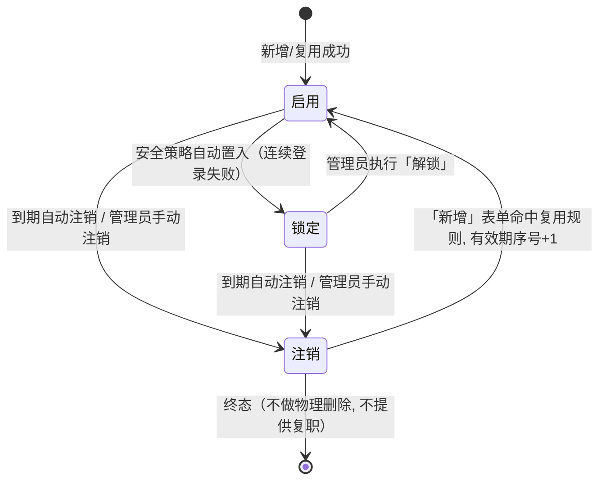
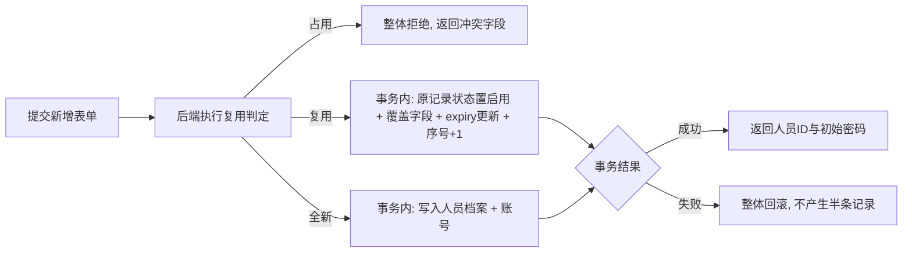

# PRD — 人员管理 · 临时人员管理

| 项 | 内容 |
|---|---|
| 文档版本 | V1.0 |
| 编制日期 | 2026-08-16 |
| 最后更新 | 2026-08-16 |
| 所属产品 | 中石油尼日尔公司上游油田项目 — 数智安防应急指挥中心（平台） |
| 所属端 | PC 后台 |
| 所属模块 | 业务管理 → 人员管理 → 临时人员管理（兄弟页，位于用户信息之后、营地管理之前） |
| 页面架构 | 标准列表页（筛选栏 + 表格 + 新增/编辑抽屉 + 配置弹窗） |
| 上游依据 | 2026-08-16 grilling session 决策、`PRD-人员管理-用户信息.md` V2.3、`PRD-人员管理-营地管理.md` V2.0 |
| 状态 | 待评审 |

---

## 1. 文档元数据与边界

### 1.1 需求背景

营地现场时常出现**外来用工人员、访客及其他非正式员工**。他们与正式员工一样需要登录移动端使用部分功能（如 SOS 上报、事件上报等），但不属于项目正式编制，不应被授予正式人员的管理权限与长期账号。

| 现状问题 | 业务影响 |
|---|---|
| 外来人员只能通过正式「用户信息」模块建号 | 需总管理员逐条操作，正式操作员无权限、无时间来频繁处理 |
| 建号后与正式人员无区分 | 无法快速筛选、统一收紧管理，账号无到期约束，可能被长期滞留使用 |
| 角色可任意选取全量角色 | 外来人员可能被误授正式角色，越权风险 |
| 账号永久有效 | 访客离场后账号不失效，存在安全后门 |

本模块的定位：**受限建号入口**——为临时人员提供一个精简的建号通道，该通道强制约束`角色来源`（仅限指定的临时角色池）与`账号有效期`（必须设置注销时间、且有最大上限），到期自动注销。临时人员与正式人员**共用同一用户数据表与账号体系**（PB-02），非独立账户体系。

### 1.2 核心指标

| 指标 | 定义 | 目标值 |
|---|---|---|
| 临时人员建号覆盖率 | 已建立临时账号的外来人员数 ÷ 到场外来人员总数 | 100% |
| 账号到期注销及时率 | 已过注销时间的临时账号中已自动注销的占比 | 100% |
| 角色受限合规率 | 临时人员所绑角色 ∈ 临时角色池的比例 | 100% |
| 用户名冲突阻断率 | 违反复用规则（在期临时人员/正式人员重名）的新增被拒绝的比例 | 100% |
| 列表首屏加载时长 | 从请求发出到表格渲染完成 | ≤ 2 秒 |

### 1.3 与既有模块的依赖关系

| 关联模块 | 关系方向 | 具体依赖内容 |
|---|---|---|
| 人员管理 → 用户信息 | 本模块**复用数据模型** | 临时人员与正式人员共用同一用户表（人员+账号一对一，PB-02），本模块是用户信息的一种**受限建号入口**；正式人员状态机（启用/锁定/注销，V2.3 三态）同样适用于临时人员 |
| 系统管理 → 角色管理 | 本模块**依赖** | 角色列表（全量角色），用于配置「临时角色池」候选项；角色本身的增删改在系统管理，本模块只消费 |
| 人员管理 → 营地管理 | 本模块**依赖** | 营地列表（仅启用态），「所属营地」字段候选项来源；营地操作员新增时锁定本人营地 |
| 事件管理 / 应急指挥 → 预案管理 | 本模块**提供数据** | 临时人员作为账号主体，其产生的 SOS、事件上报、预案引用按 `人员ID` 关联，与正式人员一致 |
| 实时监控中心（PC 端） | 本模块**提供数据** | 临时人员的姓名、岗位、所属营地等展示属性可出现在人员图层 |
| 大屏 → 安防态势综合驾驶舱 | 本模块**提供数据** | 按营地统计人力时计入在期临时人员（若展示维度需要区分，可按 `isTemp` 过滤） |

### 1.4 权限边界（红线）

| 编号 | 边界 | 说明 |
|---|---|---|
| PB-01 | 临时人员是用户的一种子类型，**共用用户表** | 不新建独立临时人员表；不新设用户状态枚举（复用启用/锁定/注销三态） |
| PB-02 | 新增临时人员仍遵 **「人员+账号一一对应、同事务创建」** 铁律 | 与用户信息 §3.3 原子性一致，严禁"人员建好账号没建"的中间态 |
| PB-03 | 临时人员的角色**只能来自全局「临时角色池」** | 池外角色（含正式角色）不可授予临时人员，从源头阻断越权 |
| PB-04 | 临时人员**必须设置注销时间**，且不得晚于「最大有效期」上限 | 到期由系统**自动注销**；注销为终态，**不提供复职** |
| PB-05 | 临时人员**注销后不做物理删除** | 用户名释放、可被复用（见 §3.2 复用规则）；历史业务数据（SOS/事件/排班/预案）保持可追溯 |
| PB-06 | 菜单与按钮权限**独立** | 「临时人员角色配置」「最大有效期设置」仅主管理员可见；新增/编辑/禁用/注销按营地操作员/全局操作员分级 |
| PB-07 | 营地操作员新增临时人员时，**所属营地锁定本人所在营地** | 防止越权为其他营地建号；全局操作员可任选营地 |

### 1.5 本期范围（In Scope）

| 编号 | 能力 |
|---|---|
| IS-01 | 临时人员列表：筛选栏条件查询（姓名/用户名、所属营地、状态、显示已注销） + 分页展示 |
| IS-02 | 新增临时人员（含同步建号：登录名、初始密码、角色、所属营地、注销时间） |
| IS-03 | 编辑在期临时人员（修正姓名/手机号/角色/所属营地等；注销时间可在上限内调整；登录名不可改） |
| IS-04 | 临时人员详情查看（只读抽屉，含有效期序号、历史有效期记录） |
| IS-05 | 单人账号操作：重置密码、分配角色、解锁 |
| IS-06 | 手动注销临时人员（提前注销，释放用户名） |
| IS-07 | 到期自动注销（定时任务，终态） |
| IS-08 | 批量导入临时人员（Excel，逐行校验与反馈） |
| IS-09 | 临时人员角色配置（全局一份，主管理员配置） |
| IS-10 | 最大有效期设置（全局一个值，主管理员配置） |
| IS-11 | 全量异常处理：空态、用户名冲突（复用判定）、角色池空、超期、字典缺项、网络异常 |
| IS-12 | 操作审计：新增、编辑、角色变更、注销、复用均留痕 |

### 1.6 本期范围外（Out of Scope）

| 编号 | 不做项 | 原因 |
|---|---|---|
| OS-01 | 临时人员的**转正** | 转正路径 = 先注销临时身份 → 总管理员在「用户信息」模块新建正式用户；本模块不提供"转化为正式"动作 |
| OS-02 | App 端临时人员上报 | 本期为 PC 端原型；App 端上报能力留待后续补齐，PC 端入口保留 |
| OS-03 | 角色池按营地/MCU 隔离 | 全局一份（2026-08-16 决策），不扩充需求 |
| OS-04 | 最大有效期按营地差异化 | 全局一个值 |
| OS-05 | 注销人员的自动归档/清理 | 注销即终态，不做物理删除（PB-05），与用户信息一致 |
| OS-06 | 临时账号与正式账号的数据隔离 | 临时人员产生的业务数据与其他人员数据在同一体系内，不做物理隔离 |

---

## 2. 业务概念与术语

| 术语 | 精确定义 |
|---|---|
| **临时人员** | 具有合法限时效力的用户子类。功能与正常用户一致，但①必须设置注销时间、②角色只能从「临时角色池」中选择。本质上是用户表（`isTemp=true`）中的记录，非独立实体。 |
| **临时角色池** | 全局一份、由主管理员配置的**可被临时人员选用的角色集合**。配一个角色即允许临时人员选择该角色；新增临时人员时，角色下拉仅展示池内角色。 |
| **最大有效期** | 全局一个值（按**天**计算），临时人员注销时间的上限：创建日起算，注销时间 ≤ 创建日 + 最大有效期天数。 |
| **注销时间** | 该临时人员账号自动注销（转终态）的时刻。必填；创建时由操作员在 [起算日, 创建日+最大有效期] 区间内选择。 |
| **在期（启用/锁定）** | 未到注销时间的临时人员，账号可（或暂不可）登录。用户名被占用。 |
| **已注销** | 到期自动注销或管理员提前注销后的终态。用户名释放，可被复用（§3.2）。 |
| **有效期序号** | 同一用户名第几次生效的序号（第 1 次、第 2 次…）。复用已注销记录后序号 +1，用于区分历次有效期。 |
| **用户名复用** | 新增临时人员时，若填写的用户名命中一条「临时 + 已注销」记录，则**复用该记录**，重置状态为启用、覆盖全部新建字段并重设注销时间，有效期序号 +1。 |
| **营地操作员** | 仅被授权在**本人所在营地**新增临时人员的操作员（数据权限限本营地）。只能使用新增/编辑/手动注销等执行功能，**不可见**角色池配置与最大有效期设置。 |
| **全局操作员（主管理员）** | 有全量人员数据权限，可配置角色池、最大有效期，新增临时人员时所属营地可任选。 |

---

## 3. 核心流程与状态机

### 3.1 页面主流程

```mermaid
flowchart TD
    A[用户点击 人员管理-临时人员管理 菜单] --> B[渲染页面骨架]
    B --> C[并行发起三路请求]
    C --> E[REST: 临时人员列表 第1页]
    C --> F[REST: 字典 营地/临时角色池]
    C --> G[REST: 最大有效期设置]
    F --> J[填充筛选下拉与表单下拉选项]
    E --> K{列表请求结果}
    K -->|成功且有数据| L[渲染表格, 默认按创建时间降序]
    K -->|成功但零条| M[展示空状态占位]
    K -->|失败| N[展示加载失败占位与重试按钮]
    N --> O[用户点击重试]
    O --> E
    L --> P[进入就绪态]
    M --> P
    P --> Q{用户交互}
    Q -->|输入条件并点击搜索| S[携带全部筛选条件重新查询, 回到第1页]
    S --> E
    Q -->|点击重置| T[清空筛选, 无条件重新查询]
    T --> E
    Q -->|切换分页| E
    Q -->|点击新增| U[打开新增抽屉]
    Q -->|点击行内编辑| V[打开编辑抽屉并回填]
    Q -->|点击行内详情| W[打开详情抽屉 只读]
    Q -->|点击手动注销| Y[二次确认后置为注销]
    Q -->|点击角色配置 *主管理员| Z[打开角色配置弹窗, 多选临时角色池]
    Q -->|点击最大有效期设置 *主管理员| AA[打开设置弹窗, 输入天数]
    U --> Z2{进入用户名校验}
    V --> U2{保存校验}
    Y --> Y2{注销结果}
    Z --> Z3[保存角色池, 刷新列表角色下拉]
    AA --> AA2[保存最大有效期, 刷新新增表单上限]
    Z2 -->|复用判定| AB{命中规则}
    AB -->|临时+已注销| AC[二次确认"将覆盖并继承历史数据"]
    AC --> AD[确认后, 表单带入历史姓名/手机号等, 登录名置灰]
    AD --> U2
    AB -->|临时+启用/锁定 或 正式人员| AE[判为用户名占用, 内联报错, 拦截]
    AE --> Z2
    AB -->|无命中| AF[全新新增, 继续填写]
    AF --> U2
    U2 -->|校验不通过| AG[表单内联报错, 停留在抽屉]
    AG --> U2
    U2 -->|校验通过| AH[提交保存]
    AH --> AI{保存结果}
    AI -->|成功 且为新增| AJ[关闭抽屉, 弹出初始密码结果窗, 刷新列表]
    AI -->|成功 且为编辑| AK[关闭抽屉, Toast 保存成功, 刷新当前页]
    AI -->|失败| AL[抽屉保持打开, 顶部内联错误提示]
    AL --> U2
    Y2 -->|成功| AM[关闭确认, Toast 注销成功, 刷新列表]
    Y2 -->|失败| AN[Toast 失败原因, 状态不变]
    AJ --> P
    AK --> P
    AM --> P
```

### 3.2 用户名校验与复用规则（核心）

> 这是本模块最关键的判定逻辑，决定"新增"走**全新建号**还是**复用已注销记录**。

新增临时人员提交时，对填写的 `username` 做三分支判定：

| 分支 | 命中条件 | 处理 |
|---|---|---|
| **复用** | 用户表中存在一条 **`isTemp=true` 且 `status=注销`** 的记录，用户名相等 | **复用该记录**：状态重置为「启用」，覆盖姓名/性别/角色/所属营地/岗位/注销时间等全部新建字段，登录名保持，**有效期序号 +1**。进入二次确认（下游）。 |
| **占用** | ① 存在 `isTemp=true` 且 `status=启用/锁定` 的临时人员用户名相等；或 ② 存在任意正式人员（`isTemp=false`）用户名相等 | 视为 **用户名已被占用**，整体拒绝新增，内联报错「用户名已存在」。 |
| **新增** | 上述均不命中 | **全新新增**一条临时人员记录，有效期序号 = 1。 |

**三种情况的判定优先级**：先查"正式人员同名"（直接拒绝，正式账号优先级最高），再查"在期临时同名"（拒绝），最后才允许"临时+已注销"复用。

**复用二次确认**：命中「复用」时，弹出确认框——

> 「用户名 {username} 已存在已注销的临时人员记录（第 N 次有效期已结束）。本次新增将**复用该记录并覆盖**，其历史业务数据（事件、SOS、排班等）将保留在该用户名下。确认继续？」

操作员确认后，表单带入历史姓名/手机号等（可修改），登录名置灰不可改，角色、注销时间仍需重新填写并校验。此二次确认**不可关闭跳过**（防误复用导致身份混淆）。

### 3.3 临时人员状态机



**与用户信息三态的关系**：临时人员复用与用户信息完全相同的三态（启用/锁定/注销）与流转，但有两处差异：

| 差异 | 用户信息（正式） | 临时人员 |
|---|---|---|
| 注销可逆性 | 注销 → 复职（管理员触发） | **注销为终态，不提供复职**；恢复只能通过「新增」表单的复用规则（有效期序号 +1） |
| 注销触发源 | 仅管理员手动 | 管理员手动 **或 系统到期自动** |
| 新增后状态 | 启用 | 启用 |

> **铁律：临时人员不可通过「复职」延长**。在已注销临时记录的「编辑」入口中，**不允许修改注销时间将其复活**（编辑入口对注销态开放，但注销时间字段置灰）。想延长只能在「新增」表单里重新走一遍（复用），从而强制每次有效期都是一次新的授权决策。

### 3.4 到期自动注销（定时任务）

- 平台定时任务（建议每日一次，可配置执行时刻）扫描所有 `isTemp=true` 且 `status=启用/锁定` 且 `expiryAt <= 当前时间` 的记录。
- 命中后将其 `status` 置为「注销」，并在审计日志记录「注销原因 = 到期自动」。
- 注销后立即生效：该账号下一次鉴权即被拒绝。
- 定时任务执行应**可重复、幂等**（多条记录并行处理，单条失败不阻塞整体，失败记录次日重扫）。

### 3.5 新增/复用原子性



---

## 4. 核心功能矩阵

| 动作名称 | 触发位置 | 前置条件 / 受控状态 | 业务结果概述 |
|---|---|---|---|
| 进入临时人员管理页 | 左侧菜单「人员管理 → 临时人员管理」 | 具备本页查看权限 | 加载营地、临时角色池、最大有效期配置与临时人员列表；默认按创建时间降序展示第 1 页，默认不含已注销人员 |
| 按条件查询 | 筛选栏「搜 索」按钮 | 无 | 姓名/用户名、所属营地、状态取交集查询，回到第 1 页 |
| 重置筛选 | 筛选栏「重 置」按钮 | 无 | 清空筛选条件，立即无条件重新查询并回到第 1 页 |
| 显示/隐藏已注销 | 筛选栏「显示已注销」勾选框 | 无 | 勾选后结果集纳入已注销临时人员；默认不勾选 |
| 新增临时人员 | 右上角「新 增」按钮 | 具备新增权限（营地操作员或全局操作员） | 打开新增抽屉；提交后走 §3.2 复用判定；成功后同步建号并返回初始密码（§3.5） |
| 编辑临时人员 | 表格行内「编辑」 | 具备编辑权限；**在期（启用/锁定）可编辑** | 打开编辑抽屉并回填；登录名置灰不可改；仅取消组态且非注销的字段可改（见 §5.6） |
| 查看详情 | 表格行内「详情」 | 具备本页查看权限 | 打开只读抽屉，展示全部字段、有效期序号与历次有效期记录 |
| 重置密码 | 行内「更多 → 重置密码」 | 具备账号管理权限；已注销不可用 | 二次确认后生成新密码，结果一次性展示 |
| 分配角色 | 行内「更多 → 分配角色」/ 编辑抽屉「角色」字段 | 具备账号管理权限；已注销不可用；**仅可在临时角色池内选择** | 从临时角色池多选角色，整体覆盖原有角色集合 |
| 解锁 | 行内「更多 → 解锁」 | 仅「锁定」态可见 | 状态由锁定回到启用 |
| 手动注销 | 行内「更多 → 手动注销」 | 具备管理权限；在期可用 | 二次确认后置为注销（终态），释放用户名（§3.3） |
| 临时人员角色配置 | 筛选栏右/工具栏「临时人员角色配置」按钮 | **仅主管理员** | 打开配置弹窗，多选临时角色池中的角色并保存（IS-09） |
| 最大有效期设置 | 工具栏「最大有效期设置」按钮 | **仅主管理员** | 打开设置弹窗，输入全局最大有效期天数并保存（IS-10） |
| 批量导入 | 右上角「批量导入」按钮 | 具备新增权限 | 上传 Excel 模板，逐行校验（见 §5.7），返回逐行成功/失败结果 |
| 导出临时人员列表 | 右上角「导 出」按钮 | 具备查看权限 | 导出当前筛选结果为 Excel |

**按操作员等级的可见性矩阵**

| 功能 | 全局操作员（主管理员） | 营地操作员 |
|---|---|---|
| 查看列表 / 详情 | ✅ | ✅（仅本人营地数据） |
| 新增 / 编辑 / 手动注销 | ✅（所属营地可任选） | ✅（所属营地锁定本人营地） |
| 批量导入 | ✅ | ✅（仅导入本人营地） |
| 重置密码 / 分配角色 / 解锁 | ✅ | ✅（仅本人营地） |
| 临时人员角色配置 | ✅ | ❌ 不渲染 |
| 最大有效期设置 | ✅ | ❌ 不渲染 |

---

## 5. 页面布局与交互逻辑

### 5.1 页面骨架

```
┌───────────────────────────────────────────────────────────────────────────────────────┐
│ 顶栏： 业务管理 │ 系统管理 │ 统计分析 │ 安防态势 │ 建设总览 │ 实时监控 │ 事件处置      │
├───────────────────────────────────────────────────────────────────────────────────────┤
│  临时人员管理  [临时人员角色配置 *][最大有效期设置 *]          [批量导入][＋ 新 增]      │
│  ┌──────────────────────────────────────────────────────────────────────────────────┐ │
│  │ 姓名/用户名 [请输入     ]  所属营地 [全部▾]  状态 [全部▾]  □显示已注销             │ │
│  │                                                                   [搜 索] [重 置] │ │
│  └──────────────────────────────────────────────────────────────────────────────────┘ │
│  ┌──────────────────────────────────────────────────────────────────────────────────┐ │
│  │□│姓名│登录名│岗位│所属营地│手机号│角色│注销时间│状态│有效期│操作                    │ │
│  ├──────────────────────────────────────────────────────────────────────────────────┤ │
│  │□│张三│zhangsan│--│Koulele│+227 98765432│访客│2026-08-30│启用│第2次│详情 编辑 更多▾ │ │
│  │□│李四│lisi   │--│Jaouro │+227 91234567│SOS上报员│2026-08-22│锁定│第1次│详情 编辑 更多▾│ │
│  │□│王五│wangwu │--│Dibeilla│+227 97654321│访客│2026-08-10│注销│第1次│详情 编辑 更多▾ │ │
│  │…│ … │ …      │ …│  …    │  …    │ …  │  …      │ …  │ … │ …      │ …               │ │
│  └──────────────────────────────────────────────────────────────────────────────────┘ │
│                                            ‹ [1] 2 3 ›  20条/页  共 N 条              │
└───────────────────────────────────────────────────────────────────────────────────────┘
```

> - 标准单栏布局，全宽自适应。
> - 「临时人员角色配置」「最大有效期设置」仅主管理员可见（PB-06）；营地操作员页面不渲染这两个按钮。
> - 「注销时间」列对**已注销**行展示原注销时间并置灰、不透明度 60%，整行同理（视觉区分在期/已注销）。

### 5.2 筛选栏字段规则

| 字段 | 控件类型 | 是否必填 | 默认值 | 取值/限制规则 | 数据来源 |
|---|---|---|---|---|---|
| 姓名/用户名 | 单行文本输入框 | 否 | 空 | 最多 64 字符；对两个字段做**或**关系模糊匹配；不区分大小写 | 用户输入 |
| 所属营地 | 单选下拉框 | 否 | 全部 | 首项「全部」，其余项为**启用态**营地；营地操作员仅可见并可选本人营地 | 营地管理 |
| 状态 | 单选下拉框 | 否 | 全部 | 固定四项：全部 / 启用 / 锁定 / 注销。选中「注销」时自动勾选「显示已注销」并置灰该勾选框 | 前端硬编码枚举 |
| 显示已注销 | 勾选框 | 否 | 未勾选 | 未勾选时结果集排除已注销人员；状态筛选选中「注销」时强制勾选且不可手动取消 | 用户操作 |
| 搜 索 | 主按钮 | —— | —— | 请求进行中显示 loading 且禁用 | —— |
| 重 置 | 次按钮 | —— | —— | 请求进行中禁用 | —— |

**筛选逻辑约定**：文本框、所属营地、状态之间为 **AND（交集）**；文本框内部对姓名/用户名两字段为 **OR**。全部为空/全部时，返回除已注销外的全部临时人员。

### 5.3 操作按钮栏规则

| 区域 | 说明 |
|---|---|
| 左侧 | 「临时人员角色配置」（主管理员专属）、「最大有效期设置」（主管理员专属） |
| 右侧 | 「批量导入」「＋ 新 增」（主按钮）|
| 导出 | 归属右侧「导 出」，或与批量导入并列；按产品既定列表页统一风格 |

### 5.4 表格列定义

| 序号 | 列名 | 数据字段 | 类型 | 列宽 | 对齐 | 排序 | 空值/异常渲染 |
|---|---|---|---|---|---|---|---|
| 0 | 勾选框 | —— | —— | 48px | 居中 | —— | 已注销行勾选框置灰不可勾选，悬浮提示「已注销人员不支持批量操作」 |
| 1 | 姓名 | `name` | 字符串 | 120px | 居中 | 不支持 | 必填，超宽以 `…` 截断 + Tooltip |
| 2 | 登录名 | `username` | 字符串 | 140px | 居中 | 不支持 | 必填，恒不为空 |
| 3 | 岗位 | `position` | 枚举 | 120px | 居中 | 不支持 | 字典缺项显示原始值并置灰，Tooltip「岗位字典中无此项」；**空值显示 `--`**（本模块岗位可不填） |
| 4 | 所属营地 | `camp` | 枚举 | 180px | 居中 | 不支持 | 营地已停用显示原始值并置灰，Tooltip「该营地已停用」；空值显示 `--` |
| 5 | 手机号 | `phone` | 字符串 | 140px | 居中 | 不支持 | 空值显示 `--` |
| 6 | 角色 | `roles` | 字符串数组 | 180px | 居中 | 不支持 | 多角色以顿号连接；超宽显示前 2 个 + `等 N 个`，Tooltip 展示全部；无角色显示 `--` 并标橙 |
| 7 | 注销时间 | `expiryAt` | 日期时间 | 160px | 居中 | 不支持 | 已注销行置灰显示原值；无值显示 `--` |
| 8 | 状态 | `status` | 枚举 | 100px | 居中 | 不支持 | 启用=绿、锁定=橙、注销=红；未知枚举值显示 `--` |
| 9 | 有效期 | `tempPeriodSeq` | 整型 | 90px | 居中 | 不支持 | 显示 `第 N 次`；第 1 次可省略或不省略（建议统一显示） |
| 10 | 操作 | —— | —— | 200px | 居中 | —— | 固定「详情」「编辑」+「更多▾」下拉；按状态与权限动态增减（见 §5.6） |

**表格通用规则（与用户信息一致）**

| 项 | 规则 |
|---|---|
| 行高 | 48px，固定 |
| 表头 | 吸顶固定，随内容区横向滚动同步 |
| 斑马纹 | 不使用 |
| 行悬浮 | 整行背景高亮 |
| 行点击 | 无响应（操作一律走操作列） |
| 横向滚动 | 列总宽超出容器时出现横向滚动条，姓名列左侧冻结，操作列右侧冻结 |
| 默认排序 | `创建时间` 降序（最新添加在前） |
| 已注销行渲染 | 整行文字不透明度 60%，与在期行视觉区分 |

### 5.5 新增抽屉字段规则

抽屉自右侧滑出，宽 640px，分「基本信息」「账号信息」两个分节，单页滚动，底部固定「取 消」「保 存」。

| 分节 | 字段 | 控件 | 必填 | 新增 | 复用已注销时 | 校验规则 |
|---|---|---|---|---|---|---|
| 基本信息 | 姓名 | 文本框 | 是 | 可填 | **带入历史值，可改** | 1–32 字符；允许中英文、空格、`·`；前后空格自动去除 |
| 基本信息 | 性别 | 单选 | 否 | 可选 | 可改 | 男/女/未知，默认未知 |
| 基本信息 | 岗位 | 下拉单选 | **否** | 可选 | 可改 | 取自岗位字典；字典为空时禁用并提示；**本模块岗位非必填**（正式用户信息必填） |
| 基本信息 | 所属营地 | 下拉单选 | 是 | 可选 | 可改 | 取自启用态营地；**营地操作员锁定本人营地置灰** |
| 基本信息 | 手机号 | 文本框 | 是 | 可填 | **带入历史值，可改** | 5–20 位；允许数字、`+`、`-`、空格 |
| 基本信息 | 邮箱 | 文本框 | 否 | 可填 | 可改 | 标准邮箱格式，非空时校验 |
| 基本信息 | 备注 | 多行文本 | 否 | 可填 | 可改 | 最多 200 字符 |
| 账号信息 | 登录名 | 文本框 | 是 | 可填，失焦建议拼音 | **带入历史值并置灰** | 4–32 字符；仅小写字母、数字、下划线；**提交时走 §3.2 复用判定**；判定为「占用」则整体拒绝 |
| 账号信息 | 初始密码 | 单选+文本框 | 是 | 二选一 | 不展示（复用沿用） | 选「管理员指定」时 8–32 字符，含字母与数字 |
| 账号信息 | 角色 | 下拉多选 | 是 | 可选 | **重填必选** | **仅展示临时角色池内角色**（PB-03）；至少 1 个；保存整体覆盖 |
| 账号信息 | 注销时间 | 日期选择器 | **是** | 可选 | **重填必输** | 可选区间 = [起算日, 创建日+最大有效期]；超出最大有效期时日期选择器禁用对应日期。**必填，不可缺省** |
| 账号信息 | 人员状态 | 只读文本 | —— | 固定「启用」 | 固定「启用」 | 不可改 |

**关键必填差异（vs 用户信息正式新增）**

| 字段 | 正式（用户信息） | 临时人员 |
|---|---|---|
| 岗位 | 必填 | **非必填**（2026-08-16 决策） |
| 注销时间 | 无此字段 | **必填**，且 ≤ 创建日+最大有效期 |

**抽屉通用规则**

| 项 | 规则 |
|---|---|
| 校验时机 | 失焦即校验单字段；点击保存时全表校验，滚动定位第一个错误 |
| 用户名冲突校验 | 失焦对「正式人员重名」做异步预检以提前提示（提高体验）；**最终以提交时的 §3.2 三态判定为准** |
| 未保存关闭 | 表单有改动时弹二次确认「有未保存的修改，确认放弃？」 |
| 保存中 | 「保 存」loading 且禁用，「取 消」禁用，防重复提交 |
| 保存失败 | 抽屉保持打开，顶部内联错误，已填内容不丢失 |
| 新增成功 | 关闭抽屉 → 弹初始密码结果窗 → 刷新列表并跳转第 1 页 |

### 5.6 操作列「更多」下拉的动态可见规则

| 临时人员状态 | 「更多」下拉中可见的项 | 不可见项及原因 |
|---|---|---|
| 启用 | 重置密码、分配角色、手动注销 | 无「解锁」（未锁定）、无「复职」（不提供，见 §3.3） |
| 锁定 | 解锁、重置密码、分配角色、手动注销 | 无「启用」（用「解锁」语义更准） |
| 注销 | ——（无操作项） | 全部隐藏；行内「编辑」按钮置灰，悬浮提示「已注销人员不可编辑，请通过新增复用」；**注销时间字段在详情中只读** |

> 与用户信息不同，临时人员**不提供「复职」**；注销后唯一出路是「新增」表单命中复用规则（§3.2）。
> 「详情」按钮在任何状态均可见可用。

### 5.7 批量导入规则

| 项 | 规则 |
|---|---|
| 模板 | 与新增字段一致：姓名*、登录名*、岗位（可空）、所属营地*、手机号*、角色*（多个用顿号）、注销时间*、备注。标 `*` 为必填 |
| 逐行校验 | 每行独立校验：登录名走 §3.2 复用判定；角色 ∈ 临时角色池；注销时间 ∈ 有效区间；所属营地权限合法 |
| 反馈 | **逐行反馈**：成功后逐行展示新密码；失败行单独分组列出每行失败原因与行号 |
| 部分成功 | 成功部分**已生效不回滚**（与用户信息批量操作一致）；登录名冲突/角色池外/超期等错误行阻止 |
| 营地操作员 | 模板默认所属营地 = 本人营地；若填写其他营地则整行失败 |

### 5.8 角色配置弹窗（主管理员）

| 项 | 规则 |
|---|---|
| 触发 | 「临时人员角色配置」按钮 |
| 内容 | 展示**全量角色**列表（来自系统管理），每项带勾选框；已勾选 = 进入临时角色池 |
| 保存 | 整体覆盖全局临时角色池；保存后立即生效于所有新增/编辑的角色下拉 |
| 边界 | 已被某**在期临时人员**绑定的角色被移出池：该临时人员角色保留（不强制解绑），但后续不可再选该角色；建议弹窗内提示受影响人数 |

### 5.9 最大有效期设置弹窗（主管理员）

| 项 | 规则 |
|---|---|
| 触发 | 「最大有效期设置」按钮 |
| 内容 | 输入天数（正整数，建议 1–365） |
| 保存 | 覆盖全局值；保存后新增表单的注销时间上限即时更新 |
| 边界 | 已在期的临时人员注销时间**不受新值追减**（不做溯及）；仅影响后续新增 |

---

## 6. 边界情况与异常处理

### 6.1 空状态

| 场景 | 判定条件 | 页面表现 |
|---|---|---|
| 系统内无任何临时人员 | 无筛选条件返回 0 条 | 空状态插图 + 文案「暂无临时人员，点击右上角「新增」建立第一条」+「＋ 新 增」按钮 |
| 筛选无结果 | 存在筛选条件返回 0 条 | 空状态插图 + 文案「未找到符合条件的临时人员」+「重置筛选条件」文字按钮 |
| 临时角色池为空 | 角色池接口返回 0 条 | 新增抽屉「角色」字段禁用并提示「临时角色池未配置，请联系主管理员」；**「保 存」置灰**（角色必填，无角色可选无法完成新增） |
| 营地为空 | 营地接口返回 0 条 | 筛选下拉仅保留「全部」；抽屉「所属营地」禁用并提示 |

### 6.2 数据校验与非法值

| 场景 | 处理策略 |
|---|---|
| 用户名重复（正式人员） | 命中「正式人员占用」分支，整体拒绝，内联报错「用户名已存在，与正式人员冲突」 |
| 用户名重复（在期临时人员） | 命中「在期临时占用」分支，整体拒绝，内联报错「用户名已存在，该临时人员仍在有效期内」 |
| 用户名命中「临时+已注销」 | 走「复用」分支，弹二次确认（§3.2） |
| 岗位字典为空 | 抽屉「岗位」字段禁用并提示「岗位字典未配置」；**本模块岗位非必填，故不阻塞保存** |
| 角色池为空 | 角色字段禁用 + 「保 存」置灰（§6.1） |
| 注销时间早于今日 | 日期选择器禁用过去日期；无法选中 |
| 注销时间晚于最大有效期 | 日期选择器禁用创建日+最大有效期之后的日期；无法选中 |
| 未选任何角色 | 内联报错「请至少选择一个角色」 |
| 未填注销时间 | 内联报错「请设置注销时间」 |
| 营地操作员越权选非本人营地 | 下拉不提供非本人营地选项（前端）；后端二次校验拒绝 403 |
| 后端返回 `status` 为枚举外值 | 状态列显示 `--`，控制台 warn，操作列仅「详情」 |
| 单条数据缺失 `id` / 重复 `id` | 缺 id 过滤不渲染；重复 id 以最后一条为准去重 |

### 6.3 网络与服务异常

| 场景 | 处理策略 |
|---|---|
| 列表首次加载失败 | 失败占位 +「重试」按钮；不自动重试 |
| 列表翻页/筛选失败 | 保留当前已渲染数据，Toast「加载失败，请重试」3 秒 |
| 字典接口失败 | 对应下拉降级为仅「全部」；对应列显示原始值并置灰 |
| 角色池接口失败 | 角色列显示原始角色 ID 并置灰；抽屉角色字段展示「角色池加载失败，点击重试」 |
| 保存超时 | 抽屉保持打开并提示「提交结果未知，请关闭后刷新确认，避免重复提交」；不自动重试（防重复建号） |
| 新增事务部分失败 | 按 §3.5 整体回滚，前端提示「创建失败，未产生任何记录」，表单保留 |
| 手动注销失败 | Toast 错误提示，状态不变 |
| 登录态失效 | 任一接口返回 401，清除会话跳登录页 |

### 6.4 引用完整性

| 场景 | 处理策略 |
|---|---|
| 临时人员绑定的角色在系统管理被删除 | 角色列不再展示；若删除后角色为空，显示 `--` 并标橙 |
| 角色被从临时角色池移除 | 在期临时人员该角色保留（不强解绑），后续不可再选 |
| 所属营地被停用 | 列显示原始值并置灰；编辑时该字段为空，需重选有效营地 |
| 已产生业务数据（事件/SOS/排班/预案）的临时人员注销 | 允许注销，历史引用保持可追溯（PB-05） |
| 复用的已注销记录 | 历史业务数据保留在该用户名下；有效期序号 +1 用于区分阶段（IS-04/details） |
| 尝试物理删除临时人员 | 前端无删除入口；后端拒绝 403 |

### 6.5 权限与越权

| 场景 | 处理策略 |
|---|---|
| 无本菜单权限 | 菜单不渲染；直接访问 URL 显示 403 |
| 营地操作员无配置权限 | 「临时人员角色配置」「最大有效期设置」按钮不渲染 |
| 营地操作员访问他营数据 | 列表默认仅本人营地；后端数据权限二次校验 |
| 无新增/编辑权限 | 「＋ 新 增」、行内「编辑」、批量导入不渲染 |
| 有查看权限、无账号管理权限 | 「重置密码」「分配角色」「手动注销」「解锁」不渲染 |
| 尝试对自己执行操作 | 「手动注销」对当前登录用户自身不可用，悬浮提示「不能对自己执行该操作」 |

### 6.6 极端数据量

| 场景 | 处理策略 |
|---|---|
| 临时人员总数 > 1000 | 服务端分页保证单页 ≤ 100 条，前端不做虚拟滚动 |
| 单批次批量导入 > 200 条 | 分页处理，展示进度，结果清单弹窗内表格自带滚动，提供「复制全部」「导出 CSV」 |
| 同一用户名复用次数 > 50 | 列表「有效期」列显示「第 50+ 次」截断；详情抽屉展示历次清单（滚动） |
| 全量角色 > 100 | 角色配置弹窗内提供搜索过滤 |

---

## 附录 A：数据字段完整定义

### A.1 涉及字段（基于用户信息用户表扩展）

| 字段名 | 展示名 | 类型 | 必填 | 唯一 | 可编辑 | 来源 | 被下游引用 | 说明 |
|---|---|---|---|---|---|---|---|---|
| `id` | 人员ID | 字符串 | 是 | 是 | 否 | 平台生成 | ✅ 与正式人员一致 | 主键，全局唯一；复用已注销记录时**沿用原 id**（不是新 id） |
| `username` | 登录名 | 字符串 | 是 | 是 | **否** | 录入/复用带入 | —— | 创建后不可改；复用判定核心（§3.2） |
| `isTemp` | 是否临时人员 | 布尔 | 是 | 否 | 否 | 建号入口决定 | ✅ 列表打标、到期自动注销任务筛选、大屏统计过滤 | `true` = 本模块建号；正式用户在用户信息入口建号时为 `false` |
| `expiryAt` | 注销时间 | 日期时间 | **临时人员必填** | 否 | 在期可改（≤上限） | 录入 | ✅ 到期自动注销任务 | 正式人员无此语义，恒为空；复用后重设 |
| `tempPeriodSeq` | 有效期序号 | 整型 | 是（默认1） | 否 | 否 | 系统 | ✅ 列表「有效期」列、详情历次展示 | 全新新增=1；复用时原序号+1 |
| `roles` | 角色 | 字符串数组 | 是 | 否 | 是（仅池内） | 系统管理→临时角色池过滤 | ✅ 鉴权 | 至少 1 个；**仅临时角色池内角色** |
| `status` | 人员状态 | 枚举 | 是 | 否 | 经操作列/定时任务 | 平台维护 | ✅ 复用判定 | 启用/锁定/注销（三态，V2.3） |
| `name` / `gender` / `position` / `camp` / `phone` / `email` / `remark` / `createdAt` / `updatedAt` / `lastLoginAt` | —— | —— | 详见用户信息附录A | —— | —— | —— | —— | 复用已注销记录时带入历史值并可改；`position` **非必填**（临时人员） |

**不新增的字段及原因**

| 未设字段 | 原因 |
|---|---|
| `isDeleted` | 不物理删除亦不做软删标记；`注销` 即终态（PB-05） |
| 独立临时人员表 | PB-01：共用用户表，避免业务表关联拆分 |
| 独立状态枚举 | 复用用户信息三态，不新设 |
| `复职` 标记 | 临时人员不提供复职（§3.3），复用即复活 |

### A.2 配置项定义

| 配置项 | 类型 | 全局范围 | 默认值 | 维护方 |
|---|---|---|---|---|
| `tempRolePool` | 角色ID数组 | 全局一份 | 空（需配置后方可新增） | 主管理员 |
| `tempMaxDays` | 正整数（天数） | 全局一个值 | 建议 30（可配） | 主管理员 |

**配置存储建议**：落平台级配置（数据字典或参数配置表），不属于用户表字段。

### A.3 API 接口清单

| 接口名称 | 请求方法 | 路径 | 说明 |
|---|---|---|---|
| 查询临时人员列表 | GET | `/api/person/temp/list` | 参数：姓名/用户名、营地、状态、显示已注销、分页 |
| 新增临时人员 | POST | `/api/person/temp` | 含复用判定；返回人员ID、初始密码、是否复用 |
| 编辑临时人员 | PUT | `/api/person/temp/{id}` | 在期可编辑；登录名不可改 |
| 用户名预检 | GET | `/api/person/temp/check-username` | 参数 username；返回新的提交时判定提示（预检，最终以 POST 为准） |
| 详情查询 | GET | `/api/person/temp/{id}` | 含有效期序号与历次有效期 |
| 手动注销 | PATCH | `/api/person/temp/{id}/cancel` | 二次确认后转注销态 |
| 重置密码 | POST | `/api/person/temp/{id}/reset-password` | 一次性返回新密码 |
| 分配角色 | PUT | `/api/person/temp/{id}/roles` | 池内角色整体覆盖 |
| 解锁 | PATCH | `/api/person/temp/{id}/unlock` | 锁定→启用 |
| 配置临时角色池 | GET/PUT | `/api/person/temp/role-pool` | 主管理员读写全局池 |
| 配置最大有效期 | GET/PUT | `/api/person/temp/max-days` | 主管理员读写全局值 |
| 批量导入 | POST | `/api/person/temp/import` | 逐行校验，返回行级结果 |
| 到期自动注销 | POST（任务） | `/api/task/temp-expiry-run` | 定时扫描，幂等 |

### A.4 前端路由设计

| 路由 name | 路径 | 页面组件 | 说明 |
|---|---|---|---|
| `TempPersonnelManagement` | `/business/temp-personnel` | `TempPersonnelManagement.vue` | 临时人员管理主页面；排序位于用户信息之后、营地管理之前 |

---

## 附录 B：待确认事项（与业主最终确认）

> 此清单中的事项为**业务口径**，需要与客户最终确认，不在本 PRD 内自行拍死（2026-08-16 grilling 决策）。

| 编号 | 事项 | 当前 PRD 采用的假设 | 影响面 |
|---|---|---|---|
| TBD-01 | **用户名复用规则（三态判定）** | 新增时：命中「临时+已注销」→ 复用并覆盖、有效期序号+1；命中「正式人员」或「在期临时」→ 视为占用拒绝；无命中 → 全新新增（§3.2） | 是模块核心逻辑，直接影响建号行为与历史数据归属 |
| TBD-02 | **复用后历史业务数据归属** | 历史数据保留在复用后的用户名下；通过有效期序号区分阶段（§3.2、IS-04） | 涉及审计与事件追溯口径需业主确认 |
| TBD-03 | **临时角色池为全局一份** | 全局一份，不按营地区分（OS-03） | 若业主期望营地差异化角色，需改为「营地×角色」配置表 |
| TBD-04 | **最大有效期为全局一个值** | 全局一个天数（OS-04） | 若业主期望按营地差异化有效期，需改为营地级配置 |
| TBD-05 | **临时人员「岗位」非必填** | 岗位可选，与正式用户必填不同（2026-08-16 决策） | 字段校验差异；确认正式/临时是否长期并存两套必填口径 |
| TBD-06 | **临时人员是否支持在 App 端自主上报建号** | 本期 App 端不做，仅 PC 端建号（OS-02）；PC 端能力保留 | 影响移动端原型排期 |
| TBD-07 | **到期自动注销的触发精度** | 每日定时扫描（§3.4） | 若业主期望分钟级精确注销，需加大任务频率与说明 |
| TBD-08 | **批量导入模板字段** | 与单条一致，逐行反馈（§5.7） | 模板设计需业主确认字段集 |

---

## 附录 C：修订记录

| 版本 | 日期 | 修订内容 | 修订人 |
|---|---|---|---|
| V1.0 | 2026-08-16 | 首版。基于 2026-08-16 grilling 决策：受限建号入口、全局角色池、全局最大有效期、到期自动注销、注销终态不复职、复用规则三态判定、有效期序号、操作员分级、批量导入逐行反馈；依赖用户信息 V2.3 三态修订 | 产品 |
