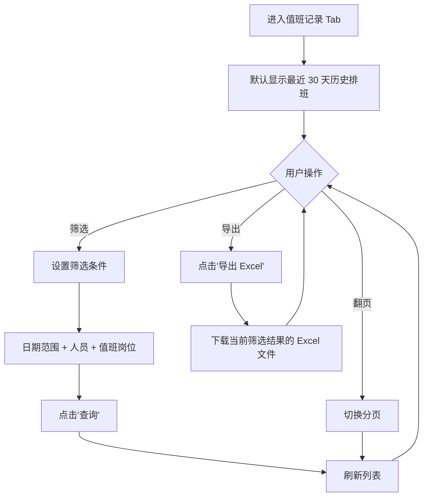
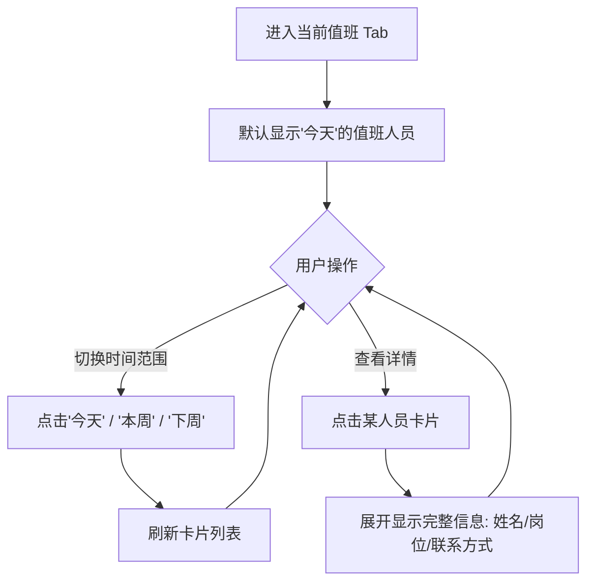
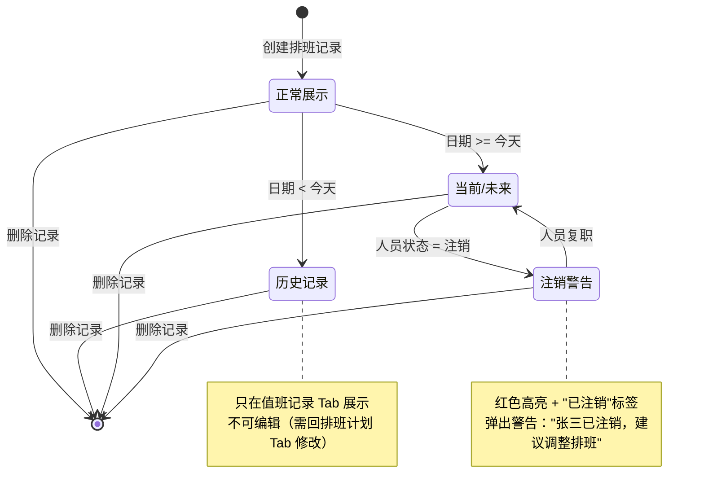

# PRD — 人员管理 · 排班管理

| 项 | 内容 |
|---|---|
| 文档版本 | V1.4 |
| 编制日期 | 2026-08-07 |
| 所属产品 | 中石油尼日尔公司上游油田项目 — 数智安防应急指挥中心（平台） |
| 所属端 | PC 后台 |
| 所属模块 | 业务管理 → 人员管理 → 排班管理 |
| 页面架构 | 三 Tab 结构（排班计划 + 值班记录[隐藏] + 当前值班）|
| 上游依据 | `应急指挥中心 (1).xmind`、2026-08-07 设计访谈 33 轮决策（简化为主、手动排班、岗位可选、历史可改无日志）、2026-08-07 原型验证优化 |
| 状态 | 待评审 |

---

## 1. 文档元数据与边界

### 1.1 需求背景

营地现场需要 7×24 值班覆盖（安全、设备、通讯等岗位），现有方式是纸质或 Excel 表格线下维护，导致：

| 现状问题 | 业务影响 |
|---|---|
| 值班表与用户信息两张皮 | 排班时查不到人员岗位、联系方式，需要来回翻花名册 |
| 历史排班无法追溯 | "上个月张三值了几次班"需要手动翻 Excel 逐行数 |
| 无快速查询入口 | 应急事件发生时，问"今天谁值班"需要打开文件、定位日期，至少 3 步操作 |
| 多人协冲突 | Excel 同时编辑会丢失修改，或出现同一人同一天被重复排班的错误 |

本模块的定位：**在线化、可追溯的值班排班工具**——管理员手动选日期选人，系统以日历和表格两种视图清晰展示"谁在哪天值班"，历史记录可查询可导出，当前值班一键可见。

### 1.2 核心指标

| 指标 | 定义 | 目标值 |
|---|---|---|
| 排班覆盖率 | 未来 7 天内至少有 1 人值班的天数 ÷ 7 | ≥ 95% |
| 历史可追溯率 | 可查询的历史排班天数 | 系统上线后所有日期 100% 可查 |
| 当前值班查询响应 | 从点击"当前值班"Tab 到展示完成 | ≤ 1 秒 |
| 冲突提示覆盖率 | 同人同天多次排班时触发警告的次数 ÷ 实际发生次数 | 100% |

### 1.3 与既有模块的依赖关系

| 关联模块 | 关系方向 | 具体依赖内容 |
|---|---|---|
| 人员管理 → 用户信息 | 本模块**依赖** | 人员选择范围 = 所有非"注销"状态的人员 |
| 人员管理 → 营地与部门 | 本模块**依赖** | ①营地选项数据，用于"负责营地"字段多选；②组织树数据，用于按营地/部门筛选人员候选范围；仅取启用态节点 |
| 预案管理 | 本模块**提供数据** | 预案编制时可能需要查询"当前值班人员"作为应急分组候选 |
| 大屏 → 安防态势综合驾驶舱 | 本模块**提供数据** | "今日值班"卡片的数据源 |

### 1.4 权限边界（红线）

| 编号 | 边界 | 说明 |
|---|---|---|
| PB-01 | 排班数据由**平台自建**，平台拥有完整增删改权 | 排班计划在平台内维护，不与三方系统同步 |
| PB-02 | 本模块**不涉及实际值班签到/签退** | 只记录"计划谁值班"，不记录"实际谁来了"（避免与考勤模块混淆） |
| PB-03 | 本模块**不记录操作日志** | 允许修改和删除历史排班，但不留痕（简化 V1.0 设计） |
| PB-04 | 值班职责是**可选字段** | 定位为"工作内容描述"，用自由文本记录值班期间的具体职责；排班记录可以不填职责 |

### 1.5 本期范围（In Scope）

| 编号 | 能力 |
|---|---|
| IS-01 | 排班计划 Tab：日历视图 / 表格视图切换，默认日历视图展示本月 |
| IS-02 | 排班计划 Tab：单日添加（点击日期格子）+ 批量添加（选起止时间） |
| IS-03 | 排班计划 Tab：编辑、删除排班记录 |
| IS-04 | 排班计划 Tab：同人同天多次排班时给出警告提（不拦截） |
| IS-05 | 值班记录 Tab：历史排班数据查询，支持按日期范围 + 人员 + 营地筛选（Tab默认隐藏，代码保留） |
| IS-06 | 值班记录 Tab：导出当前筛选结果为 Excel |
| IS-07 | 当前值班 Tab：展示今天 / 本周 / 下周的值班人员，卡片按日期分组 |
| IS-08 | 全量异常处理：空态、注销人员标记、网络异常、权限拦截 |

### 1.6 本期范围外（Out of Scope）

| 编号 | 不做项 | 原因 |
|---|---|---|
| OS-01 | 周期性排班模板（如 4 班 3 倒自动生成） | V1.0 简化设计，手动排班即可 |
| OS-02 | 实际值班签到 / 签退 / 交接日志 | 本模块只记录排班计划，不涉及考勤打卡（PB-02） |
| OS-03 | 操作日志 / 审计追溯 | 允许修改删除但不记录日志（PB-03） |
| OS-04 | 排班记录复制功能 | V1.0 不做，有需求再迭代；新增排班已支持多日多人快速创建 |
| OS-05 | 营地信息的新增、编辑、删除 | 由人员管理 → 营地与部门承载 |
| OS-06 | 排班冲突的强校验拦截 | 只做弱提示，不强制拦截（用户可能有特殊场景需要一人多岗） |

---

## 2. 业务概念与术语

| 术语 | 精确定义 |
|---|---|
| **排班记录** | 一条排班记录 = 日期 + 人员 + 负责营地（多选）+ 值班职责（可选）。例如："2026-08-07，张三，负责 Bravia 营地 + Niamey 营地，值班职责：负责营地安全巡查，监控门禁系统运行"。负责营地字段必填，值班职责字段可以为空。 |
| **负责营地** | 值班人员在值班期间负责的营地范围，支持多选。从"营地与部门"模块获取营地列表，用户可选择一个或多个营地。必填字段。 |
| **值班职责** | 值班人员在值班期间的具体工作内容描述，自由文本输入（最多500字符）。例如："负责营地安全巡查，监控门禁系统运行"。定位为工作内容记录，非必填。 |
| **排班计划** | 指未来（含今天）的排班安排。用户在"排班计划"Tab 中维护，可增删改。 |
| **值班记录** | 指历史（过去日期）的排班数据。"值班记录"Tab 是"排班计划"的历史只读视图，实际数据来自同一张表。V1.4 版本中该 Tab 默认隐藏（`v-if="false"`），代码保留以便后续启用。 |
| **当前值班** | 指"今天"或"本周"或"下周"的值班人员。"当前值班"Tab 是快速查询入口，不提供编辑功能。 |
| **日历视图** | 按月历布局展示排班，每个日期格子内显示该日值班人员姓名（超过 3 人时显示前 2 人 + "+N 更多"）。未排班的日期显示"未排班"文字。 |
| **表格视图** | 以列表形式展示排班记录，每行 = 一条排班记录，列包括：日期、值班人员、负责营地、值班职责、操作。 |
| **批量添加** | 一次操作为多人或多天创建排班。例如：选择起止时间 2026-08-10 至 2026-08-15 + 选择张三和李四 → 为这两人在该时间段内每天创建排班记录（共 12 条）。V1.0已合并到新增排班统一入口，通过起止时间和值班人员（多选）的灵活组合实现单日/多日、单人/多人的所有场景。 |
| **冲突提示** | 当同一人在同一天已有排班记录，再次添加时，系统弹出确认框提示："张三在 2026-08-07 已安排值班，确认继续添加？"。用户可选择继续或取消，不强制拦截。 |
| **注销人员标记** | 如果一个人在用户信息中被标记为"注销"，其未来日期的排班记录在排班计划 Tab 中用特殊样式标记（如红色高亮 + "已注销"标签），并给出警告提示："张三已注销，建议调整排班"。历史排班记录保留。 |

---

## 3. 核心流程与状态机

### 3.1 排班计划 Tab 核心流程

```mermaid
graph TD
    A[进入排班计划 Tab] --> B[默认显示日历视图 - 当前月份]
    B --> C{用户操作}
    
    C -->|切换视图| D[表格视图 / 日历视图切换]
    D --> C
    
    C -->|日历翻页| E[点击上月/下月按钮]
    E --> C
    
    C -->|单日添加| F[点击日历格子 / 点击'新增排班'按钮]
    F --> G[弹出新增抽屉]
    G --> H[选择起止时间 + 人员(多选) + 可选岗位]
    H --> I{是否有冲突?}
    I -->|有| J[弹出冲突提示确认框 - 列出所有冲突日期]
    J -->|用户点击'继续'| K[为每个选中的人员在时间段内每天创建排班记录]
    J -->|用户点击'取消'| C
    I -->|无| K
    
    C -->|编辑| R[点击表格操作列'编辑' / 单击日历格子人员姓名]
    R --> S[弹出编辑抽屉]
    S --> T[修改人员或岗位]
    T --> U[保存修改]
    
    C -->|删除| V[点击表格操作列'删除']
    V --> W[二次确认弹窗]
    W -->|确认| X[删除排班记录]
    W -->|取消| C
    
    K --> Y[刷新视图]
    Q --> Y
    U --> Y
    X --> Y
    Y --> C
```

### 3.2 值班记录 Tab 核心流程



### 3.3 当前值班 Tab 核心流程



### 3.4 排班记录状态机

排班记录本身无状态流转，其生命周期只有：**新增 → 存在 → 删除**。

但在展示层面，根据日期和人员状态，排班记录有不同的**展示状态**：



---

## 4. 核心功能矩阵

| 动作名 | 触发位置 | 前置条件 | 业务结果 |
|---|---|---|---|
| 查看排班计划 | 点击"业务管理 → 人员管理 → 排班管理"菜单 | 有"查看排班"或"管理排班"权限 | 进入排班计划 Tab，默认显示日历视图 - 当前月份 |
| 切换视图 | 排班计划 Tab 顶部"日历视图"/"表格视图"按钮 | 无 | 视图切换，显示的时间范围保持一致 |
| 单日新增排班 | 日历视图：点击日期格子；表格视图：点击"新增排班"按钮 | 有"管理排班"权限 | 弹出新增抽屉，起止时间预填为该日期（日历点击时）或空（按钮点击时） |
| 保存排班 | 新增抽屉内点击"保存" | 必填项校验通过（起止时间 + 人员） | 检测冲突 → 列出所有冲突日期和人员 → 用户确认 → 为每个选中的人员在时间段内每天创建排班记录；保存后关闭抽屉，刷新视图 |
| 编辑排班记录 | 表格视图：点击操作列"编辑"；日历视图：单击人员姓名（含"+N 更多"弹层内的姓名） | 有"管理排班"权限 | 弹出编辑抽屉，预填当前记录数据 |
| 保存编辑 | 编辑抽屉内点击"保存" | 必填项校验通过 | 更新排班记录，关闭抽屉，刷新视图 |
| 删除排班记录 | 表格视图：点击操作列"删除" | 有"管理排班"权限 | 弹出二次确认："确认删除该排班记录？" → 用户确认 → 删除记录，刷新视图 |
| 查看值班记录 | 点击"值班记录"Tab | 有"查看排班"或"管理排班"权限 | 进入值班记录 Tab，默认显示最近 30 天历史排班 |
| 筛选值班记录 | 设置筛选条件后点击"查询" | 无 | 刷新列表，展示符合条件的历史排班 |
| 导出值班记录 | 点击"导出 Excel"按钮 | 有"查看排班"或"管理排班"权限 | 下载当前筛选结果的 Excel 文件（包含：日期、值班人员、值班岗位、联系方式） |
| 查看当前值班 | 点击"当前值班"Tab | 有"查看排班"或"管理排班"权限 | 进入当前值班 Tab，默认显示"今天"的值班人员 |
| 切换当前值班时间范围 | 点击"今天"/"本周"/"下周"按钮 | 无 | 刷新卡片列表，展示选定时间范围的值班人员 |

**说明**：
- 所有增删改操作均需"管理排班"权限，查看操作只需"查看排班"权限
- 历史日期的排班可以在排班计划 Tab 中编辑和删除（PB-03：不记录操作日志）
- 值班记录 Tab 是只读视图，不提供编辑入口

---

## 5. 页面布局与交互逻辑

### 5.1 整体布局（三 Tab 结构）

```
┌─────────────────────────────────────────────────────────────────┐
│ 业务管理 > 人员管理 > 排班管理                                        │
├─────────────────────────────────────────────────────────────────┤
│ [排班计划] [值班记录] [当前值班]                                      │
├─────────────────────────────────────────────────────────────────┤
│                                                                 │
│                      Tab 内容区域                                 │
│                   （见下文各 Tab 详细布局）                           │
│                                                                 │
└─────────────────────────────────────────────────────────────────┘
```

---

### 5.2 排班计划 Tab 布局

#### 5.2.1 顶部操作栏

```
┌─────────────────────────────────────────────────────────────────┐
│ [日历视图] [表格视图]    [新增排班]                                  │
└─────────────────────────────────────────────────────────────────┘
```

**字段说明**：
- **视图切换**：单选按钮组，默认选中"日历视图"
- **新增排班**：按钮，仅"管理排班"权限可见；统一入口，支持单日或多日、单人或多人的排班创建

**说明**：
- 日历视图固定为月视图，通过日历头部的"上月/下月"按钮切换月份
- 表格视图支持分页浏览所有未来排班记录

---

#### 5.2.2 日历视图布局

```
┌─────────────────────────────────────────────────────────────────┐
│                         2026 年 8 月                              │
│                     [< 上月]        [下月 >]                       │
├──────┬──────┬──────┬──────┬──────┬──────┬──────┤
│  日  │  一  │  二  │  三  │  四  │  五  │  六  │
├──────┼──────┼──────┼──────┼──────┼──────┼──────┤
│      │      │      │      │  1   │  2   │  3   │
│      │      │      │      │ 张三 │ 李四 │未排班│
├──────┼──────┼──────┼──────┼──────┼──────┼──────┤
│  4   │  5   │  6   │  7   │  8   │  9   │  10  │
│ 王五 │ 张三 │ 李四 │ 张三 │未排班│ 赵六 │ 张三 │
│      │      │      │ 王五 │      │      │ 李四 │
│      │      │      │+2更多│      │      │      │
├──────┼──────┼──────┼──────┼──────┼──────┼──────┤
│ ...                                               │
└─────────────────────────────────────────────────────────────────┘
```

**交互规则**：
- **日期格子内容**：
  - 显示该日值班人员姓名（一行一个），格子最多占 3 行，保证整月行高一致
  - 1–3 人：全部显示
  - 超过 3 人：显示前 2 人 + 第 3 行"+N 更多"（N = 总人数 − 2）
  - 如果该日无排班，显示灰色文字"未排班"
- **点击"+N 更多"**：在格子右侧弹出 Popover，标题为"M 月 D 日 值班人员（总数）"，列出该日全部值班人员；列表超高时内部滚动；点击弹层外区域关闭。点击"+N 更多"不触发格子的新增排班
- **点击日期格子空白处**：弹出新增抽屉，日期字段预填为该日期
- **单击人员姓名**（格子内或 Popover 内）：弹出编辑抽屉，预填该人员的排班记录；从 Popover 内点击时先关闭 Popover。单击姓名不触发格子的新增排班
- **注销人员标记**：
  - 如果该人员在用户信息中为"注销"状态，姓名显示为红色 + 删除线
  - 鼠标悬浮显示 Tooltip："张三已注销，建议调整排班"
  - 保存时弹出警告弹窗（不拦截）

---

#### 5.2.3 表格视图布局

```
┌─────────────────────────────────────────────────────────────────┐
│ 日期        │ 值班人员   │ 负责营地   │ 值班职责   │ 操作           │
├─────────────────────────────────────────────────────────────────┤
│ 2026-08-07  │ 张三      │ Bravia营地 │ 负责营地安 │ [编辑] [删除]  │
│             │           │ Niamey营地 │ 全巡查...  │                │
│ 2026-08-07  │ 李四      │ Agadem营地 │ 设备运行状 │ [编辑] [删除]  │
│             │           │            │ 态监控...  │                │
│ 2026-08-08  │ 王五      │ Bravia营地 │            │ [编辑] [删除]  │
│ 2026-08-09  │ 赵六      │ Diffa营地  │ 通讯系统值 │ [编辑] [删除]  │
│             │           │ Zinder营地 │ 守...      │                │
│ ...                                                              │
├─────────────────────────────────────────────────────────────────┤
│ 共 120 条   每页 20 条   [< 上一页] [1] [2] [3] ... [下一页 >]      │
└─────────────────────────────────────────────────────────────────┘
```

**列定义**：

| 列名 | 宽度 | 对齐 | 说明 |
|---|---|---|---|
| 日期 | 120px | 居中 | 格式：YYYY-MM-DD |
| 值班人员 | 120px | 居中 | 显示人员姓名，注销人员红色 + 删除线 |
| 负责营地 | 200px | 居中 | 显示多个营地标签（Tag），为空显示"-" |
| 值班职责 | 200px | 居中 | 长文本省略显示 + Tooltip，为空显示"-" |
| 操作 | 160px | 居中 | [编辑] [删除] 按钮，仅"管理排班"权限可见 |

**排序规则**：
- 默认按日期倒序排列（最新日期在前）
- 支持点击"日期"列头切换正序/倒序

---

#### 5.2.4 新增排班抽屉（统一入口）

```
┌─────────────────────────────────────┐
│  新增排班                      [X]  │
├─────────────────────────────────────┤
│                                     │
│  起止时间 *                          │
│  [2026-08-07] 至 [2026-08-10]       │
│                                     │
│  值班人员 * (可多选)                 │
│  [请选择人员      ▼]  (下拉多选)     │
│                                     │
│  负责营地 * (可多选)                 │
│  [请选择营地      ▼]  (下拉多选)     │
│                                     │
│  值班职责                            │
│  ┌─────────────────────────────┐  │
│  │                             │  │
│  │  (文本域，4行，最多500字符)   │  │
│  │                             │  │
│  └─────────────────────────────┘  │
│  示例：负责营地安全巡查，监控门禁    │
│       系统运行                      │
│                                     │
│  提示：将为每个选中的人员在起止时间内  │
│       的每一天创建排班记录            │
│  示例：2026-08-07至08-10(4天)，      │
│       选择3人 → 创建12条记录         │
│                                     │
│  ────────────────────────────────  │
│                                     │
│           [取消]     [保存]          │
│                                     │
└─────────────────────────────────────┘
```

**字段规则**：

| 字段 | 必填 | 类型 | 说明 |
|---|---|---|---|
| 起止时间 | ✅ | 日期范围选择器 | 两个日期选择器，起始日期 ≤ 结束日期；可选择同一天（单日排班）或多天（多日排班） |
| 值班人员 | ✅ | 下拉多选搜索 | 候选范围 = 所有非"注销"状态的人员；支持按姓名/工号搜索 |
| 负责营地 | ✅ | 下拉多选 | 从"营地与部门"模块获取启用态营地列表，至少选择1个营地 |
| 值班职责 | ❌ | 文本域 | 自由文本输入，4行，最多500字符，带字数统计；可为空 |

**保存逻辑**：
1. 必填项校验（起止时间 + 人员）
2. 检查时间段内所有日期是否有冲突
3. 如有冲突 → 弹出确认框："以下日期 张三 已有排班：2026-08-10, 2026-08-12。确认继续添加？"
4. 用户确认 → 为每个选中的人员在时间段内每天创建排班记录 → 关闭抽屉 → 刷新视图

**生成规则**：
- 起止时间 = 同一天（如 2026-08-07 至 2026-08-07）+ 选3人 → 创建3条记录
- 起止时间 = 4天（如 2026-08-07 至 2026-08-10）+ 选1人 → 创建4条记录
- 起止时间 = 4天 + 选3人 → 创建12条记录（4天 × 3人）

**触发方式**：
- 日历视图点击日期格子：起止时间预填为该日期
- 点击顶部"新增排班"按钮：起止时间为空，手动选择

---

#### 5.2.5 编辑排班抽屉

布局与"新增排班抽屉"相同，差异：
- 标题改为"编辑排班"
- 起止时间预填为当前记录的日期（两个日期相同）
- 值班人员预填为当前记录的人员（单选状态）
- 负责营地预填为当前记录的营地列表
- 值班职责预填为当前记录的职责文本
- 保存时同样检查冲突（如果修改了日期或人员）

---

### 5.3 值班记录 Tab 布局

```
┌─────────────────────────────────────────────────────────────────┐
│ 筛选条件                                                          │
│ 日期范围: [最近30天 ▼]  人员: [全部 ▼]  营地: [全部 ▼] │
│ [查询] [重置]                                        [导出 Excel] │
├─────────────────────────────────────────────────────────────────┤
│ 日期        │ 值班人员   │ 负责营地   │ 值班职责   │ 联系方式       │
├─────────────────────────────────────────────────────────────────┤
│ 2026-08-06  │ 张三      │ Bravia营地 │ 负责营地安 │ 138xxxx1234   │
│             │           │ Niamey营地 │ 全巡查...  │               │
│ 2026-08-05  │ 李四      │ Agadem营地 │ 设备运行状 │ 139xxxx5678   │
│             │           │            │ 态监控...  │               │
│ 2026-08-04  │ 王五      │ Bravia营地 │            │ 137xxxx9012   │
│ ...                                                              │
├─────────────────────────────────────────────────────────────────┤
│ 共 80 条   每页 20 条   [< 上一页] [1] [2] [3] [4] [下一页 >]       │
└─────────────────────────────────────────────────────────────────┘
```

**筛选条件规则**：

| 筛选项 | 类型 | 说明 |
|---|---|---|
| 日期范围 | 下拉 + 自定义 | 快捷项：最近7天/最近30天/最近90天/自定义 |
| 人员 | 下拉多选 | 候选范围 = 所有人员（含注销），支持搜索 |
| 营地 | 下拉单选 | 营地列表 + "全部"选项 |

**列定义**：同排班计划表格视图，去掉"操作"列，保留"日期、值班人员、负责营地、值班职责、联系方式"列

**导出逻辑**：
- 点击"导出 Excel"按钮
- 导出当前筛选条件下的**所有记录**（不限分页）
- 文件名格式：`值班记录_起始日期_结束日期.xlsx`
- 导出列：日期、值班人员、负责营地、值班职责、联系方式

**说明**：V1.4 版本中，值班记录 Tab 默认隐藏（`v-if="false"`），代码保留以便后续启用。

---

### 5.4 当前值班 Tab 布局

```
┌─────────────────────────────────────────────────────────────────┐
│ [今天] [本周] [下周]                                              │
├─────────────────────────────────────────────────────────────────┤
│                                                                 │
│  【2026-08-07 今天 星期三】                                       │
│  ┌─────────────────────────────────────────────────┐          │
│  │ 张三                                               │          │
│  │ 负责营地：[Bravia营地] [Niamey营地]                 │          │
│  │ 职责：负责营地安全巡查，监控门禁系统运行            │          │
│  │ 联系方式：138xxxx1234                              │          │
│  └─────────────────────────────────────────────────┘          │
│  ┌─────────────────────────────────────────────────┐          │
│  │ 李四                                               │          │
│  │ 负责营地：[Agadem营地]                              │          │
│  │ 职责：设备运行状态监控，及时处理故障报警            │          │
│  │ 联系方式：139xxxx5678                              │          │
│  └─────────────────────────────────────────────────┘          │
│                                                                 │
│  【2026-08-08 明天 星期四】                                       │
│  ┌─────────────────────────────────────────────────┐          │
│  │ 王五                                               │          │
│  │ 负责营地：[Bravia营地]                              │          │
│  │ 职责：未设置职责                                    │          │
│  │ 联系方式：137xxxx9012                              │          │
│  └─────────────────────────────────────────────────┘          │
│  ┌─────────────────────────────────────────────────┐          │
│  │ 赵六                                               │          │
│  │ 负责营地：[Diffa营地] [Zinder营地]                  │          │
│  │ 职责：通讯系统值守，保障内外联络畅通                │          │
│  │ 联系方式：136xxxx3456                              │          │
│  └─────────────────────────────────────────────────┘          │
│                                                                 │
│  ...                                                            │
│                                                                 │
└─────────────────────────────────────────────────────────────────┘
```

**时间范围规则**：

| 选项 | 显示范围 |
|---|---|
| 今天 | 仅当前日期 |
| 本周 | 本周一 ~ 本周日（7天） |
| 下周 | 下周一 ~ 下周日（7天） |

**卡片内容规则**：
- 按日期分组展示
- 每个日期下显示该日所有值班人员
- 卡片内容：姓名 + 负责营地（多个Tag） + 值班职责（无则显示"未设置职责"） + 联系方式
- 如果该日无排班，显示："该日无值班安排"

---

## 6. 边界情况与异常处理

### 6.1 空状态处理

| 场景 | 展示方式 |
|---|---|
| 排班计划 Tab - 日历视图某日无排班 | 日期格子内显示灰色文字"未排班" |
| 排班计划 Tab - 表格视图无数据 | 空状态插画 + 文案："暂无排班记录，点击'新增排班'开始排班" |
| 值班记录 Tab - 筛选后无结果 | 空状态插画 + 文案："未找到符合条件的值班记录" |
| 当前值班 Tab - 某日无排班 | 卡片显示："【2026-08-07 今天】该日无值班安排" |

### 6.2 数据校验

| 校验项 | 触发时机 | 校验规则 | 不通过处理 |
|---|---|---|---|
| 日期必填 | 保存排班 | 日期字段不能为空 | 字段下红色提示："请选择值班日期" |
| 人员必填 | 保存排班 | 人员字段不能为空 | 字段下红色提示："请选择值班人员" |
| 起止时间顺序 | 批量添加保存 | 起始日期 ≤ 结束日期 | 弹出 Toast 提示："起始日期不能晚于结束日期" |
| 同人同天冲突 | 保存排班 | 检查数据库是否已存在同日期 + 同人员的记录 | 弹出确认框（见 §5.2.4），不强制拦截 |

### 6.3 网络异常

| 场景 | 处理方式 |
|---|---|
| 列表加载失败 | 显示错误状态 + "加载失败，请重试"按钮 |
| 保存排班失败 | Toast 提示："保存失败，请检查网络后重试"，抽屉不关闭，用户可重新保存 |
| 导出失败 | Toast 提示："导出失败，请稍后重试" |

### 6.4 引用完整性

| 场景 | 处理方式 |
|---|---|
| 人员被标记为"注销" | 未来日期的排班记录保留，但在 UI 上标记（红色 + 删除线 + "已注销"标签）；历史记录正常展示 |
| 营地被标记为"停用" | 已保存的排班记录保留原营地ID，但显示时营地名称后添加"（已停用）"标识 |
| 营地被物理删除（不应发生） | 排班记录保留营地ID，展示时显示为"<已删除营地>" |
| 人员被物理删除（不应发生） | 排班记录保留人员ID，展示时显示为"<已删除用户>" |

### 6.5 权限拦截

| 场景 | 拦截方式 |
|---|---|
| 无"查看排班"或"管理排班"权限 | 菜单入口不可见 |
| 仅有"查看排班"权限，尝试点击"新增/编辑/删除" | 按钮不可见或置灰 |
| 通过 URL 直接访问但无权限 | 页面显示 403 提示 + 返回首页按钮 |

### 6.6 极端数据量

| 场景 | 处理方式 |
|---|---|
| 单日值班人数超过 3 人（如 10 人） | 日历格子显示前 2 人 + "+8 更多"，点击后弹出完整名单 Popover（超高时内部滚动） |
| 导出超过 10000 条记录 | Toast 提示："数据量较大，导出可能需要 1-2 分钟，请耐心等待" |
| 批量添加超过 90 天 | Toast 提示："批量添加最多支持 90 天，请分批操作" |

---

## 附录 A：数据字段完整定义

### A.1 排班记录表（schedule_record）

| 字段名 | 中文名 | 数据类型 | 长度 | 必填 | 默认值 | 说明 |
|---|---|---|---|---|---|---|
| id | 主键 | BIGINT | - | ✅ | 自增 | 排班记录唯一标识 |
| schedule_date | 值班日期 | DATE | - | ✅ | - | 值班日期，格式 YYYY-MM-DD |
| user_id | 值班人员ID | BIGINT | - | ✅ | - | 外键，关联用户信息表 |
| camp_ids | 负责营地 | JSON | - | ✅ | - | 营地ID数组，如 ["camp-1", "camp-2"]，至少包含1个营地 |
| duty_responsibility | 值班职责 | VARCHAR | 500 | ❌ | NULL | 值班工作内容描述，自由文本 |
| created_at | 创建时间 | DATETIME | - | ✅ | NOW() | 记录创建时间 |
| created_by | 创建人 | BIGINT | - | ✅ | - | 创建人用户ID |
| updated_at | 更新时间 | DATETIME | - | ✅ | NOW() | 记录最后更新时间 |
| updated_by | 更新人 | BIGINT | - | ✅ | - | 最后更新人用户ID |

**索引设计**：
- 主键索引：`id`
- 唯一索引：`(schedule_date, user_id)` — 防止同人同天重复排班（注：业务层允许冲突，此索引可选）
- 普通索引：`schedule_date` — 按日期查询
- 普通索引：`user_id` — 按人员查询

**约束说明**：
- `user_id` 外键关联用户信息表，级联规则：RESTRICT（人员被删除时拒绝，需先解除排班关联）
- `schedule_date` + `user_id` 允许重复（业务上允许同人同天多次排班）

---

### A.2 关联字段映射

| 本模块字段 | 关联模块 | 关联字段 | 说明 |
|---|---|---|---|
| user_id | 人员管理 → 用户信息 | id | 值班人员主键 |
| - | 人员管理 → 用户信息 | name | 展示用：人员姓名 |
| - | 人员管理 → 用户信息 | employee_no | 展示用：工号 |
| - | 人员管理 → 用户信息 | phone | 展示用：联系方式 |
| - | 人员管理 → 用户信息 | status | 判断用：人员状态（注销人员标记） |
| camp_ids | 人员管理 → 营地与部门 | id | 营地主键（数组） |
| - | 人员管理 → 营地与部门 | name | 展示用：营地名称 |
| - | 人员管理 → 营地与部门 | status | 判断用：营地状态（停用营地标记） |

---

### A.3 API 接口清单

#### A.3.1 排班计划相关接口

| 接口名称 | 请求方法 | 路径 | 说明 |
|---|---|---|---|
| 查询排班列表 | GET | /api/schedule/list | 支持按日期范围、人员、岗位筛选 |
| 新增排班记录 | POST | /api/schedule | 单条新增 |
| 批量新增排班记录 | POST | /api/schedule/batch | 批量新增 |
| 编辑排班记录 | PUT | /api/schedule/{id} | 更新单条记录 |
| 删除排班记录 | DELETE | /api/schedule/{id} | 删除单条记录 |
| 检查排班冲突 | POST | /api/schedule/check-conflict | 保存前检查同人同天冲突 |

#### A.3.2 值班记录相关接口

| 接口名称 | 请求方法 | 路径 | 说明 |
|---|---|---|---|
| 查询历史值班记录 | GET | /api/schedule/history | 同排班列表接口，但前端过滤日期 < 今天 |
| 导出值班记录 | GET | /api/schedule/export | 返回 Excel 文件流 |

#### A.3.3 当前值班相关接口

| 接口名称 | 请求方法 | 路径 | 说明 |
|---|---|---|---|
| 查询当前值班 | GET | /api/schedule/current | 支持时间范围参数：today/this_week/next_week |

---

### A.4 前端路由设计

| 路由路径 | 组件名 | 说明 |
|---|---|---|
| /business/personnel/schedule | ScheduleManagement.vue | 排班管理主页面（三 Tab） |
| /business/personnel/schedule?tab=plan | - | 默认 Tab：排班计划 |
| /business/personnel/schedule?tab=history | - | 值班记录 Tab |
| /business/personnel/schedule?tab=current | - | 当前值班 Tab |

---

## 附录 B：待确认事项

| 编号 | 问题 | 影响范围 | 当前 PRD 处理方式 |
|---|---|---|---|
| TBD-01 | 负责营地字段是否允许选择全部营地的快捷选项？ | 新增排班交互 | 当前方案：手动多选，不提供"全选"快捷按钮 |
| TBD-02 | 批量添加时，起止时间是否自动排除周末/节假日？ | 批量添加逻辑 | 当前方案：不排除，为时间段内每一天创建记录 |
| TBD-03 | 日历视图中"未排班"的视觉样式 | UI 设计 | 暂定：灰色文字 #999999，字号 12px |
| TBD-04 | 导出 Excel 的列顺序和表头名称 | 导出功能 | 当前方案：日期、值班人员、负责营地、值班职责、联系方式 |
| TBD-05 | 批量添加的最大天数限制 | 批量添加逻辑 | 当前方案：限制 90 天 |
| TBD-07 | 是否需要支持"复制上周排班"或"复制上月排班"快捷功能？ | 排班计划功能 | V1.0 不做，有需求再迭代 |
| TBD-08 | 值班记录 Tab 默认显示的历史天数 | 值班记录初始状态 | 当前方案：最近 30 天（Tab 当前隐藏） |
| TBD-09 | 值班职责文本域是否需要支持富文本格式（换行、列表等）？ | 表单输入 | 当前方案：纯文本输入，不支持富文本 |

---

## 附录 C：修订记录

| 版本 | 日期 | 修订人 | 修订内容 |
|---|---|---|---|
| V1.0 | 2026-08-07 | GaoYuan | 初版，基于设计访谈与原型验证完成 |
| V1.1 | 2026-08-10 | GaoYuan | 移除班组概念：①删除与班组管理模块的依赖关系；②删除新增抽屉"快速添加"班组按钮；③删除表格视图"班组"列；④删除值班记录筛选"班组"字段；⑤删除当前值班卡片中班组显示；⑥更新关联字段映射、API接口、待确认事项 |
| V1.2 | 2026-08-10 | 产品 | 术语统一：将"离职"改为"注销"，全面更新业务概念、核心流程、页面布局、边界异常、字段映射 |
| V1.3 | 2026-08-17 | 产品 | 对齐用户信息 V2.3 三态变更：`userStatus` 类型移除「禁用」，仅保留 启用/锁定/注销；同步更新 mock 数据（schedule.ts 接口类型） |
| V1.4 | 2026-08-17 | 产品 | 字段重构与Tab调整：①删除`duty_post`字段（值班岗位字典下拉），新增`camp_ids`字段（负责营地JSON数组，必填）和`duty_responsibility`字段（值班职责VARCHAR(500)，可选）；②删除与"系统管理→数据字典"的依赖，强化与"营地与部门"模块的依赖；③更新所有表格列定义、抽屉表单、筛选条件、当前值班卡片布局；④值班记录Tab默认隐藏（`v-if="false"`），代码保留；⑤同步更新数据表结构、索引设计、关联字段映射、导出字段、待确认事项；⑥原型文件 ScheduleManagement.vue 与 schedule.ts 已同步修改 |

---

**PRD 完成标志**：本文档已覆盖固定 8 章结构（元数据与边界、业务概念、核心流程、功能矩阵、页面布局、边界异常、字段定义、待确认事项），所有 Mermaid 流程图已通过连通性自检，无死路无悬空节点。

