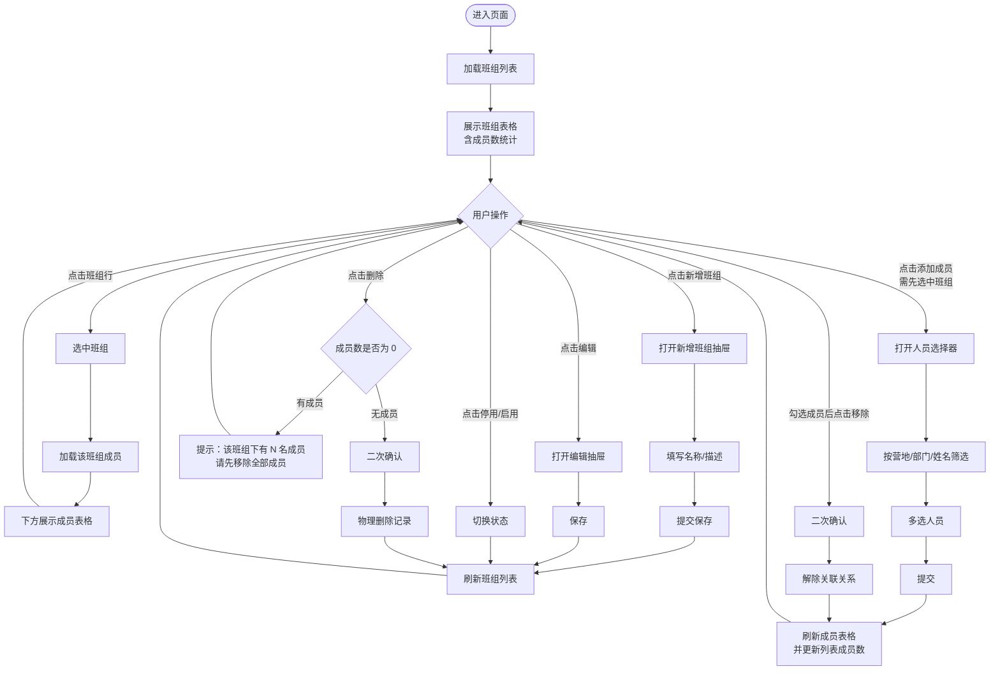
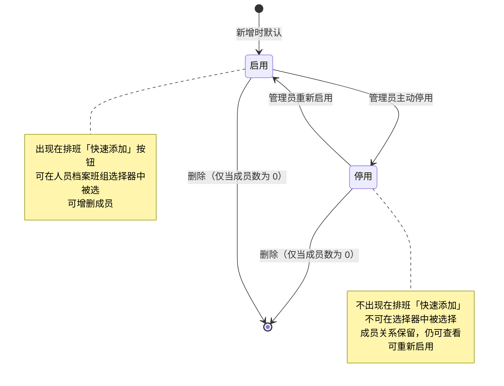

# PRD — 人员管理 · 班组管理

| 项 | 内容 |
|---|---|
| 文档版本 | V1.0 |
| 编制日期 | 2026-08-07 |
| 所属产品 | 中石油尼日尔公司上游油田项目 — 数智安防应急指挥中心（平台） |
| 所属端 | PC 后台 |
| 所属模块 | 业务管理 → 人员管理 → 班组管理 |
| 页面架构 | 主从表（上方班组列表 + 下方成员表格） |
| 上游依据 | 2026-08-07 grilling session 决策 |
| 状态 | 待评审 |

---

## 1. 文档元数据与边界

### 1.1 需求背景

营地现场实行轮班值守制度，安保、后勤等岗位按 A 班 / B 班 / C 班等分组轮值。排班管理在编排值班计划时，需要一键把整个班组的人员批量加入排班，逐个选人效率过低。现有设计中「班组」只是人员档案里的一个单选字典字段，存在两个问题：

| 现状问题 | 业务影响 |
|---|---|
| 班组是人员的单选字段 | 一个人只能属于一个班组；现实中一人可同时在「A 班」轮值、又编入「机动班」，无法表达 |
| 班组无独立维护入口 | 要看「A 班有哪些人」只能去人员列表筛选，无法批量增减成员 |

本模块的定位：**值班班组的独立维护入口**——班组是一个**纯粹为排班服务的人员分组标签**，与营地、部门等组织架构**完全解耦**，成员可以来自任意营地的任意部门，一个人也可以同时属于多个班组。

### 1.2 核心指标

| 指标 | 定义 | 目标值 |
|---|---|---|
| 班组覆盖率 | 至少属于 1 个班组的在职人员数 ÷ 在职人员总数 | ≥ 90% |
| 空班组比例 | 成员数为 0 的启用班组数 ÷ 启用班组总数 | ≤ 5% |
| 批量添加效率 | 一次批量添加操作可加入的成员数上限 | ≥ 100 人 |
| 列表加载时长 | 从请求发出到班组列表渲染完成 | ≤ 1.5 秒 |

### 1.3 与既有模块的依赖关系

| 关联模块 | 关系方向 | 具体依赖内容 |
|---|---|---|
| 人员管理 → 用户信息 | **双向** | **依赖**：成员选择器的人员候选范围 = 所有非「注销」状态人员；**提供数据**：人员档案的「班组」字段（多值）来自本模块的班组-人员关联关系 |
| 人员管理 → 营地与部门 | 本模块**依赖** | 成员选择器与成员列表按营地/部门筛选、展示；本模块不产生任何组织归属 |
| 人员管理 → 排班管理 | 本模块**提供数据** | 新增排班抽屉的「快速添加：A班/B班/C班」按钮，一键添加该班组全部成员 |
| 应急指挥 → 预案管理 | **无关** | 预案的应急分组（指挥组/处置组/警戒组）是独立数据结构与入口，**与本模块的值班班组无关** |

### 1.4 权限边界（红线）

| 编号 | 边界 | 说明 |
|---|---|---|
| PB-01 | 班组数据由**平台自建**，平台拥有完整增删改权 | 不对接三方系统 |
| PB-02 | 班组与组织架构**零从属关系** | 班组不归属任何营地或部门，不设 `camp_id` / `dept_id` 字段；成员可跨营地、跨部门 |
| PB-03 | 人员与班组是**多对多**关系 | 一个人可属于多个班组，一个班组可含多人；关系存于独立关联表 |
| PB-04 | 本模块**只管值班班组** | 应急小组（指挥组/处置组等）是另外的数据结构与入口，不在本模块 |
| PB-05 | 本模块**不维护人员档案本身** | 只维护「人员 ↔ 班组」的关联关系；人员的姓名、岗位、营地、部门等在用户信息台账维护 |
| PB-06 | 班组的增删改**不考虑权限细分** | 有菜单权限即有操作权限 |

### 1.5 本期范围（In Scope）

| 编号 | 能力 |
|---|---|
| IS-01 | 班组列表：分页展示全部班组，含成员数统计 |
| IS-02 | 新增班组：名称、描述 |
| IS-03 | 编辑班组基础信息 |
| IS-04 | 停用/启用班组（逻辑删除） |
| IS-05 | 删除班组（仅限成员数为 0 的班组） |
| IS-06 | 成员管理：选中班组后，下方展示成员表格 |
| IS-07 | 批量添加成员：人员选择器支持按营地/部门/姓名筛选，一次多选 |
| IS-08 | 批量移除成员：成员表格勾选多人后一键移除 |
| IS-09 | 全量异常处理：空态、重名校验、重复添加、引用保护 |

### 1.6 本期范围外（Out of Scope）

| 编号 | 不做项 | 原因 |
|---|---|---|
| OS-01 | 应急小组（指挥组/处置组/警戒组等）的编组管理 | PB-04：独立数据结构与入口，另行设计 |
| OS-02 | 班组的类型/分类字段 | 本模块只有值班班组一种类型，无需分类 |
| OS-03 | 班组归属营地/部门 | PB-02：班组与组织架构零从属 |
| OS-04 | 班组的有效期/时效性 | 班组是长期存在的轮值分组，临时编组不走本模块 |
| OS-05 | 班组长/负责人字段 | 本期不设；如后续需要再补 |
| OS-06 | 主班组 / 兼职班组的区分 | 多个班组之间无主次之分，都是平等的标签 |
| OS-07 | 排班计划的编排 | 由「人员管理 → 排班管理」PRD 承载 |
| OS-08 | 班组成员变更的操作日志 | 本期不留痕，与排班管理 PB-03 保持一致 |

---

## 2. 业务概念与术语

| 术语 | 精确定义 |
|---|---|
| **班组** | 为排班便利而设置的**人员分组标签**，如 A 班、B 班、C 班、夜班组、机动班。班组**不是组织架构的一部分**——它不归属任何营地或部门，成员可以来自任意营地的任意部门。反例：班组不是部门——部门是行政隶属关系（人只能属于一个部门），班组是排班标签（人可以属于多个班组）。 |
| **班组成员** | 加入某个班组的人员。一名人员可以同时是多个班组的成员；一个班组可以包含来自不同营地、不同部门的人员。 |
| **多对多关系** | 人员与班组之间的关联方式：N 名人员 ↔ M 个班组。关系存储在独立的「班组-人员关联表」中，而非人员表或班组表的字段。 |
| **值班班组** | 本模块管理的唯一班组类型，用于日常轮值排班。与应急预案中的「应急小组」是完全不同的两套数据结构（PB-04）。 |
| **停用** | 逻辑删除状态。停用的班组不出现在排班管理的「快速添加」按钮中、不可在人员档案的班组选择器中被选择，但成员关系保留，支持重新启用。 |
| **删除** | 物理删除。**仅当班组成员数为 0 时允许删除**；有成员的班组只能停用。 |
| **成员数** | 该班组当前关联的人员总数（含非启用状态的人员）。列表中单独成列展示。 |

---

## 3. 核心流程与状态机

### 3.1 班组管理主流程



### 3.2 班组状态机



**状态与操作的关系**

| 当前状态 | 可执行操作 | 不可执行操作 |
|---|---|---|
| 启用 | 编辑、停用、添加成员、移除成员、删除（成员数为 0 时） | 启用 |
| 停用 | 编辑、启用、查看成员、删除（成员数为 0 时） | 停用、添加成员 |

**说明**：停用班组不允许再添加成员（停用意味着不再使用），但保留已有成员关系并可查看，避免误停用导致数据丢失；如需增减成员，先启用。

---

## 4. 核心功能矩阵

| 功能 | 触发位置 | 前置条件 | 业务结果 | 备注 |
|---|---|---|---|---|
| 加载班组列表 | 页面初始化 | 无 | 分页展示全部班组（默认不含停用），含成员数 | 默认按 `sort_order` 升序 |
| 筛选班组 | 列表上方筛选栏 | 无 | 按名称模糊匹配 + 状态过滤 | 点「搜索」生效 |
| 选中班组 | 点击班组行 | 无 | 下方成员区加载并展示该班组成员 | 单选；再次点击取消选中 |
| 新增班组 | 列表顶部「新增班组」按钮 | 无 | 创建班组记录，刷新列表 | 初始状态「启用」，成员数 0 |
| 编辑班组 | 列表行操作列「编辑」 | 无 | 更新班组名称/描述 | 表单预填当前值 |
| 停用班组 | 列表行操作列「停用」 | 班组为启用状态 | 标记为停用，从排班快速添加中移除 | 无关联数据校验，可直接停用 |
| 启用班组 | 列表行操作列「启用」 | 班组为停用状态 | 恢复启用 | 可逆 |
| 删除班组 | 列表行操作列「删除」 | **成员数 = 0** | 物理删除记录 | 有成员时拦截并提示 |
| 添加成员 | 成员区「添加成员」按钮 | 已选中一个**启用**状态的班组 | 打开人员选择器，批量加入成员 | 已是成员的人员在选择器中置灰 |
| 移除成员 | 成员区勾选后「批量移除」按钮 | 已勾选 ≥ 1 名成员 | 解除关联关系，刷新成员表与成员数 | 二次确认 |
| 移除单个成员 | 成员行操作列「移除」 | 无 | 解除该人员与班组的关联 | 二次确认 |

---

## 5. 页面布局与交互逻辑

### 5.1 整体布局（主从表）

```
┌───────────────────────────────────────────────────────────────────────┐
│  业务管理 > 人员管理 > 班组管理                                          │
├───────────────────────────────────────────────────────────────────────┤
│  班组列表                                                               │
│  ┌─────────────────────────────────────────────────────────────────┐  │
│  │ 班组名称：[        ]  状态：[全部 ▾]  [搜索] [重置]  [ ]显示已停用 │  │
│  │ [新增班组]                                                        │  │
│  ├─────────────────────────────────────────────────────────────────┤  │
│  │ [ ] | 班组名称 | 成员数 | 描述            | 状态 | 操作          │  │
│  ├─────────────────────────────────────────────────────────────────┤  │
│  │ [√] | A 班    |   12   | 日班轮值       | 启用 | 编辑 停用 删除  │  │
│  │ [ ] | B 班    |    9   | 夜班轮值       | 启用 | 编辑 停用 删除  │  │
│  │ [ ] | C 班    |   11   | 周末轮值       | 启用 | 编辑 停用 删除  │  │
│  │ [ ] | 机动班   |    5   | 应急机动       | 启用 | 编辑 停用 删除  │  │
│  └─────────────────────────────────────────────────────────────────┘  │
│  [1 / 10]                                                  [上一页] [下一页]
├───────────────────────────────────────────────────────────────────────┤
│  班组成员 — A 班（12人）                                                │
│  ┌─────────────────────────────────────────────────────────────────┐  │
│  │ [添加成员] [批量移除]                                             │  │
│  ├─────────────────────────────────────────────────────────────────┤  │
│  │ [ ] | 姓名   | 工号     | 所属营地    | 所属部门 | 联系方式       │ 操作 │
│  ├─────────────────────────────────────────────────────────────────┤  │
│  │ [√] | 张三   | 202601001| Bravia 营地 | 安保部   | +227 123 4567 | 移除 │
│  │ [ ] | 李四   | 202601002| Bravia 营地 | 后勤部   | +227 234 5678 | 移除 │
│  │ [ ] | 王五   | 202601003| Niamey 营地 | 安保部   | +227 345 6789 | 移除 │
│  └─────────────────────────────────────────────────────────────────┘  │
│  [1 / 12]                                                  [上一页] [下一页]
└───────────────────────────────────────────────────────────────────────┘
```

**布局规格**

| 区域 | 高度分配 | 说明 |
|---|---|---|
| 班组列表区 | 视口上半部分，最小 300px | 占用约 40% 视口高度；超高时区域内滚动 |
| 成员区 | 视口下半部分，自适应 | 占用约 60% 视口高度；未选中班组时显示空态 |
| 两区间分隔线 | 可拖拽调整 | 分隔线支持上下拖拽，调整两区高度比例 |

### 5.2 班组列表区规则

**筛选栏**

| 字段 | 控件类型 | 默认值 | 取值规则 | 数据来源 |
|---|---|---|---|---|
| 班组名称 | 单行文本框 | 空 | 前后空格自动去除；对班组名称做模糊匹配（包含即命中） | 用户输入 |
| 状态 | 单选下拉框 | 全部 | 固定三项：全部 / 启用 / 停用 | 前端枚举 |
| 显示已停用 | 勾选框 | 未勾选 | 未勾选时结果集排除停用班组；状态筛选选中「停用」时强制勾选且置灰 | 用户操作 |
| 搜 索 | 主按钮 | —— | 常态可点击；请求进行中 loading | —— |
| 重 置 | 次按钮 | —— | 清空筛选条件，恢复默认值 | —— |

**表格列定义**

| 列名 | 数据字段 | 数据类型 | 列宽 | 对齐 | 排序 | 空值/异常渲染 |
|---|---|---|---|---|---|---|
| 勾选框 | —— | —— | 48px | 居中 | —— | 停用态行的勾选框置灰不可勾选 |
| 班组名称 | `name` | 字符串 | 150px | 左 | 不支持 | 必填，恒不为空 |
| 成员数 | `member_count` | 整型 | 80px | 居中 | 支持 | 0 显示为 `0`；≥ 100 时缩写为 `100+` |
| 描述 | `description` | 字符串 | 自适应 | 左 | 不支持 | 空值显示 `--`；超宽以 `…` 截断，悬浮 Tooltip |
| 状态 | `status` | 枚举 | 80px | 居中 | 支持 | 启用 / 停用，不同颜色标签 |
| 操作 | —— | —— | 150px | 居中 | —— | 动态按钮，见 5.3 |

**分页规则**

| 项 | 规则 |
|---|---|
| 每页条数 | 固定 20 条，不可调整 |
| 默认排序 | `sort_order` 升序，相同时按创建时间升序 |
| 空态 | 无班组时显示空态图 + 「暂无班组，点击上方「新增班组」按钮创建」 |
| 筛选无结果 | 显示「未找到匹配的班组」+ 「重置筛选条件」链接 |

### 5.3 操作列按钮的动态显示规则

| 状态 | 成员数 | 显示的按钮 |
|---|---|---|
| 启用 | 0 | [编辑] [停用] [删除] |
| 启用 | > 0 | [编辑] [停用] |
| 停用 | 0 | [编辑] [启用] [删除] |
| 停用 | > 0 | [编辑] [启用] |

**说明**：
- 删除按钮仅在「成员数 = 0」时显示
- 停用/启用根据当前状态互斥显示
- 编辑按钮始终显示

### 5.4 新增/编辑班组表单

**表单布局（抽屉，宽度 480px）**

```
┌─────────────────────────────────┐
│  新增班组                    [×] │
├─────────────────────────────────┤
│  班组名称 *                      │
│  ┌───────────────────────────┐  │
│  │                           │  │
│  └───────────────────────────┘  │
│                                 │
│  描述                            │
│  ┌───────────────────────────┐  │
│  │                           │  │
│  │                           │  │
│  └───────────────────────────┘  │
│                          0/200  │
├─────────────────────────────────┤
│              [取 消]  [保 存]    │
└─────────────────────────────────┘
```

**字段规则**

| 字段 | 控件 | 必填 | 新增时 | 编辑时 | 校验规则 |
|---|---|---|---|---|---|
| 班组名称 | 文本框 | 是 | 可填 | 可改 | 1–32 字符；允许中英文、数字、空格、`-`；前后空格自动去除；全局唯一，重复时内联报错「班组名称已存在」 |
| 描述 | 多行文本 | 否 | 可填 | 可改 | 最多 200 字符，显示字数计数 |

**表单通用规则**

| 项 | 规则 |
|---|---|
| 校验时机 | 失焦即校验单字段；点击保存时全表校验 |
| 唯一性校验 | 班组名称失焦时异步查重，保存时后端二次校验 |
| 未保存关闭 | 表单有改动时弹二次确认「有未保存的修改，确认放弃？」 |
| 保存中 | 「保 存」显示 loading 且禁用，「取 消」同时禁用 |
| 保存失败 | 抽屉保持打开，顶部内联展示错误信息，已填内容不丢失 |
| 新增成功 | 关闭抽屉 → Toast「新增成功」→ 刷新列表 → 跳转到第 1 页 |
| 编辑成功 | 关闭抽屉 → Toast「保存成功」→ 刷新列表，保持当前页码 |

### 5.5 成员区规则

**表格列定义**

| 列名 | 数据字段 | 数据类型 | 列宽 | 对齐 | 排序 | 空值/异常渲染 |
|---|---|---|---|---|---|---|
| 勾选框 | —— | —— | 48px | 居中 | —— | 全选框仅勾选当前页 |
| 姓名 | `name` | 字符串 | 120px | 左 | 不支持 | 恒不为空；注销人员姓名后追加灰色标签「已注销」 |
| 工号 | `employee_no` | 字符串 | 120px | 左 | 不支持 | 空值显示 `--` |
| 所属营地 | `camp_name` | 字符串 | 150px | 左 | 支持 | 营地已停用时置灰并 Tooltip「所属营地已停用」 |
| 所属部门 | `dept_name` | 字符串 | 180px | 左 | 支持 | 部门已停用时置灰并 Tooltip「所属部门已停用」；无部门显示 `--` |
| 联系方式 | `phone` | 字符串 | 150px | 左 | 不支持 | 空值显示 `--` |
| 操作 | —— | —— | 80px | 居中 | —— | [移除] |

**成员区状态**

| 场景 | 展示 |
|---|---|
| 未选中班组 | 空态图 + 「请从上方选择一个班组查看其成员」；操作按钮禁用 |
| 选中班组但无成员 | 空态图 + 「该班组暂无成员，点击「添加成员」按钮加入人员」；「添加成员」按钮可用 |
| 选中停用班组 | 正常展示成员列表；「添加成员」按钮**禁用**并 Tooltip「班组已停用，请先启用后再添加成员」；「移除」按钮保持可用 |
| 加载中 | 表格骨架屏 |
| 加载失败 | 失败占位 + 「重试」按钮 |

**区标题**：`班组成员 — {班组名称}（{成员数}人）`；未选中时显示 `班组成员`。

**分页**：每页 20 条，与班组列表分页独立。

### 5.6 添加成员 — 人员选择器

**触发**：选中启用状态的班组 → 成员区点击「添加成员」

**弹窗布局（模态框，宽度 900px）**

```
┌────────────────────────────────────────────────────────────────┐
│  添加成员 — A 班                                           [×]  │
├────────────────────────────────────────────────────────────────┤
│  姓名/工号：[          ]  营地：[全部 ▾]  部门：[全部 ▾] [搜索] │
├──────────────────────────────┬─────────────────────────────────┤
│  待选人员                     │  已选人员（8）      [清空全部]   │
│  ┌────────────────────────┐  │  ┌───────────────────────────┐ │
│  │[ ] 张三 | Bravia|安保部 │  │  │ 张三  Bravia 营地     [×] │ │
│  │[√] 李四 | Bravia|后勤部 │  │  │ 李四  Bravia 营地     [×] │ │
│  │[—] 王五 | Niamey|安保部 │  │  │ 赵六  Niamey 营地     [×] │ │
│  │    （已是成员，置灰）    │  │  │ ...                       │ │
│  │[√] 赵六 | Niamey|工程部 │  │  │                           │ │
│  └────────────────────────┘  │  └───────────────────────────┘ │
│  [1 / 15]        [上页][下页] │                                 │
├──────────────────────────────┴─────────────────────────────────┤
│                                        [取 消]  [确 定（8）]     │
└────────────────────────────────────────────────────────────────┘
```

**筛选栏字段规则**

| 字段 | 控件类型 | 默认值 | 取值规则 | 数据来源 |
|---|---|---|---|---|
| 姓名/工号 | 单行文本框 | 空 | 对姓名、工号两字段做**或**关系模糊匹配；不区分大小写 | 用户输入 |
| 营地 | 单选下拉框 | 全部 | 首项「全部」，其余为**启用状态**的营地 | 营地与部门模块 |
| 部门 | 树形下拉单选 | 全部 | 首项「全部」；选中营地后联动加载该营地下**启用状态**的部门树；未选营地时展示全部营地的部门树 | 营地与部门模块 |
| 搜 索 | 主按钮 | —— | 点击后刷新待选列表 | —— |

**候选人员范围**：所有**非「注销」**状态的人员（含启用、锁定态）。

> V2.3 对齐：账号状态由四态收敛为三态（启用/锁定/注销），移除「禁用」，见用户信息 PRD §3.2。

**交互规则**

| 项 | 规则 |
|---|---|
| 已是成员的人员 | 在待选列表中置灰、勾选框禁用，行尾标注「已是成员」 |
| 选中方式 | 待选列表勾选 → 自动加入右侧「已选人员」；右侧点 `[×]` 移出 |
| 跨页保持 | 已选人员在翻页、切换筛选条件后**保持不丢失** |
| 全选 | 待选列表表头全选框仅勾选**当前页**的可选人员（不含已是成员的） |
| 清空全部 | 右侧「清空全部」清空已选列表，需二次确认 |
| 已选计数 | 右侧标题与「确定」按钮同步显示已选人数 |
| 单次上限 | 单次最多添加 200 人；超出时「确定」按钮禁用并提示「单次最多添加 200 人，请分批操作」 |
| 确定 | 提交关联关系 → 关闭弹窗 → Toast「成功添加 N 名成员」→ 刷新成员表与班组列表成员数 |
| 取消 | 已选不为空时弹二次确认「已选择 N 人尚未保存，确认放弃？」 |

### 5.7 移除成员

| 触发方式 | 前置条件 | 交互 |
|---|---|---|
| 成员行「移除」 | 无 | 弹二次确认「确认将「张三」从「A 班」中移除？」→ 确认后解除关联 |
| 「批量移除」按钮 | 已勾选 ≥ 1 名成员 | 弹二次确认「确认将选中的 N 名成员从「A 班」中移除？」→ 确认后批量解除关联 |

**移除后行为**：Toast「成功移除 N 名成员」→ 刷新成员表（保持当前筛选与页码，若当前页已空则回退一页）→ 更新班组列表中该班组的成员数。

**说明**：移除只解除「人员 ↔ 班组」的关联关系，**不影响人员档案本身**（PB-05）；该人员在其他班组中的成员身份也不受影响。

---

## 6. 边界情况与异常处理

### 6.1 空状态处理

| 场景 | 处理方式 |
|---|---|
| 无任何班组 | 列表区空态图 + 「暂无班组，点击上方「新增班组」按钮创建」 |
| 筛选无匹配班组 | 「未找到匹配的班组」+ 「重置筛选条件」链接 |
| 未选中班组 | 成员区空态图 + 「请从上方选择一个班组查看其成员」 |
| 选中班组无成员 | 成员区空态图 + 「该班组暂无成员，点击「添加成员」按钮加入人员」 |
| 人员选择器无候选人员 | 待选区显示「未找到符合条件的人员」 |
| 人员选择器全部人员已是成员 | 待选区正常展示但全部置灰，顶部提示「当前筛选范围内的人员均已加入该班组」 |

### 6.2 数据校验

| 场景 | 处理方式 |
|---|---|
| 班组名称重复 | 失焦异步查重，内联报错「班组名称已存在」；后端二次校验拒绝 |
| 班组名称仅含空格 | 去空格后为空，触发必填校验「请输入班组名称」 |
| 描述超长 | 输入到 200 字符时停止输入，字数计数变红 |
| 单次添加成员超 200 人 | 「确定」按钮禁用，提示「单次最多添加 200 人，请分批操作」 |
| 重复添加同一人员 | 选择器中该人员已置灰不可选；若并发导致重复提交，后端按关联表唯一约束去重，不报错 |

### 6.3 网络异常

| 场景 | 处理方式 |
|---|---|
| 班组列表加载失败 | 列表区失败占位 + 「重试」；成员区显示空态，不阻塞 |
| 成员列表加载失败 | 成员区失败占位 + 「重试」；班组列表保持正常 |
| 保存班组超时 | 抽屉保持打开，顶部内联「保存超时，请重试」，已填内容不丢失 |
| 添加成员失败 | 选择器保持打开，顶部内联展示错误，已选人员不丢失 |
| 移除成员失败 | Toast 错误提示，成员表不刷新，勾选状态保留 |
| 停用/启用失败 | Toast 错误提示，状态不变 |

### 6.4 引用完整性

| 场景 | 处理方式 |
|---|---|
| 删除有成员的班组 | 拦截，提示「该班组下有 N 名成员，请先移除全部成员后再删除」；删除按钮本身在成员数 > 0 时不显示 |
| 停用班组后排班管理的引用 | 排班管理「快速添加」按钮不再显示该班组；**历史排班记录不受影响**，保持可追溯 |
| 人员注销后其班组关系 | 关联关系**保留**，成员列表中该人员姓名后标注「已注销」；排班「快速添加」时自动排除注销人员 |
| 人员档案中删除某个班组 | 用户信息台账编辑时取消勾选某班组 = 解除该关联，等价于在本模块移除该成员（双向绑定，同一张关联表） |
| 成员的营地/部门被停用 | 成员列表中该字段置灰并 Tooltip 提示，**不影响班组成员关系** |

### 6.5 权限拦截

| 场景 | 处理方式 |
|---|---|
| 无本菜单权限 | 菜单项不显示；直接访问路由时跳转 403 页面 |
| 有菜单权限 | 视为拥有全部增删改权限（PB-06） |

### 6.6 极端数据量

| 场景 | 处理方式 |
|---|---|
| 班组数 > 100 | 列表分页展示（每页 20 条），不影响性能 |
| 单班组成员数 > 300 | 成员表分页展示（每页 20 条）；列表中成员数显示为 `100+` |
| 人员选择器候选人员 > 1000 | 待选列表分页（每页 20 条）；强制要求先输入筛选条件再搜索，避免全量加载 |
| 班组名称超长（32 字符满额） | 表格列以 `…` 截断，悬浮 Tooltip 展示全名 |
| 批量移除勾选 > 100 人 | 正常执行；二次确认文案明确人数「确认将选中的 156 名成员从「A 班」中移除？」 |

---

## 附录 A：数据字段完整定义

### A.1 班组表（team）

| 字段名 | 展示名 | 类型 | 必填 | 唯一 | 可编辑 | 来源 | 被下游引用 | 说明 |
|---|---|---|---|---|---|---|---|---|
| `id` | 班组ID | 整型 | 是 | 是 | 否 | 平台生成 | ✅ 关联表、用户信息、排班 | 自增主键，创建后恒定；**不对用户展示** |
| `name` | 班组名称 | 字符串 | 是 | 是 | 是 | 平台录入 | ✅ 用户信息（班组列）、排班（快速添加按钮） | 1–32 字符，全局唯一 |
| `description` | 描述 | 字符串 | 否 | 否 | 是 | 平台录入 | —— | ≤ 200 字符 |
| `sort_order` | 排序号 | 整型 | 是 | 否 | 否 | 平台生成 | ✅ 排班「快速添加」按钮的排列顺序 | 默认按创建顺序递增 |
| `status` | 状态 | 枚举 | 是 | 否 | 经操作列变更 | 平台维护 | ✅ **排班快速添加与人员档案选择器仅取「启用」态班组** | 启用 / 停用 |
| `created_at` | 创建时间 | 日期时间 | 是 | 否 | 否 | 平台生成 | —— | —— |
| `updated_at` | 更新时间 | 日期时间 | 是 | 否 | 否 | 平台生成 | —— | —— |

**派生字段（非存储）**

| 字段名 | 展示名 | 计算方式 | 说明 |
|---|---|---|---|
| `member_count` | 成员数 | `COUNT(team_member WHERE team_id = ?)` | 列表接口返回，不落库 |

### A.2 班组-人员关联表（team_member）

| 字段名 | 展示名 | 类型 | 必填 | 唯一 | 来源 | 说明 |
|---|---|---|---|---|---|---|
| `id` | 关联ID | 整型 | 是 | 是 | 平台生成 | 自增主键 |
| `team_id` | 班组ID | 整型 | 是 | 否 | 班组表外键 | 关联 `team.id` |
| `person_id` | 人员ID | 整型 | 是 | 否 | 人员表外键 | 关联用户信息台账的 `id` |
| `created_at` | 加入时间 | 日期时间 | 是 | 否 | 平台生成 | 记录成员加入班组的时间，暂不在界面展示 |

**约束**：`(team_id, person_id)` 联合唯一——同一人员不可重复加入同一班组。

**不设置的字段及原因**

| 未设字段 | 原因 |
|---|---|
| `camp_id` / `dept_id`（班组归属） | PB-02：班组与组织架构零从属，成员可跨营地跨部门 |
| `team_type`（班组类型） | OS-02：本模块只有值班班组一种类型 |
| `leader_id`（班组长） | OS-05：本期不设 |
| `valid_from` / `valid_to`（有效期） | OS-04：班组是长期存在的轮值分组 |
| `is_primary`（是否主班组） | OS-06：多个班组之间无主次之分 |
| `code`（班组编码） | 与营地/部门保持一致，不提供用户可见的编码字段 |

### A.3 关联字段映射

| 本模块字段 | 关联模块 | 关联字段 | 说明 |
|---|---|---|---|
| `team.id` | 人员管理 → 用户信息 | `team`（数组元素） | 人员档案的班组字段为多值，值来自本表 |
| `team.name` | 人员管理 → 用户信息 | 展示用 | 人员列表班组列，多个以顿号连接 |
| `team.id` | 人员管理 → 排班管理 | 快速添加按钮 | 按钮列表 = 启用态班组，按 `sort_order` 排序 |
| `team_member.person_id` | 人员管理 → 排班管理 | 批量添加数据源 | 点击「快速添加：A班」时取该班组全部成员（自动排除注销人员） |
| `team_member.person_id` | 人员管理 → 用户信息 | `id` | 成员表格的姓名、工号、营地、部门、联系方式均由此关联查得 |
| —— | 人员管理 → 营地与部门 | `camp.id` / `department.id` | 成员选择器与成员列表的筛选、展示维度 |

### A.4 API 接口清单

| 接口名称 | 请求方法 | 路径 | 说明 |
|---|---|---|---|
| 查询班组列表 | GET | `/api/team/list` | 分页；参数：`name`、`status`、`includeDisabled`、`page`、`size`；返回含 `member_count` |
| 查询班组详情 | GET | `/api/team/{id}` | 返回单个班组完整信息 |
| 新增班组 | POST | `/api/team` | 创建班组 |
| 编辑班组 | PUT | `/api/team/{id}` | 更新名称/描述 |
| 变更班组状态 | PATCH | `/api/team/{id}/status` | 停用/启用 |
| 删除班组 | DELETE | `/api/team/{id}` | 服务端校验成员数为 0，否则拒绝 |
| 校验名称唯一性 | GET | `/api/team/check-name` | 参数：`name`、`excludeId` |
| 查询班组成员 | GET | `/api/team/{id}/members` | 分页；返回姓名、工号、营地、部门、联系方式、人员状态 |
| 批量添加成员 | POST | `/api/team/{id}/members` | 请求体：`personIds` 数组；服务端按唯一约束去重 |
| 批量移除成员 | DELETE | `/api/team/{id}/members` | 请求体：`personIds` 数组 |
| 查询可选人员 | GET | `/api/team/{id}/candidates` | 人员选择器数据源；参数：`keyword`、`campId`、`deptId`、`page`、`size`；返回项含 `isMember` 标记 |

### A.5 前端路由设计

| 路由 name | 路径 | 页面组件 | 说明 |
|---|---|---|---|
| `TeamManagement` | `/business/personnel/team` | `TeamManagement.vue` | 班组管理主页面 |

---

## 附录 B：待确认事项

| 编号 | 事项 | 当前 PRD 处理方式 | 需确认方 |
|---|---|---|---|
| TBD-01 | 人员信息台账当前无「工号」字段（登录名作为唯一业务标识），成员列表的「工号」列数据来源待定 | 成员表格暂保留工号列，无数据时显示 `--`；如确认不设工号，则该列改为「登录名」 | 业主 / 产品 |
| TBD-02 | 停用班组是否需要同时从人员档案的班组字段中移除 | 当前设计：关系保留，仅不可再被选择；人员档案中仍展示该班组（置灰） | 业主 |
| TBD-03 | 是否需要班组成员变更的操作日志 | OS-08：本期不留痕 | 业主 |
| TBD-04 | 单次添加成员 200 人上限是否满足实际场景 | 按 300 人营地规模估算，200 人上限足够；超出可分批 | 业主 |
| TBD-05 | 班组名称是否需要与业主现行叫法对齐（A班/B班 vs 白班/夜班） | PRD 示例使用 A 班 / B 班 / C 班 / 机动班，实际由管理员自行录入 | 业主 |

---

## 附录 C：修订记录

| 版本 | 日期 | 修订内容 | 修订人 |
|---|---|---|---|
| V1.0 | 2026-08-07 | 首版，基于 2026-08-07 grilling session 的 40 项决策编写 | 产品 |
