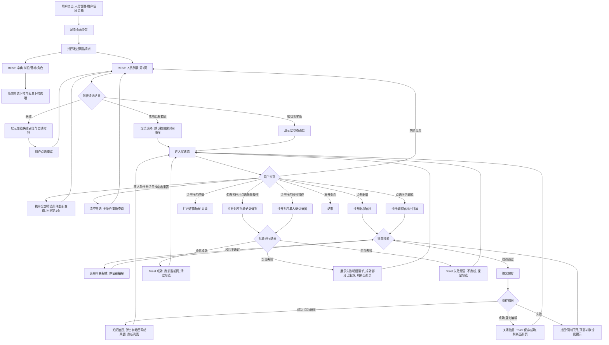
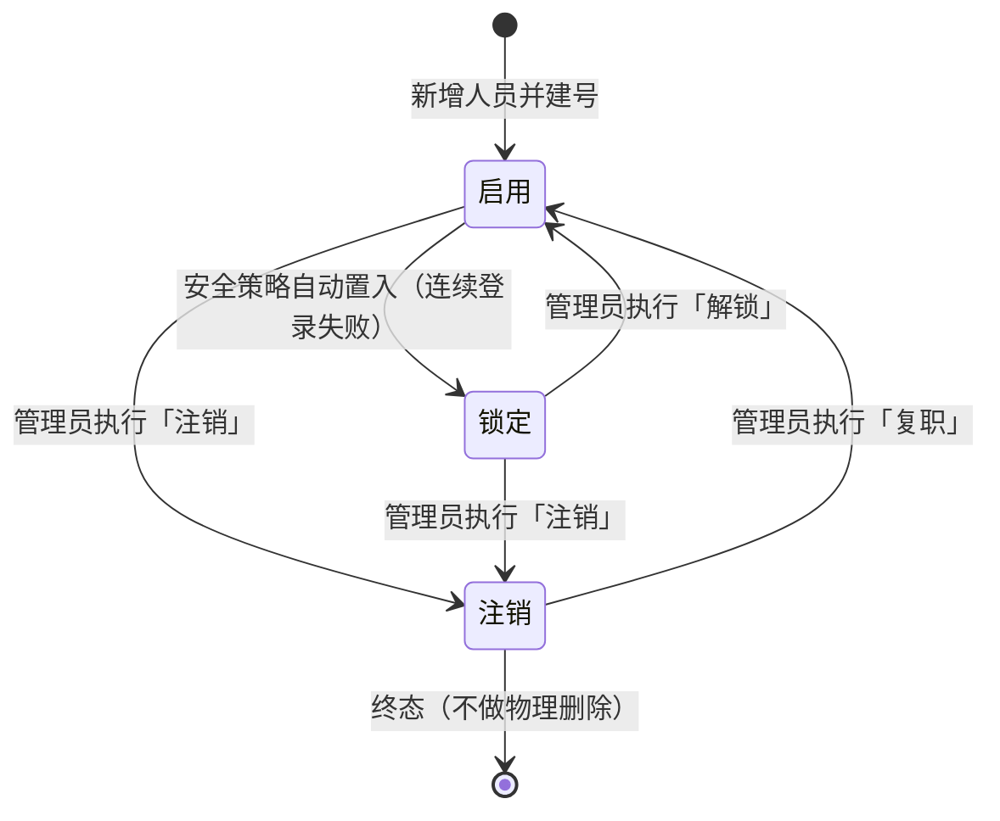
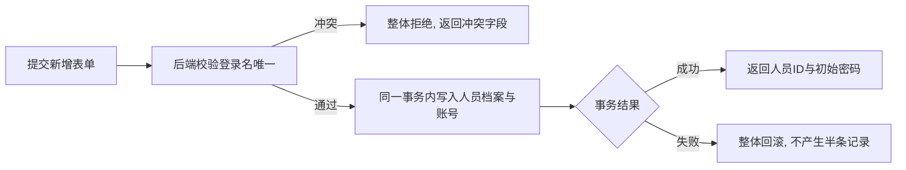

# PRD — 人员管理 · 用户信息

| 项 | 内容 |
|---|---|
| 文档版本 | V2.5 |
| 编制日期 | 2026-08-06 |
| 最后更新 | 2026-08-16 |
| 所属产品 | 中石油尼日尔公司上游油田项目 — 数智安防应急指挥中心（平台） |
| 所属端 | PC 后台 |
| 所属模块 | 业务管理 → 人员管理 → 用户信息 |
| 页面架构 | 标准列表页（筛选栏 + 表格 + 新增/编辑抽屉 + 详情抽屉） |
| 上游依据 | `应急指挥中心 (1).xmind`、2026-08-05 业主答复 8 项（人员即用户、全员建号、账号能力并入本页、角色取自系统管理、不设终端绑定字段、应急分组归预案、账号状态单字段四态）、2026-08-09 架构简化决策（移除部门层级）、2026-08-10 简化决策（移除班组概念） |
| 状态 | 待评审 |

---

## 1. 文档元数据与边界

### 1.1 需求背景

营地现场约 300 名人员，既是安保业务的调度对象（排班、值守、清点、应急编组），也是平台的登录主体（PC 后台、手机 App）。现有 AIRIOT 底座把"用户"当作纯技术账号维护，与现场花名册两张皮，导致：

| 现状问题 | 业务影响 |
|---|---|
| 花名册与登录账号分属两处维护 | 同一人入职要录两次、注销要停两处，漏停即为越权风险 |
| 账号表只有登录名与邮箱，无岗位信息 | 预案无法按岗位筛人，排班无法查看人员岗位 |
| 无统一在职状态 | 已离场人员仍出现在排班候选与清点名单中 |
| 角色分配入口与人员档案割裂 | 调整一人权限需先查工号、再去账号页检索，两页来回 |

本模块的定位：**全员人事档案与登录账号的单一维护入口**——一条人员记录同时承载业务属性（岗位、营地、联系方式）与账号属性（登录名、角色、账号状态），一处录入、一处停用。

### 1.2 核心指标

| 指标 | 定义 | 目标值 |
|---|---|---|
| 档案完整度 | 姓名、登录名、岗位、所属营地、手机号五项均非空的人员数 ÷ 在职人员总数 | ≥ 95% |
| 建号覆盖率 | 已分配登录名的人员数 ÷ 在职人员总数 | 100% |
| 角色覆盖率 | 至少绑定 1 个角色的启用态账号数 ÷ 启用态账号总数 | 100% |
| 列表首屏加载时长 | 从请求发出到表格渲染完成（300 条数据量级、单页 20 条） | ≤ 2 秒 |
| 注销停号时延 | 人员状态置为"注销"到该账号无法登录 | 立即生效，下一次鉴权即拒绝 |

### 1.3 与既有模块的依赖关系

| 关联模块 | 关系方向 | 具体依赖内容 |
|---|---|---|
| 系统管理 → 角色管理 | 本模块**依赖** | 角色列表（角色 ID、角色名）。角色的增删改查、权限点配置**不在本 PRD 范围**，由开发团队既有模块提供 |
| 人员管理 → 营地管理 | 本模块**依赖** | 营地列表数据（仅启用态）。「所属营地」字段的候选项来源，本页只读消费、不提供营地增删改 |
| 系统管理 → 数据字典 | 本模块**依赖** | 岗位字典。字典维护由开发团队既有模块提供，字典缺项时本页显示原始值并置灰 |
| 人员管理 → 排班管理 | 本模块**提供数据** | 排班候选人范围 = 本模块在职人员；排班表按 `人员ID` 引用 |
| 应急指挥 → 预案管理 | 本模块**提供数据** | 预案编制时按**岗位/所属营地**筛选人员组建应急分组；预案表按 `人员ID` 引用（分组归属存于预案，见 §2 术语「应急分组」） |
| 事件管理 | 本模块**提供数据** | 指派整改人时的人员选择范围 |
| 实时监控中心（PC 端） | 本模块**提供数据** | 人员图层的姓名、岗位、所属营地等展示属性（实时经纬度由三方系统按 `人员ID` 推送，不落本模块） |
| 大屏 → 安防态势综合驾驶舱 | 本模块**提供数据** | "今日值班"卡片的人员姓名与岗位（值班名单本身来自排班管理） |
| 应急物资管理 → 存放点管理/物资台账 | 本模块**提供数据** | 存放点责任人候选列表（仅取在职人员）；物资盘点人候选列表（仅取在职人员，默认当前登录用户） |

### 1.4 权限边界（红线）

| 编号 | 边界 | 说明 |
|---|---|---|
| PB-01 | 人员主数据由**平台自建**，平台拥有完整增删改权 | 与装备管理各模块「三方权威源、平台只读」相反，本模块平台即权威源 |
| PB-02 | 人员与账号**一人一号、一一对应** | 不存在无账号的人员，也不存在无人员的孤立账号；新增人员时同步建号 |
| PB-03 | 平台**不存储明文密码**，不提供"查看密码"能力 | 仅提供重置密码，重置结果一次性展示 |
| PB-04 | 角色的**定义**不在本模块 | 本模块只做「人员 ↔ 角色」的绑定关系维护，角色本身的增删改在系统管理 |
| PB-05 | 人员记录**不做物理删除** | 一律走「注销」状态；已产生排班、事件、预案引用的人员记录必须可追溯 |
| PB-06 | 本模块**不维护人员与定位终端的绑定关系** | 实时定位由三方系统直接上报「人员ID + 经纬度」，平台不落终端 SN 字段（见 §2 术语「实时定位」） |

### 1.5 本期范围（In Scope）

| 编号 | 能力 |
|---|---|
| IS-01 | 人员列表：筛选栏条件查询（姓名/用户名、岗位、所属营地、状态、显示注销人员） + 分页展示 |
| IS-02 | 新增人员（含同步建号：登录名、初始密码、角色） |
| IS-03 | 编辑人员业务属性与账号属性 |
| IS-04 | 人员详情查看（只读抽屉） |
| IS-05 | 单人账号操作：重置密码、分配角色、解锁 |
| IS-06 | 批量账号操作：批量分配角色、批量重置密码 |
| IS-07 | 人员状态流转：启用 → 注销、锁定 → 注销、注销 → 复职 |
| IS-08 | 全量异常处理：空态、重名校验、越权、字典缺项 |
| IS-09 | 操作审计：新增、编辑、重置密码、角色变更、状态变更均留痕 |

### 1.6 本期范围外（Out of Scope）

| 编号 | 不做项 | 原因 |
|---|---|---|
| OS-01 | 角色的新增、编辑、删除、权限点配置 | 由开发团队既有角色管理模块承载，本模块只消费角色列表（PB-04） |
| OS-02 | 营地的新增、编辑、停用 | 由「人员管理 → 营地管理」独立 PRD 承载，本页只读消费营地列表 |
| OS-03 | 数据字典（岗位、营地）的维护 | 开发团队既有模块承载 |
| OS-04 | 人员实时定位地图、轨迹回放、人员清点 | 由「实时监控中心（PC 端）」PRD 承载，避免能力重复 |
| OS-05 | 排班计划编制、值班记录、日报周报 | 由「人员管理 → 排班管理」独立 PRD 承载 |
| OS-06 | 应急分组（指挥组/处置组/警戒组…）的编组与维护 | 分组归属随预案变化，存于预案管理，人员表不设该字段（见 §2 术语「应急分组」） |
| OS-07 | 人员与 GPS 终端、手台的绑定关系维护 | PB-06 |
| OS-08 | 人脸、指纹等生物特征采集与门禁联动 | 本期不接入 |
| OS-09 | 密码强度策略、登录失败锁定阈值等安全策略配置 | 属平台级安全配置，由开发团队既有模块承载；本模块只消费其结果（锁定态） |
| OS-10 | 人员照片以外的附件管理（合同、资质证书扫描件） | 本期不做 |

---

## 2. 业务概念与术语

| 术语 | 精确定义 |
|---|---|
| **人员** | 在营地现场从事作业、安保、后勤、管理等工作的自然人，是本模块的唯一主数据对象。**人员即用户**：每条人员记录同时是一个平台登录账号，二者一一对应，不可拆分（PB-02）。 |
| **登录名** | 人员登录平台（PC 后台 / 手机 App）时输入的账号标识，全局唯一。**创建后不可修改**——修改登录名等价于换号，会切断审计链路。新增人员时，系统根据姓名自动生成拼音全拼作为登录名的建议值，管理员可在提交前修改；一旦保存，登录名终生不可改。拼音生成规则：汉字转拼音，非汉字字符保留字母和数字（空格与`·`删除），全部转为小写。示例：`张三`→`zhangsan`，`买买提·艾力`→`mmtal`，`John Smith`→`johnsmith`。 |
| **AI+U平台用户名** | 集团 AI+U 门户平台的用户标识，用于支持单点登录（SSO）场景。新增人员时默认值等于登录名，管理员可在提交前修改；创建后可修改。**非必填**，为空时表示"AI+U 用户名与本平台登录名一致"。当 AI+U 实际用户名与本平台登录名不一致时（如 AI+U 叫 `zhangsan`，本平台登录名被占用只能用 `zhangsan1`），需手动填写此字段建立映射。单点登录匹配规则：优先用此字段匹配，为空时 fallback 到用登录名匹配。**全局唯一**（非空值之间不可重复）。无格式限制，允许任意字符。 |
| **岗位** | 人员的**职能属性**，描述"这个人是干什么的"，取值来自岗位字典（如：安保队长、驾驶员、医护、现场作业员）。相对稳定，随晋升或转岗变更。预案系统按岗位筛人（如"找出全部驾驶员"）。 |
| **所属营地** | 人员当前常驻的营地，取值来自人员管理 → 营地管理。用于排班按营地过滤、大屏按营地统计。 |
| **人员状态** | 单字段三态互斥枚举：**启用 / 锁定 / 注销**。它同时表达"这个人还在不在"与"这个号能不能登录"两层含义——业主明确要求单字段，以降低使用心智（见 §3.2 状态机与各态语义）。 |
| **启用** | 人员在职，账号可正常登录。是唯一可参与排班、被指派、被预案编组的状态。 |
| **锁定** | 因连续登录失败等安全策略被系统**自动**置入的状态，账号不可登录。**平台不主动写入该状态**，仅接收并展示，管理员可通过「解锁」将其恢复为启用。反例：锁定不由管理员手动设置——管理员要停号请执行「注销」或「复职」管理在册状态。 |
| **注销** | 人员已离场，账号永久停用。人员不做物理删除（PB-05），历史排班、事件、预案引用保持可追溯。注销人员默认不在列表中展示，需显式勾选「显示注销人员」。 |
| **应急分组** | 应急预案中的作业编组（如指挥组、处置组、警戒组、保障组、医疗组）。**该归属不存于人员表**：同一人在 A 预案属 a 组、在 B 预案可属 b 组，是「预案 × 人员」的多对多关系，由预案管理维护（OS-06）。 |
| **实时定位** | 三方系统上报的人员当前经纬度，按 `人员ID` 关联到本模块的人员档案。平台不维护人与终端设备的绑定关系（PB-06）——手机 App 与其他定位终端上报的均为经纬度，平台只消费坐标，不关心它来自哪台设备。 |
| **初始密码** | 新增人员或重置密码时由系统生成或管理员指定的一次性密码，仅在操作完成后的结果弹窗中展示一次，关闭后不可再查（PB-03）。 |

---

## 3. 核心流程与状态机

### 3.1 页面主流程



### 3.2 人员状态机



**状态流转约束表**

| 起始态 | 允许的目标态 | 触发方 | 二次确认 | 禁止的流转与原因 |
|---|---|---|---|---|
| 启用 | 锁定 / 注销 | 锁定由安全策略自动触发；注销由管理员触发 | 注销需二次确认 | —— |
| 锁定 | 启用（解锁）/ 注销 | 管理员 | 注销需二次确认 | —— |
| 注销 | 启用（复职） | 管理员 | 复职需二次确认 | 注销 → 锁定：复职一律回到启用态 |

> **平台不主动写入「锁定」**：该状态由平台级安全策略（OS-09）自动置入，本模块仅展示并提供「解锁」出口。
>
> **V2.3 修订：移除「禁用」状态。** 原「禁用」（人工停号、可逆）职责并入「注销 → 复职」：管理员需临时停号时，直接执行「注销」，恢复时执行「复职」。账号状态由四态（启用/禁用/锁定/注销）收敛为三态（启用/锁定/注销），降低状态机心智负担（2026-08-16 grilling 决策）。

### 3.3 新增人员与建号的原子性



> **原子性铁律**：人员档案与登录账号必须在同一事务内创建（PB-02）。**严禁出现"人员建好了但账号没建"或"账号建好了但档案没建"的中间态**——一旦出现，排班候选与登录鉴权将读到不一致的数据。

---

## 4. 核心功能矩阵

| 动作名称 | 触发位置 | 前置条件 / 受控状态 | 业务结果概述 |
|---|---|---|---|
| 进入用户信息页 | 左侧菜单「人员管理 → 用户信息」 | 具备本页查看权限 | 加载营地列表与人员列表,默认按工号升序展示第 1 页，默认不含注销人员与临时人员 |
| 按条件查询 | 筛选栏 ·「搜 索」按钮 | 无 | 姓名/登录名、岗位、所属营地、人员状态取交集查询，回到第 1 页 |
| 回车快捷查询 | 姓名/登录名输入框获焦时按 Enter | 同上 | 等效于点击「搜 索」 |
| 重置筛选 | 筛选栏 ·「重 置」按钮 | 无 | 清空全部筛选条件与营地列表选中态，立即无条件重新查询并回到第 1 页 |
| 显示/隐藏临时人员 | 筛选栏 ·「显示临时人员」勾选框 | 无 | 勾选后结果集纳入临时人员（`isTemp=true`）；默认不勾选 |
| 显示/隐藏注销人员 | 筛选栏 ·「显示注销人员」勾选框 | 无 | 勾选后结果集纳入注销人员；默认不勾选 |
| 翻页 / 切换每页条数 | 表格右下角分页器 | 总条数 > 每页条数 | 加载目标页，筛选条件保持不变 |
| 新增人员 | 页面右上角「新 增」按钮 | 具备人员编辑权限 | 打开新增抽屉；提交成功后同步创建登录账号并返回初始密码（§3.3） |
| 编辑人员 | 表格行内「编辑」 | 具备人员编辑权限；**注销态不可编辑** | 打开编辑抽屉并回填；工号与登录名置灰不可改 |
| 查看详情 | 表格行内「详情」 | 具备本页查看权限 | 打开只读抽屉，展示全部字段与账号信息，不含任何编辑入口 |
| 重置密码（单人） | 表格行内「更多 → 重置密码」/ 详情抽屉「重置密码」 | 具备账号管理权限；注销态不可用 | 二次确认后生成新密码，结果一次性展示（PB-03） |
| 分配角色（单人） | 表格行内「更多 → 分配角色」/ 编辑抽屉「角色」字段 | 具备账号管理权限；注销态不可用 | 多选角色并保存，**整体覆盖**该人员原有角色集合 |
| ~~禁用 / 启用（单人）~~ | ~~表格行内「更多 → 禁用/启用」~~ | ~~具备账号管理权限~~ | ~~V2.3 移除：禁用状态已撤销，人工停号走「注销→复职」~~ |
| 解锁（单人） | 表格行内「更多 → 解锁」 | 仅**锁定**态可见 | 状态由锁定回到启用 |
| 注销（单人） | 表格行内「更多 → 注销」 | 具备人员编辑权限；注销态不可用 | 二次确认后状态置为注销，账号永久停用，人员记录保留（PB-05） |
| 复职（单人） | 表格行内「更多 → 复职」 | 仅**注销**态可见（需先勾选「显示注销人员」） | 二次确认后状态回到启用 |
| 批量分配角色 | 勾选多行后 · 批量操作栏「批量分配角色」 | 已勾选 ≥ 1 行；勾选集合中含注销人员时该部分跳过 | 对选中人员**整体覆盖**角色集合，返回逐条执行结果 |
| 批量重置密码 | 勾选多行后 · 批量操作栏「批量重置密码」 | 同上 | 逐人生成新密码，结果以清单形式一次性展示并支持复制 |
| ~~批量启用 / 批量禁用~~ | ~~勾选多行后 · 批量操作栏~~ | ~~同上~~ | ~~V2.3 移除：禁用状态已撤销~~ |
| 清空勾选 | 批量操作栏「取消选择」 | 已勾选 ≥ 1 行 | 清空全部勾选，批量操作栏收起 |


---

## 5. 页面布局与交互逻辑

### 5.1 页面骨架

```
┌───────────────────────────────────────────────────────────────────────────────────────┐
│ 顶栏： 业务管理 │ 系统管理 │ 统计分析 │ 安防态势 │ 建设总览 │ 实时监控 │ 事件处置      │
├───────────────────────────────────────────────────────────────────────────────────────┤
│  用户信息                                                              [＋ 新 增]      │
│  ┌──────────────────────────────────────────────────────────────────────────────────┐ │
│  │ 姓名/登录名 [请输入      ]  岗位 [全部▾]  所属营地 [全部▾]                         │ │
│  │ 状态 [全部▾]  □显示临时人员  □显示注销人员   [搜 索] [重 置]                     │ │
│  └──────────────────────────────────────────────────────────────────────────────────┘ │
│                                                                                        │
│  ┌──────────────────────────────────────────────────────────────────────────────────┐ │
│  │ 已选 3 项  [批量分配角色][批量重置密码][取消选择]                                │ │
│  └──────────────────────────────────────────────────────────────────────────────────┘ │
│  ┌──────────────────────────────────────────────────────────────────────────────────┐ │
│  │□│姓名│登录名│岗位│所属营地│手机号│角色│状态│操作                                    │ │
│  ├──────────────────────────────────────────────────────────────────────────────────┤ │
│  │□│张三│zhangsan│安保队长│Koulele│+227 98765432│队长│启用│详情 编辑 更多▾            │ │
│  │□│李四│lisi    │驾驶员  │Jaouro │+227 91234567│司机│锁定│详情 编辑 更多▾            │ │
│  │□│王五│wangwu  │医护    │Dibeilla│+227 97654321│--│锁定│详情 编辑 更多▾             │ │
│  │…│ … │ …      │  …     │  …│  …    │     …       │ … │ … │      …               │ │
│  └──────────────────────────────────────────────────────────────────────────────────┘ │
│                                            ‹ [1] 2 3 ›  20条/页  共 N 条              │
└───────────────────────────────────────────────────────────────────────────────────────┘
```

> - 标准单栏布局，全宽自适应。
> - 批量操作栏**仅在勾选 ≥ 1 行时出现**，插入于筛选栏与表格之间，通栏高 48px；未勾选时不占位。

### 5.2 筛选栏字段规则

| 字段 | 控件类型 | 是否必填 | 默认值 | 取值/限制规则 | 数据来源 |
|---|---|---|---|---|---|
| 姓名/登录名 | 单行文本输入框 | 否 | 空 | 最多 64 字符；前后空格自动去除；对两个字段做**或**关系模糊匹配（包含即命中）；不区分大小写 | 用户输入 |
| 岗位 | 单选下拉框 | 否 | 全部 | 首项固定为「全部」，其余项来自岗位字典；支持下拉内搜索 | 岗位字典 |
| 所属营地 | 单选下拉框 | 否 | 全部 | 首项固定为「全部」，其余项为**启用态**营地 | 营地管理 |
| 状态 | 单选下拉框 | 否 | 全部 | 固定四项：全部 / 启用 / 锁定 / 注销。选中「注销」时自动勾选「显示注销人员」并置灰该勾选框 | 前端硬编码枚举 |
| 显示临时人员 | 勾选框 | 否 | 未勾选 | 未勾选时结果集排除临时人员（`isTemp=true`）；勾选后纳入临时人员 | 用户操作 |
| 显示注销人员 | 勾选框 | 否 | 未勾选 | 未勾选时结果集排除注销人员；状态筛选选中「注销」时强制勾选且不可手动取消 | 用户操作 |
| 搜 索 | 主按钮 | —— | —— | 常态可点击；请求进行中显示 loading 且禁用，防重复提交 | —— |
| 重 置 | 次按钮 | —— | —— | 常态可点击；请求进行中禁用 | —— |

**筛选逻辑约定**：文本框、岗位、所属营地、状态之间为 **AND（交集）** 关系；文本框内部对姓名/登录名两字段为 **OR** 关系。全部为空/全部时，返回除注销人员和临时人员外的全部正式人员（`isTemp=false` 且 `status≠注销`）。

### 5.4 表格列定义

| 序号 | 列名 | 数据字段 | 数据类型 | 列宽 | 对齐 | 排序 | 空值/异常渲染 |
|---|---|---|---|---|---|---|---|
| 0 | 勾选框 | —— | —— | 48px | 居中 | —— | 注销态行的勾选框置灰不可勾选，悬浮提示「注销人员不支持批量操作」 |
| 1 | 姓名 | `name` | 字符串 | 120px | 居中 | 不支持 | 必填，恒不为空；超宽以 `…` 截断并悬浮显示 Tooltip |
| 2 | 登录名 | `username` | 字符串 | 140px | 居中 | 不支持 | 必填，恒不为空 |
| 3 | 岗位 | `position` | 枚举 | 120px | 居中 | 不支持 | 字典缺项时显示原始值并置灰，Tooltip「岗位字典中无此项」；空值显示 `--` |
| 4 | 所属营地 | `camp` | 枚举 | 180px | 居中 | 不支持 | 营地已停用时显示原始值并置灰，Tooltip「该营地已停用」；空值显示 `--` |
| 5 | 手机号 | `phone` | 字符串 | 140px | 居中 | 不支持 | 空值显示 `--` |
| 6 | 角色 | `roles` | 字符串数组 | 180px | 居中 | 不支持 | 多角色以顿号连接；超宽显示前 2 个 + `等 N 个`，悬浮 Tooltip 展示全部；无角色显示 `--` 并标橙（违反 §1.2 角色覆盖率目标） |
| 7 | 状态 | `status` | 枚举 | 100px | 居中 | 不支持 | 启用=绿色圆点+文字；锁定=橙色；注销=红色。未知枚举值显示 `--` |
| 9 | 操作 | —— | —— | 200px | 居中 | —— | 固定「详情」「编辑」+「更多▾」下拉；按状态与权限动态增减项（见 §5.6） |

**表格通用规则**

| 项 | 规则 |
|---|---|
| 行高 | 48px，固定 |
| 表头 | 吸顶固定，随内容区横向滚动同步 |
| 斑马纹 | 不使用 |
| 行悬浮 | 整行背景高亮 |
| 行点击 | 无响应（操作一律走操作列，避免误触） |
| 勾选框 | 提供。表头全选仅选中**当前页非注销行** |
| 横向滚动 | 列总宽超出容器时出现横向滚动条，姓名列左侧冻结，操作列右侧冻结 |
| 每页条数 | 20 条/页，提供切换器（10/20/50/100） |
| 分页器 | 右下角，展示页码与总条数；总条数 ≤ 当前每页条数时隐藏 |
| 默认排序 | `创建时间` 降序（最新添加的在前） |
| 注销行渲染 | 整行文字不透明度 60%，与在职行视觉区分 |

### 5.5 新增/编辑抽屉字段规则

抽屉自右侧滑出，宽 640px，分「基本信息」「账号信息」两个分节，单页滚动，底部固定「取 消」「保 存」。

| 分节 | 字段 | 控件 | 必填 | 新增时 | 编辑时 | 校验规则 |
|---|---|---|---|---|---|---|
| 基本信息 | 姓名 | 文本框 | 是 | 可填 | 可改 | 1–32 字符；允许中英文、空格、`·`；前后空格自动去除 |
| 基本信息 | 性别 | 单选 | 否 | 可选 | 可改 | 男 / 女 / 未知，默认未知 |
| 基本信息 | 岗位 | 下拉单选 | 是 | 可选 | 可改 | 取自岗位字典；字典为空时禁用该字段并提示「岗位字典未配置」 |
| 基本信息 | 所属营地 | 下拉单选 | 是 | 可选 | 可改 | 取自营地管理（仅启用态营地） |
| 基本信息 | 手机号 | 文本框 | 是 | 可填 | 可改 | 5–20 位；允许数字、`+`、`-`、空格（尼日尔号码格式与国内不同，不做国内 11 位强校验） |
| 基本信息 | 邮箱 | 文本框 | 否 | 可填 | 可改 | 标准邮箱格式；非空时校验 |
| 基本信息 | 入职日期 | 日期选择器 | 否 | 可选 | 可改 | 不可晚于今日 |
| 基本信息 | 备注 | 多行文本 | 否 | 可填 | 可改 | 最多 200 字符，显示字数计数 |
| 账号信息 | 登录名 | 文本框 | 是 | 可填，**姓名首次失焦时自动生成拼音全拼作为建议值**，管理员可修改 | **置灰不可改** | 4–32 字符；仅允许小写字母、数字、下划线；全局唯一，重复时内联报错「登录名已存在」；失焦时异步查重，提交时后端二次校验 |
| 账号信息 | AI+U平台用户名 | 文本框 | 否 | 可填，**姓名首次失焦时与登录名同步生成**，管理员可修改或清空 | 可改 | 非空时全局唯一，重复时内联报错「AI+U平台用户名已存在」；失焦时异步查重，提交时后端二次校验；**无格式限制**，允许任意字符 |
| 账号信息 | 初始密码 | 单选 + 文本框 | 是 | 二选一：① 系统生成（默认）② 管理员指定 | **不展示该字段**（改密走「重置密码」） | 选②时 8–32 字符，须同时含字母与数字 |
| 账号信息 | 角色 | 下拉多选 | 是 | 可选 | 可改 | 取自角色列表；至少选 1 个；保存时**整体覆盖**原有角色集合 |
| 账号信息 | 人员状态 | 只读文本 | —— | 固定显示「启用」，不可改 | 只读展示当前状态，变更走操作列 | —— |

**抽屉通用规则**

| 项 | 规则 |
|---|---|
| 校验时机 | 失焦即校验单字段；点击保存时全表校验，滚动定位到第一个错误字段 |
| 唯一性校验 | 登录名在失焦时发起异步查重，保存时后端二次校验为准 |
| 未保存关闭 | 表单有改动时点击「取 消」或遮罩，弹二次确认「有未保存的修改，确认放弃？」 |
| 保存中 | 「保 存」显示 loading 且禁用，「取 消」同时禁用，防重复提交 |
| 保存失败 | 抽屉保持打开，顶部内联展示后端返回的错误信息，已填内容不丢失 |
| 新增成功 | 关闭抽屉 → 弹出初始密码结果窗（见 §5.7）→ 刷新列表并跳转到第 1 页 |
| 编辑成功 | 关闭抽屉 → Toast「保存成功」→ 刷新当前页，保持筛选与页码 |

### 5.6 操作列「更多」下拉的动态可见规则

| 人员状态 | 「更多」下拉中可见的项 | 不可见项及原因 |
|---|---|---|
| 启用 | 重置密码、分配角色、注销 | 无「解锁」（未锁定）、无「复职」（未注销） |
| 锁定 | 解锁、重置密码、分配角色、注销 | 无「启用」（用「解锁」语义更准） |
| 注销 | 复职 | 其余全部隐藏；行内「编辑」按钮同时置灰，悬浮提示「注销人员不可编辑，请先复职」 |

> 「详情」按钮在**任何状态**下均可见可用。

### 5.7 密码结果窗规则

| 场景 | 展现形式 | 规则 |
|---|---|---|
| 新增人员成功 | 模态弹窗，标题「人员创建成功」 | 展示姓名、登录名、初始密码三项；提供「复制」按钮一键复制全部；底部红字提示「密码仅展示一次，关闭后无法再次查看，请立即转交本人」 |
| 单人重置密码成功 | 模态弹窗，标题「密码已重置」 | 同上 |
| 批量重置密码成功 | 模态弹窗 + 表格清单 | 逐行展示姓名、登录名、新密码；提供「复制全部」按钮；失败条目单独分组展示失败原因 |
| 关闭方式 | 仅「我已知悉」主按钮 | **禁用遮罩点击关闭与 ESC 关闭**，防止误触导致密码丢失 |

### 5.8 联动规则表

| 触发条件 | 联动对象 | 联动行为 |
|---|---|---|
| 用户修改筛选栏任一字段 | 表格数据 | **不自动查询**，需点击「搜 索」后生效 |
| 用户点击「搜 索」 | 分页器 | 强制重置到第 1 页 |
| 用户点击「重 置」 | 筛选栏全部字段、营地列表选中态、分页器 | 同时复位（空/全部、取消树选中、第 1 页），并立即无条件查询 |
| 状态筛选选中「注销」 | 「显示注销人员」勾选框 | 强制勾选并置灰不可取消；状态改回其他值时解除置灰并恢复为未勾选 |
| 用户勾选任意行 | 批量操作栏 | 从无到有出现，展示「已选 N 项」；N 归零时自动收起 |
| 用户勾选后执行查询/翻页 | 勾选集合 | **清空全部勾选**并收起批量操作栏（避免跨页跨条件的隐式批量误操作） |
| 表头全选勾选框 | 当前页各行勾选框 | 仅勾选当前页**非注销**行；注销行保持不可勾选 |
| 列表请求进行中 | 「搜 索」「重 置」按钮、分页器、营地列表 | 全部置为禁用态，表格区展示骨架屏 |
| 新增/编辑抽屉打开 | 页面主区 | 主区不锁定，遮罩层拦截交互；ESC 键等效于点击「取 消」（含未保存二次确认） |
| 「初始密码」选择「系统生成」 | 密码文本框 | 隐藏文本框，右侧展示说明「保存后自动生成并展示一次」 |
| 「初始密码」选择「管理员指定」 | 密码文本框 | 展示文本框并聚焦，实时校验长度与字母数字组合 |
| 岗位字典为空 | 抽屉「岗位」字段、筛选栏「岗位」下拉 | 字段禁用并展示提示「岗位字典未配置，请联系系统管理员」；不阻塞其余字段填写与保存以外的操作 |
| 角色列表为空 | 抽屉「角色」字段、「保 存」按钮 | 角色字段禁用并提示「角色列表为空，请先在系统管理中配置角色」；**「保 存」置灰**（角色为必填，无角色可选时无法完成新增） |
| 姓名输入框首次失焦 | 登录名输入框、AI+U平台用户名输入框 | 自动生成姓名的拼音全拼并**同时填充到登录名和AI+U平台用户名**（汉字→拼音，非汉字保留字母数字并转小写，空格与`·`删除）；如两个字段任一已有内容则不覆盖该字段 |
| 人员状态由「启用」/「锁定」变为「注销」或由「注销」变为「启用」 | 该行状态列、操作列「更多」下拉项 | 状态列即时重绘配色，「更多」下拉项按 §5.6 重新计算可见性 |
| 注销成功 且当前未勾选「显示注销人员」 | 表格数据 | 该行从当前结果集中移除；若移除后当前页变空且非第 1 页，自动回退至前一页 |
| 批量操作部分失败 | 表格数据、勾选集合 | 刷新当前页（成功部分已生效），清空勾选，失败明细以清单弹窗展示 |

---

## 6. 边界情况与异常处理

### 6.1 空状态

| 场景 | 判定条件 | 页面表现 |
|---|---|---|
| 系统内无任何人员 | 无筛选条件时返回 0 条 | 表格区居中展示空状态插图 + 文案「暂无人员，点击右上角「新增」建立第一条人员档案」+「＋ 新 增」按钮。分页器隐藏 |
| 筛选无结果 | 存在筛选条件时返回 0 条 | 空状态插图 + 文案「未找到符合条件的人员」+「重置筛选条件」文字按钮，点击等效于「重 置」 |
| 岗位字典 / 营地为空 | 对应接口返回 0 条 | 对应筛选下拉仅保留「全部」项；抽屉内对应字段按 §5.8 规则禁用并提示 |
| 角色列表为空 | 角色接口返回 0 条 | 新增抽屉「保 存」置灰（§5.8）；列表页角色列统一显示 `--` |

### 6.2 数据校验与非法值

| 场景 | 处理策略 |
|---|---|
| 姓名超过 32 字符 | 输入框硬性截断，不弹提示 |
| 登录名重复 | 失焦异步查重即内联报错「登录名已存在」；保存时后端二次校验，冲突则整体拒绝并高亮该字段 |
| 登录名含大写字母或特殊字符 | 输入时实时过滤，仅保留小写字母、数字、下划线 |
| 姓名重复（同名同姓） | **允许**。姓名非唯一键，不做拦截；列表页对同名人员不做特殊标记（登录名已足以区分） |
| 手机号格式不符 | 内联报错「请输入 5–20 位有效号码」；**不做国内 11 位强校验**（尼日尔号码格式不同） |
| 邮箱格式不符 | 非空时内联报错「邮箱格式不正确」；为空时不校验 |
| 管理员指定的初始密码强度不足 | 内联报错「密码需 8–32 位且同时包含字母与数字」，保存按钮不可点 |
| 入职日期晚于今日 | 日期选择器禁用未来日期，无法选中 |
| 备注超过 200 字符 | 硬性截断，字数计数标红 |
| 提交时未选择任何角色 | 内联报错「请至少选择一个角色」 |
| 后端返回的 `status` 为枚举外的值 | 状态列显示 `--`，控制台记录 warn；该行其余数据正常渲染，「更多」下拉仅保留「详情」 |
| 单条人员数据缺失 `id` | 该条记录直接过滤不渲染，控制台记录 error |
| 返回数据中存在重复 `id` | 以最后一条为准去重渲染 |

### 6.3 网络与服务异常

| 场景 | 判定条件 | 处理策略 |
|---|---|---|
| 人员列表首次加载失败 | HTTP 非 2xx 或超时（10 秒） | 表格区展示失败占位 +「重试」按钮。不自动重试，不弹全局 Toast |
| 列表翻页/筛选时失败 | 同上 | 保留当前已渲染数据不清空，顶部 Toast「加载失败，请重试」持续 3 秒；筛选与分页恢复可用 |
| 字典接口失败 | HTTP 非 2xx 或超时 | 对应下拉降级为仅「全部」项；列表页对应列显示原始值并置灰；不弹全局提示 |
| 角色接口失败 | HTTP 非 2xx 或超时 | 角色列显示原始角色 ID 并置灰；新增/编辑抽屉的角色字段展示「角色列表加载失败，点击重试」 |
| 保存人员时后端超时 | 请求超时但未返回结果 | 抽屉保持打开并提示「提交结果未知，请关闭后刷新列表确认是否已创建，避免重复提交」；**不自动重试**（防止重复建号） |
| 新增事务部分失败 | 后端返回事务回滚 | 按 §3.3 整体回滚，前端提示「创建失败，未产生任何记录」，表单内容保留 |
| 重置密码接口失败 | HTTP 非 2xx | Toast「重置失败，原密码仍然有效」；不展示结果窗 |
| 批量操作部分成功 | 后端返回逐条结果 | 弹出结果清单：成功 N 条、失败 M 条并列出每条失败原因；成功部分**已生效不回滚** |
| 登录态失效 | 任一接口返回 401 | 清除本地会话并跳转登录页 |

### 6.4 引用完整性

| 场景 | 处理策略 |
|---|---|
| 人员绑定的角色在系统管理中被删除 | 角色列不再展示该角色；若删除后该人员角色为空，角色列显示 `--` 并标橙 |
| 人员所属营地被停用 | 「所属营地」列显示原始值并置灰，Tooltip「所属营地已停用」；编辑时该字段为空，需重选有效营地 |
| 岗位字典项被删除 | 「岗位」列显示原始值并置灰，Tooltip「字典中无此项」；编辑时该字段为空，需重选 |
| 已被排班/事件/预案引用的人员被注销 | **允许注销**，历史引用保持可追溯（PB-05）；注销后不再出现在新的排班候选与指派候选中 |
| 尝试物理删除人员 | 前端无删除入口；后端拒绝并返回 403（PB-05） |
| 用户停留在第 5 页时数据总量缩减至 2 页 | 请求返回空列表且总页数 < 当前页，自动跳转至最后一页并重新请求 |

### 6.5 权限与越权

| 场景 | 处理策略 |
|---|---|
| 无「用户信息」菜单权限 | 左侧菜单不渲染该入口；直接访问 URL 时展示 403 页面 |
| 有查看权限、无编辑权限 | 「新 增」按钮、行内「编辑」、批量操作栏整体不渲染；「更多」下拉仅保留只读项；「详情」正常可用 |
| 有编辑权限、无账号管理权限 | 可编辑基本信息；「重置密码」「分配角色」「解锁」不渲染；新增时角色字段只读且由后端按默认角色填充 |
| 用户尝试编辑自己的账号状态 | 「注销」对当前登录用户自身不可用，悬浮提示「不能对自己执行该操作」（防止管理员自锁出系统） |
| 用户尝试通过接口调试工具越权操作 | 后端统一鉴权拒绝并返回 403，前端无对应入口 |

### 6.6 极端数据量

| 场景 | 处理策略 |
|---|---|
| 人员总数 > 1000 | 服务端分页已保证单页 ≤ 100 条，前端不做虚拟滚动 |
| 营地列表节点 > 200 | 树默认仅展开根节点；不做虚拟滚动，依赖折叠控制渲染量 |
| 单人绑定角色 > 10 个 | 列表角色列显示前 2 个 + `等 N 个`，完整清单走 Tooltip 与详情抽屉 |
| 批量选中 > 100 人执行批量操作 | 二次确认弹窗中明确展示影响条数；后端分批处理，前端展示进度条；执行期间禁止关闭弹窗 |
| 批量重置密码 > 50 人 | 结果清单弹窗内表格自带滚动，提供「复制全部」与「导出 CSV」两个出口 |
| 姓名超长 | 列内截断 + Tooltip，不撑开列宽 |

---

## 附录 A：数据字段完整定义

| 字段名 | 展示名 | 类型 | 必填 | 唯一 | 可编辑 | 来源 | 被下游引用 | 说明 |
|---|---|---|---|---|---|---|---|---|
| `id` | 人员ID | 字符串 | 是 | 是 | 否 | 平台生成 | ✅ 排班/事件/预案/实时定位/存放点管理/物资台账 | 主键，全局唯一，创建后恒定；三方定位系统按此字段上报坐标 |
| `name` | 姓名 | 字符串 | 是 | 否 | 是 | 平台录入 | ✅ 排班/预案/大屏/存放点管理/物资台账 | 1–32 字符，允许重名 |
| `username` | 登录名 | 字符串 | 是 | 是 | **否** | 平台录入，新增时根据姓名自动生成拼音全拼作为建议值 | —— | 创建后不可改；仅小写字母、数字、下划线；拼音生成规则见§2术语 |
| `aiuUsername` | AI+U平台用户名 | 字符串 | 否 | 是（非空时） | 是 | 平台录入，新增时默认值=登录名 | ✅ **单点登录（SSO）用户匹配** | 用于集团AI+U平台单点登录，默认值=登录名；特殊情况下可修改；为空时单点登录fallback到登录名匹配；非空时全局唯一；无格式限制 |
| `gender` | 性别 | 枚举 | 否 | 否 | 是 | 平台录入 | —— | 男/女/未知，默认未知 |
| `position` | 岗位 | 枚举 | 是 | 否 | 是 | 岗位字典 | ✅ **预案按岗位筛选人员** | 职能属性，相对稳定 |
| `camp` | 所属营地 | 枚举 | 是 | 否 | 是 | 人员管理 → 营地管理 | ✅ **预案按营地筛选**、排班按营地过滤、大屏统计 | 物理常驻位置 |
| `phone` | 手机号 | 字符串 | 是 | 否 | 是 | 平台录入 | ✅ 预案（应急联络）、事件（指派通知） | 5–20 位，不做国内格式强校验 |
| `email` | 邮箱 | 字符串 | 否 | 否 | 是 | 平台录入 | —— | 标准邮箱格式，非空时校验 |
| `hireDate` | 入职日期 | 日期 | 否 | 否 | 是 | 平台录入 | —— | 不可晚于今日 |
| `roles` | 角色 | 字符串数组 | 是 | 否 | 是 | 系统管理 → 角色 | —— | 至少 1 个；保存时整体覆盖 |
| `status` | 人员状态 | 枚举 | 是 | 否 | 经操作列变更 | 平台维护 | ✅ **排班/事件/预案/存放点管理/物资台账仅取「启用」态人员** | 启用/锁定/注销（§3.2）；V2.3 移除「禁用」 |
| `isTemp` | 是否临时人员 | 布尔 | 是 | 否 | 否 | 建号入口决定 | ✅ **用户信息页面筛选、临时人员管理模块数据过滤** | `false` = 本模块建号（正式人员）；`true` = 临时人员管理模块建号；本页默认不显示临时人员 |
| `remark` | 备注 | 字符串 | 否 | 否 | 是 | 平台录入 | —— | ≤ 200 字符 |
| `createdAt` | 创建时间 | 日期时间 | 是 | 否 | 否 | 平台生成 | —— | 仅详情抽屉展示 |
| `updatedAt` | 最后更新时间 | 日期时间 | 是 | 否 | 否 | 平台生成 | —— | 仅详情抽屉展示 |
| `lastLoginAt` | 最后登录时间 | 日期时间 | 否 | 否 | 否 | 鉴权模块 | —— | 仅详情抽屉展示；从未登录显示 `--` |

**不设置的字段及原因**

| 未设字段 | 原因 |
|---|---|
| `terminalSn` / `gpsSn` / `radioSn` | PB-06：三方系统直接按 `人员ID` 上报经纬度，平台不维护人与终端的绑定关系 |
| `emergencyRole`（应急角色/应急分组） | OS-06：同一人在不同预案可属不同分组，是「预案 × 人员」多对多关系，存于预案管理 |
| `password` | PB-03：平台不存储明文密码 |
| `employeeNo`（工号） | 本版本不设工号字段，登录名作为唯一业务标识 |
| `isDeleted` | PB-05：不做物理删除也不做软删除标记，注销即为终态 |

## 附录 B：待确认事项

| 编号 | 事项 | 当前 PRD 采用的假设 | 影响面 |
|---|---|---|---|
| TBD-01 | 岗位字典的具体取值清单 | PRD 按「取自岗位字典、平台只消费」设计，未硬编码任何岗位值 | 不影响页面结构；仅影响筛选下拉与表单下拉的选项内容 |
| TBD-02 | 角色的具体清单与默认角色 | PRD 按「至少选 1 个角色、取自系统管理」设计；未定义任何具体角色名 | 影响 §6.5「无账号管理权限时由后端按默认角色填充」的默认值取值 |
| TBD-03 | 平台级密码策略（长度、复杂度、有效期、登录失败锁定阈值） | PRD 按「管理员指定密码时 8–32 位且含字母数字」落盘；锁定阈值归 OS-09 | 若既有安全策略与此不符，需调整 §5.5 与 §6.2 的密码校验规则 |
| TBD-04 | 手机号是否需要国际区号字段独立存储 | 当前合并在 `phone` 单字段内，允许 `+` 号 | 若需独立区号字段，需在附录 A 增补 `phoneCountryCode` 并调整 §5.5 |
| TBD-05 | 注销人员的账号是否需要在 N 天后自动归档/清理 | 当前为永久保留（PB-05） | 若需自动清理，需补充归档状态与定时任务设计 |
| TBD-06 | 是否需要人员照片字段（用于大屏人员图层点击展示） | 当前不含照片字段（OS-10 仅排除了照片以外的附件，照片本身待定） | 若需要，需在附录 A 增补 `avatar` 字段并在 §5.5 增加上传控件 |
| TBD-07 | 拼音生成库的选择 | 前端使用成熟JS库（如`pinyin-pro`），拼音转换仅用于生成登录名建议值 | 不影响后端逻辑，仅影响前端依赖项 |

---

## 附录 C：修订记录

| 版本 | 日期 | 修订内容 | 修订人 |
|---|---|---|---|
| V1.0 | 2026-08-06 | 首版 | 产品 |
| V2.0 | 2026-08-09 | 架构简化：①移除部门层级，组织架构只维护营地（对齐营地管理 V2.0）；②页面从"左侧组织树+右侧列表"改为"标准列表页"；③删除左侧组织树、删除5.3"组织树规则"章节；④表格列删除"部门"列（原第5列）并重新编号；⑤表单字段删除"部门"字段；⑥附录A删除 `deptId`、`deptName` 字段；⑦所有列对齐方式改为居中（对齐表格单元格对齐规范） | 产品 |
| V2.1 | 2026-08-10 | 移除班组概念：①删除筛选栏"班组"字段；②删除表格"班组"列并重新编号；③删除新增/编辑抽屉"班组"字段；④删除与班组管理模块的依赖关系；⑤删除附录A `team` 字段；⑥更新上游依据、核心指标、业务概念、待确认事项 | 产品 |
| V2.2 | 2026-08-10 | 术语统一：将状态枚举值"离职"改为"注销"，全面更新原型、PRD、相关模块；状态枚举改为：启用/禁用/锁定/注销 | 产品 |
| V2.3 | 2026-08-16 | grilling 决策 ①：账号状态由四态收敛为三态（启用/锁定/注销），**移除「禁用」**——原「人工停号（可逆）」职责并入「注销→复职」；同步清理状态机、术语、功能矩阵、操作列、筛选、权限、附录A的禁用条文 | 产品 |
| V2.4 | 2026-08-16 | 新增「显示临时人员」筛选功能：①筛选栏新增「显示临时人员」勾选框，默认不勾选（仅显示正式人员 `isTemp=false`）；②附录A新增 `isTemp` 字段说明；③更新页面骨架、功能矩阵、筛选逻辑约定；④对齐临时人员管理PRD V1.0，明确两模块共用用户表 | 产品 |
| V2.5 | 2026-08-16 | 新增「AI+U平台用户名」字段以支持集团门户单点登录：①§2术语新增「AI+U平台用户名」定义；②§5.5抽屉字段规则新增该字段（非必填、默认值=登录名、创建后可改、无格式限制、非空时全局唯一）；③§5.8联动规则更新：姓名失焦时同步生成到登录名和AI+U平台用户名；④附录A新增 `aiuUsername` 字段完整定义 | 产品 |
