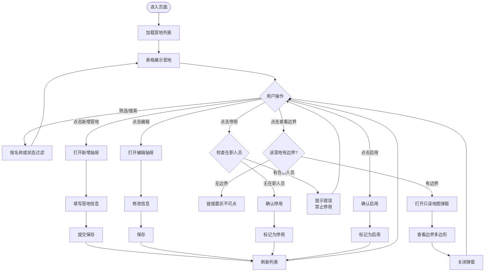
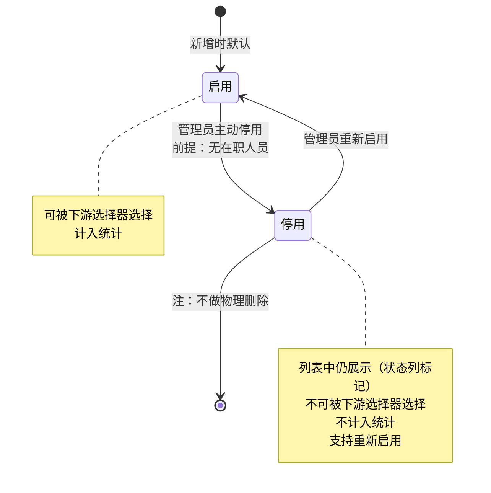

# PRD — 人员管理 · 营地管理

| 项 | 内容 |
|---|---|
| 文档版本 | V2.0 |
| 编制日期 | 2026-08-07 |
| 最后更新 | 2026-08-09 |
| 所属产品 | 中石油尼日尔公司上游油田项目 — 数智安防应急指挥中心（平台） |
| 所属端 | PC 后台 |
| 所属模块 | 业务管理 → 人员管理 → 营地管理 |
| 页面架构 | 标准列表页（筛选栏 + 表格 + 抽屉表单） |
| 上游依据 | 2026-08-07 grilling session 决策；2026-08-09 架构简化决策 |
| 状态 | 待评审 |

---

## 1. 文档元数据与边界

### 1.1 需求背景

中石油尼日尔项目分布在多个营地，营地是组织架构中平台需要维护的唯一层级。现有 AIRIOT 底座无法维护营地这一自定义主数据，导致：

| 现状问题 | 业务影响 |
|---|---|
| 无营地主数据 | 人员、物资、装备无法按营地筛选与统计 |
| 营地边界无处查看 | 大屏与后台无法展示营地区域范围 |
| 营地信息随意删除 | 历史档案断链，无法追溯 |

本模块的定位：**营地主数据管理**——维护营地的基础信息（名称、负责人、联系方式、备注），并只读展示营地的 GIS 边界，为人员信息、排班管理、班组管理、物资存放点、装备管理提供营地维度的筛选能力。

### 1.2 核心指标

| 指标 | 定义 | 目标值 |
|---|---|---|
| 营地覆盖度 | 已配置基础信息的营地数 ÷ 实际营地数 | 100% |
| 负责人完整度 | 已配置负责人的营地数 ÷ 营地总数 | 100% |
| 列表加载时长 | 从请求发出到表格渲染完成 | ≤ 1.5 秒 |

### 1.3 与既有模块的依赖关系

| 关联模块 | 关系方向 | 具体依赖内容 |
|---|---|---|
| 人员管理 → 人员信息 | 本模块**提供数据** | 人员信息台账的「所属营地」下拉选项数据来源 |
| 人员管理 → 排班管理 | 本模块**提供数据** | 排班时按营地筛选人员候选范围 |
| 人员管理 → 班组管理 | 本模块**提供数据** | 班组成员选择器按营地筛选 |
| 应急指挥 → 预案管理 | 本模块**提供数据** | 预案编制时按营地筛选人员组建应急分组 |
| 实时监控中心（PC 端） | 本模块**提供数据** | 人员图层按营地分组、营地边界在地图上叠加展示 |
| 大屏 → 安防态势综合驾驶舱 | 本模块**提供数据** | 按营地统计人力、装备分布 |
| 装备管理（各子模块） | 本模块**提供数据** | 设备的「所属营地」「可服务营地」等字段的营地候选项来源；仅取启用态营地 |
| 应急物资管理 → 存放点管理 | 本模块**提供数据** | 存放点的「所属营地」下拉候选项来源；仅取启用态营地 |
| GIS 侧（边界数据） | 本模块**消费数据** | 营地边界的绘制与维护在 GIS 侧完成，本模块只读展示 |

### 1.4 权限边界（红线）

| 编号 | 边界 | 说明 |
|---|---|---|
| PB-01 | 营地基础信息由**平台自建**，平台拥有完整增改权 | 不对接 HR 系统或 OA 系统 |
| PB-02 | 营地**不做物理删除** | 一律走「停用」状态；有人员引用的营地必须可追溯 |
| PB-03 | 营地边界**平台只读** | 本模块只展示边界，不提供绘制、编辑、清除能力；边界数据的维护在 GIS 侧完成 |
| PB-04 | 本模块**不提供人员的组织归属变更** | 人员的营地字段在人员信息台账中维护，本模块只提供选择器数据源 |
| PB-05 | 营地的增改**不考虑权限细分** | 有菜单权限即有操作权限；细粒度权限（如各营地管理员分权）留待后期迭代 |
| PB-06 | 本模块**不维护部门** | 组织架构只维护到营地一级，不设部门层级 |

### 1.5 本期范围（In Scope）

| 编号 | 能力 |
|---|---|
| IS-01 | 营地列表展示：表格形式，含名称、负责人、联系方式、边界状态、状态、备注、更新时间 |
| IS-02 | 新增营地：名称、负责人、联系方式、备注 |
| IS-03 | 编辑营地基础信息 |
| IS-04 | 停用/启用营地（逻辑删除） |
| IS-05 | 查看营地边界：只读地图弹窗，展示已有的边界多边形 |
| IS-06 | 按营地名称模糊搜索、按状态筛选、重置筛选 |
| IS-07 | 停用规则：营地下有在职人员时禁止停用 |
| IS-08 | 停用后不可选：所有下游下拉选择器不可选择停用营地 |
| IS-09 | 导出营地列表 |
| IS-10 | 全量异常处理：空态、名称重复校验、关联数据保护 |

### 1.6 本期范围外（Out of Scope）

| 编号 | 不做项 | 原因 |
|---|---|---|
| OS-01 | 部门层级（含组织树、部门增删改、部门停用规则） | PB-06：组织架构只维护到营地一级 |
| OS-02 | 营地的物理删除 | PB-02：一律走停用，保护历史数据可追溯性 |
| OS-03 | 营地边界的绘制、编辑、清除 | PB-03：边界在 GIS 侧维护，本模块只读 |
| OS-04 | 营地编码字段 | 不提供用户可见的编码字段，使用自增 ID 作为主键 |
| OS-05 | 营地类型等分类字段 | 本期不做分类，保持简单 |
| OS-06 | 营地负责人的权限联动 | 本模块只记录负责人信息，不自动授予该负责人管理权限 |

---

## 2. 业务概念与术语

| 术语 | 精确定义 |
|---|---|
| **营地** | 海外油田项目的独立运营单元，是组织架构中平台维护的**唯一层级**。营地是可配置的主数据，非硬编码。 |
| **营地边界** | 营地的地理范围，以 GIS 数据形式存储。本模块**只读展示**，不提供绘制与编辑能力（PB-03）。用于大屏与监控中心展示营地范围。 |
| **停用** | 逻辑删除状态。停用的营地不可在下游下拉选择器中被选择、不计入统计报表。**停用不等于删除**——记录仍存在于列表中（状态列标记为「停用」），支持重新启用。 |
| **启用** | 正常可用状态。启用的营地可被下游下拉选择器选择、计入统计。 |
| **停用保护** | 营地下有在职人员时，禁止停用该营地。强制管理员先转移人员。 |

---

## 3. 核心流程与状态机

### 3.1 营地管理主流程



### 3.2 营地状态机



---

## 4. 核心功能矩阵

| 功能 | 触发位置 | 前置条件 | 业务结果 | 备注 |
|---|---|---|---|---|
| 加载营地列表 | 页面初始化 | 无 | 表格展示全部营地（含停用） | 加载失败展示失败占位与「重试」 |
| 按名称搜索 | 筛选栏「营地名称」输入框 | 无 | 按名称模糊匹配过滤列表，重置到第 1 页 | 支持清空 |
| 按状态筛选 | 筛选栏「状态」下拉 | 无 | 按启用/停用过滤列表，重置到第 1 页 | 默认「全部」 |
| 重置筛选 | 筛选栏「重置」按钮 | 无 | 清空全部筛选条件，回到第 1 页 | —— |
| 新增营地 | 左上角「新增营地」按钮 | 无 | 创建营地记录，刷新列表 | 初始状态为「启用」，初始「边界」为「未绘制」 |
| 编辑营地 | 表格行「编辑」链接 | 无 | 更新营地信息与更新时间，刷新列表 | 表单预填充当前值 |
| 查看营地边界 | 表格行「查看边界」链接 | 该营地已有边界数据 | 打开只读地图弹窗展示边界多边形 | 无边界时链接置灰不可点（PB-03：只读，不提供绘制） |
| 停用营地 | 表格行「停用」链接 | 营地为启用状态；营地下无在职人员 | 二次确认后标记为停用 | 强校验，不满足条件时提示并拒绝 |
| 启用营地 | 表格行「启用」链接 | 营地为停用状态 | 二次确认后恢复启用 | 可逆操作 |
| 导出 | 右上角「导出」按钮 | 无 | 导出当前筛选结果为 Excel | —— |

---

## 5. 页面布局与交互逻辑

### 5.1 整体布局（标准列表页）

```
┌───────────────────────────────────────────────────────────────────────────┐
│  业务管理 > 人员管理 > 营地管理                                             │
├───────────────────────────────────────────────────────────────────────────┤
│  营地名称 [____________]   状态 [全部 ▾]   [重 置]                          │
├───────────────────────────────────────────────────────────────────────────┤
│  [+ 新增营地]                                                    [导 出]    │
├───────────────────────────────────────────────────────────────────────────┤
│  营地名称   │ 负责人 │ 联系方式    │ 边界   │ 状态 │ 备注  │ 更新时间 │ 操作  │
│ ────────────┼────────┼─────────────┼────────┼──────┼───────┼──────────┼───── │
│ WAPCO总部营地│  张三  │ 13800138001 │ 已绘制 │ 启用 │ 总部… │ 06-20    │ 编辑 │
│             │        │             │        │      │       │          │ 查看 │
│             │        │             │        │      │       │          │ 边界 │
│             │        │             │        │      │       │          │ 停用 │
│ ────────────┼────────┼─────────────┼────────┼──────┼───────┼──────────┼───── │
│ 钻井营地A   │  王五  │ 13800138003 │ 未绘制 │ 启用 │   -   │ 02-01    │  …   │
├───────────────────────────────────────────────────────────────────────────┤
│                                                     共 N 条  [1] [2] ...   │
└───────────────────────────────────────────────────────────────────────────┘
```

**布局规格**

| 区域 | 说明 |
|---|---|
| 筛选栏 | 横向内联布局，位于表格上方 |
| 操作按钮栏 | 左侧「新增营地」（主按钮），右侧「导出」 |
| 表格 | 横向滚动阈值 1200px；操作列右侧固定 |
| 分页 | 表格下方右对齐，支持切换每页条数与快速跳页，展示「共 N 条」；默认每页 20 条 |

### 5.2 筛选栏规则

| 筛选项 | 控件 | 默认值 | 说明 |
|---|---|---|---|
| 营地名称 | 文本框（宽 200px） | 空 | 模糊匹配，不区分大小写；输入即过滤并重置到第 1 页；支持清空 |
| 状态 | 下拉单选（宽 120px） | 全部 | 选项：启用 / 停用；支持清空回到「全部」；切换即过滤并重置到第 1 页 |
| 重置 | 按钮 | —— | 清空全部筛选条件，回到第 1 页 |

### 5.3 表格列定义

| 列名 | 字段 | 宽度 | 对齐 | 渲染规则 |
|---|---|---|---|---|
| 营地名称 | `name` | 200 | 居中 | 纯文本 |
| 负责人 | `leader` | 120 | 居中 | 纯文本 |
| 联系方式 | `contact` | 150 | 居中 | 纯文本 |
| 边界 | `hasBoundary` | 100 | 居中 | 有边界显示绿色「已绘制」；无边界显示灰色「未绘制」 |
| 状态 | `status` | 100 | 居中 | 标签：启用为绿色，停用为灰色 |
| 备注 | `remark` | 200 | 居中 | 超过 30 字符截断加 `…`，悬浮 Tooltip 展示全文；空值显示 `-` |
| 更新时间 | `updatedAt` | 160 | 居中 | `YYYY-MM-DD HH:mm:ss` |
| 操作 | —— | 200 | 居中 | 右侧固定列：编辑 / 查看边界 / 停用或启用 |

**对齐规范**：本表格全部为文字类列，一律居中；表头与单元格的对齐方式必须一致。

### 5.4 操作列按钮规则

| 按钮 | 显示条件 | 行为 |
|---|---|---|
| 编辑 | 始终显示 | 打开编辑抽屉，预填充当前值 |
| 查看边界 | 始终显示；营地无边界时置灰不可点 | 打开只读地图弹窗 |
| 停用 | 营地为启用状态时显示（红色） | 二次确认后停用 |
| 启用 | 营地为停用状态时显示（蓝色） | 二次确认后启用 |

**说明**：不提供「删除」按钮（PB-02）；不提供「绘制边界」「编辑边界」按钮（PB-03）。

### 5.5 新增/编辑营地表单

**表单布局（抽屉，宽度 640px）**

```
┌─────────────────────────────────┐
│  新增营地                    [×] │
├─────────────────────────────────┤
│  营地名称 *  [_______________]   │
│                          0/50   │
│  负责人 *    [_______________]   │
│                                 │
│  联系方式 *  [_______________]   │
│                                 │
│  备注        ┌───────────────┐  │
│              │               │  │
│              └───────────────┘  │
│                          0/200  │
├─────────────────────────────────┤
│              [取 消]  [保 存]    │
└─────────────────────────────────┘
```

**字段规则**

| 字段 | 控件 | 必填 | 新增时 | 编辑时 | 校验规则 |
|---|---|---|---|---|---|
| 营地名称 | 文本框 | 是 | 可填 | 可改 | 最多 50 字符，显示字数计数；前后空格自动去除；全局唯一，重复时报错「营地名称已存在」；为空时报错「请填写营地名称」 |
| 负责人 | 文本框 | 是 | 可填 | 可改 | 最多 50 字符；为空时报错「请填写负责人」 |
| 联系方式 | 文本框 | 是 | 可填 | 可改 | 11 位手机号（`1` 开头）；为空时报错「请填写联系方式」；格式错误时报错「请输入正确的11位手机号」 |
| 备注 | 多行文本（3 行） | 否 | 可填 | 可改 | 最多 200 字符，显示字数计数 |

**说明**：
- 新增的营地初始状态为「启用」，初始「边界」为「未绘制」。
- 表单中**不含边界字段**——边界由 GIS 侧维护，本模块只读展示（PB-03）。
- 状态不在表单中修改，通过表格行的「停用」/「启用」链接变更。

### 5.6 表单通用规则

| 项 | 规则 |
|---|---|
| 校验时机 | 点击保存时按字段顺序校验，命中第一个错误即 Toast 提示并中止提交 |
| 唯一性校验 | 营地名称保存时校验，后端二次校验为准 |
| 保存中 | 「保 存」显示 loading，防重复提交 |
| 保存失败 | 抽屉保持打开，已填内容不丢失 |
| 新增成功 | 关闭抽屉 → Toast「营地创建成功」→ 刷新列表 |
| 编辑成功 | 关闭抽屉 → Toast「营地更新成功」→ 刷新列表，同时更新「更新时间」 |

### 5.7 停用/启用确认

| 项 | 规则 |
|---|---|
| 触发 | 表格行点击「停用」或「启用」 |
| 确认弹窗标题 | 「确认停用」/「确认启用」 |
| 确认弹窗内容 | 停用：「确认停用营地"XXX"？停用后将不可在选择器中被选择。」<br/>启用：「确认启用营地"XXX"？」 |
| 按钮 | 「确认停用」（危险色）/「确认启用」（主色）、「取消」 |
| 成功反馈 | Toast「停用成功」/「启用成功」，刷新列表并更新「更新时间」 |
| 停用被拦截 | 该营地下有在职人员时，提示「该营地下有 N 名在职人员，请先转移人员到其他营地」，不执行停用 |

### 5.8 查看营地边界

**触发**：表格行点击「查看边界」（该营地已有边界数据时可点）

**弹窗布局（地图弹窗，宽度 90%，地图区高度 70vh）**

```
┌──────────────────────────────────────────────────────────────────────┐
│  查看营地边界 — WAPCO总部营地                                    [×]  │
├──────────────────────────────────────────────────────────────────────┤
│  ┌────────────────────────────────────────────────────────────────┐  │
│  │                                                                │  │
│  │                     [ 地图画布区域 ]                            │  │
│  │                                                                │  │
│  │              显示营地边界多边形（只读）                          │  │
│  │                                                                │  │
│  └────────────────────────────────────────────────────────────────┘  │
├──────────────────────────────────────────────────────────────────────┤
│                                                            [关 闭]    │
└──────────────────────────────────────────────────────────────────────┘
```

**交互规则**

| 项 | 规则 |
|---|---|
| 弹窗尺寸 | 宽度 90%，地图区高度 70vh |
| 弹窗标题 | 「查看营地边界 — {营地名称}」 |
| 地图初始视野 | 定位并缩放到该营地边界范围 |
| 边界渲染 | 以多边形形式渲染，**只读**——不提供绘制、拖拽顶点、清除等编辑能力（PB-03） |
| 地图交互 | 仅支持平移、缩放等浏览操作 |
| 底部按钮 | 仅「关闭」一个按钮，无「保存」 |
| 无边界的营地 | 「查看边界」链接置灰不可点，不弹出弹窗 |

**待技术确认**：地图底图来源、坐标系（WGS84 / GCJ02）、地图组件选型 — 见附录 B TBD-01。

---

## 6. 边界情况与异常处理

### 6.1 空状态处理

| 场景 | 处理方式 |
|---|---|
| 无任何营地 | 表格区显示空态图 + 文案「暂无数据」 |
| 搜索/筛选无匹配结果 | 表格区显示空态图 + 文案「暂无数据」，筛选条件保留可清空 |
| 营地无备注 | 备注列显示 `-` |
| 营地无边界 | 边界列显示灰色「未绘制」，操作列「查看边界」置灰不可点 |

### 6.2 数据校验

| 场景 | 处理方式 |
|---|---|
| 营地名称为空或仅含空格 | Toast 报错「请填写营地名称」 |
| 营地名称重复 | Toast 报错「营地名称已存在」，后端二次校验拒绝 |
| 负责人为空 | Toast 报错「请填写负责人」 |
| 联系方式为空 | Toast 报错「请填写联系方式」 |
| 联系方式格式错误 | Toast 报错「请输入正确的11位手机号」 |
| 营地名称超长 | 输入到 50 字符时停止输入，字数计数变红 |
| 备注超长 | 输入到 200 字符时停止输入，字数计数变红 |

### 6.3 网络异常

| 场景 | 处理方式 |
|---|---|
| 列表加载失败 | 表格区显示失败占位 + 「重试」按钮 |
| 保存请求超时 | 抽屉保持打开，提示「保存超时，请重试」，已填内容不丢失 |
| 停用/启用请求失败 | Toast 错误提示，状态不变，列表不刷新 |
| 地图底图加载失败 | 地图区显示「地图加载失败，请检查网络后重试」+ 「重试」按钮 |
| 边界数据加载失败 | 地图区显示「边界数据加载失败」+ 「重试」按钮 |

### 6.4 引用完整性

| 场景 | 处理方式 |
|---|---|
| 停用营地时该营地下有在职人员 | 拦截，提示「该营地下有 N 名在职人员，请先转移人员到其他营地」 |
| 人员信息台账引用已停用的营地 | 人员档案中保留该营地名称并置灰，Tooltip「所属营地已停用」；编辑该人员时必须重新选择有效营地才能保存 |
| 物资存放点引用已停用的营地 | 存放点保留该营地名称并置灰；编辑该存放点时必须重新选择有效营地才能保存 |
| 装备的「所属营地」引用已停用营地 | 保留原值并置灰；编辑时必须重新选择有效营地 |
| 排班/预案引用已停用营地下的人员 | 历史记录保持可追溯，不做数据清理；新建时该营地下人员不出现在候选范围 |

### 6.5 权限拦截

| 场景 | 处理方式 |
|---|---|
| 无本菜单权限 | 菜单项不显示；直接访问路由时跳转 403 页面 |
| 有菜单权限 | 视为拥有全部增改权限（PB-05） |

### 6.6 极端数据量

| 场景 | 处理方式 |
|---|---|
| 营地数 > 20 | 表格分页展示，默认每页 20 条 |
| 营地名称超长（50 字符满额） | 单元格内换行展示，不截断 |
| 备注超长（200 字符满额） | 列表中截断到 30 字符加 `…`，悬浮 Tooltip 展示全文 |
| 营地边界顶点数 > 500 | 地图渲染可能变慢，前端做渲染降级（简化顶点后展示） |

---

## 附录 A：数据字段完整定义

### A.1 营地表（camp）

| 字段名 | 展示名 | 类型 | 必填 | 唯一 | 可编辑 | 来源 | 被下游引用 | 说明 |
|---|---|---|---|---|---|---|---|---|
| `id` | 营地ID | 整型 | 是 | 是 | 否 | 平台生成 | ✅ 人员信息、排班、班组、预案、物资存放点、装备、大屏 | 自增主键，创建后恒定；**不对用户展示** |
| `name` | 营地名称 | 字符串 | 是 | 是 | 是 | 平台录入 | ✅ 人员信息、排班、班组、预案、物资存放点、装备、大屏 | ≤ 50 字符，全局唯一 |
| `leader` | 负责人 | 字符串 | 是 | 否 | 是 | 平台录入 | —— | ≤ 50 字符 |
| `contact` | 联系方式 | 字符串 | 是 | 否 | 是 | 平台录入 | —— | 11 位手机号 |
| `remark` | 备注 | 字符串 | 否 | 否 | 是 | 平台录入 | —— | ≤ 200 字符 |
| `boundary_data` | 边界数据 | 待定 | 否 | 否 | **否（平台只读）** | GIS 侧维护 | ✅ 大屏、实时监控中心 | GIS 边界数据，格式待技术确定；本模块只读展示（PB-03） |
| `status` | 状态 | 枚举 | 是 | 否 | 经操作链接变更 | 平台维护 | ✅ **下游选择器仅取「启用」态营地** | 启用 / 停用 |
| `created_at` | 创建时间 | 日期时间 | 是 | 否 | 否 | 平台生成 | —— | 不在列表展示 |
| `updated_at` | 更新时间 | 日期时间 | 是 | 否 | 否 | 平台生成 | —— | 列表「更新时间」列 |

**不设置的字段及原因**

| 未设字段 | 原因 |
|---|---|
| `code`（营地编码） | OS-04：不提供用户可见的编码字段，避免增加使用心智负担；使用自增 ID 作为主键 |
| `camp_type`（营地类型） | OS-05：本期不做分类 |
| `sort_order`（排序号） | 列表按创建顺序展示，不需要人工排序 |
| `longitude` / `latitude`（营地中心点坐标） | 中心点可由边界计算得出；如后续大屏需要独立中心点再补 |
| 部门相关全部字段 | OS-01：本期不维护部门层级 |

### A.2 关联字段映射

| 本模块字段 | 关联模块 | 关联字段 | 说明 |
|---|---|---|---|
| `camp.id` | 人员管理 → 人员信息 | `camp` | 人员的所属营地 |
| `camp.name` | 人员管理 → 人员信息 | 展示用 | 人员列表的营地列 |
| `camp.id` | 人员管理 → 班组管理 | 筛选条件 | 班组成员选择器按营地筛选 |
| `camp.id` | 应急物资管理 → 存放点管理 | `campId` | 存放点的所属营地 |
| `camp.name` | 应急物资管理 → 存放点管理 | `campName` | 存放点列表的营地列 |
| `camp.id` | 装备管理（各子模块） | 所属营地 / 可服务营地 | 设备的营地归属 |
| `camp.boundary_data` | 实时监控中心 / 大屏 | 图层数据 | 地图上叠加营地边界 |

### A.3 API 接口清单

| 接口名称 | 请求方法 | 路径 | 说明 |
|---|---|---|---|
| 查询营地列表 | GET | `/api/org/camp/list` | 返回营地列表；参数 `name`（名称模糊）、`status`（状态）、分页参数 |
| 查询营地详情 | GET | `/api/org/camp/{id}` | 返回单个营地的完整信息 |
| 新增营地 | POST | `/api/org/camp` | 创建营地 |
| 编辑营地 | PUT | `/api/org/camp/{id}` | 更新营地基础信息（不含边界） |
| 变更营地状态 | PATCH | `/api/org/camp/{id}/status` | 停用/启用；服务端校验在职人员 |
| 查询营地边界 | GET | `/api/org/camp/{id}/boundary` | **只读**，返回边界数据用于地图展示 |
| 校验名称唯一性 | GET | `/api/org/check-name` | 参数：`name`、`excludeId` |
| 查询关联数据统计 | GET | `/api/org/camp/{id}/references` | 停用前调用，返回该营地下的在职人员数 |
| 导出营地列表 | GET | `/api/org/camp/export` | 导出当前筛选结果为 Excel |

**说明**：不提供边界的写接口（POST/PUT/DELETE），边界数据由 GIS 侧维护（PB-03）。

### A.4 前端路由设计

| 路由 name | 路径 | 页面组件 | 说明 |
|---|---|---|---|
| `CampDeptManagement` | `/business/camp-dept` | `CampDeptManagement.vue` | 营地管理主页面 |

---

## 附录 B：待确认事项

| 编号 | 事项 | 当前 PRD 处理方式 | 需确认方 |
|---|---|---|---|
| TBD-01 | 地图底图来源、坐标系（WGS84 / GCJ02）、地图组件选型 | PRD 只约定「只读展示边界」，组件选型待定 | 技术团队 |
| TBD-02 | 边界数据的存储格式（GeoJSON / 坐标点数组 / 其他） | `boundary_data` 字段类型标注为「待定」 | 技术团队 |
| TBD-03 | 营地边界由谁维护、通过什么工具录入 | PRD 约定平台只读（PB-03），维护方式在 GIS 侧确定 | 技术团队 / 业主 |
| TBD-04 | 各营地的准确名称与拼写 | 原型使用示例名称，以业主提供的正式名称为准 | 业主 |
| TBD-05 | 营地边界是否需要用于人员/设备的区域归属判断（电子围栏） | 本期只做只读展示，不做区域判断逻辑 | 业主 |
| TBD-06 | 营地负责人是否需要关联到具体人员记录（而非纯文本） | 本期为纯文本字段，不与人员表关联 | 业主 |
| TBD-07 | 原「部门」维度在人员信息、班组管理中的既有字段如何处置 | 本模块已不维护部门；下游模块的部门字段处置需单独确认 | 业主 / 产品 |

---

## 附录 C：修订记录

| 版本 | 日期 | 修订内容 | 修订人 |
|---|---|---|---|
| V1.0 | 2026-08-07 | 首版，基于 2026-08-07 grilling session 的 40 项决策编写 | 产品 |
| V2.0 | 2026-08-09 | 架构简化：①移除部门层级，只维护营地（PB-06、OS-01）；②页面从「单树全屏」改为「标准列表页」；③营地边界由「平台绘制+存储」改为「平台只读展示」（PB-03、OS-03）；④文档更名为「营地管理」；⑤负责人、联系方式改为必填，名称长度调整为 ≤50 字符；⑥新增按名称搜索、按状态筛选、导出能力；⑦新增 TBD-07（下游部门字段处置待确认） | 产品 |
