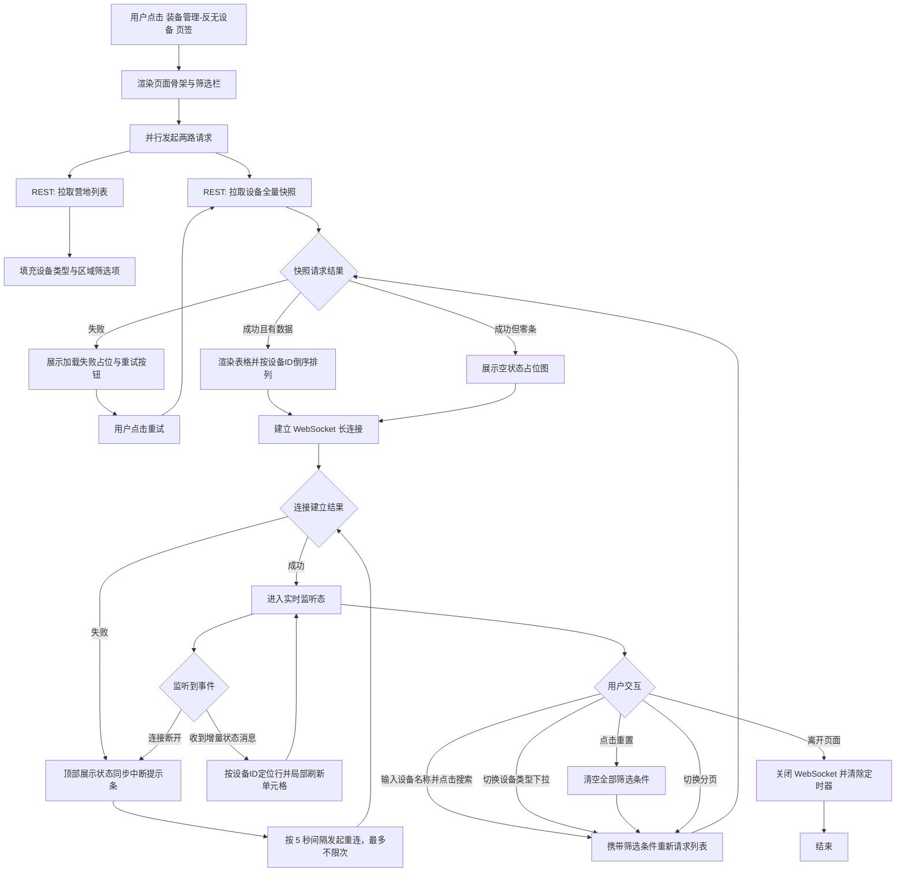
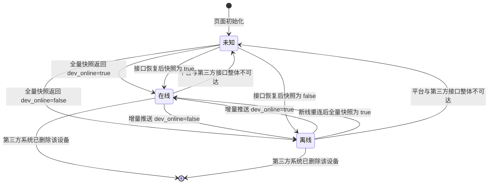
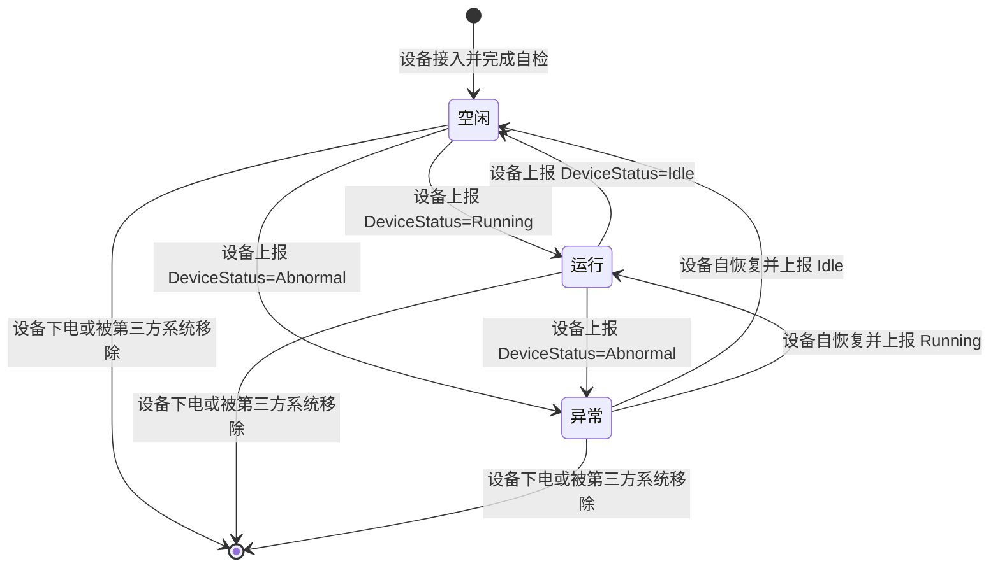

# PRD — 装备管理 · 反无设备管理

| 项 | 内容 |
|---|---|
| 文档版本 | v1.1 |
| 创建日期 | 2026-08-03 |
| 所属模块 | 装备管理 → 反无设备 |
| 文档状态 | 待评审 |
| 参考基线 | 现网 AIRIOT 平台「系统管理-设备管理-反无设备」页面截图（172.30.1.20:3030） |
| 数据基线 | `设备管理-表定义配置.json`（modelProperties） |

---

## 1. 文档元数据与边界

### 1.1 需求背景

海外油田现场安保平台的感知层设备绝大部分由第三方系统建设与管理。反无设备（反无人机侦测/反制设备）由第三方反无系统统一纳管，平台侧不承担设备的建档、配置与运维职责。

本模块的唯一目标是：**为指挥人员提供一个反无设备的实时状态总览台账**，用于回答三个问题——
1. 现场共有多少台反无设备、分别部署在哪个区域；
2. 每台设备此刻是否在线、处于何种工作状态、GPS 是否可用；
3. 每台设备今日的探测/预警/入侵活动量级。

### 1.2 核心指标

| 指标 | 定义 | 目标值 |
|---|---|---|
| 状态时延 | 第三方设备状态变化 → 平台页面刷新的端到端耗时 | ≤ 3 秒（P95） |
| 首屏加载时长 | 进入页面 → 表格首行渲染完成 | ≤ 1.5 秒（P95，100 条数据内） |
| 状态准确率 | 平台展示的「设备在线」与第三方系统真值一致的比例 | ≥ 99.5% |
| 误判离线率 | 因平台侧链路问题导致的错误离线判定占比 | ≤ 0.1% |

### 1.3 与既有模块的依赖关系

| 依赖方向 | 模块 | 依赖内容 | 失效影响 |
|---|---|---|---|
| 上游 | 第三方反无系统 | 设备主数据、实时状态（REST + WebSocket） | 本页面无数据可展示，降级为异常态（见 §6.3） |
| 上游 | 营地管理 | 「所属区域」下拉选项与区域名称 | 区域列显示区域 ID 原值，筛选项为空 |
| 上游 | 中台事件台账 | 今日探测/预警/入侵次数的聚合计数 | 三个统计列显示 `--`，不阻塞主表格渲染 |
| 平级 | 装备管理其余 7 类设备页 | 共用页签导航栏、共用列表页视觉规范 | 无 |
| 下游 | 无 | 本模块不向任何模块输出数据 | —— |

> **架构约束**：依据既有决策，8 类设备各自独立页面，本 PRD 仅覆盖「反无设备」页签，不涉及摄像头设备、A 类无人机、A 类地面站、C 类机巢、C 类无人机等其余页签。

### 1.4 权限边界（红线）

| 能力 | 平台是否具备 | 说明 |
|---|---|---|
| 新增设备 | ❌ 否 | 设备档案由第三方系统创建，平台同步发现 |
| 编辑设备 | ❌ 否 | 含主数据与扩展信息，本期平台无任何可写字段 |
| 删除设备 | ❌ 否 | 第三方系统删除后，平台通过同步感知并移除 |
| 启用/禁用设备 | ❌ 否 | 不提供该操作入口 |
| 批量操作 | ❌ 否 | 表格不提供勾选框 |
| 导入/导出 | ❌ 否 | 本期不做 |
| 查询/筛选/分页 | ✅ 是 | 纯前端交互，不改变任何数据 |
| 实时状态监控 | ✅ 是 | 被动接收推送，只读 |

> **本页面为纯只读页面。任何形态的写操作入口（新增按钮、行操作列、右键菜单、双击编辑、拖拽排序）均不得出现。**

### 1.5 本期范围外（Out of Scope）

| 项 | 不做的原因 |
|---|---|
| 设备详情抽屉/弹窗 | 参考基线页面无详情入口，本期不引入 |
| 温度、电压、工作频率、校准角、IP、型号、定位、断电、禁用、报警状态 | 表定义中存在但参考基线前台未呈现，本期不展示、不处理 |
| 地图视图 / 列表-地图双模式切换 | 参考基线为纯表格页 |
| 设备历史报警记录查询 | 归属中台事件台账模块 |
| 设备关联无人机轨迹回溯 | 归属反无系统模块 |
| 统计字段的下钻跳转 | 本期仅展示数字，不可点击 |
| 多语言（法语）切换 | 表定义中含 `_fr` 字段，本期不实现 |
| 列显隐自定义、列宽拖拽记忆 | 本期使用固定列配置 |

---

## 2. 业务概念与术语

| 术语 | 精确定义 |
|---|---|
| **反无设备** | 部署于营地周界、用于对低慢小无人机目标实施射频侦测或电磁反制的地面设备。理论上单台设备同时具备侦测与反制能力，实际投用时按 `设备类型` 字段区分其当前承担的职能。 |
| **侦测（detect）** | 设备当前职能为无人机信号探测与测向，不发射干扰信号。 |
| **反制（nemesis）** | 设备当前职能为对已锁定的无人机目标发射干扰信号，实施驱离或迫降。 |
| **所属区域** | 设备物理部署所在的营地，取值来源于「营地管理」模块的营地档案，非硬编码枚举。 |
| **设备在线** | 中台基于第三方系统数据源判定的设备通信链路可达性。平台被动接收在线/离线状态推送，不执行本地离线判定逻辑。 |
| **设备状态** | 设备自身上报的工作状态，三态互斥：空闲（Idle）、运行（Running）、异常（Abnormal）。平台完全透传，不做任何推导。 |
| **GPS 卫星数量** | 设备当前可见并参与解算的导航卫星颗数，整数。 |
| **通信时间** | 平台最近一次成功接收到该设备任意状态上报的服务器时刻，精确到秒。 |
| **心跳周期** | 第三方系统向平台推送设备状态的约定间隔，由第三方系统与中台约定。 |
| **离线阈值** | 由中台判定并推送结果，平台不执行本地离线判定逻辑。 |
| **今日** | 服务器本地时区当日 00:00:00 至 23:59:59，跨日自动归零。 |
| **今日探测次数** | 当日该设备累计发现无人机目标的批次数，取自中台事件台账聚合。 |
| **今日预警次数** | 当日该设备累计触发预警规则的次数，取自中台事件台账聚合。 |
| **今日入侵次数** | 当日该设备累计确认为「侵入防护区」的事件数，取自中台事件台账聚合。 |
| **全量快照** | 通过 REST 接口一次性拉取的全部设备当前状态，用于首屏渲染与断线重连后的状态对齐。 |
| **增量推送** | 通过 WebSocket 接收的单设备状态变更消息，仅含发生变化的字段。 |
| **位置信息** | 设备部署的地理坐标（经度、纬度），由用户在平台侧通过地图选点或手动输入设置。本信息为**平台扩展信息**，不来源于第三方反无系统，仅用于平台内部地图展示与定位。 |

---

## 3. 核心流程与状态机

### 3.1 页面主流程



### 3.2 设备在线状态机



> **防误判铁律**：当平台与第三方系统之间的接口整体不可达（WebSocket 断连或 REST 连续 3 次失败）时，**严禁将全部设备批量判定为离线**。此时所有设备统一进入「未知」态，页面保留最后已知状态并置灰，同时在表格上方展示全局中断提示条。设备在线/离线状态完全由中台判定并推送，平台仅做透传渲染。

### 3.3 设备工作状态机



> **平台职责边界**：设备状态的三态流转完全由第三方系统裁定，平台仅做透传渲染，**不得基于在线状态、GPS 状态或统计数值推导或改写设备状态**。设备离线期间，该列冻结显示离线前最后一次上报值（渲染规则见 §5.4）。

---

## 4. 核心功能矩阵

| 动作名称 | 触发位置 | 前置条件 / 受控状态 | 业务结果概述 |
|---|---|---|---|
| 进入反无设备页 | 顶部页签「反无设备」 | 用户具备装备管理菜单权限 | 加载全量快照并建立实时连接，默认按设备 ID 倒序展示第 1 页 |
| 按设备名称搜索 | 筛选栏 · 设备名称输入框 + 「搜 索」按钮 | 输入框内容长度 0–64 字符 | 按名称模糊匹配过滤，结果重置到第 1 页；空输入等同于不限该条件 |
| 按设备类型筛选 | 筛选栏 · 设备类型下拉框 | 下拉选项固定为「全部 / 侦测 / 反制」 | 选中后不自动查询，需点击「搜 索」生效；结果重置到第 1 页 |
| 回车快捷搜索 | 设备名称输入框获焦时按 Enter | 同「按设备名称搜索」 | 等效于点击「搜 索」按钮 |
| 重置筛选 | 筛选栏 · 「重 置」按钮 | 无 | 设备名称清空、设备类型回到「全部」，立即以无条件重新查询并回到第 1 页 |
| 翻页 | 表格右下角分页器 | 总条数 > 每页条数时可用 | 加载目标页数据，筛选条件保持不变 |
| 接收实时状态更新 | 系统自动（WebSocket） | 长连接处于已建立状态 | 按设备 ID 定位到对应行，局部刷新变更单元格，不打断用户正在进行的滚动或输入 |
| 断线重连与状态对齐 | 系统自动 | WebSocket 断开 | 每 5 秒重连一次；连接恢复后立即重新拉取全量快照，以快照结果**整体覆盖**本地状态 |
| 查看位置 | 表格操作列 · 「查看位置」按钮 | 无 | 打开位置查看弹窗（80%宽、80vh高），弹窗标题为「设备位置 — [设备名称]」；地图区域显示设备位置坐标（若已设置）；底部操作栏仅包含「关闭」按钮；位置信息只读展示，不支持编辑 |
| 重试加载 | 列表加载失败占位区 · 「重试」按钮 | 仅在请求失败态可见 | 重新发起当前筛选条件下的列表请求 |
| 离开页面清理 | 切换页签 / 路由跳转 / 关闭标签页 | 无 | 关闭 WebSocket、清除全部定时器，释放监听 |

> 矩阵中不含任何增、删、改类动作，与 §1.4 权限边界一致。

---

## 5. 页面布局与交互逻辑

### 5.1 页面骨架

```
┌──────────────────────────────────────────────────────────────────────────────────┐
│ 顶部主导航： 实时态势 │ 反无系统 │ 摄像头监控 │ C类无人机 │ A类无人机 │ [系统管理] │
├────────────┬─────────────────────────────────────────────────────────────────────┤
│            │  ┌────────┬──────────┬──────────┬──────────┬────────┬──────────┐   │
│  用户管理   │  │[反无设备]│ 摄像头设备│ A类无人机 │ A类地面站 │ C类机巢 │ C类无人机│  │
│ ▸[设备管理] │  └────────┴──────────┴──────────┴──────────┴────────┴──────────┘   │
│  区域管理   │                                                                     │
│            │  ┌───────────────────────────────────────────────────────────────┐ │
│            │  │ 设备名称 [请输入设备名称   ]  设备类型 [全部 ▾]  [搜 索] [重 置] │ │
│            │  └───────────────────────────────────────────────────────────────┘ │
│            │                                                                     │
│            │  ┌───────────────────────────────────────────────────────────────┐ │
│            │  │ID│名称│区域│类型│卫星│状态│在线│时间│探测│预警│入侵│操作│ │
│            │  ├───────────────────────────────────────────────────────────────┤ │
│            │  │ 7│东南角侦测│Koulele│侦测│22│运行│✓│08:59│45│3│0│标记 查看│ │
│            │  │ 6│东北角反制│Koulele│反制│8│空闲│✓│08:59│12│1│0│标记 查看│ │
│            │  │ …│  …    │  …   │ … │ … │ … │ … │ … │ … │ … │ … │ … │  …     │ │
│            │  └───────────────────────────────────────────────────────────────┘ │
│            │                                                                     │
│            │                                         ‹  [1]  2  3  ›   共 N 条   │
└────────────┴─────────────────────────────────────────────────────────────────────┘
```

> 全局中断提示条（仅异常态出现）插入位置：页签行与筛选栏之间，通栏展示，高度 40px。

### 5.2 筛选栏字段规则

| 字段 | 控件类型 | 是否必填 | 默认值 | 取值/限制规则 | 数据来源 |
|---|---|---|---|---|---|
| 设备名称 | 单行文本输入框 | 否 | 空 | 最多 64 字符；前后空格自动去除；支持中英文、数字、括号；模糊匹配（包含即命中）；不区分大小写 | 用户输入 |
| 设备类型 | 单选下拉框 | 否 | 全部 | 固定三项：全部 / 侦测 / 反制。不支持多选、不支持搜索、不可清空为空值 | `deviceType` 枚举，前端硬编码映射 `detect→侦测`、`nemesis→反制` |
| 搜 索 | 主按钮 | —— | —— | 常态可点击；请求进行中显示 loading 且禁用，防重复提交 | —— |
| 重 置 | 次按钮 | —— | —— | 常态可点击；请求进行中禁用 | —— |

**筛选逻辑约定**：设备名称与设备类型之间为 **AND（交集）** 关系。两项均为空/全部时，返回全部设备。

### 5.3 表格列定义

| 序号 | 列名 | 数据字段 | 数据类型 | 列宽 | 对齐 | 排序 | 空值/异常渲染 |
|---|---|---|---|---|---|---|---|
| 1 | 设备ID | `id` | 字符串 | 80px | 左 | 默认倒序，支持点击切换升/降序 | 主键，恒不为空 |
| 2 | 设备名称 | `name` | 字符串 | 200px | 左 | 不支持 | 超出列宽以 `…` 截断，悬浮显示完整名称 Tooltip |
| 3 | 所属区域 | `camp` | 字符串 | 140px | 左 | 不支持 | 关联营地档案取名称；关联失败时显示原始 ID 并置灰 |
| 4 | 设备类型 | `deviceType` | 枚举 | 100px | 左 | 不支持 | `detect→侦测`、`nemesis→反制`；未知枚举值显示 `--` |
| 5 | GPS卫星数量 | `GpsStalliteNum` | 整数 | 120px | 居中 | 不支持 | 空/null 显示 `--`；负数按 `--` 处理 |
| 6 | 设备状态 | `DeviceStatus` | 枚举 | 100px | 居中 | 不支持 | `Idle→空闲`、`Running→运行`、`Abnormal→异常`；异常态文字标红；未知枚举值显示 `--` |
| 7 | 设备在线 | `dev_online` | 布尔 | 100px | 居中 | 不支持 | `true` 显示绿色对勾图标，`false` 显示红色叉号图标 |
| 8 | 通信时间 | `connectTime` | 日期时间 | 180px | 左 | 不支持 | 格式 `YYYY-MM-DD HH:mm:ss`；从未通信过显示 `--` |
| 9 | 今日探测次数 | 中台聚合 | 整数 | 120px | 居中 | 不支持 | 无记录显示 `0`；接口失败显示 `--` |
| 10 | 今日预警次数 | 中台聚合 | 整数 | 120px | 居中 | 不支持 | 无记录显示 `0`；接口失败显示 `--` |
| 11 | 今日入侵次数 | 中台聚合 | 整数 | 120px | 居中 | 不支持 | 无记录显示 `0`；接口失败显示 `--` |
| 12 | 操作 | `action` | - | 100px | 居中 | 不支持 | 固定右侧；仅包含「查看位置」文字链接按钮 |

> **列 1–8 完全对齐参考基线截图。列 9–11 为本次需求新增的统计列，追加在通信时间之后**；若评审确认不在本页面呈现，直接删除该三列即可，不影响其余任何逻辑。

**表格通用规则**

| 项 | 规则 |
|---|---|
| 行高 | 48px，固定 |
| 表头 | 吸顶固定，随内容区横向滚动同步 |
| 斑马纹 | 不使用 |
| 行悬浮 | 整行背景高亮，鼠标指针为默认箭头（非手型，强调不可点击） |
| 行点击 | 无任何响应 |
| 勾选框 | 不提供 |
| 操作列 | 提供，固定在右侧，宽度100px，仅包含「查看位置」按钮 |
| 横向滚动 | 列总宽超出容器时出现横向滚动条，设备ID 与设备名称两列左侧冻结 |
| 每页条数 | 20 条/页，底部提供每页条数切换器（可选 10/20/50/100） |
| 分页器 | 右下角，展示页码与总条数；总条数 ≤ 当前每页条数时分页器隐藏 |
| 默认排序 | `设备ID` 倒序 |

### 5.4 联动规则表

| 触发条件 | 联动对象 | 联动行为 |
|---|---|---|
| 用户修改「设备名称」输入框内容 | 「搜 索」按钮 | 无变化，仍需手动点击才生效（不做输入即时查询） |
| 用户切换「设备类型」下拉选项 | 表格数据 | **不自动查询**，需点击「搜 索」后生效 |
| 用户点击「搜 索」 | 分页器 | 强制重置到第 1 页 |
| 用户点击「重 置」 | 设备名称、设备类型、分页器 | 三者同时复位（空、全部、第 1 页），并立即触发一次无条件查询 |
| 列表请求进行中 | 「搜 索」「重 置」按钮、分页器 | 全部置为禁用态，表格区展示骨架屏 |
| 列表请求进行中 | WebSocket 增量消息 | 暂存于缓冲队列，待新列表渲染完成后按设备 ID 匹配补齐；匹配不到的消息直接丢弃 |
| 收到某设备增量推送 | 该设备所在行的对应单元格 | 仅局部更新变更字段，触发一次 800ms 的背景色高亮渐隐动效；不重排行序、不重置滚动位置 |
| 收到的增量推送对应设备不在当前页/当前筛选结果中 | 表格 | 静默丢弃，不做任何提示，不自动跳页 |
| `dev_online` 由 true 变为 false | 该行「设备状态」「GPS卫星数量」两列 | 保留最后已知值，文字与图标整体降低不透明度至 45%，悬浮 Tooltip 提示「该值为设备离线前最后上报值，更新于 YYYY-MM-DD HH:mm:ss」 |
| `dev_online` 由 true 变为 false | 该行「今日探测/预警/入侵次数」三列 | **不置灰、不冻结**，继续按中台台账聚合结果更新（统计口径归属中台，与设备链路状态解耦） |
| `dev_online` 由 false 变为 true | 该行全部状态列 | 解除置灰，恢复正常渲染 |
| WebSocket 断开 | 全局提示条 | 表格上方出现橙色提示条：「实时状态同步已中断，正在重连…（当前展示为最后同步数据）」 |
| WebSocket 断开 | 全部设备行 | 统一进入「未知」态置灰，**严禁批量判离线** |
| WebSocket 重连成功 | 全局提示条、表格数据 | 提示条自动消失；立即拉取全量快照并**整体覆盖**本地状态（而非增量合并） |
| 服务器时间跨越 00:00:00 | 今日探测/预警/入侵次数 | 由后端聚合口径自动归零，前端在下一次数据刷新时体现，不做前端本地清零 |
| 「所属区域」关联的营地在营地管理中被删除 | 该行区域列 | 显示原始区域 ID 并置灰，Tooltip 提示「所属营地档案已不存在」；该行其余数据正常展示，不隐藏该行 |

### 5.5 位置查看弹窗

**触发方式**：
- 点击表格操作列的「查看位置」按钮

**弹窗规格**：
- 宽度：80%（响应式）
- 高度：80vh
- 标题：`设备位置 — [设备名称]`
- 无默认 footer（`:footer="null"`）

**布局结构**：

| 区域 | 高度 | 说明 |
|------|------|------|
| 地图区域 | flex: 1 | 浅灰色背景（#f0f0f0），居中显示占位提示"[ 地图组件待集成 ]"；显示设备位置坐标（若已设置）；待集成GIS后展示地图与标记点 |
| 底部操作栏 | 固定高度 | 深色背景（#1f1f1f）、边框（#303030）；右侧显示「关闭」按钮 |

**交互规则**：
- 打开弹窗时，加载设备现有位置信息（若设备无位置信息则显示提示）
- 位置信息只读展示，不支持编辑
- 点击关闭：关闭弹窗

**地图占位提示**：
```
[ 地图组件待集成 ]
显示设备位置标记点
📍 设备位置：[经度], [纬度]（若已设置）
```

**数据结构扩展**：
```typescript
export interface AntiUavDevice {
  // ... 现有字段
  location?: {  // 新增字段
    latitude: number   // 纬度，-90 ~ 90
    longitude: number  // 经度，-180 ~ 180
  }
}
```

---

## 6. 边界情况与异常处理

### 6.1 空状态

| 场景 | 判定条件 | 页面表现 |
|---|---|---|
| 系统内无任何反无设备 | 无筛选条件时返回 0 条 | 表格区居中展示空状态插图 + 文案「暂无反无设备。设备档案由第三方反无系统维护，请联系系统管理员核查同步状态。」分页器隐藏 |
| 筛选无结果 | 存在筛选条件时返回 0 条 | 表格区居中展示空状态插图 + 文案「未找到符合条件的设备」+ 「重置筛选条件」文字按钮，点击等效于「重 置」 |
| 营地列表为空 | 营地管理接口返回 0 条 | 区域列直接显示设备原始 `camp` 值，不阻塞表格渲染 |
| 统计接口返回空 | 中台聚合接口返回空对象 | 三个统计列统一显示 `0` |

### 6.2 数据校验与非法值

| 场景 | 处理策略 |
|---|---|
| 设备名称输入超过 64 字符 | 输入框硬性截断至 64 字符，不弹提示 |
| 设备名称输入纯空格 | 提交前 trim，等同于空条件 |
| 设备名称含 SQL/脚本特殊字符 | 前端不做拦截，统一由后端参数化查询处理；前端渲染时对返回内容做 HTML 转义，防止 XSS |
| `GpsStalliteNum` 返回非整数或负数 | 显示 `--`，前端不抛错 |
| `DeviceStatus` 返回枚举外的值 | 显示 `--`，控制台记录一条 warn 日志，不影响整行渲染 |
| `connectTime` 返回非法时间格式 | 显示 `--`，前端不抛错 |
| 单条设备数据缺失 `id` | 该条记录直接过滤不渲染，控制台记录 error 日志 |
| 返回数据中存在重复 `id` | 以最后一条为准去重渲染 |

### 6.3 网络与服务异常

| 场景 | 判定条件 | 处理策略 |
|---|---|---|
| 列表接口首次加载失败 | HTTP 非 2xx 或超时（10 秒） | 表格区展示失败占位：「数据加载失败」+「重试」按钮。不自动重试，不弹全局 Toast |
| 列表接口翻页/筛选时失败 | 同上 | 保留当前已渲染数据不清空，顶部弹出 Toast「加载失败，请重试」，持续 3 秒；分页器与筛选按钮恢复可用 |
| 营地接口失败 | HTTP 非 2xx 或超时 | 静默失败，区域列降级显示原始 ID；不影响主流程，不弹提示 |
| 统计接口失败 | HTTP 非 2xx 或超时 | 三个统计列显示 `--`；不弹提示，不阻塞主表格 |
| WebSocket 建立失败 | 握手失败 | 展示全局中断提示条，按 5 秒固定间隔无限重连；每次重连不重复弹 Toast |
| WebSocket 中途断开 | onclose / onerror | 同上；全部设备置「未知」态置灰 |
| 第三方接口整体不可达 | REST 连续 3 次失败 或 WS 断开超过 60 秒 | 提示条文案升级为「与反无系统连接中断，当前为历史快照数据，更新于 YYYY-MM-DD HH:mm:ss」，底色由橙色转红色。**全部设备维持最后已知状态，严禁批量判离线**。设备在线/离线状态由中台判定，平台不执行本地判定逻辑 |
| 服务恢复 | 任意一次 REST 或 WS 重连成功 | 提示条消失，立即全量快照覆盖，页面右上角弹出 Toast「实时同步已恢复」持续 2 秒 |
| 增量推送消息格式非法 | JSON 解析失败或缺少 `id` | 丢弃该条消息，控制台记录 warn 日志，不中断长连接 |
| 推送频率过高 | 单设备 1 秒内收到多条推送 | 前端按设备 ID 做 500ms 节流合并，仅渲染最后一次状态 |

### 6.4 引用完整性

| 场景 | 处理策略 |
|---|---|
| 第三方系统删除了某设备 | 下一次全量快照中该设备消失，前端整行移除；若用户当前正停留在该设备所在页且该页因此变空，自动回退至前一页 |
| 第三方系统新增了某设备 | 下一次全量快照中出现，按当前排序规则插入；若不符合当前筛选条件则不展示 |
| 设备关联的营地被删除 | 见 §5.4 联动规则，设备行保留，区域列降级展示 |
| 用户停留在第 5 页时数据总量缩减至 2 页 | 请求返回空列表且总页数 < 当前页，自动跳转至最后一页并重新请求 |

### 6.5 权限与越权

| 场景 | 处理策略 |
|---|---|
| 用户无「装备管理」菜单权限 | 左侧菜单不渲染「设备管理」入口；直接访问 URL 时展示 403 页面 |
| 用户通过接口调试工具尝试对设备发起写操作 | 后端统一拒绝并返回 403，前端无相应入口 |
| 登录态失效 | 列表或 WS 返回 401 时，清除本地会话并跳转登录页，不展示中断提示条 |

### 6.6 极端数据量

| 场景 | 处理策略 |
|---|---|
| 设备总数 > 500 | 服务端分页已保证单页 20 条，前端不做虚拟滚动 |
| 单设备名称超过 50 字符 | 列内截断 + Tooltip，不撑开列宽 |
| 全部设备同时离线 | 由中台推送各设备的离线状态，平台逐条渲染；不执行批量本地判定 |
| 同一秒内收到全部设备的推送 | 按 §6.3 节流规则合并渲染，单帧最多重绘一次表格 |

---

## 附录 A：字段与表定义映射对照

| 页面列名 | 表定义 key | 表定义 title | 本期是否展示 |
|---|---|---|---|
| 设备ID | `id` | 编号 | ✅ |
| 设备名称 | `name` | 名称 | ✅ |
| 所属区域 | `camp` | 营地 | ✅ |
| 设备类型 | `deviceType` | 设备类型 | ✅ |
| GPS卫星数量 | `GpsStalliteNum` | GPS卫星数量 | ✅ |
| —— | `GpsLocked` | GPS锁定 | ❌ 本期不展示 |
| 设备状态 | `DeviceStatus` | 设备状态 | ✅ |
| 设备在线 | `dev_online` | 设备在线 | ✅ |
| 通信时间 | `connectTime` | 通信时间 | ✅ |
| —— | `online` | 在线 | ❌ 与 `dev_online` 语义重复，本期统一采用 `dev_online` |
| —— | `warnFlag` | 报警状态 | ❌ 本期不展示 |
| —— | `disable` | 禁用 | ❌ 平台无禁用能力 |
| —— | `off` | 断电 | ❌ 本期不展示 |
| —— | `text-FA75` | 型号 | ❌ 本期不展示 |
| —— | `text-BA3C` | IP | ❌ 本期不展示 |
| —— | `longitude` / `latitude` / `map` | 经度/纬度/定位 | ❌ 本期无地图视图 |
| —— | `Temperature` | 温度 | ❌ 本期不展示 |
| —— | `Voltage` | 电压 | ❌ 本期不展示 |
| —— | `PowerFlag` | 工作频率 | ❌ 本期不展示 |
| —— | `CalibrationAngle` | 校准角 | ❌ 本期不展示 |

## 附录 B：待确认事项

| 编号 | 事项 | 当前 PRD 采用的假设 | 影响面 |
|---|---|---|---|
| ~~TBD-01~~ | ~~今日探测/预警/入侵三列是否在本页面呈现~~ | ~~已作为新增列写入 §5.3 列 10–12~~ | ✅ **已确认呈现** |
| ~~TBD-02~~ | ~~心跳周期实际值~~ | ~~默认 30 秒，离线阈值 90 秒~~ | ✅ **已确认由中台判定，平台不执行本地离线判定** |
| ~~TBD-03~~ | ~~设备离线时「设备状态」的呈现方式~~ | ~~冻结最后值 + 45% 透明度 + Tooltip~~ | ✅ **已确认可行** |
| ~~TBD-04~~ | ~~每页条数是否需要可切换~~ | ~~固定 20 条~~ | ✅ **已确认提供切换器（10/20/50/100）** |

> **所有待确认事项已闭环，本 PRD 可直接进入开发排期。**

---

## 附录 C：修订记录

| 版本 | 日期 | 修订人 | 修订内容 |
|---|---|---|---|
| v1.0 | 2026-08-03 | 产品 | 初版，基于 AIRIOT 平台参考基线完成 |
| v1.1 | 2026-08-17 | 产品 | 移除标记位置功能：①删除「标记位置」操作按钮；②位置查看弹窗改为只读展示，移除经纬度编辑输入框和保存按钮；③操作列宽度由180px调整为100px；④更新 §4 核心功能矩阵、§5.3 表格列定义、§5.5 位置弹窗交互规则；⑤同步更新原型文件 AntiUavList.vue |
