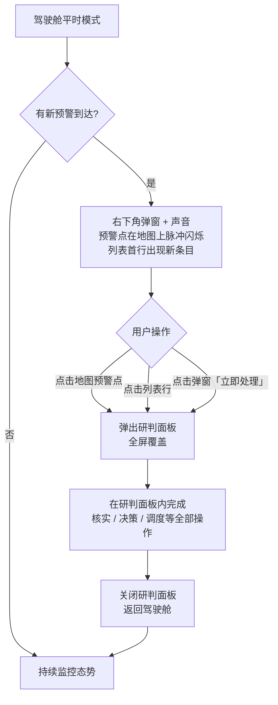
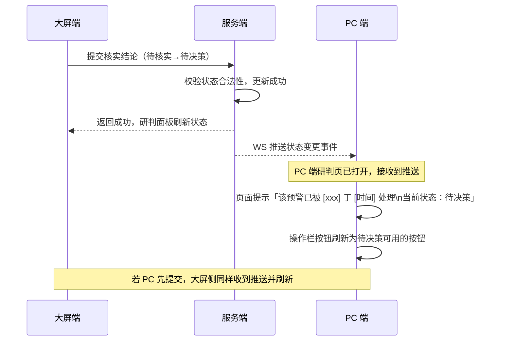

# PRD — 大屏 · 事件感知处置 · 预警部分

| 项 | 内容 |
|---|---|
| 文档版本 | V1.0 |
| 编制日期 | 2026-09-26 |
| 所属产品 | 中石油尼日尔公司上游油田项目 — 数智安防应急指挥中心（平台） |
| 所属端 | 大屏（顶栏：事件感知处置） |
| 所属模块 | 事件感知处置一体驾驶舱 · 平时模式 · 预警部分 |
| 页面架构 | 全屏驾驶舱，分区布局；预警研判面板以全屏覆盖层形式弹出 |
| 上游依据 | `PRD-预警管理-预警工作台.md`（状态机与研判组件）、`PRD-系统-消息中心.md`、`应急指挥中心 (1).xmind`、2026-09-26 设计访谈 Q43、Q47–Q50 |
| 状态 | 待评审 |

---

## 1. 文档元数据与边界

### 1.1 需求背景

大屏是指挥中心的值班员和负责人在大型显示器或拼接屏前使用的全局态势界面，需要一眼看清当前安防态势、快速响应最紧急的预警，同时能在不离开大屏界面的前提下完成核实、决策、研判等全部操作。

本文档只描述「事件感知处置一体驾驶舱」的**平时模式**，以及该模式下的**预警部分**。骨架布局中为未来的「事件区」留出占位框，其内容待事件 PRD 完成后填入，不影响当前骨架的排版。战时和演练模式留待后续版本设计。

### 1.2 与既有模块的依赖关系

| 关联模块 | 关系方向 | 具体内容 |
|---|---|---|
| 预警管理 – 预警工作台 | 本文档**引用** | 状态机、字段、操作权限点、研判组件全部定义在工作台 PRD；本文档只描述大屏端的呈现形式和差异点 |
| 预警管理 – 预警规则配置 | 本文档**依赖** | KPI 和漏斗的状态名称与工作台 PRD 的状态机保持一致 |
| 系统 – 消息中心 | 本文档**触发** | 大屏端实时弹窗复用消息中心的弹窗组件，声音提示共用同一开关状态 |
| 安防态势综合驾驶舱（首页） | 平行大屏 | 首页的「预警图标」点击跳转到本驾驶舱；本驾驶舱不重复首页的全局 KPI |

### 1.3 权限边界

| 编号 | 边界 |
|---|---|
| PB-01 | 大屏端的全部操作按钮受同一套权限点控制（见工作台 PRD 附录 A.5），无专属大屏权限 |
| PB-02 | 大屏端与 PC 端共用同一套预警数据，两端同时对同一条预警操作时，先提交的生效，后提交方收到「已被处理」提示 |
| PB-03 | 大屏端不提供规则配置入口，所有规则在 PC 端维护 |

### 1.4 本期范围（In Scope）

| 编号 | 能力 |
|---|---|
| IS-01 | 平时模式骨架布局（预警区 + 事件占位框 + 态势地图区） |
| IS-02 | 预警 KPI 看板（5 个核心指标） |
| IS-03 | 预警处置漏斗（7 个节点，含平均停留时长） |
| IS-04 | 预警列表（大屏适配版，支持滚动和展开） |
| IS-05 | 预警地图标注（预警点、紧急程度区分、点击展开研判面板） |
| IS-06 | 研判面板（以全屏覆盖层形式呈现，复用工作台研判页的逻辑和数据，大屏适配布局） |
| IS-07 | 两端同时操作的冲突处理 |

### 1.5 本期范围外（Out of Scope）

| 编号 | 内容 |
|---|---|
| OS-01 | 事件区内容（占位框，待事件 PRD 完成后填入） |
| OS-02 | 战时模式和演练模式 |
| OS-03 | 安防态势综合驾驶舱（首页）的预警图标（属于首页 PRD） |
| OS-04 | 预警规则配置页面（属于 PC 端，大屏无此入口） |
| OS-05 | 自定义布局 / 区块拖拽重排 |

---

## 2. 术语说明

本文档复用工作台 PRD 中的全部术语定义。以下术语为大屏端特有：

| 术语 | 定义 |
|---|---|
| **研判面板** | 用户在大屏点击某条预警后，以全屏覆盖层形式弹出的研判工作区，内容与 PC 端研判页一致，布局针对大屏优化 |
| **预警点** | 地图上代表一条预警位置的交互标注，以圆形脉冲动画区分紧急程度 |
| **平时模式** | 无应急事件激活时的驾驶舱默认模式，以预警处置为主要工作流 |

---

## 3. 核心流程

### 3.1 大屏日常操作主流程



### 3.2 两端同时操作的冲突处理



---

## 4. 核心功能矩阵

| 功能 | 入口 | 前置条件 | 业务结果 | 权限点 |
|---|---|---|---|---|
| 查看预警 KPI 和漏斗 | 驾驶舱主界面 | — | 实时数据展示 | `alert.view` |
| 查看预警列表 | 驾驶舱预警区 | — | 列表显示全部活跃预警 | `alert.view` |
| 查看预警地图标注 | 驾驶舱地图区 | — | 地图标注实时更新 | `alert.view` |
| 打开研判面板 | 点击列表行 / 地图预警点 / 消息弹窗 | — | 全屏覆盖层弹出 | `alert.view` |
| 在研判面板内操作预警 | 研判面板操作栏 | 各操作的前置条件与工作台 PRD 一致 | 与 PC 端操作结果相同 | 各操作对应的权限点 |
| 关闭研判面板 | 研判面板左上角「返回驾驶舱」 | — | 覆盖层关闭，返回驾驶舱 | — |
| 切换预警（在面板内） | 研判面板左侧待办队列 | — | 不保存未提交的输入（弹二次确认） | `alert.view` |

---

## 5. 页面布局与交互逻辑

### 5.1 平时模式骨架

目标分辨率：1920×1080（实际物理分辨率待确认，TBD-10）。布局使用 CSS Grid，比例为固定值而非百分比拉伸，以保证在不同尺寸拼接屏上内容密度不变。

```
┌─────────────────────────────────────────────────────────────────────────────┐
│ 顶栏：[安防态势] [实时监控] [事件感知处置●] [应急指挥] [业务应用] [系统]  [声音🔔] [用户] │
├─────────────────────────────────────────────────────────────────────────────┤
│                        │                                  │                 │
│   预警区               │         态势地图                  │  事件区         │
│   （左侧，宽 360px）   │   （中央，flex 自适应剩余宽度）    │  （右侧 360px） │
│                        │                                  │                 │
│   5.2 KPI 看板         │   - 预警点（脉冲动画）            │  ⚠️ 事件模块    │
│   5.3 处置漏斗         │   - 营地边界                      │  建设中         │
│   5.4 预警列表         │   - 围栏和危险区                  │                 │
│                        │   - 图层：反无目标（可关闭）       │  事件 PRD       │
│                        │   - 图层：车辆（可关闭）          │  完成后填入     │
│                        │                                  │                 │
│                        │                                  │                 │
└─────────────────────────────────────────────────────────────────────────────┘
```

**区块尺寸约束：**
- 左右侧边栏宽度固定 360px，内容区域垂直全屏（高度 = 窗口高度 − 顶栏 48px）
- 中央地图区域自适应剩余宽度，永远填满
- 顶栏 48px 高，字号 14px，不随分辨率缩放
- 所有区块禁止出现横向滚动条

### 5.2 预警 KPI 看板

位于左侧预警区顶部，5 个指标卡垂直排列（或 2+3 两行排列，视实际文字宽度而定）：

| 指标 | 数值来源 | 含义 |
|---|---|---|
| 待处理 | `待核实数 + 待决策数 + 复核到期数` | 当前需要人工处理的预警总数，红色背景（>0 时） |
| 持续跟踪中 | `status = tracking` | 正在观察但未处置的风险数 |
| 今日新增 | `created_at 在今日 0 点之后` | 今天产生了多少预警 |
| 今日误报 | `status = false_alarm AND created_at 今日` | 今日误报数，辅助判断设备噪声 |

数值每 5 秒通过 WS 增量更新，不整页刷新。

### 5.3 预警处置漏斗

位于 KPI 看板下方，垂直漏斗图（竖排），显示当前存量和流转效率：

```
待核实        [   8  ]  ← 当前存量
  ↓ 平均停留 3.2 分钟
待决策        [   3  ]
  ↓ 平均停留 8.7 分钟
持续跟踪中    [   1  ]  ← 中间态（可向下两路出口）

已解除  [12]  已升级  [4]  误报关闭  [23]  已合并  [6]   ← 今日终态数
```

**数值说明：**
- 上方三行（待核实 / 待决策 / 持续跟踪中）：**当前存量**（实时）
- 下方四列（已解除 / 已升级 / 误报关闭 / 已合并）：**今日进入终态的数量**（滚动计数）
- 平均停留时长：过去 24 小时内从该状态流出的预警的中位停留时长
- 今日 0 点重置终态计数，存量数不重置

### 5.4 预警列表

位于漏斗下方，垂直列表滚动，占据左侧剩余高度。

**列表 Tab（简化版，适配大屏窄列宽）：**

```
[待处理 (11)] [持续跟踪 (1)] [今日已结束]
```

**列字段（大屏适配，去掉 PC 端的部分次要列）：**

```
┌────┬───────────────────────────┬──────┬───────────┐
│    │ YJ-001 · 反无 · 3分钟前   │      │           │
├────┼───────────────────────────┼──────┼───────────┤
│ 🔴 │ Jaouro·无人机威胁         │剩5分 │  [研判]   │
│    │ YJ-003 · C类无人机 · 刚刚 │      │           │
├────┼───────────────────────────┼──────┼───────────┤
│ ⚪ │ Koulele·设备告警          │剩22分│  [研判]   │
│    │ YJ-002 · 高点 · 18分钟前  │      │           │
└────┴───────────────────────────┴──────┴───────────┘
```

**每行两行文字设计：**
- 第二行：预警编号 + 来源 + 生成时间（相对时间，如「3 分钟前」）

**交互规则：**
- 超时行：行背景加深，时限列红色文字
- 紧急且超时：左侧竖条颜色更深（区别于只超时）
- 点击行任意位置（包括「研判」按钮）：打开研判面板
- 列表最多显示 50 条，超出时底部显示「还有 xx 条，请筛选缩小范围」
- 列表自动刷新：新条目以动画插入顶部（向下推动已有条目），终态条目以淡出动画移除

### 5.5 态势地图

中央区域，默认显示所有营地的鸟瞰视角，自动缩放以包含全部营地。

**预警点标注规则：**

| 属性 | 规则 |
|---|---|
| 图标形状 | 圆形，直径 24px（地图缩放级别变化时保持固定屏幕尺寸） |
| 颜色 | 紧急：红色；一般：橙色 |
| 动画 | 外圈脉冲扩散（每 2 秒一次），持续到预警进入终态 |
| 已进入研判面板的预警点 | 脉冲停止，改为实心高亮，表示「有人正在处理」 |
| 终态预警点 | 移出地图标注（不做历史点留存，历史预警在研判页的「历史同区域预警」图层中查看） |
| 「待定位」预警 | 不出现在地图上，只出现在列表中 |
| 点击 | 打开研判面板 |

**地图常驻图层（不可关闭）：**
- 营地边界（GIS 数据）
- 围界线和禁入区

**地图可关闭图层（右上角图层切换面板）：**
- 反无实时目标（默认开启，含白名单/疑似己方标注）
- 我方无人机实时位置（默认开启）
- 在线车辆（默认关闭）

这些图层是全局常驻层，不是某一条预警专属的研判图层。研判图层只在研判面板打开时存在。

### 5.6 研判面板（大屏覆盖层）

用户点击预警点或列表行后，研判面板以全屏覆盖层形式出现，覆盖整个驾驶舱。

**布局（针对大屏优化，与 PC 端有差异）：**

```
┌─────────────────────────────────────────────────────────────────────────────┐
├──────────────┬────────────────────────────────────────────┬─────────────────┤
│ 待办队列      │                                            │                 │
│ （可折叠，   │            地图（扩大版）                   │  右侧 Tab 区    │
│  宽 280px）  │            + 图层控制                       │  （宽 420px）   │
│              │                                            │                 │
│  [YJ-001] 🔴 │                                            │ 概要│证据│
│  [YJ-003] 🔴 │                                            │                 │
│  [YJ-002] ⚪ │                                            │  [Tab 内容]     │
│              │                                            │                 │
├──────────────┼────────────────────────────────────────────┤                 │
│              │  视频多屏区（可折叠，4 路，高约 200px）     │                 │
└──────────────┴────────────────────────────────────────────┴─────────────────┤
│ 操作栏（固定底部，高 64px，按钮比 PC 端更大，最小 48px 高，手指可触达）       │
│  [标记误报]  [并入其他预警]  [下发核实任务]  [PC补录]  [调度无人机]  [提交核实结论 →] │
└─────────────────────────────────────────────────────────────────────────────┘
```

**与 PC 端研判页的差异点：**

| 属性 | PC 端研判页 | 大屏研判面板 |
|---|---|---|
| 进入方式 | 列表行点击，在新页面打开 | 覆盖层，驾驶舱保持在底层 |
| 退出方式 | 「← 返回列表」 | 「← 返回驾驶舱」 |
| 地图尺寸 | 中间列宽度的地图 | 覆盖层中央，更大 |
| 操作按钮高度 | 32px（PC 默认） | ≥ 48px（适配触屏和指点棒操作） |
| 右侧 Tab 宽度 | 400px | 420px（大屏宽松） |
| 待办队列 | 左侧 | 左侧，默认展开（大屏有足够宽度） |
| 业务逻辑 | 完全相同 | 完全相同 |

**逻辑复用声明：** 研判面板与工作台研判页**共用同一套 Vue 组件**，区别只在于：
1. 外层容器从路由页面换成全屏覆盖层（Dialog 或 Teleport 到 body）
2. 返回按钮文案变为「返回驾驶舱」
3. 操作按钮最小高度提升到 48px
4. 地图默认高度由组件外部容器控制（覆盖层中更高）

**没有为大屏额外实现任何操作或业务逻辑**，确保两端行为完全一致。

### 5.7 实时弹窗与声音（大屏端）

大屏端复用消息中心的弹窗组件，行为与消息中心 PRD 的 5.3 节一致：
- 弹窗出现在右下角
- 紧急消息须手动关闭，点击「立即处理」打开研判面板后弹窗关闭
- 一般消息 3 秒后自动关闭
- 声音开关在顶栏右侧，与 PC 端共享激活状态

**大屏端特有规则：** 大屏长期无人交互时（例如自动播放模式），浏览器可能降低页面活跃度导致声音无法播放。建议在部署时将大屏设为「不休眠」模式并保持窗口最大化。

---

## 6. 边界情况与异常处理

### 6.1 空状态

| 场景 | 展示方式 |
|---|---|
| 无活跃预警 | 地图无预警点，列表显示「当前无待处理预警，系统运行正常」，KPI 全部显示 0 |
| 事件区占位框 | 显示「事件模块建设中」+ 简短说明文字，灰色低调样式，不影响预警区视觉重心 |

### 6.2 网络异常

| 场景 | 处理方式 |
|---|---|
| WS 断线 | 顶栏右侧显示橙色「数据连接中断」提示；地图和列表保持最后一次数据，标注数据时间「最后更新于 xx:xx」 |
| 断线超过 60 秒 | 提示升级为红色「数据连接已中断 [xx] 秒，请检查网络」，直到重连成功 |
| 重连成功 | 全量拉取当前状态覆盖本地缓存，提示消失 |

### 6.3 两端操作冲突

研判面板内有未提交的输入（已填写核实说明但未点击提交）时，收到 WS 推送该预警已被另一端处理：
- 研判面板顶部显示橙色横幅：「该预警已被 [xxx] 于 [xx:xx] 处理，状态已更新为 [xx]」
- 操作栏按钮刷新为新状态可用的按钮
- **已输入的核实说明等文字不清空**，由用户决定是否继续使用（例如负责人刚解除了，值班员输入的核实说明仍然可以作为 PC 补录保存）

### 6.4 极端数据量

| 场景 | 处理方式 |
|---|---|
| 预警点密集（同一营地 10+ 个预警） | 地图聚合标注，圆圈内显示数量；点击聚合点展开查看列表，从列表中选择某条进入研判面板 |
| 列表超过 50 条 | 底部提示，建议切换到 PC 端工作台处理 |

---

## 附录 A：与 xmind 原始需求的差异说明

以下差异来自 2026-09-26 设计访谈中已确认的状态机更新，此处单独记录以方便大屏侧开发对照。

| xmind 原始内容（平时模式·驾驶舱） | 本 PRD 做法 | 原因 |
|---|---|---|
| KPI：待核实 / **待发布** / 持续跟踪 | KPI：待核实 / 待决策 / 持续跟踪中 | 「待发布」状态已删除，见工作台 PRD 附录 D |
| 漏斗：待核实 → **待发布** → 持续跟踪 → 已解除 → 升级事件 → **已归档** | 漏斗：待核实 → 待决策 → 持续跟踪中；终态：已解除 / 已升级 / 误报关闭 / 已合并 | 「待发布」和「已归档」均已删除 |

---

## 附录 B：待确认事项

| 编号 | 事项 | 当前处理方式 |
|---|---|---|
| TBD-10 | 大屏物理分辨率（1920×1080 / 4K / 拼接屏总分辨率） | 按 1920×1080 设计，适配到其他分辨率时只调整整体缩放比 |
| TBD-BIG-01 | 大屏操作方式（鼠标 / 触屏 / 指点棒 / 遥控器） | 已按触屏标准设计（48px 最小点击区）；遥控器的键盘导航焦点环未额外设计，如需确认 |
| TBD-BIG-02 | 大屏是否有专属登录账号（与 PC 端相同账号，还是独立「大屏值班账号」） | 暂按「同账号多端登录」设计；如有独立账号，通知接收人配置需要额外覆盖大屏账号 |
| TBD-BIG-03 | 顶栏导航项在大屏端是否与 PC 端完全一致（是否需要隐藏部分配置入口） | 暂按完全一致处理，如有差异待确认后更新 |
