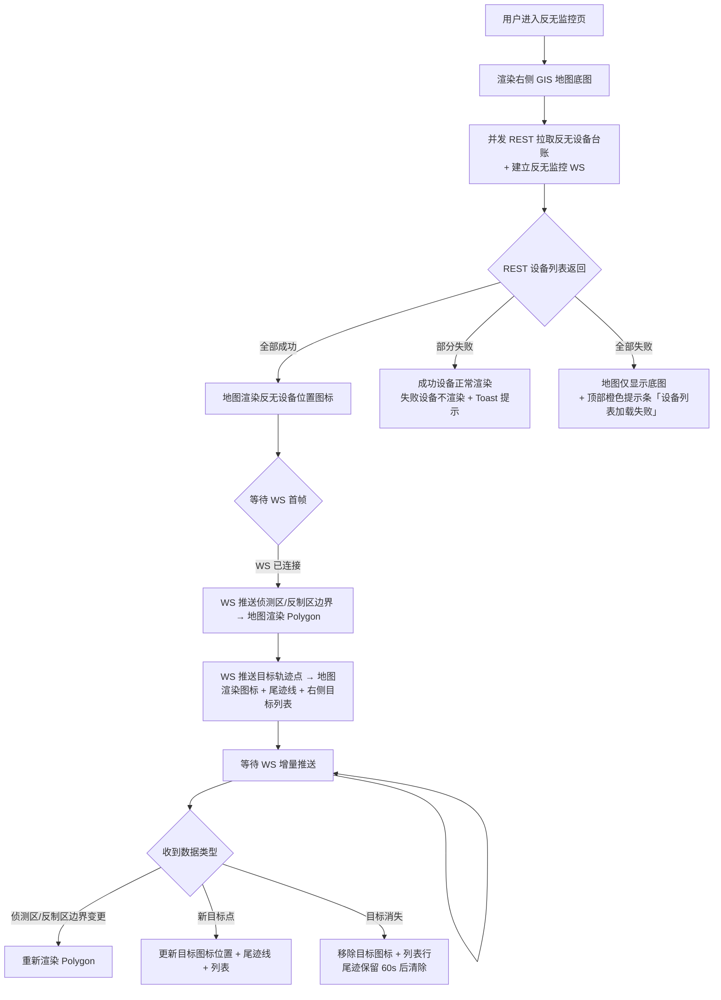
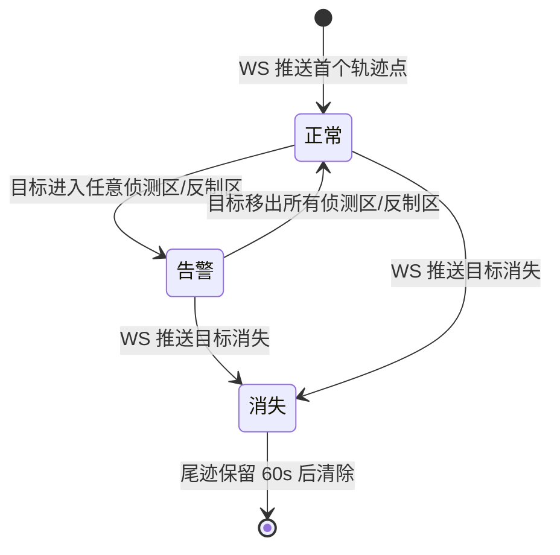

# PRD — 实时监控中心（PC端）· 反无监控

| 项 | 内容 |
|---|---|
| 文档版本 | V1.0 |
| 编制日期 | 2026-08-16 |
| 所属产品 | 中石油尼日尔公司上游油田项目 — 数智安防应急指挥中心（平台） |
| 所属端 | PC后台 |
| 所属模块 | 业务应用 → 实时监控中心 → 反无监控 |
| 页面路由 | `monitor/anti-uav` → `AntiUavMonitor` |
| 上游依据 | `实时监控中心-设计交接文档.md`（2026-08-15 grilling 19轮决策结果） |
| 状态 | 待评审 |

---

## 1. 文档元数据与边界

### 1.1 需求背景

实时监控中心（PC端）「反无监控」子模块目标：**在 GIS 地图上实时呈现反无设备部署布局（侦测区/反制区）以及当前探测到的无人机目标轨迹**，值班员借此判断是否有未经授权的无人机入侵防护区域。

与无人机监控模块（关注"我们自己有多少无人机在飞"）不同，反无监控关注的是**"有没有敌方的/未知的无人机靠近"**——目标是被探测对象，不是平台自有的设备。

数据来源特殊性（[[project-background-overseas-oilfield-security]]）：

| 数据 | 来源 | 说明 |
|---|---|---|
| 侦测区边界坐标 | 三方反无系统 | 独立 WebSocket 接口推送 |
| 反制区边界坐标 | 三方反无系统 | 独立 WebSocket 接口推送 |
| 实时目标轨迹点 | 三方反无系统 | 独立 WebSocket 接口推送 |
| 反无设备基础信息 | 反无设备台账 + 平台扩展信息 | 已有 `AntiUavList.vue`，本页只读引用 |

> **关键链路说明**：反无监控的 WS 与反无设备台账（ACCESS）的 WS 是**两条独立的数据流**。台账 WS 推送「设备的接入状态」；反无监控 WS 推送「侦测区/反制区/实时目标轨迹」。两者互不替代（文档 5.2 节）。

### 1.2 核心指标

| 指标 | 定义 | 目标值 |
|---|---|---|
| 地图首屏加载时长 | 进入页面到地图底图 + 侦测区/反制区 Polygon 渲染完成 | ≤ 3 秒（P95） |
| 目标位置更新延迟 | WS 推送轨迹点到地图目标图标移动 | ≤ 500ms |
| 目标轨迹点采样频率 | 三方系统目标位置上报频率 | 1 次/秒（由三方系统控制，前端被动接收） |
| 目标发现到展示延迟 | 三方系统推送新目标到右侧目标列表出现 | ≤ 2 秒 |

### 1.3 与既有模块的集成关系

| 关联模块 | 关系方向 | 具体依赖 |
|---|---|---|
| 装备管理 → 反无设备管理 | 本模块**依赖** | 反无设备列表（SN、位置、类型）+ 平台扩展信息（GIS 坐标、是否大屏展示） |
| 系统管理 → 角色权限 | 本模块**依赖** | 菜单级访问权限点 + 营地维度的细粒度权限 |
| 无人机监控模块 | 本模块**独立** | 两个模块独立订阅 WS；反无探测目标是"外来无人机"，与平台自有无人机无关联 |

### 1.4 权限边界（两层）

| 层级 | 控制维度 | 实现方式 |
|---|---|---|
| 第1层 | 能否访问「反无监控」子菜单 | 系统管理 → 角色管理 菜单级权限点 |
| 第2层 | 能看哪些营地的反无设备与目标 | 用户所属营地自动过滤（推荐方案，TBD-05） |

**本页面无任何写操作入口。** 所有地图图层、目标轨迹均为三方系统推送的只读数据，平台不可编辑、不可删除。

### 1.5 本期范围（In Scope）

| 编号 | 能力 |
|---|---|
| IS-01 | GIS 地图主体：反无设备位置图标 + 侦测区（扇形/圆形）/反制区（圆形）Polygon 渲染 |
| IS-02 | 实时目标轨迹：WS 推送目标点在地图上实时绘制图标 + 轨迹线 |
| IS-03 | 右侧目标列表：当前探测到的所有目标（编号/速度/方向/发现时间），点击目标地图定位 |
| IS-04 | 图层控制面板：侦测区 / 反制区 / 实时目标 三个图层独立显隐开关 |
| IS-05 | 目标尾迹线：每个目标保留最近 N 个轨迹点连成的尾迹线（可设开关） |
| IS-06 | 警戒联动：目标进入任何侦测区/反制区时，目标图标高亮 + 列表目标行标红 + 弹 Toast 告警 |
| IS-07 | 目标历史：目标消失（丢失/飞出范围）后从列表移除，轨迹保留 60s 后清除 |

### 1.6 本期不做（Out of Scope）

| 编号 | 不做项 | 原因 |
|---|---|---|
| OS-01 | 反制操作（干扰/拦截下发） | 平台无写回权限，归属三方反无系统自身控制 |
| OS-02 | 目标详情/身份识别 | 三方系统未提供该字段，预留接口占位 |
| OS-03 | 历史轨迹回放 | 需接入单独历史数据接口，本期只做实时监控 |
| OS-04 | 反无设备台账新增/编辑 | 归属装备管理 → 反无设备管理模块 |
| OS-05 | 告警推送至大屏/事件感知处置 | 跨端联动，与事件管理模块一起规划（TBD-04 延伸） |

---

## 2. 业务概念与术语

| 术语 | 精确定义 |
|---|---|
| **反无设备** | 部署在营地的反无人机系统，本平台已通过台账管理，含平台扩展信息（GIS 坐标） |
| **侦测区** | 反无设备能够探测无人机的区域范围，可为扇形或圆形（由三方系统定义边界坐标），用于展示探测覆盖范围 |
| **反制区** | 反无设备能够实施反制的区域范围，圆形为主，用于展示可处置范围 |
| **探测目标** | 三方反无系统探测到的无人机，由 WS 推送，含编号/速度/方向/位置/发现时间，本平台不自建目标源 |
| **目标轨迹点** | 单个目标的实时位置点，含时间戳；连续点连线形成尾迹线 |
| **尾迹线** | 地图上连接某个目标最近 N 个轨迹点的折线（Polyline），展示目标运动路径 |
| **目标列表** | 页面右侧当前探测到的全部目标清单，按发现时间倒序排列 |
| **告警目标** | 位置进入任一侦测区/反制区的目标，地图图标高亮 + 列表标红 + Toast 告警 |
| **目标消失** | 目标停止上报（离开探测范围 / 丢点 / 被排除），从列表移除，尾迹保留 60s |
| **图层控制面板** | 地图右上角悬浮控件，侦测区/反制区/实时目标三图层独立显隐开关 |
| **Polygon** | 地图上的多边形覆盖物，用于绘制侦测区/反制区边界 |

---

## 3. 核心流程与状态机

### 3.1 页面加载主流程



### 3.2 目标生命周期状态机



### 3.3 WS 断线处理

遵循全平台通用 WS 协议（[[websocket-device-status-protocol]]）：
1. 页面建立反无监控 WS 长连接（与反无设备台账 WS 独立）；
2. WS 增量推送侦测区/反制区边界 + 实时目标轨迹点；
3. **WS 断线时保留最后已知的侦测区/反制区 Polygon 和最后一批目标位置**，顶部显示黄色提示条「反无数据同步中断」；
4. WS 重连成功后**从最后已知位置重新全量覆盖**，目标列表与地图整体刷新，不再做增量合并（避免脏数据残留）；
5. 断线期间目标列表冻结，不产生新目标，也不移除（状态不可信）。

---

## 4. 核心功能矩阵

| 动作名称 | 触发位置 | 前置条件 | 业务结果 |
|---|---|---|---|
| 进入反无监控 | 侧栏菜单「实时监控中心 → 反无监控」 | 用户具备该菜单权限 | 加载 GIS 地图底图 + 反无设备图标，建立 WS 长连接 |
| 点击反无设备图标 | GIS 地图上反无设备 Marker | 无 | 弹出地图 Tooltip 显示设备名 + 接入状态；不触发右侧面板滑入 |
| 点击目标图标 | GIS 地图上探测目标 Marker | 无 | 地图定位到该目标 zoom=16 + 右侧目标列表高亮对应行 |
| 点击目标列表行 | 右侧目标列表某一行 | 目标存在 | 地图定位到该目标 zoom=16 |
| 关闭某目标 | 目标列表行尾「×」按钮 | 无 | 该目标从列表移除 + 地图图标移除 + 尾迹清除（人工忽略） |
| 开关侦测区图层 | 图层控制面板「侦测区」开关 | 无 | 地图上所有侦测区 Polygon 显示/隐藏；不影响其他图层 |
| 开关反制区图层 | 图层控制面板「反制区」开关 | 无 | 地图上所有反制区 Polygon 显示/隐藏；不影响其他图层 |
| 开关实时目标图层 | 图层控制面板「实时目标」开关 | 无 | 地图上所有目标图标 + 尾迹线显示/隐藏；不影响列表 |
| 开关尾迹线 | 图层控制面板「目标尾迹」开关 | 实时目标图层开启 | 地图上所有目标尾迹线显示/隐藏；不影响目标图标 |
| WS 推送新目标 | 系统自动（WS） | 新目标首个轨迹点到达 | 地图新增目标图标 + 右侧列表新增一行（发现时间倒序插入） |
| WS 推送目标轨迹点 | 系统自动（WS，1次/秒） | 目标存在 | 目标图标平滑移动到新位置 + 尾迹线添加新点 + 列表速度/方向更新 |
| 目标进入侦测区 | 系统自动（WS） | 目标位置进入任一侦测区 Polygon | 目标图标红色高亮 + 列表行背景变红 + 弹 Toast「目标 XX 进入侦测区」 |
| 目标进入反制区 | 系统自动（WS） | 目标位置进入任一反制区 Polygon | 目标图标红色高亮 + 列表行背景变红 + 弹 Toast「目标 XX 进入反制区」（告警升级） |
| 目标移出侦测区/反制区 | 系统自动（WS） | 目标位置移出所有 Polygon | 目标图标恢复正常色 + 列表行恢复正常 + 无额外提示 |
| WS 推送目标消失 | 系统自动（WS） | 目标停止上报 | 目标从列表移除 + 地图图标移除；尾迹保留 60s 后自动清除；若目标正处于告警态，弹「目标 XX 已消失」Toast |
| 人工忽略目标 | 目标列表行尾「×」按钮 | 无 | 目标移除，无尾迹保留；列表行不再出现该目标 |
| WS 断线 | 系统自动 | WS 连接中断 | 顶部黄色提示条「反无数据同步中断」；地图保留最后已知 Polygon + 目标位置；列表冻结；每 5s 重连一次 |
| WS 重连成功 | 系统自动 | WS 断开后重连 | 重拉全量覆盖 Polygon + 目标 + 列表，提示条消失，Toast「反无数据同步已恢复」2s |
| 离开页面清理 | 切换菜单 / 路由跳转 | 无 | 关闭 WS、清除所有定时器、销毁地图实例 |

---

## 5. 页面布局与交互逻辑

### 5.1 页面骨架（ASCII）

```
┌──────────────────────────────────────────────────────────────────────────────┐
│ PageContainer · 反无监控                                                       │
│ ┌──────────────────────────────────────────────────────────────────────────┐ │
│ │ PanelCard（no-padding）                                                   │ │
│ │ ┌─────────────────────────────────────────────────────┬──────────────┐  │ │
│ │ │  GIS 地图                    ┌─ 图层控制 ─┐        │  右侧目标列表  │  │ │
│ │ │                              │ ☑ 侦测区    │        │  目标数：3     │  │ │
│ │ │        ┌─────┐               │ ☑ 反制区    │        │ ┌──────────┐ │  │ │
│ │ │       / 侦测区\              │ ☑ 实时目标  │        │ │ ✈ 编号T-01│ │  │ │
│ │ │      /        \              │ ☑ 目标尾迹  │        │ │ 速度 15m/s │ │  │ │
│ │ │     (  反制区   )            └────────────┘        │ │ 方向 NE    │ │  │ │
│ │ │      \        /                                      │ │ 发现 14:32 │ │  │ │
│ │ │       \─────/                                       │ └──────────┘ │  │ │
│ │ │         ⚡反无设备                                    │ ┌──────────┐ │  │ │
│ │ │                  ● 目标T-01 ──尾迹线──                │ │ ✈ 编号T-02│ │  │ │
│ │ │                                                    │ │ 速度 22m/s │ │  │ │
│ │ │         ┌─────┐                                    │ │ 方向 SW    │ │  │ │
│ │ │        / 侦测区\                                   │ │ 发现 14:35 │ │  │ │
│ │ │       (        )                                  │ └──────────┘ │  │ │
│ │ │        \─────/                                    │              │  │ │
│ │ └─────────────────────────────────────────────────────┴──────────────┘  │ │
│ └──────────────────────────────────────────────────────────────────────────┘ │
└──────────────────────────────────────────────────────────────────────────────┘
```

**布局约定：**
- 右侧 GIS 地图：`flex: 1`，填满剩余宽度
- 右侧目标列表宽度：320px，固定，不可拖拽
- 图层控制面板：地图右上角悬浮
- PanelCard 禁用默认内边距（`no-padding` 模式）
- 页面内容区高度撑满视口（`height: calc(100vh - 顶栏高度 - 面包屑高度)`）

### 5.2 GIS 地图规格

**地图引擎：**

| 配置项 | 值 |
|---|---|
| SDK | 高德地图 JS API v2.0（TBD-08，与无人机监控模块共用一个 SDK 实例） |
| 初始中心点 | 第一台在线反无设备的位置；若无在线设备则默认 Agadem 营地中心（TBD-09） |
| 初始缩放级别 | zoom = 13（可同时看到多个营地侦测区） |
| 最小缩放 | zoom = 8 |
| 最大缩放 | zoom = 18 |
| 地图主题 | 深色主题（与平台整体 UI 一致） |

**反无设备图标规格：**

| 属性 | 值 |
|---|---|
| 图标 | 闪电 ⚡ 图标（实心） |
| 颜色 | 绿色 `#52c41a`（接入状态 ONLINE） |
| 颜色 | 灰色 `#8c8c8c`（接入状态 OFFLINE / 同步中断） |
| 大小 | 32×32 px |
| 悬浮效果 | Tooltip「设备名 \| 接入状态」 |
| 点击效果 | 展示 Tooltip 详情，不触发右侧面板 |

**侦测区 Polygon 规格：**

| 属性 | 值 |
|---|---|
| 来源 | 三方反无系统 WS 推送的边界坐标组 |
| 形状 | 扇形（由弧线 + 两条半径组成）或圆形（TBD-12） |
| 填充色 | 蓝色 `#1677ff`，透明度 15% |
| 边框色 | 蓝色 `#1677ff`，透明度 40%，线宽 1px |
| Tooltip | Polygon 中心悬浮显示「侦测区 - 设备名」 |
| 点击 | 无交互（仅可视化展示） |

**反制区 Polygon 规格：**

| 属性 | 值 |
|---|---|
| 来源 | 三方反无系统 WS 推送的边界坐标组 |
| 形状 | 圆形（以设备为圆心、反制半径） |
| 填充色 | 橙色 `#fa8c16`，透明度 15% |
| 边框色 | 橙色 `#fa8c16`，透明度 50%，线宽 1px |
| Tooltip | Polygon 中心悬浮显示「反制区 - 设备名」 |
| 点击 | 无交互 |

> Polygon 叠加绘制：当侦测区与反制区重叠时，反制区图层默认渲染在侦测区之上，保证两者独立可见。

**目标图标规格：**

| 属性 | 值 |
|---|---|
| 图标 | 无人机图标（实心） |
| 正常色 | 黄色 `#faad14` |
| 告警色 | 红色 `#ff4d4d` + 呼吸闪烁动画（1s 周期） |
| 大小 | 24×24 px |
| 悬浮效果 | Tooltip「目标编号 \| 速度 \| 方向」 |
| 点击效果 | 地图定位 zoom=16 + 右侧列表高亮对应行 |

**目标尾迹线规格：**

| 属性 | 值 |
|---|---|
| 触发条件 | 目标有 ≥2 个轨迹点 |
| 线条颜色 | 正常：黄色 `#faad14`（50% 透明）；告警：红色 `#ff4d4d`（50% 透明） |
| 线条宽度 | 1.5px |
| 点位数量 | 保留每个目标最近 50 个轨迹点（队列），超出移除最老点 |
| 清除时机 | 目标消失后 60s / 目标被人工忽略后立即 |

**图层控制面板：**

| 规格 | 说明 |
|---|---|
| 位置 | 地图右上角，距顶部 16px、距右侧 16px |
| 默认状态 | 折叠，仅显示图层图标按钮（☰） |
| 展开方式 | 点击图层图标，向下展开面板；再次点击或点击空白处收起 |
| 面板内容 | 4 行开关：「侦测区」「反制区」「实时目标」「目标尾迹」，默认全部勾选 |
| 交互规则 | 「目标尾迹」开关仅在「实时目标」开启时有效；非飞行中关闭「实时目标」时「目标尾迹」自动置灰禁用 |

### 5.3 右侧目标列表规格

**列表结构：**

| 规格 | 说明 |
|---|---|
| 宽度 | 320px，固定 |
| 标题栏 | 「目标列表」+ 徽标（当前目标总数）|
| 排序 | 默认按发现时间倒序（最新在上）|
| 滚动 | 超过可视高度时滚动条；目标数量上限 100 行（超出丢弃最早，前端不做分页） |
| 状态 | 分「正常」「告警」「已消失（保留 60s）」三种行状态（见下） |

**每行卡片内容：**

| 字段 | 说明 | 对齐 |
|---|---|---|
| 目标编号 | 三方系统推送的目标 ID，如 `T-01` | 左对齐，粗体 |
| 速度 | `speed`，单位 m/s | 右对齐 |
| 方向 | `direction`，如 NE / SW（十六方位），或角度 0-360°（TBD-13）| 右对齐 |
| 发现时间 | `firstSeenTime`，格式 HH:mm:ss | 右对齐 |

**告警行为列表：**

| 场景 | 行状态 | 背景色 | 右侧按钮 |
|---|---|---|---|
| 目标正常 | 正常 | 透明 | ×（忽略） |
| 目标在侦测区/反制区 | 告警 | 红色描边 + 浅红底 | ×（忽略） |
| 目标消失（保留 60s） | 已消失 | 灰色 + 透明度 0.6 | ×（移除尾迹） |

### 5.4 告警与 Toast 规格

| 场景 | Toast 文案 | 展示时长 | Toast 级别 |
|---|---|---|---|
| 目标进入侦测区 | 「⚠ 目标 {编号} 进入 {设备名} 侦测区」| 5s | warning |
| 目标进入反制区 | 「⚠ 目标 {编号} 进入 {设备名} 反制区」| 5s | error |
| 告警目标消失 | 「目标 {编号} 已消失」| 3s | info |
| WS 断线 | 页面顶部橙色提示条（常驻，非 Toast）| 直到重连成功 | — |
| WS 重连成功 | 「反无数据同步已恢复」| 2s | success |

**告警抑制规则：**
- 同一目标重复进出同一 Polygon 在 60s 内只弹 1 次 Toast（防刷屏）；
- 同一目标同时在多 Polygon 时只弹最高级别（反制区 > 侦测区）一次。

---

## 6. 边界情况与异常处理

### 6.1 空状态

| 场景 | 处理 |
|---|---|
| 反无设备列表为空 | 地图显示空状态提示「暂无可监控反无设备」|
| 无任何侦测区/反制区 Polygon（WS 未推送或三方未配置） | 地图只显示底图 + 反无设备图标；列表空态「暂无探测目标」|
| 无任何目标 | 目标列表显示「暂无探测目标，等待三方反无系统推送」|
| 目标数量超出 100 行 | 丢弃最早目标（前端硬上限，不展示分页或翻页）|

### 6.2 数据同步异常

| 场景 | 处理 |
|---|---|
| WS 断线 | 保留最后已知 Polygon + 目标位置；顶部橙色提示条「反无数据同步中断」；列表冻结；每 5s 重连一次 |
| WS 断线超过 60s | 提示条底色升级为红色，文案改为「与反无系统连接中断，实时数据不可信，更新于 YYYY-MM-DD HH:mm:ss」|
| WS 重连成功 | 重拉全量覆盖 Polygon + 目标 + 列表，提示条消失，Toast「反无数据同步已恢复」2s |
| 反无设备台账 REST 失败 | 地图无法落反无设备图标，但 Polygon/目标仍可渲染（若 WS 正常）；顶部 Toast「反无设备列表加载失败」|

### 6.3 目标数据异常

| 场景 | 处理 |
|---|---|
| 目标位置坐标奇形（超出地图范围 / 空坐标） | 该轨迹点丢弃，不渲染图标；控制台记录 warn 日志；不阻塞其他目标 |
| 目标轨迹点时间戳异常（早于上一帧） | 该点丢弃，不加入尾迹线；控制台记录 warn 日志 |
| 目标编号重复（同一 ID 两次推送） | 视为同一目标，合并更新，不重复建行 |
| WS 推送目标消失但目标从未出现过 | 忽略，不弹 Toast（防止脏数据误报）|

### 6.4 告警边界

| 场景 | 处理 |
|---|---|
| 目标恰好在 Polygon 边界上 | 按「在区内」处理（含边界），触发告警 |
| 同一目标 60s 内反复进出同一 Polygon | 抑制重复 Toast，仅首次弹出 |
| 目标进入多 Polygon | 仅弹最高级别一次（反制区 > 侦测区）|

---

## 7. 附录 A：字段与接口对照

| 页面用途 | 字段 key | 数据接口 | 说明 |
|---|---|---|---|
| 反无设备位置 | `lat`, `lng` | 装备管理扩展信息（平台侧）| 反无设备台账 GIS 坐标 |
| 反无设备接入状态 | `accessStatus` | 反无设备台账 WS | `'ONLINE' \| 'OFFLINE'` |
| 侦测区边界坐标 | `detectPolygon` | 反无监控 WS（独立链路）| 多边形坐标组，扇形/圆形（TBD-02）|
| 反制区边界坐标 | `suppressPolygon` | 反无监控 WS（独立链路）| 多边形坐标组（TBD-02）|
| 目标编号 | `targetId` | 反无监控 WS | 三方系统分配的唯一 ID |
| 目标位置 | `lat`, `lng` | 反无监控 WS | 秒钟级坐标 |
| 目标速度 | `speed` | 反无监控 WS | m/s |
| 目标方向 | `direction` | 反无监控 WS | 十六方位或角度（TBD-13）|
| 目标发现时间 | `firstSeenTime` | 反无监控 WS | 首次探测时间戳（TBD-02 结构待确认）|
| 目标消失标记 | `isGone` | 反无监控 WS | 目标停止上报标记（TBD-02 结构待确认）|

---

## 8. 附录 B：待确认事项（TBD）

| 编号 | 事项 | 当前假设 | 影响面 |
|---|---|---|---|
| TBD-02 | 反无监控 WS 接口字段结构 | 三方独立 WS，推送侦测区/反制区边界坐标 + 目标轨迹点；具体字段序列化格式待三方确认 | §7 字段对照、§5.2 Polygon/目标渲染 |
| TBD-05 | 营地权限绑定方式细节 | 反无设备按用户所属营地自动过滤 | §1.4 权限边界 |
| TBD-08 | GIS 地图 SDK | 暂按高德地图 JS API v2.0，与无人机监控共用引擎 | §5.2 GIS 地图规格 |
| TBD-09 | 地图初始中心点 | 第一台在线反无设备位置；若无在线设备则默认 Agadem 营地中心 | §5.2 GIS 地图规格 |
| TBD-12 | 侦测区形状（扇形/圆形） | 三方系统推送的边界坐标组决定；若为扇形需提供圆心+半径+角度 | §5.2 侦测区 Polygon |
| TBD-13 | 目标方向字段格式 | 十六方位（NE/SW）或 0-360° 角度，待三方确认 | §5.3 目标列表 |
| TBD-14 | 目标消失判定机制 | 假设三方 WS 推送 `isGone` 标记；若三方不提供则退化为「N 个周期未上报即判定消失」（N 待定）| §3.2 目标生命周期状态机 |

> **所有其余设计决策已闭环，本 PRD 可直接进入原型开发。**

---

*文档结束。版本 V1.0，2026-08-16，待评审。*
