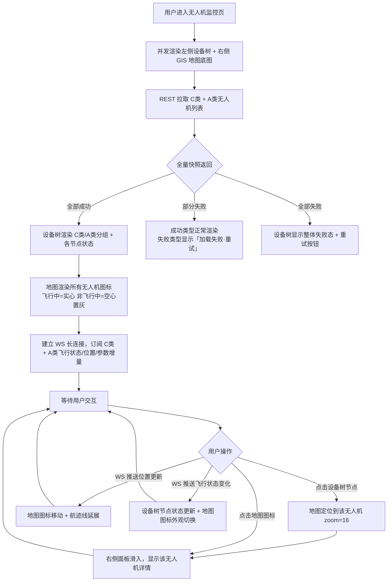
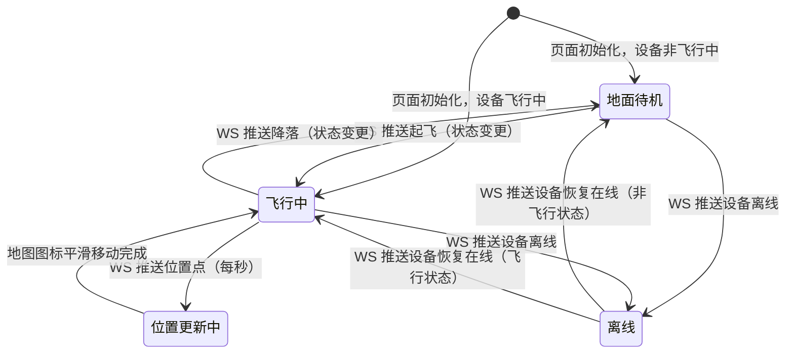
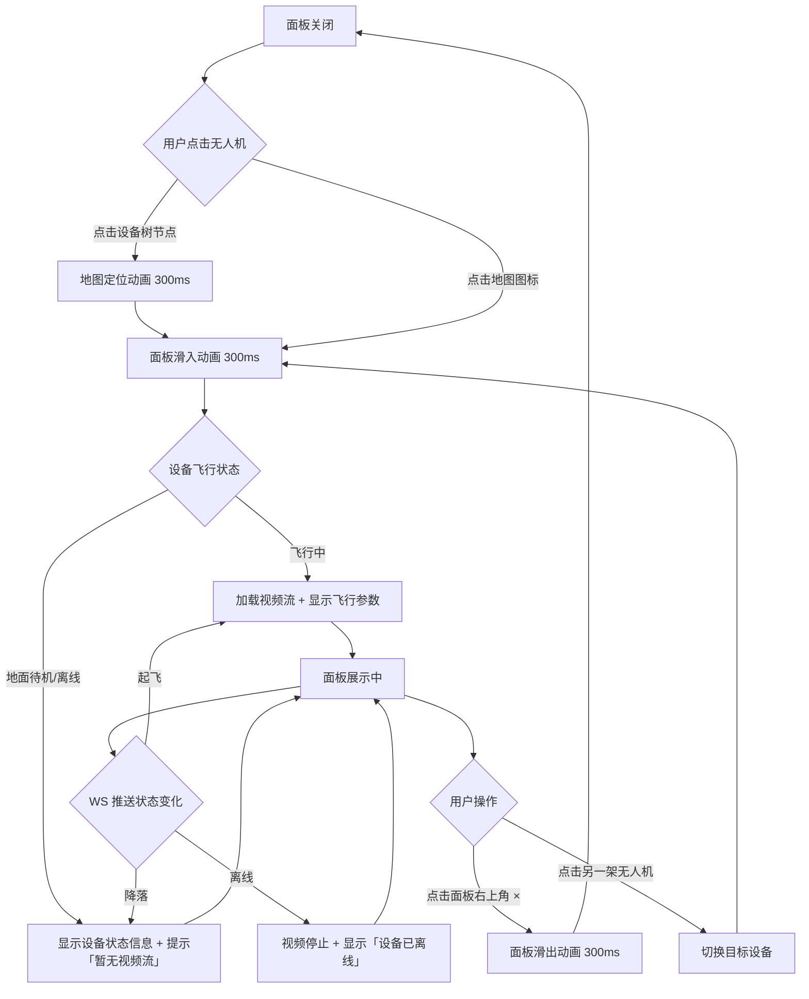

# PRD — 实时监控中心（PC端）· 无人机监控

| 项 | 内容 |
|---|---|
| 文档版本 | V1.0 |
| 编制日期 | 2026-08-16 |
| 所属产品 | 中石油尼日尔公司上游油田项目 — 数智安防应急指挥中心（平台） |
| 所属端 | PC后台 |
| 所属模块 | 业务应用 → 实时监控中心 → 无人机监控 |
| 页面路由 | `monitor/uav` → `UavMonitor` |
| 上游依据 | `实时监控中心-设计交接文档.md`（2026-08-15 grilling 19轮决策结果） |
| 状态 | 待评审 |

---

## 1. 文档元数据与边界

### 1.1 需求背景

实时监控中心（PC端）「无人机监控」子模块目标：**在 GIS 地图上实时监看所有无人机（C类 + A类）的位置、航线和视频流**。与视频监控模块的宫格多路切换不同，本页面以**地图为中心**，通过点击地图上的无人机图标展开右侧面板查看单架飞机的实时视频与飞行参数。

支持 2 类无人机：

| 设备类型 | 视频接口来源 | 地图标识 | 飞行状态来源 |
|---|---|---|---|
| C类无人机 | AIRIOT 中台 | 蓝色无人机图标 | `mode_code`（group='flying'） |
| A类无人机 | 航天中台 | 橙色无人机图标 | `flightStatus`（FLYING / NOT_FLYING） |

**核心场景：**
1. 指挥中心值班员需要在一张图上看到所有在飞无人机的分布与实时位置
2. 点击某架飞机，右侧弹出面板立即看到该飞机的实时视频 + 飞行参数（电量/高度/速度/航线）
3. 非飞行中的无人机也在地图展示（置灰），点击后右侧面板显示设备状态信息

### 1.2 核心指标

| 指标 | 定义 | 目标值 |
|---|---|---|
| 地图首屏加载时长 | 进入页面到地图底图 + 所有无人机图标渲染完成 | ≤ 3 秒（P95） |
| 位置更新延迟 | WS 推送位置变化到图标移动 | ≤ 500ms |
| 视频面板首帧延迟 | 点击飞行中无人机到右侧面板视频首帧出现 | ≤ 5 秒（P95，HLS 协议） |
| 轨迹点采样频率 | 飞行中无人机位置上报频率 | 1 次/秒（由中台控制，前端被动接收） |

### 1.3 与既有模块的集成关系

| 关联模块 | 关系方向 | 具体依赖 |
|---|---|---|
| 装备管理 → C类无人机管理 | 本模块**依赖** | C类无人机设备列表（营地、SN、接入状态、扩展信息含 GIS 坐标） |
| 装备管理 → A类无人机管理 | 本模块**依赖** | A类无人机设备列表（SN、在线状态、扩展信息含 GIS 坐标） |
| 系统管理 → 角色权限 | 本模块**依赖** | 菜单级访问权限点 + 营地维度的细粒度权限 |
| 视频监控模块 | 本模块**独立** | 两个模块独立订阅 WS，不共享视频流连接或状态 |

### 1.4 权限边界（两层）

| 层级 | 控制维度 | 实现方式 |
|---|---|---|
| 第1层 | 能否访问「无人机监控」子菜单 | 系统管理 → 角色管理 菜单级权限点 |
| 第2层 | 能看哪些营地的 C类无人机 | 用户所属营地自动过滤（推荐方案，TBD-05）；A类无人机无营地过滤（全局设备） |

**本页面无任何写操作入口。** 所有地图图层、视频流、飞行参数均为只读接收，设备主数据不可编辑。

### 1.5 本期范围（In Scope）

| 编号 | 能力 |
|---|---|
| IS-01 | 左侧设备树：C类/A类分组，显示所有无人机（含非飞行中状态），点击节点地图自动定位 + 右侧面板展开 |
| IS-02 | GIS 地图主体：实时无人机位置图标，C类蓝色、A类橙色，飞行中实心、非飞行中空心置灰 |
| IS-03 | 地图右上角图层控制面板：可单独开关 C类图层/A类图层 |
| IS-04 | 右侧面板（飞行中）：实时视频 + 飞行参数（电量/高度/速度/经纬度/航线进度） |
| IS-05 | 右侧面板（非飞行中）：设备状态信息（SN/所属营地/接入状态/最后飞行时间），提示「设备未飞行，暂无视频流」 |
| IS-06 | 飞行轨迹线：飞行中无人机地图上绘制实时航迹（最近 50 个点连线） |
| IS-07 | WS 实时同步：位置/飞行状态/电量/高度/速度 增量推送，设备树节点与地图图标联动更新 |
| IS-08 | 设备树与地图联动：点击设备树节点 → 地图定位 + 右侧面板展开；点击地图图标 → 右侧面板展开（不联动设备树） |

### 1.6 本期不做（Out of Scope）

| 编号 | 不做项 | 原因 |
|---|---|---|
| OS-01 | 历史航迹回放 | 需接入单独历史数据接口，本期只做实时监控 |
| OS-02 | 无人机任务下发/航线规划 | 归属任务管理模块，非监控职责 |
| OS-03 | 视频录制/截图下载 | 本期只做实时浏览 |
| OS-04 | 云台控制（PTZ） | 归属大屏实时监控中心 |
| OS-05 | 多架无人机同时视频对比 | 本期右侧面板单选模式，未来可扩展多面板 |
| OS-06 | 地理围栏/禁飞区图层 | 归属任务管理模块，本期不实现 |

---

## 2. 业务概念与术语

| 术语 | 精确定义 |
|---|---|
| **GIS 地图** | 页面右侧主体区域，使用高德地图 SDK（或同等 GIS 引擎），承载无人机图标、航迹线、营地边界等图层 |
| **无人机图标** | 地图上表示单架无人机位置的 Marker，包含图标外观（颜色/实心/空心）+ 朝向角度 |
| **飞行中** | 无人机飞行状态，此状态下有实时位置推送 + 视频流推送 + 飞行参数推送 |
| **地面待机 / 未飞行** | 无人机非飞行状态，无位置更新、无视频流；图标位置保持最后已知位置或设备台账登记的 GIS 坐标 |
| **航迹线** | 地图上连接飞行中无人机最近 50 个位置点的折线（Polyline），实时延展 |
| **右侧面板** | 点击无人机图标或设备树节点后从右侧滑入的抽屉面板，宽度 480px，显示单架无人机详情 |
| **图层控制面板** | 地图右上角的悬浮控件，展开后显示 C类图层/A类图层 的显隐开关 |
| **设备树** | 页面左侧以「C类无人机 / A类无人机」两级分组展示所有无人机的树形组件，点击节点触发地图定位 + 右侧面板 |
| **地图定位** | 点击设备树节点后，地图自动平移缩放到该无人机位置（飞行中）或最后已知位置（非飞行中），缩放级别 zoom=16 |
| **状态指示器** | 设备树节点右侧的圆形小图标 + 状态文字，颜色编码飞行中/地面待机/离线 |

---

## 3. 核心流程与状态机

### 3.1 页面加载主流程



### 3.2 无人机图标状态机



### 3.3 右侧面板生命周期



### 3.4 WS 断线处理

遵循全平台通用 WS 协议（[[websocket-device-status-protocol]]）：
1. REST 快照获取初始状态和位置；
2. WS 增量推送单设备状态/位置/参数变更；
3. **WS 断线时保持最后已知状态和位置**，顶部显示黄色提示条「实时数据同步中断」；
4. WS 重连成功后立即重拉全量快照整体覆盖本地状态，Toast「实时同步已恢复」2s。

---

## 4. 核心功能矩阵

| 动作名称 | 触发位置 | 前置条件 | 业务结果 |
|---|---|---|---|
| 进入无人机监控 | 侧栏菜单「实时监控中心 → 无人机监控」 | 用户具备该菜单权限 | 加载设备树 + GIS 地图，渲染所有无人机图标 |
| 点击设备树节点 | 设备树 C类/A类分组下的具体设备节点 | 无 | 地图定位到该无人机 zoom=16 + 右侧面板滑入显示该设备详情 |
| 点击地图无人机图标 | GIS 地图上的无人机 Marker | 无 | 右侧面板滑入显示该设备详情；不触发地图定位（已在点击位置） |
| 关闭右侧面板 | 面板右上角 × 按钮 | 面板已展开 | 面板滑出，视频流停止，地图不变 |
| 切换到另一架无人机 | 面板展开时点击其他设备树节点或地图图标 | 面板已展开 | 停止当前视频，面板内容切换为新目标，地图定位到新目标 |
| 开关 C类图层 | 地图右上角图层控制面板「C类无人机」开关 | 无 | 地图上所有 C类无人机图标显示/隐藏；不影响设备树；关闭后再打开恢复显示 |
| 开关 A类图层 | 地图右上角图层控制面板「A类无人机」开关 | 无 | 地图上所有 A类无人机图标显示/隐藏；不影响设备树；关闭后再打开恢复显示 |
| WS 推送起飞 | 系统自动（WS） | 设备从地面待机进入飞行中 | 设备树节点状态变蓝色「飞行中」+ 地图图标从空心置灰变实心蓝/橙 + 开始绘制航迹线 + 若面板已展开该设备则自动加载视频 |
| WS 推送降落 | 系统自动（WS） | 设备从飞行中进入地面待机 | 设备树节点状态变灰色「地面待机」+ 地图图标从实心变空心置灰 + 航迹线停止延展 + 若面板已展开该设备则停止视频显示状态信息 |
| WS 推送位置更新 | 系统自动（WS，1次/秒） | 设备飞行中 | 地图图标平滑移动到新位置 + 航迹线添加新点 + 面板飞行参数实时更新（经纬度/高度/速度） |
| WS 推送电量更新 | 系统自动（WS） | 设备飞行中 | 面板飞行参数中电量百分比实时更新；电量 ≤ 20% 红色预警显示 |
| WS 推送设备离线 | 系统自动（WS） | 设备在线 → 离线 | 设备树节点状态变红色「离线」+ 地图图标变虚线边框 + 若面板已展开该设备则停止视频显示「设备已离线」 |
| WS 推送设备恢复在线 | 系统自动（WS） | 设备离线 → 在线 | 设备树节点状态恢复（飞行中/地面待机）+ 地图图标恢复实心/空心外观 |
| 设备树搜索 | 设备树顶部搜索框 | 无 | 实时高亮匹配节点（模糊匹配设备名称/SN），非匹配节点淡化；清空恢复全量；不影响地图图层 |
| 展开/收起 C类分组 | 设备树 C类无人机节点展开箭头 | 无 | 切换该分组展开状态，显示/隐藏该分组下所有设备节点 |
| 展开/收起 A类分组 | 设备树 A类无人机节点展开箭头 | 无 | 切换该分组展开状态，显示/隐藏该分组下所有设备节点 |
| WS 断线 | 系统自动 | WS 连接中断 | 页面顶部显示黄色提示条「实时数据同步中断」；设备树所有节点状态指示器变灰（未知态）；地图图标保持最后位置；每 5s 重连一次 |
| WS 重连成功 | 系统自动 | WS 断开后重连 | 重拉全量快照覆盖设备状态和位置，提示条消失，Toast「实时同步已恢复」2s |
| 离开页面清理 | 切换菜单 / 路由跳转 | 无 | 关闭右侧面板视频流、关闭 WS、清除所有定时器、销毁地图实例 |

---

## 5. 页面布局与交互逻辑

### 5.1 页面骨架（ASCII）

```
┌──────────────────────────────────────────────────────────────────────────────┐
│ PageContainer · 无人机监控                                                     │
│ ┌──────────────────────────────────────────────────────────────────────────┐ │
│ │ PanelCard（no-padding）                                                   │ │
│ │ ┌──────────────┬─────────────────────────────────────────────────────┐  │ │
│ │ │  设备树        │  GIS 地图                        ┌─ 图层控制 ─┐     │  │ │
│ │ │  [搜索...]     │                                  │ □ C类无人机  │     │  │ │
│ │ │               │         🛩 C类（蓝）              │ □ A类无人机  │     │  │ │
│ │ │ ▼ C类无人机(5) │                                  └────────────┘     │  │ │
│ │ │   DJI-01 ✈   │              🛩 A类（橙）                           │  │ │
│ │ │   DJI-02 —   │                                                      │  │ │
│ │ │ ▼ A类无人机(2) │         ┈┈┈┈┈ 航迹线                               │  │ │
│ │ │   UAV-01 ✈   │                                                      │  │ │
│ │ │   UAV-02 —   │                                                      │  │ │
│ │ │               │                                                      │  │ │
│ │ └──────────────┴─────────────────────────────────────────────────────┘  │ │
│ └──────────────────────────────────────────────────────────────────────────┘ │
│                                                                                │
│ ┌─ 右侧面板（点击无人机后滑入，宽 480px）─────────────────────┐               │
│ │ DJI-Dock-01                                            × │               │
│ │ ┌────────────────────────────────────────────────────┐  │               │
│ │ │  视频画面（飞行中）                                  │  │               │
│ │ │                                                      │  │               │
│ │ └────────────────────────────────────────────────────┘  │               │
│ │ ━━━ 飞行参数 ━━━                                          │               │
│ │ 电量：85%  ●●●●●●●●○○                                     │               │
│ │ 高度：120m     速度：15m/s                                │               │
│ │ 经纬度：13.5122°N, 2.1128°E                               │               │
│ │ 航线进度：3/8 航点                                         │               │
│ └──────────────────────────────────────────────────────────┘               │
└──────────────────────────────────────────────────────────────────────────────┘
```

**布局约定：**
- 左侧设备树宽度：260px，固定，不可拖拽
- 右侧 GIS 地图：`flex: 1`，填满剩余宽度
- 右侧面板：绝对定位，从右侧滑入，宽度 480px，z-index 高于地图
- PanelCard 禁用默认内边距（`no-padding` 模式）
- 页面内容区高度撑满视口（`height: calc(100vh - 顶栏高度 - 面包屑高度)`）

### 5.2 设备树规格

**搜索框：**

| 规格 | 说明 |
|---|---|
| 位置 | 设备树顶部固定，宽度 100% |
| 占位文案 | 「搜索无人机...」 |
| 过滤方式 | 实时模糊匹配设备名称/SN，输入变化即时生效，无需按 Enter |
| 清除 | 右侧 × 图标，点击清空搜索词恢复完整树 |

**树节点规格：**

| 节点层级 | 内容 | 右侧附属信息 |
|---|---|---|
| C类无人机分组节点（L1） | 「C类无人机」 | 徽标：飞行中数量/总数，如「2/5」 |
| A类无人机分组节点（L1） | 「A类无人机」 | 徽标：飞行中数量/总数，如「1/2」 |
| 设备节点（L2） | 设备名称/SN，超长截断 + Tooltip | 状态指示器 + 状态文字（见下表） |

**状态指示器颜色规则：**

| 状态 | 指示器颜色 | 状态文字 | 适用设备类型 | 节点文字色 |
|---|---|---|---|---|
| 飞行中 | 蓝色 `#1677ff` | ✈ 飞行中 | C类 / A类 | 正常色，粗体 |
| 地面待机 / 未飞行 | 灰色 `#8c8c8c` | — 地面待机 | C类 / A类 | 浅灰色，节点整体置灰外观 |
| 离线 | 红色 `#ff4d4f` | ● 离线 | C类 / A类 | 浅灰色，节点整体置灰外观 |

### 5.3 GIS 地图规格

**地图引擎：**

| 配置项 | 值 |
|---|---|
| SDK | 高德地图 JS API v2.0（TBD-08） |
| 初始中心点 | 第一架在线无人机的位置；若无在线设备则默认 Agadem 营地中心（TBD-09） |
| 初始缩放级别 | zoom = 12 |
| 最小缩放 | zoom = 8（可看到所有营地） |
| 最大缩放 | zoom = 18（可看清无人机图标朝向） |
| 地图主题 | 深色主题（与平台整体 UI 一致） |

**无人机图标规格：**

| 属性 | C类无人机（飞行中） | C类无人机（地面待机） | A类无人机（飞行中） | A类无人机（未飞行） |
|---|---|---|---|---|
| 图标颜色 | 蓝色 `#1677ff` | 灰色 `#8c8c8c` | 橙色 `#fa8c16` | 灰色 `#8c8c8c` |
| 图标形状 | 实心无人机 icon | 空心无人机 icon | 实心无人机 icon | 空心无人机 icon |
| 图标大小 | 32×32 px | 28×28 px | 32×32 px | 28×28 px |
| 图标朝向 | 跟随航向角度旋转 | 固定朝向（朝北） | 跟随航向角度旋转 | 固定朝向（朝北） |
| 悬浮效果 | 显示 Tooltip「设备名 \| 飞行中」 | 显示 Tooltip「设备名 \| 地面待机」 | 显示 Tooltip「设备名 \| 飞行中」 | 显示 Tooltip「设备名 \| 未飞行」 |
| 点击效果 | 右侧面板滑入 | 右侧面板滑入 | 右侧面板滑入 | 右侧面板滑入 |

**航迹线规格：**

| 属性 | 值 |
|---|---|
| 触发条件 | 设备进入飞行中状态 |
| 线条颜色 | C类：蓝色 `#1677ff`，50% 透明度；A类：橙色 `#fa8c16`，50% 透明度 |
| 线条宽度 | 2px |
| 点位数量 | 保留最近 50 个位置点，超出后移除最老的点（队列） |
| 清除时机 | 设备降落/离线后立即清除该设备的航迹线 |

**图层控制面板：**

| 规格 | 说明 |
|---|---|
| 位置 | 地图右上角，距顶部 16px、距右侧 16px |
| 默认状态 | 折叠，仅显示图层图标按钮（☰） |
| 展开方式 | 点击图层图标，向下展开面板；再次点击或点击空白处收起 |
| 面板内容 | 两行开关：「□ C类无人机」「□ A类无人机」，默认全部勾选 |
| 交互逻辑 | 取消勾选 → 该类型所有图标从地图移除；再次勾选 → 恢复显示 |

### 5.4 右侧面板规格

**面板外观：**

| 属性 | 值 |
|---|---|
| 宽度 | 480px，固定 |
| 高度 | 100%，撑满页面内容区高度 |
| 背景色 | `#1f1f1f`（深色，与 PanelCard 一致） |
| 滑入动画 | 从右侧滑入，300ms ease-out |
| 关闭按钮 | 右上角 × 图标，点击面板滑出 |

**面板内容（飞行中）：**

```
┌─ DJI-Dock-01 ────────────────────────────────── × ┐
│ ┌────────────────────────────────────────────┐  │
│ │  实时视频播放区（16:9）                      │  │
│ │                                              │  │
│ └────────────────────────────────────────────┘  │
│ ━━━ 飞行参数 ━━━                                 │
│ 电量：85%  ●●●●●●●●○○  （≤20% 红色预警）         │
│ 高度：120m                                       │
│ 速度：15m/s                                      │
│ 经纬度：13.5122°N, 2.1128°E                      │
│ 航线进度：3/8 航点（若有航线任务，TBD-10）         │
│ ━━━ 设备信息 ━━━                                 │
│ SN：DJI-001-ABC123                               │
│ 所属营地：Agadem                                 │
│ 接入状态：已接入                                  │
└────────────────────────────────────────────────┘
```

**面板内容（地面待机 / 未飞行）：**

```
┌─ DJI-Dock-02 ────────────────────────────────── × ┐
│ ┌────────────────────────────────────────────┐  │
│ │  ⚠ 设备未飞行，暂无视频流                    │  │
│ │                                              │  │
│ └────────────────────────────────────────────┘  │
│ ━━━ 设备状态 ━━━                                 │
│ 飞行状态：地面待机                                │
│ 最后飞行时间：2026-08-15 14:32（TBD-11）         │
│ 电量：95%（非飞行中的电量，若中台提供）            │
│ ━━━ 设备信息 ━━━                                 │
│ SN：DJI-002-DEF456                               │
│ 所属营地：Agadem                                 │
│ 接入状态：已接入                                  │
└────────────────────────────────────────────────┘
```

**飞行参数字段映射：**

| 面板显示项 | 数据字段 key | 数据来源 | 单位 | 说明 |
|---|---|---|---|---|
| 电量 | `battery` | WS 增量推送 | % | 百分比，≤20% 红色预警 |
| 高度 | `altitude` | WS 增量推送 | m | 相对起飞点高度 |
| 速度 | `speed` | WS 增量推送 | m/s | 地速 |
| 经纬度 | `lat`, `lng` | WS 增量推送 | 度 | 小数点后 4 位 |
| 航向角 | `heading` | WS 增量推送 | 度 | 0-360°，用于旋转地图图标，不在面板显示 |
| 航线进度 | `waypointIndex`, `totalWaypoints` | WS 增量推送（若有） | 无 | 「3/8 航点」格式，无航线任务时不显示该行 |

### 5.5 联动规则表

| 触发条件 | 联动对象 | 联动行为 |
|---|---|---|
| 点击设备树节点 | GIS 地图 + 右侧面板 | 地图平滑定位到该无人机位置（zoom=16，300ms 动画）+ 右侧面板滑入显示该设备详情 |
| 点击地图无人机图标 | 右侧面板 | 面板滑入显示该设备详情；不触发地图定位（已在点击位置） |
| 面板展开时点击另一架无人机 | 右侧面板 | 停止当前视频流，面板内容切换为新目标，地图定位到新目标 |
| 关闭右侧面板 | 视频流 + 面板 | 停止视频流，面板滑出；地图保持当前视图 |
| WS 推送起飞 | 设备树节点 + 地图图标 + 右侧面板 | 节点状态变「飞行中」蓝色 + 地图图标从空心变实心 + 开始绘制航迹线 + 若面板已展开该设备则自动加载视频 |
| WS 推送降落 | 设备树节点 + 地图图标 + 右侧面板 | 节点状态变「地面待机」灰色 + 地图图标从实心变空心 + 航迹线清除 + 若面板已展开该设备则停止视频显示状态信息 |
| WS 推送位置更新（1次/秒） | 地图图标 + 航迹线 + 右侧面板 | 图标平滑移动到新位置 + 航迹线添加新点 + 面板经纬度/高度/速度实时更新 |
| WS 推送电量更新 | 右侧面板 | 面板电量百分比实时更新；≤20% 文字变红色 + 电量条变红色 |
| WS 推送设备离线 | 设备树节点 + 地图图标 + 右侧面板 | 节点状态变「离线」红色 + 地图图标变虚线边框 + 面板停止视频显示「设备已离线」 |
| 关闭 C类图层 | 地图图标 | 所有 C类无人机图标从地图移除；不影响设备树；不关闭右侧面板（若已展开 C类设备） |
| 关闭 A类图层 | 地图图标 | 所有 A类无人机图标从地图移除；不影响设备树；不关闭右侧面板（若已展开 A类设备） |
| 搜索词输入 | 设备树 | 实时高亮匹配节点，非匹配节点 opacity 0.35；不影响地图图层 |
| WS 断线 | 设备树全部节点 + 全局提示条 | 指示器全部变灰（未知态）；页面顶部橙色提示条「实时数据同步中断」；地图图标保持最后位置 |
| WS 重连成功 | 全局提示条 + 设备树 + 地图 | 提示条消失；重拉全量快照覆盖节点状态和位置；Toast「实时同步已恢复」2s |

---

## 6. 边界情况与异常处理

### 6.1 空状态

| 场景 | 处理 |
|---|---|
| C类无人机列表为空（无设备或无权限） | 设备树「C类无人机」分组节点显示「(0)」；地图无 C类图标 |
| A类无人机列表为空（无设备） | 设备树「A类无人机」分组节点显示「(0)」；地图无 A类图标 |
| 所有无人机均为空 | 设备树显示空状态「暂无可监控无人机」；地图显示空状态提示「暂无无人机数据」 |
| 搜索无结果 | 设备树内显示「未找到匹配设备」；不影响地图图层 |

### 6.2 视频加载异常

| 场景 | 判定条件 | 处理 |
|---|---|---|
| 视频加载超时 | `<video>` 超过 10s 未触发 `playing` 事件 | 面板视频区显示「视频加载超时」+ 「重试」按钮 |
| 视频流地址无效 | `<video>` error 事件 | 面板视频区显示「视频流不可用」+ 「重试」按钮 |
| 视频播放中断 | `<video>` stalled / ended 事件 | 延迟 3s 后自动重试一次；重试失败显示「视频中断」+ 「重试」按钮 |
| 非飞行中无人机视频 | 点击地面待机/未飞行节点 | 面板显示「⚠ 设备未飞行，暂无视频流」占位提示 + 设备状态信息 |

### 6.3 GIS 地图异常

| 场景 | 处理 |
|---|---|
| 地图 SDK 加载失败 | 地图区域显示「地图加载失败」+ 「重试」按钮；设备树正常工作 |
| 无人机无 GIS 坐标 | 该设备在设备树显示但地图不渲染图标；点击节点 Toast 提示「该设备暂无位置信息」 |
| 所有无人机均无坐标 | 地图显示空状态「暂无位置数据」 |
| 无人机坐标超出地图范围（异常数据） | 该设备图标不渲染；控制台记录 warn 日志；不阻塞其他设备 |

### 6.4 WS 连接异常

| 场景 | 处理 |
|---|---|
| WS 断线 | 设备树全部节点进入未知态（指示器灰色），**严禁批量判离线**；页面顶部橙色提示条「实时数据同步中断」 |
| 断线超过 60s | 提示条底色升级为红色，文案改为「与无人机系统连接中断，实时数据不可信，更新于 YYYY-MM-DD HH:mm:ss」 |
| WS 重连 | 每 5s 一次无限重连；成功后重拉全量快照覆盖，提示条消失 |
| 正在播放的视频流 | WS 断线**不停止**正在播放的视频（视频流链路与 WS 状态链路独立） |

### 6.5 设备树数据异常

| 场景 | 处理 |
|---|---|
| C类无人机 REST 接口失败 | 「C类无人机」分组节点显示「加载失败 · 重试」；A类正常渲染；不阻塞整体设备树 |
| A类无人机 REST 接口失败 | 「A类无人机」分组节点显示「加载失败 · 重试」；C类正常渲染；不阻塞整体设备树 |
| 中台删除了某设备 | 下次全量快照时该节点从设备树消失，地图图标移除；若该设备正在右侧面板展开，面板显示「设备已移除」 |

---

## 7. 附录 A：字段与接口对照

| 页面用途 | 设备类型 | 字段 key | 数据接口 | 说明 |
|---|---|---|---|---|
| 设备树节点名称 | C类无人机 | `name` | AIRIOT 中台 REST | CUavDevice.name |
| 设备树节点名称 | A类无人机 | `sn` | 航天中台 REST | 原型用 SN 代替名称 |
| 飞行状态 | C类无人机 | `mode_code` | AIRIOT WS | group='flying' 为飞行中（TBD-07） |
| 飞行状态 | A类无人机 | `flightStatus` | 航天中台 WS | `'FLYING' \| 'NOT_FLYING'`（TBD-06） |
| 位置（经纬度） | C类 / A类 | `lat`, `lng` | 各自中台 WS | 小数点后 6 位 |
| 高度 | C类 / A类 | `altitude` | 各自中台 WS | 单位：m |
| 速度 | C类 / A类 | `speed` | 各自中台 WS | 单位：m/s |
| 航向角 | C类 / A类 | `heading` | 各自中台 WS | 0-360°，用于旋转图标 |
| 电量 | C类 / A类 | `battery` | 各自中台 WS | 百分比 0-100 |
| 视频流地址 | C类 / A类 | `streamUrl` | 中台视频接口（TBD-03） | HLS .m3u8 假设 |
| 接入状态 | C类无人机 | `access_status` | AIRIOT WS | `'ONLINE' \| 'OFFLINE'` |
| 在线状态 | A类无人机 | `online` | 航天中台 WS | Boolean，true = 在线 |
| 所属营地 | C类无人机 | `campId`, `campName` | 装备管理扩展信息 | 用于权限过滤 |
| 航线进度 | C类 / A类 | `waypointIndex`, `totalWaypoints` | 各自中台 WS（若有） | 「3/8 航点」格式（TBD-10） |
| 最后飞行时间 | C类 / A类 | `lastFlightTime` | 各自中台 REST（若有） | YYYY-MM-DD HH:mm（TBD-11） |

---

## 8. 附录 B：待确认事项（TBD）

| 编号 | 事项 | 当前假设 | 影响面 |
|---|---|---|---|
| TBD-03 | 视频流协议（HLS/RTSP/WebRTC/FLV） | 暂按 HLS（.m3u8）设计 | 视频播放器组件选型、§1.2 首帧延迟指标 |
| TBD-05 | 营地权限绑定方式细节 | C类无人机按用户所属营地自动过滤；A类无人机无营地过滤（全局设备） | §1.4 权限边界 |
| TBD-06 | A类无人机飞行状态字段名 | `flightStatus`，取值 `FLYING` / `NOT_FLYING` | §5.4 飞行参数字段映射、§5.2 设备树状态指示器 |
| TBD-07 | C类无人机飞行状态判定逻辑 | 通过 `mode_code` 推导，`group='flying'` 为飞行中 | §5.4 飞行参数字段映射、§5.2 设备树状态指示器 |
| TBD-08 | GIS 地图 SDK | 暂按高德地图 JS API v2.0 设计 | §5.3 GIS 地图规格、地图组件选型 |
| TBD-09 | 地图初始中心点 | 第一架在线无人机位置；若无在线设备则默认 Agadem 营地中心（经纬度待确认） | §5.3 GIS 地图规格 |
| TBD-10 | 航线进度字段 | `waypointIndex` / `totalWaypoints`，若中台不提供则不显示该行 | §5.4 右侧面板飞行参数 |
| TBD-11 | 最后飞行时间字段 | `lastFlightTime`，若中台不提供则不显示该行 | §5.4 右侧面板设备状态 |

> **所有其余设计决策已闭环，本 PRD 可直接进入原型开发。**

---

*文档结束。版本 V1.0，2026-08-16，待评审。*
