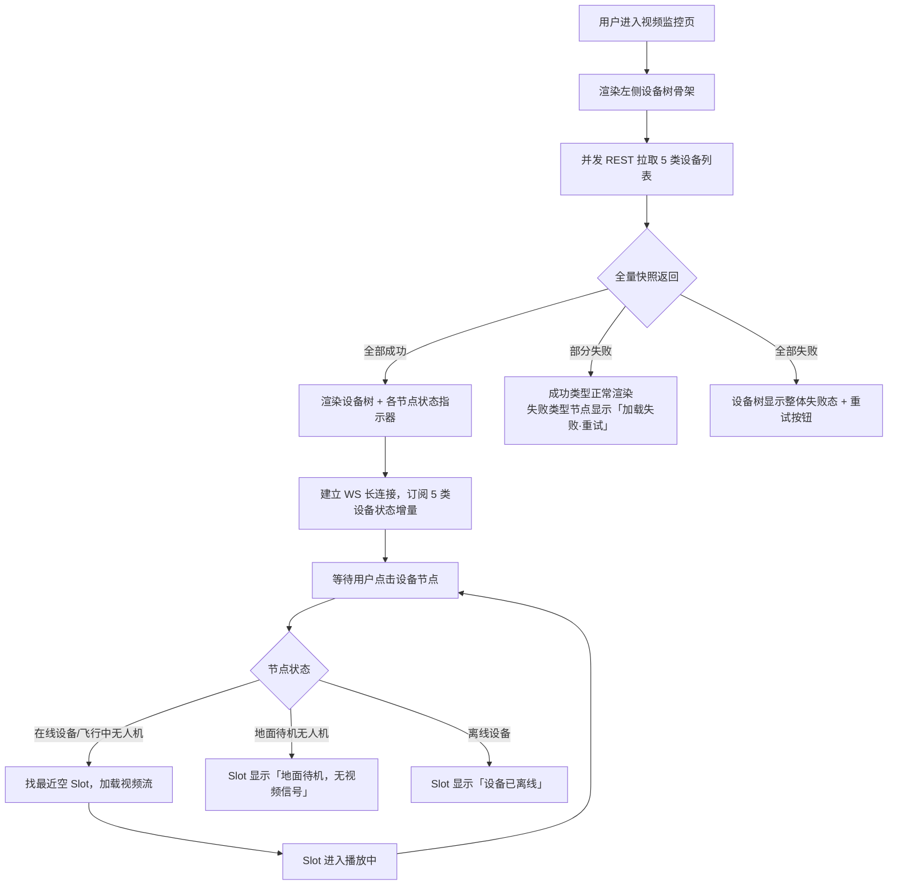
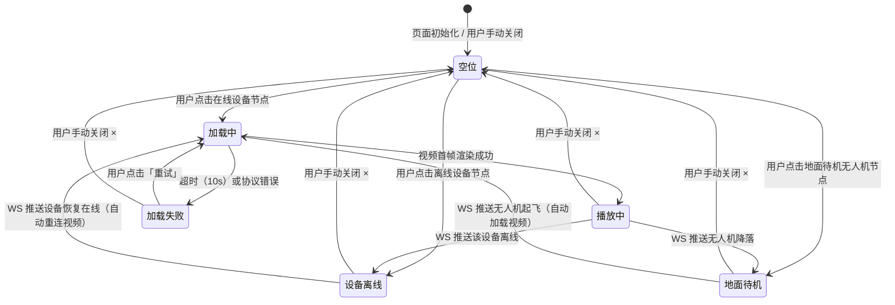

# PRD — 实时监控中心（PC端）· 视频监控

| 项 | 内容 |
|---|---|
| 文档版本 | V1.0 |
| 编制日期 | 2026-08-15 |
| 所属产品 | 中石油尼日尔公司上游油田项目 — 数智安防应急指挥中心（平台） |
| 所属端 | PC后台 |
| 所属模块 | 业务应用 → 实时监控中心 → 视频监控 |
| 页面路由 | `monitor/video` → `VideoMonitor` |
| 上游依据 | `实时监控中心-设计交接文档.md`（2026-08-15 grilling 19轮决策结果） |
| 状态 | 待评审 |

---

## 1. 文档元数据与边界

### 1.1 需求背景

实时监控中心（PC端）是「业务应用」侧栏下的垂直场景模块，面向**只需要看实时视频流、不需要加载信息繁复大屏**的操作员。本页「视频监控」子模块目标：**在一个界面内同时调看最多 9 路来自不同设备类型、不同营地的视频流**，通过左侧设备树快速定位和切换目标设备。

涉及 5 类视频设备来源：

| 设备类型 | 视频接口来源 | 备注 |
|---|---|---|
| 高点摄像头 | 第三方视频平台经中台 | 按物理设备展示，聚合多通道 |
| CCTV | 第三方视频平台经中台 | 有站点子层级（营地 > 站点 > CCTV） |
| C类机巢 | AIRIOT 中台（TBD-01） | 舱内摄像头，接口待确认 |
| C类无人机 | AIRIOT 中台 | 仅飞行中状态有视频流 |
| A类无人机 | 航天中台 | 仅飞行中状态有视频流 |

### 1.2 核心指标

| 指标 | 定义 | 目标值 |
|---|---|---|
| 首帧加载延迟 | 点击设备树节点到视频首帧出现 | ≤ 5 秒（P95，HLS 协议） |
| 设备树加载时长 | 进入页面到设备树全量渲染完成 | ≤ 2 秒（P95） |
| 在线状态准确率 | 设备树展示的在线状态与中台真值一致 | 100%（被动接收，不本地推导） |

### 1.3 与既有模块的集成关系

| 关联模块 | 关系方向 | 具体依赖 |
|---|---|---|
| 装备管理 → 高点摄像头管理 | 本模块**依赖** | 高点摄像头设备列表（营地、通道信息、在线状态） |
| 装备管理 → CCTV管理 | 本模块**依赖** | CCTV 设备列表（营地、站点、在线状态） |
| 装备管理 → C类机巢管理 | 本模块**依赖** | 机巢设备列表（营地、接入状态）及舱内摄像头视频流 |
| 装备管理 → C类无人机管理 | 本模块**依赖** | C类无人机设备列表（营地、飞行状态） |
| 装备管理 → A类无人机管理 | 本模块**依赖** | A类无人机设备列表（在线状态、飞行状态） |
| 系统管理 → 角色权限 | 本模块**依赖** | 菜单级访问权限点 + 营地维度的细粒度权限 |

### 1.4 权限边界（两层）

| 层级 | 控制维度 | 实现方式 |
|---|---|---|
| 第1层 | 能否访问「视频监控」子菜单 | 系统管理 → 角色管理 菜单级权限点 |
| 第2层 | 能看哪些营地的设备 | 用户所属营地自动过滤（推荐方案，TBD-05）；细粒度设备类型权限通过角色权限点配置 |

**本页面无任何写操作入口。** 所有视频流为只读接收，设备主数据不可编辑。

### 1.5 本期范围（In Scope）

| 编号 | 能力 |
|---|---|
| IS-01 | 左侧设备树：支持两种分组模式（按营地分类/按设备类型分类），实时在线状态指示器，设备数量统计 |
| IS-02 | 右侧视频宫格：1/4/9 宫格切换，点击设备树节点加载视频到空位 |
| IS-03 | 非飞行无人机：设备树可见但置灰，点击后右侧展示状态面板（非视频） |
| IS-04 | 视频格位管理：空位优先填充、手动关闭单路、清空全部、重复设备提示 |
| IS-05 | 5 类设备的 WS 在线/飞行状态实时同步（设备树节点状态指示器实时更新） |
| IS-06 | 全量异常处理：视频加载失败/超时、设备离线格位提示、WS断线未知态 |

### 1.6 本期不做（Out of Scope）

| 编号 | 不做项 | 原因 |
|---|---|---|
| OS-01 | 视频录制/截图下载 | 本期只做实时浏览 |
| OS-02 | 历史回放/时间轴 | 需接入单独录像接口，本期不实现 |
| OS-03 | 云台控制（PTZ） | 归属大屏实时监控中心 |
| OS-04 | 视频流内AI叠层（人形检测/告警框） | 由后端处理后推流，前端按普通视频播放 |
| OS-05 | 人员清点 | 跨端联动，与大屏一起规划（TBD-04） |

---

## 2. 业务概念与术语

| 术语 | 精确定义 |
|---|---|
| **视频宫格** | 页面右侧的视频播放区域，支持 1/4/9 宫格切换。每个宫格位（Slot）独立承载一路视频流 |
| **宫格位（Slot）** | 视频宫格中的一个播放单元。状态：空位 / 加载中 / 播放中 / 加载失败 / 设备离线 / 地面待机 |
| **设备树** | 页面左侧以可切换的分组模式展示所有可监控设备的树形组件，支持按营地分类和按设备类型分类两种视图 |
| **按营地分类** | 设备树分组模式之一，层级结构：营地 > 设备类型 > 具体设备（CCTV为营地 > 设备类型 > 站点 > 设备） |
| **按设备类型分类** | 设备树分组模式之一，层级结构：设备类型 > 营地 > 具体设备（CCTV为设备类型 > 营地 > 站点 > 设备） |
| **营地节点** | 设备树第一级节点，对应一个实际部署营地，徽标显示「在线数/总数」 |
| **设备类型节点** | 设备树第二级节点，固定5类：高点摄像头 / CCTV / C类机巢 / C类无人机 / A类无人机 |
| **设备节点** | 设备树第三级节点（CCTV 为第四级，第三级为站点），对应一个具体可调看的设备 |
| **飞行中** | 无人机飞行状态，此状态下有实时视频流推送 |
| **地面待机** | 无人机非飞行状态，无视频流；点击后 Slot 显示占位提示 |
| **HLS** | HTTP Live Streaming，本期视频流协议假设（TBD-03） |
| **状态指示器** | 设备节点右侧的圆形小图标 + 状态文字，颜色编码在线/离线/飞行中/地面待机 |

---

## 3. 核心流程与状态机

### 3.1 页面加载主流程



### 3.2 宫格位（Slot）状态机



### 3.3 WS 断线处理

设备树节点在线状态遵循 WS 协议：
1. REST 快照获取初始状态；
2. WS 增量推送单设备状态变更；
3. **WS 断线时保持最后已知状态**，顶部显示黄色提示条说明状态可能有延迟；
4. WS 重连成功后立即重拉全量快照整体覆盖本地状态。

---

## 4. 核心功能矩阵

| 动作名称 | 触发位置 | 前置条件 | 业务结果 |
|---|---|---|---|
| 进入视频监控 | 侧栏菜单「实时监控中心 → 视频监控」 | 用户具备该菜单权限 | 加载设备树，默认 4 宫格，所有 Slot 为空 |
| 切换宫格模式 | 页面右上角 1/4/9 切换按钮 | 无 | 切换宫格数；缩减时超出范围的 Slot 视频流停止；扩展时新增空位 |
| 点击在线设备/飞行中无人机节点 | 设备树第三级节点 | 节点在线或飞行中 | 找最近空 Slot（从 Slot 1 开始）加载视频；若无空 Slot 则替换编号最大的 Slot |
| 点击地面待机无人机节点 | 设备树无人机节点（置灰态） | 节点处于地面待机状态 | 找最近空 Slot，显示「地面待机，无视频信号」占位提示 |
| 点击离线设备节点 | 设备树设备节点（置灰态） | 节点处于离线状态 | 找最近空 Slot，显示「设备已离线」占位提示 |
| 关闭单路视频 | 宫格位右上角 × 按钮（hover 显示） | 宫格位非空 | 该 Slot 回到空位状态，视频连接断开 |
| 清空全部 | 页面右上角「清空」按钮 | 至少 1 个 Slot 非空 | 所有 Slot 回到空位，所有视频连接断开 |
| 点击已在播放的设备节点 | 设备树节点 | 该设备已在某 Slot 播放 | 弹出 Toast「该设备已在监看中」，高亮对应 Slot（闪烁 1s）；不重复加载 |
| 重试加载视频 | 宫格位内「重试」按钮 | Slot 处于加载失败态 | 重新发起视频流请求，Slot 回到加载中状态 |
| 设备离线自动重连 | WS 推送设备恢复在线 | Slot 处于「设备离线」态 | 自动重新发起视频流请求，Slot 进入加载中状态 |
| 无人机起飞自动加载 | WS 推送无人机起飞 | Slot 处于「地面待机」态 | 自动发起视频流请求，Slot 进入加载中状态 |
| 展开所有 | 设备树搜索框下方「展开所有」链接 | 无 | 展开所有营地、设备类型、站点节点 |
| 收起所有 | 设备树搜索框下方「收起所有」链接 | 无 | 收起所有营地、设备类型、站点节点 |
| 展开/收起单个节点 | 设备树营地/设备类型/站点节点的展开箭头 | 无 | 切换该节点展开状态 |
| 搜索/过滤设备 | 设备树顶部搜索框 | 无 | 实时高亮匹配节点（模糊匹配设备名称），非匹配节点淡化；清空恢复全量 |
| WS 推送设备离线 | 系统自动（WS） | Slot 正在播放该设备 | Slot 切换到「设备离线」态，保留设备名 + 「设备已离线」提示 |
| WS 推送无人机降落 | 系统自动（WS） | Slot 正在播放该无人机 | Slot 切换到「地面待机」态，保留设备名 + 「地面待机，无视频信号」提示 |
| WS 断线 | 系统自动 | WS 连接中断 | 页面顶部显示黄色提示条，设备树保持最后已知状态；每 5s 重连一次 |
| WS 重连成功 | 系统自动 | WS 断开后重连 | 重拉全量快照覆盖设备状态，提示条消失 |
| 离开页面清理 | 切换菜单 / 路由跳转 | 无 | 关闭所有视频流、关闭 WS、清除所有定时器 |

---

## 5. 页面布局与交互逻辑

### 5.1 页面骨架（ASCII）

```
┌──────────────────────────────────────────────────────────────────────────────┐
│ PageContainer · 视频监控                                                      │
│ ┌──────────────────────────────────────────────────────────────────────────┐ │
│ │ PanelCard（no-padding）                                                   │ │
│ │ ┌──────────────┬─────────────────────────────────────────────────────┐  │ │
│ │ │  设备树        │  右上角工具栏：[■] [⊞] [⊟]  [清空]                 │  │ │
│ │ │  [搜索设备...]  │ ─────────────────────────────────────────────────  │  │ │
│ │ │               │  ┌───────────┐  ┌───────────┐                      │  │ │
│ │ │ ▼ Agadem营地  │  │  Slot 1   │  │  Slot 2   │                      │  │ │
│ │ │   ▶高点摄像头  │  │  视频画面  │  │  空 位     │                      │  │ │
│ │ │   ▶CCTV       │  │           │  │           │                      │  │ │
│ │ │   ▶C类机巢    │  └───────────┘  └───────────┘                      │  │ │
│ │ │   ▶C类无人机  │  ┌───────────┐  ┌───────────┐                      │  │ │
│ │ │   ▶A类无人机  │  │  Slot 3   │  │  Slot 4   │                      │  │ │
│ │ │ ▼ Koulele营地 │  │  空 位     │  │  空 位     │                      │  │ │
│ │ │   ▶...        │  │           │  │           │                      │  │ │
│ │ │               │  └───────────┘  └───────────┘                      │  │ │
│ │ └──────────────┴─────────────────────────────────────────────────────┘  │ │
│ └──────────────────────────────────────────────────────────────────────────┘ │
└──────────────────────────────────────────────────────────────────────────────┘
```

**布局约定：**
- 左侧设备树宽度：260px，固定，不可拖拽
- 右侧视频区域：`flex: 1`，填满剩余宽度
- PanelCard 禁用默认内边距（`no-padding` 模式）
- 页面内容区高度撑满视口（`height: calc(100vh - 顶栏高度 - 面包屑高度)`）

### 5.2 设备树规格

**搜索框：**

| 规格 | 说明 |
|---|---|
| 位置 | 设备树顶部固定，宽度 100% |
| 占位文案 | 「搜索设备...」 |
| 过滤方式 | 实时模糊匹配设备名称，输入变化即时生效，无需按 Enter |
| 清除 | 右侧 × 图标，点击清空搜索词恢复完整树 |
| 展开/收起 | 搜索框下方独立一行，右对齐：「展开所有 \| 收起所有」文字链接 |

**分组模式切换：**

| 规格 | 说明 |
|---|---|
| 位置 | 搜索框与展开/收起操作之间 |
| 样式 | 两个并列Tab按钮，各占50%宽度 |
| 选项 | 「按营地分类」「按设备类型分类」 |
| 默认 | 「按营地分类」 |
| 视觉规则 | 选中态：蓝色文字 + 淡蓝色背景；未选中态：灰色文字 + 透明背景 |

**按营地分类时的树节点规格：**

| 节点层级 | 内容 | 右侧附属信息 |
|---|---|---|
| 营地节点（L1） | 营地名称 | 徽标：在线设备数/总设备数，如「3/5」 |
| 设备类型节点（L2） | 类型名称 | 在线数量/总数量，如「(2/5)」 |
| 站点节点（L3，仅CCTV有） | 站点名称（如「井场A」） | 该站点 CCTV 数量，如「(4)」 |
| 设备节点（L3 或 L4） | 设备名称，超长截断 + Tooltip | 状态指示器 + 状态文字（见下表） |

**按设备类型分类时的树节点规格：**

| 节点层级 | 内容 | 右侧附属信息 |
|---|---|---|
| 设备类型节点（L1） | 类型名称 | 徽标：在线设备数/总设备数，如「12/25」 |
| 营地节点（L2） | 营地名称 | 在线数量/总数量，如「(3/5)」 |
| 站点节点（L3，仅CCTV有） | 站点名称（如「井场A」） | 该站点 CCTV 数量，如「(4)」 |
| 设备节点（L3 或 L4） | 设备名称，超长截断 + Tooltip | 状态指示器 + 状态文字（见下表） |

**状态指示器颜色规则：**

| 状态 | 指示器颜色 | 适用设备类型 | 节点文字色 |
|---|---|---|---|
| 在线 | 绿色 `#52c41a` | 高点摄像头 / CCTV / C类机巢 | 正常色 |
| 离线 | 红色 `#ff4d4f` | 高点摄像头 / CCTV / C类机巢 | 浅灰色，节点整体置灰外观 |
| 飞行中 | 蓝色 `#1677ff` | C类无人机 / A类无人机 | 正常色 |
| 地面待机 / 未飞行 | 灰色 `#8c8c8c` | C类无人机 / A类无人机 | 浅灰色，节点整体置灰外观 |

**CCTV 特殊树结构（4层）：**

按营地分类时：
```
▼ Agadem营地 (12/25)
  ▼ CCTV (4/12)
    ▼ 井场A (4)          ← 站点（Site）层，仅 CCTV 有此层
        NVR-01-东南角  ● 在线
        NVR-01-西侧    ○ 离线
    ▶ 宿舍区 (3)
```

按设备类型分类时：
```
▼ CCTV (12/45)
  ▼ Agadem营地 (4/12)
    ▼ 井场A (4)          ← 站点（Site）层，仅 CCTV 有此层
        NVR-01-东南角  ● 在线
        NVR-01-西侧    ○ 离线
    ▶ 宿舍区 (3)
```

> 设计决策：其余4类设备为标准3层树；CCTV 因有 `siteName` 层级，实际为4层。两种分组模式下CCTV都保留站点层。

### 5.3 视频宫格规格

**宫格模式切换：**

| 按钮样式 | 说明 | 宫格布局 |
|---|---|---|
| ■ 1 | 单路全屏 | 1×1 |
| ⊞ 4（2×2小方块网格） | 默认模式 | 2×2 |
| ⊟ 9（3×3小方块网格） | 多路监看 | 3×3 |

**单个宫格位（Slot）视觉规格：**

| 状态 | 背景 | 中心内容 | 关闭按钮 |
|---|---|---|---|
| 空位 | 深色 `#141414` | 「点击左侧设备开始监看」灰色文字 | 无 |
| 加载中 | 深色 + 半透明蒙层 | Loading spinner + 设备名称 | 常显 × |
| 播放中 | 视频画面铺满 | 左下角半透明蒙层显示设备名称 | hover 时右上角显示 × |
| 加载失败 | 深色 `#141414` | 错误图标 + 设备名 + 「加载失败」+ 「重试」按钮 | 常显 × |
| 设备离线 | 深色 `#141414` | 断开图标 + 设备名 + 「设备已离线」 | 常显 × |
| 地面待机 | 深色 `#141414` | 断开图标 + 设备名 + 「地面待机，无视频信号」 | 常显 × |

**Slot 与设备绑定规则：**
- 每个 Slot 绑定 `{ deviceId, deviceType, deviceName }`；断线重连时使用该信息重新发起视频请求
- 同一设备不可同时出现在多个 Slot；重复点击时 Toast 提示 + 高亮对应 Slot

### 5.5 联动规则表

| 触发条件 | 联动对象 | 联动行为 |
|---|---|---|
| 点击在线设备/飞行中无人机节点 | 视频宫格 | 找最近空 Slot（Slot 1 → Slot N）加载视频；若无空 Slot 则替换 Slot N |
| 点击非飞行无人机节点 | 右侧区域 | 整体切换为状态面板，宫格视图暂时隐藏 |
| 点击「返回监看」 | 右侧区域 | 恢复宫格视图，原有 Slot 内容不变 |
| 切换到更少宫格（如 9→4） | 超出范围的 Slot | 停止视频流，Slot 移除；不影响保留的 Slot |
| WS 推送当前播放设备离线 | 对应 Slot | 立即进入「设备离线」态；不自动清除 Slot，用户手动关闭 |
| WS 推送设备树某节点离线 | 设备树节点 | 指示器变红，节点文字变浅灰色 |
| WS 断线 | 设备树全部节点 + 全局提示条 | 指示器全部变灰（未知态）；宫格区顶部出现橙色提示条「实时状态同步中断，设备在线状态不可信」 |
| WS 重连成功 | 全局提示条 + 设备树 | 提示条消失；重拉全量快照覆盖节点状态；Toast「实时同步已恢复」2s |
| 搜索词输入 | 设备树 | 实时高亮匹配节点，非匹配节点 opacity 0.35 |
| 搜索词清空 | 设备树 | 恢复全量展示，opacity 全部恢复 1 |

---

## 6. 边界情况与异常处理

### 6.1 空状态

| 场景 | 处理 |
|---|---|
| 某营地下某设备类型无设备 | 该设备类型节点隐藏，不渲染空节点 |
| 某营地下无任何设备（无权限或该营地无设备） | 该营地节点不渲染 |
| 当前用户无任何设备权限 | 设备树展示空状态：「您没有可监看的设备，请联系管理员配置权限」 |
| 搜索无结果 | 设备树内显示「未找到匹配设备」，不影响宫格区 |

### 6.2 视频加载异常

| 场景 | 判定条件 | 处理 |
|---|---|---|
| 视频加载超时 | `<video>` 超过 10s 未触发 `playing` 事件 | Slot 进入加载失败态，显示「加载超时」+ 重试按钮 |
| 视频流地址无效 | `<video>` error 事件 | Slot 进入加载失败态，显示「视频流不可用」+ 重试按钮 |
| 视频播放中断 | `<video>` stalled / ended 事件 | 延迟 3s 后自动重试一次；重试失败进入加载失败态 |
| C类机巢舱内摄像头（TBD-01） | 接口未确认 | 原型阶段占位显示「视频流接口待接入」，不模拟视频 |

### 6.3 WS 连接异常

| 场景 | 处理 |
|---|---|
| WS 断线 | 设备树全部节点进入未知态（指示器灰色），**严禁批量判离线**；宫格区顶部橙色提示条 |
| 断线超过 60s | 提示条底色升级为红色，文案改为「与视频系统连接中断，在线状态不可信，更新于 YYYY-MM-DD HH:mm:ss」 |
| WS 重连 | 每 5s 一次无限重连；成功后重拉全量快照覆盖，提示条消失 |
| 正在播放的视频流 | WS 断线**不停止**正在播放的视频（视频流链路与 WS 状态链路独立） |

### 6.4 设备树数据异常

| 场景 | 处理 |
|---|---|
| 某类设备 REST 接口失败 | 该类型节点显示「加载失败 · 重试」；其余类型正常渲染；不阻塞整体设备树 |
| 中台删除了某设备 | 下次全量快照时该节点消失；若该设备正在某 Slot 播放，WS 将推送离线，Slot 进入「设备离线」态 |

---

## 7. 附录 A：字段与接口对照

| 页面用途 | 设备类型 | 字段 key | 数据接口 | 说明 |
|---|---|---|---|---|
| 设备树节点名称 | 高点摄像头 | `deviceGroup` | 中台 REST 快照 | 物理设备名（通道 deviceGroup 聚合后） |
| 设备树节点名称 | CCTV | `name` | 中台 REST 快照 | CctvDevice.name |
| 设备树节点名称 | C类机巢 | `name` | AIRIOT 中台 REST | CNestDevice.name |
| 设备树节点名称 | C类无人机 | `name` | AIRIOT 中台 REST | CUavDevice.name |
| 设备树节点名称 | A类无人机 | `sn` / 台账名称 | 航天中台 REST | 原型用 SN 代替名称 |
| 在线状态（高点/CCTV） | 高点 / CCTV | `online` | 中台 WS 增量推送 | Boolean，true = 在线 |
| 接入状态（机巢/C类无人机） | C类机巢 / C类无人机 | `access_status` | AIRIOT WS | `'ONLINE' \| 'OFFLINE'` |
| 飞行状态（无人机） | A类无人机 | `flightStatus` | 航天中台 WS | `'FLYING' \| 'NOT_FLYING'`（TBD-06） |
| 飞行状态（无人机） | C类无人机 | `mode_code` | AIRIOT WS | group='flying' 为飞行中（TBD-07） |
| 视频流地址 | 全部 | `streamUrl` | 中台视频接口（TBD-03） | HLS .m3u8 假设 |
| 站点分组键 | CCTV | `siteName` | CctvDevice.siteName | 设备树 CCTV 第三级分组 |
| 营地分组键 | 全部 | `campId` / `campName` | 各自中台 | 设备树第一级分组键 |

---

## 8. 附录 B：待确认事项（TBD）

| 编号 | 事项 | 当前假设 | 影响面 |
|---|---|---|---|
| TBD-01 | C类机巢舱内摄像头视频流接口 | 假设从 AIRIOT 中台统一拿流（与 C类无人机同链路） | §4 视频加载逻辑、§7 字段对照 |
| TBD-03 | 视频流协议（HLS/RTSP/WebRTC/FLV） | 暂按 HLS（.m3u8）设计 | 视频播放器组件选型、§1.2 首帧延迟指标 |
| TBD-04 | 人员清点完整设计 | 跨端联动，与大屏一起规划；本模块仅加菜单占位 | 不影响本 PRD |
| TBD-05 | 营地权限绑定方式细节 | 用户所属营地自动绑定，设备树默认只展示用户所属营地的设备 | §1.4 权限边界 |
| TBD-06 | A类无人机飞行状态字段名 | `flightStatus`，取值 `FLYING` / `NOT_FLYING` | §5.2 设备树状态指示器、§5.4 状态面板字段 |
| TBD-07 | C类无人机飞行状态判定逻辑 | 通过 `mode_code` 推导，`group='flying'` 为飞行中 | §5.2 设备树状态指示器 |

> **所有其余设计决策已闭环，本 PRD 可直接进入原型开发。**

---

## 9. 附录 C：修订记录

| 版本 | 日期 | 修订人 | 修订内容 |
|---|---|---|---|
| V1.0 | 2026-08-15 | 产品 | 初版，基于实时监控中心设计交接文档完成 |
| V1.0-update | 2026-08-17 | 产品 | 设备树增强：①新增分组模式切换（按营地/按设备类型），Tab样式；②所有分组节点（营地/设备类型）新增设备数量统计（在线数/总数）；③两种分组模式下CCTV都保留站点层；④更新 §1.5 本期范围、§2 术语表、§5.2 设备树规格；⑤同步更新原型文件 VideoMonitor.vue |

---

*文档结束。版本 V1.0，2026-08-15，待评审。*

