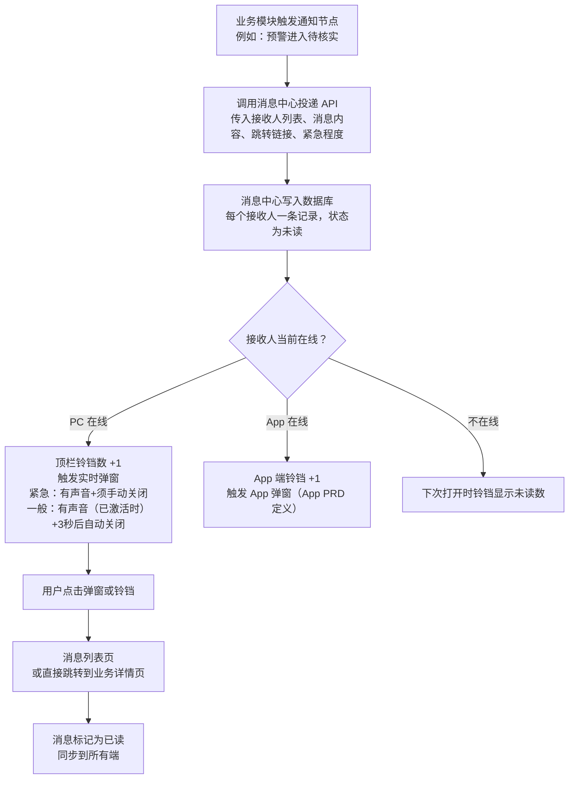
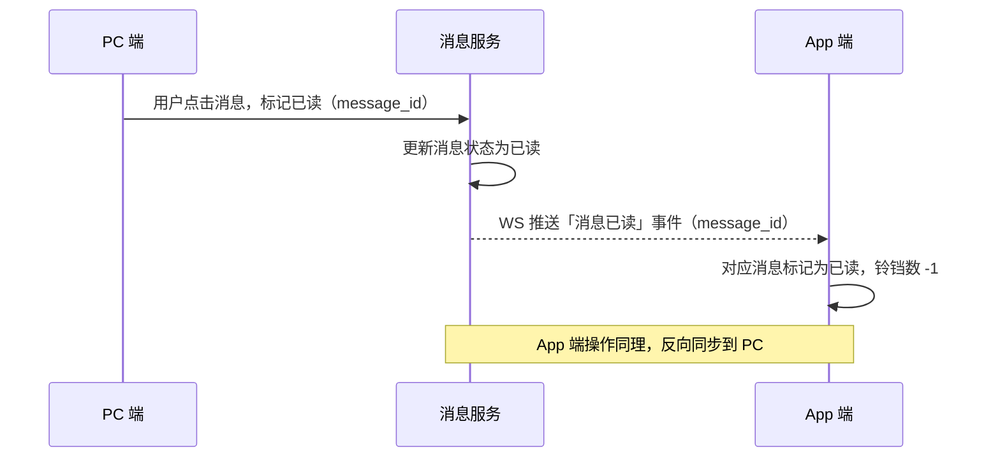

# PRD — 系统 · 消息中心

| 项 | 内容 |
|---|---|
| 文档版本 | V1.0 |
| 编制日期 | 2026-09-26 |
| 所属产品 | 中石油尼日尔公司上游油田项目 — 数智安防应急指挥中心（平台） |
| 所属端 | PC 后台（主）+ App 端（数据契约，页面设计在 App PRD 中） |
| 所属模块 | 系统全局组件 |
| 页面架构 | 顶栏铃铛 + 实时弹窗 + 消息列表页（全屏） |
| 上游依据 | `PRD-预警管理-预警工作台.md`、`App端功能规划-v2.md`、2026-09-26 设计访谈 Q31、Q38、Q57 |
| 状态 | 待评审 |

---

## 1. 文档元数据与边界

### 1.1 需求背景

平台各模块（预警、事件、核实任务、应急指挥等）都需要向用户推送通知。如果每个模块自己实现一套弹窗和列表，用户会在不同地方看到不同样式的通知，已读状态也不会统一。消息中心解决两件事：

1. **统一容器**：所有模块的通知统一投递到消息中心，用户在一个地方管理所有通知。
2. **跨端已读同步**：用户在 PC 上已读的消息，App 上也标记为已读；反之亦然。

消息中心本身不承载业务处理入口，它只负责通知的送达、已读和跳转。业务处理在各模块自己的页面里完成。

### 1.2 与既有模块的依赖关系

| 关联模块 | 关系方向 | 具体内容 |
|---|---|---|
| 预警管理 | 本模块**接收消息** | 预警状态变更等 8 个通知节点，详见附录 A |
| 事件管理（规划中） | 本模块**接收消息** | 事件相关通知，消息类型定义待事件 PRD 完成后补充 |
| 应急指挥（规划中） | 本模块**接收消息** | 应急指令、清点通知等，待相关 PRD 完成后补充 |
| App 端 | 本模块**同步数据** | 消息列表和已读状态跨端同步，App 端页面设计在 App PRD 中 |
| 系统管理 – 用户信息 | 本模块**读取** | 接收人 user_id 到用户名、头像的映射 |

### 1.3 权限边界

| 编号 | 边界 |
|---|---|
| PB-01 | 每条消息只对指定接收人可见，用户只能查看发给自己的消息 |
| PB-02 | 消息内容由各业务模块投递，消息中心不修改内容 |
| PB-03 | 消息保留 90 天（可配置），超出后自动清理，不可恢复 |
| PB-04 | 用户可以将自己的消息标记为已读或全部已读，不可删除消息 |

### 1.4 本期范围（In Scope）

| 编号 | 能力 |
|---|---|
| IS-01 | 顶栏铃铛，显示未读数（上限 99+） |
| IS-02 | 实时弹窗：紧急消息须手动关闭，一般消息自动消失（3 秒） |
| IS-03 | 声音提示，须用户主动激活（浏览器策略），顶栏常驻开关 |
| IS-04 | 消息列表页：分 Tab、可筛选、支持已读/全部已读 |
| IS-05 | 点击消息跳转到对应业务详情页 |
| IS-06 | PC 和 App 已读状态双向同步 |
| IS-07 | 消息保留 90 天，可配置 |

### 1.5 本期范围外（Out of Scope）

| 编号 | 内容 |
|---|---|
| OS-01 | App 端消息中心页面（在 App PRD 中设计） |
| OS-02 | 短信、企业微信、邮件、电话外呼等站外推送渠道（列入规划） |
| OS-03 | 消息分组 / 静音 / 置顶等高级管理功能 |
| OS-04 | 消息的已读回执（即发送方看到接收人是否已读） |

---

## 2. 业务概念与术语

| 术语 | 精确定义 |
|---|---|
| **消息** | 由业务模块触发、投递给指定用户的一条通知记录。包含标题、摘要、跳转链接、消息类型、紧急程度和发送时间。消息本身不包含业务操作按钮，处理入口在跳转目标页 |
| **消息类型** | 由业务模块定义的分类标签，用于消息列表的 Tab 分组和筛选。本期已定义的类型见附录 A |
| **紧急程度** | 两档：**紧急**（对应预警紧急档）和**一般**，影响弹窗行为和声音强度 |
| **投递** | 业务模块调用消息中心 API，将一条消息写入指定接收人的消息列表的动作 |
| **已读同步** | 用户在任一端（PC 或 App）读取某条消息后，所有端的该条消息状态同步改为已读 |
| **站内信** | 本期实现的通知载体，消息只在平台内部流转，不向外部发送 |

---

## 3. 核心流程

### 3.1 消息投递与展示流程



### 3.2 跨端已读同步



---

## 4. 核心功能矩阵

| 功能 | 触发位置 | 前置条件 | 业务结果 |
|---|---|---|---|
| 显示未读数 | 顶栏铃铛 | 有未读消息 | 铃铛右上角红色数字，上限显示「99+」 |
| 实时弹窗 | 有新消息到达 | 页面处于活跃标签页 | 右下角弹出通知卡片，紧急须手动点击关闭，一般 3 秒后自动关闭 |
| 声音提示 | 有新消息到达 | 用户已激活声音开关 | 紧急消息播放较急促音效，一般消息播放轻柔提示音 |
| 激活声音 | 顶栏声音开关 / 首次消息弹窗引导 | 用户完成首次点击交互 | 声音功能激活，设置持久化到 localStorage |
| 查看消息列表 | 点击铃铛 / 导航菜单 | — | 打开消息列表页，全部消息按时间倒序排列 |
| 标记单条已读 | 消息列表行点击 | 消息处于未读状态 | 状态改为已读，铃铛数 -1，跨端同步 |
| 全部已读 | 消息列表页顶部按钮 | 有未读消息 | 当前 Tab 的全部未读消息改为已读 |
| 跳转业务详情 | 消息列表行点击 / 弹窗点击 | 跳转链接有效 | 路由到对应业务页面（研判页、事件详情等） |
| 筛选消息 | 消息列表页 Tab / 筛选栏 | — | 按类型或时间筛选消息列表 |

---

## 5. 页面布局与交互逻辑

### 5.1 顶栏铃铛

```
顶栏右侧：
[声音🔔/🔕]  [铃铛🔔  99+]  [用户头像]

声音开关：
- 🔔（已激活）：点击关闭声音，图标变为 🔕
- 🔕（已关闭）：点击开启声音，需确认浏览器自动播放权限
- 声音状态持久化在 localStorage，刷新页面后保持
- Tooltip 始终显示当前状态说明（「声音提醒：开」或「声音提醒：关」）

铃铛：
- 无未读：只显示铃铛图标
- 有未读：右上角红色徽标，1–99 显示数字，100+ 显示「99+」
- 点击：打开消息列表页（或铃铛旁的下拉预览，见 5.2）
```

### 5.2 铃铛下拉预览（快速查看）

点击铃铛时，先弹出一个下拉预览，而不是直接跳转消息列表页，避免用户频繁离开当前页面。

```
┌─────────────────────────────────────┐
│  消息通知              [全部已读]    │
├─────────────────────────────────────┤
│ 🔴 YJ-001 Jaouro营地·区域入侵       │
│    进入待核实，请处理                │
│    2 分钟前                          │
├─────────────────────────────────────┤
│ ⚪ YJ-002 Koulele营地·设备告警      │
│    进入待核实                        │
│    15 分钟前                         │
├─────────────────────────────────────┤
│ ⚪ 核实任务 #T-001 已回填            │
│    张某某已提交现场核实结果          │
│    1 小时前                          │
├─────────────────────────────────────┤
│           [查看全部消息]             │
└─────────────────────────────────────┘
```

- 显示最近 5 条未读消息，超出显示「还有 xx 条未读」
- 每行点击：标记已读 + 跳转到对应业务详情页
- 「全部已读」：当前预览中 5 条全部标记已读
- 「查看全部消息」：跳转到消息列表页

### 5.3 实时弹窗

弹窗出现在页面右下角，多条消息时垂直堆叠，最多同时显示 3 条，超出时排队等待。

```
紧急消息弹窗：
┌────────────────────────────────────┐
│ 🔴 预警通知                    [✕] │  ← 必须手动点击 ✕ 关闭
│ YJ-001 Jaouro营地·区域入侵已进入   │
│ 待核实，请立即处理。               │
│                           [立即处理] │
└────────────────────────────────────┘

一般消息弹窗：
┌────────────────────────────────────┐
│ ⚪ 核实任务回填                     │  ← 3 秒后自动关闭
│ 张某某已提交核实任务 #T-001 的回填  │
│ 结果。                              │
└────────────────────────────────────┘
```

**弹窗行为规则：**

| 属性 | 紧急 | 一般 |
|---|---|---|
| 关闭方式 | 手动点击 ✕，或点击「立即处理」跳转后关闭 | 3 秒后自动关闭，也可手动点击关闭 |
| 声音 | 较急促音效（激活时） | 轻柔提示音（激活时） |
| 背景色 | 带轻微红色/橙色底色 | 中性深色底色 |
| 最大同时显示 | 3 条，超出排队 | 3 条（与紧急共享上限） |
| 非活跃标签页 | 不弹窗，但铃铛数更新；恢复活跃时若还有未读的紧急消息，补弹一次 | 不弹窗 |

### 5.4 消息列表页

```
┌─────────────────────────────────────────────────────────────────┐
│  消息中心                                              [全部已读] │
├─────────────────────────────────────────────────────────────────┤
│  [全部 (12)] [预警 (8)] [事件 (0)] [任务 (3)] [系统 (1)]        │
├─────────────────────────────────────────────────────────────────┤
│  筛选：[未读/全部 ▼]  [时间范围]                                  │
├──────┬──────────────────────────────────────────┬───────┬───────┤
│ 状态 │ 内容                                      │ 时间  │ 操作  │
├──────┼──────────────────────────────────────────┼───────┼───────┤
│ 🔴未读│ YJ-001 Jaouro营地·区域入侵进入待核实     │ 2分前 │ [跳转]│
│      │ 请立即核实，剩余时限 3 分钟               │       │       │
├──────┼──────────────────────────────────────────┼───────┼───────┤
│ 🔴未读│ YJ-001 待核实时限已超时                  │ 1分前 │ [跳转]│
│      │ 请尽快处理                                │       │       │
├──────┼──────────────────────────────────────────┼───────┼───────┤
│  已读 │ 核实任务 #T-001 已回填                   │ 1小时 │ [跳转]│
│      │ 张某某于 14:40 提交了现场核实结果         │       │       │
└──────┴──────────────────────────────────────────┴───────┴───────┘
```

**Tab 分组：**

| Tab | 包含消息类型 |
|---|---|
| 全部 | 所有类型 |
| 预警 | 预警相关（见附录 A） |
| 事件 | 事件相关（待事件 PRD 完成后补充） |
| 任务 | 核实任务回填、催办 |
| 系统 | 配置变更提醒、账号相关等 |

**列表交互规则：**
- 未读行：左侧蓝色竖条 + 字重加粗
- 点击任意位置：标记已读 + 跳转业务详情
- 跳转链接无效（业务记录已被删除）：提示「对应记录已不存在」，消息标记已读
- 消息保留 90 天（可配置），超出自动清理，清理前不出现在列表

### 5.5 声音激活引导

浏览器要求用户有交互行为后才允许播放声音。具体交互如下：

1. 用户首次登录或首次有消息到达时，铃铛图标旁边显示一条内联提示：「开启声音提醒，及时收到紧急通知 [点击开启]」
2. 用户点击「点击开启」即完成交互，声音功能激活，提示消失
3. 声音激活状态写入 localStorage，刷新页面后保持；换浏览器或清除缓存后需重新激活
4. 顶栏声音开关始终可见，激活后可随时关闭再重新打开

---

## 6. 边界情况与异常处理

### 6.1 空状态

| 场景 | 展示文案 |
|---|---|
| 消息列表为空（新账号） | 「暂无消息，系统通知将在这里显示」 |
| 筛选结果为空 | 「该时间范围内没有符合条件的消息」 |
| 全部已读 | 「所有消息已读」（列表仍显示，但无蓝色竖条） |

### 6.2 网络异常

| 场景 | 处理方式 |
|---|---|
| WS 断线 | 铃铛旁显示小黄点「连接中断，通知可能延迟」；重连成功后消失 |
| 标记已读失败 | 前端乐观更新（先改 UI），失败后回滚，Toast 提示「操作失败，请重试」 |
| 消息列表加载失败 | PanelCard 显示「加载失败，点击重试」 |

### 6.3 跨端同步异常

| 场景 | 处理方式 |
|---|---|
| App 离线时 PC 标记已读 | 消息服务存储同步事件，App 重连后下发，App 再更新本地状态 |
| 双端同时标记已读 | 幂等处理，以最早到达服务端的为准，另一端收到「已读」推送后直接采纳 |

### 6.4 极端数据量

| 场景 | 处理方式 |
|---|---|
| 单用户消息超过 1000 条 | 分页加载，每页 20 条，虚拟滚动 |
| 弹窗积压超过 3 条 | 排队显示，用户清除一条后下一条弹出；页面切换后队列清空（不补发已超过 30 秒的弹窗） |

---

## 附录 A：预警模块消息类型与触发规则

| 消息类型 Key | 显示名称 | 触发节点 | 接收人 | 紧急程度 | 跳转目标 | 消息文案模板 |
|---|---|---|---|---|---|---|
| `alert.new` | 新预警待核实 | 预警生成 | 通知配置·新预警待核实 | 与预警紧急程度一致 | 研判页 | `[营地]·[类型]进入待核实，请处理` |
| `alert.timeout_verify` | 待核实超时 | 待核实时限到期 | 通知配置·待核实超时 | 紧急 | 研判页 | `[编号] 待核实已超时 [xx] 分钟，请尽快处理` |
| `alert.pending_decision` | 预警待决策 | 进入待决策 | 通知配置·待决策 | 与预警紧急程度一致 | 研判页 | `[编号] 核实完成，等待您决策（解除/跟踪/升级）` |
| `alert.timeout_decision` | 待决策超时 | 待决策时限到期 + 每次重复通知 | 通知配置·待决策超时 | 紧急 | 研判页 | `[编号] 待决策已超时 [xx] 分钟，请尽快处理` |
| `alert.review_due` | 预警待复核 | 跟踪中复核周期到期 | 通知配置·复核到期 | 一般 | 研判页 | `[编号] 持续跟踪中预警已到复核时间，请更新跟踪状态` |
| `alert.task_fulfilled` | 核实任务已回填 | 核实任务被接收人回填 | 任务下发人（自动） | 一般 | 研判页（时间线 Tab） | `[接收人姓名] 已提交核实任务 [#T-xxx] 的回填结果` |
| `alert.task_fulfilled_late` | 核实任务关闭后回填 | 任务关闭后迟到回填到达 | 预警最后一位决策人 | 一般 | 研判页（时间线 Tab） | `[接收人姓名] 提交了已关闭任务 [#T-xxx] 的迟到回填，已追加至时间线` |
| `alert.related_hint` | 出现疑似关联预警 | 系统判定两条预警疑似关联 | 通知配置·出现疑似关联 | 一般 | 研判页（关联 Tab） | `[编号] 与 [编号] 可能关联，请确认` |

**消息文案中的变量说明：**
- `[营地]`：预警的营地名称
- `[类型]`：预警具体类型名称
- `[编号]`：预警编号，例如 `YJ-2026-0926-0001`
- `[xx]`：已超时分钟数
- `[接收人姓名]`：回填用户的姓名

---

## 附录 B：消息数据结构

```typescript
interface Message {
  message_id: string          // UUID
  user_id: string             // 接收人 user_id
  type: string                // 消息类型 Key，例如 'alert.new'
  category: 'alert' | 'event' | 'task' | 'system'  // 消息列表分组
  title: string               // 标题，最多 40 个字符
  body: string                // 摘要，最多 100 个字符
  urgency: 'urgent' | 'normal'
  target_url: string          // 跳转路由，例如 '/alerts/YJ-2026-0926-0001?tab=timeline'
  is_read: boolean
  read_at: datetime | null
  created_at: datetime
  expires_at: datetime        // created_at + 保留天数（默认 90 天）
  source_module: string       // 投递方模块标识，例如 'alert'
  source_record_id: string    // 关联业务记录 ID，例如 alert_id
}
```

---

## 附录 C：投递 API（供各业务模块使用）

```
POST /api/notifications/send

Request:
{
  "recipients": ["user_id_1", "user_id_2"],  // 接收人列表
  "type": "alert.new",                        // 消息类型 Key
  "category": "alert",
  "title": "新预警待核实",
  "body": "Jaouro营地·区域入侵进入待核实，请处理",
  "urgency": "urgent",
  "target_url": "/alerts/YJ-2026-0926-0001",
  "source_module": "alert",
  "source_record_id": "alert-uuid-xxx"
}

Response:
{
  "success": true,
  "delivered_count": 2,    // 成功写入的消息条数
  "message_ids": ["msg-uuid-1", "msg-uuid-2"]
}
```

**投递幂等性：** 各业务模块同一触发节点同一记录的同一消息类型，若在 60 秒内重复调用，消息中心只写入一条（以 `source_module + source_record_id + type + recipient` 为幂等键）。防止因重试逻辑导致重复消息。

---

## 附录 D：待确认事项

| 编号 | 事项 | 当前处理方式 |
|---|---|---|
| TBD-MSG-01 | 消息保留天数配置项的位置（系统管理 → 系统参数，还是本页面） | 暂按 90 天硬编码设计，配置项位置待系统管理 PRD 确认后补充 |
| TBD-MSG-02 | App 端消息推送（APNs/FCM）的可行性和接入方案 | 本期只做站内信；App 推送在 App PRD 中规划，技术可行性待确认 |
| TBD-MSG-03 | 浏览器声音文件格式和音效素材 | 设计建议：mp3 + ogg 双格式兼容，音效 ≤ 3 秒 |
