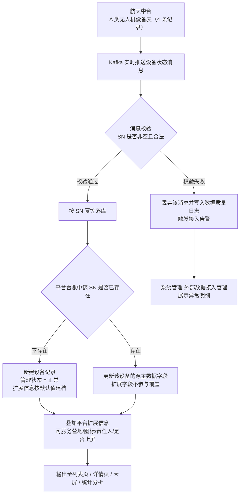
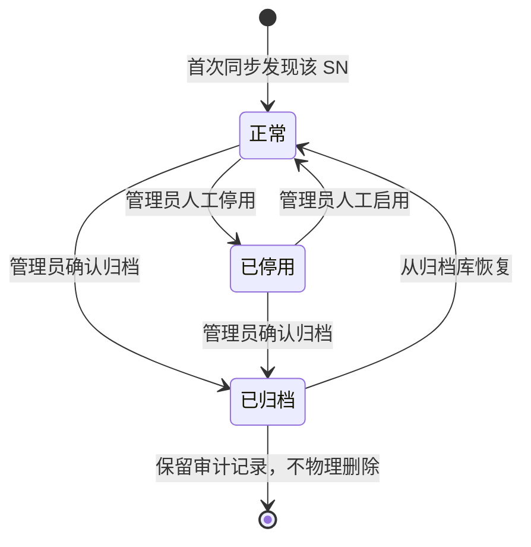
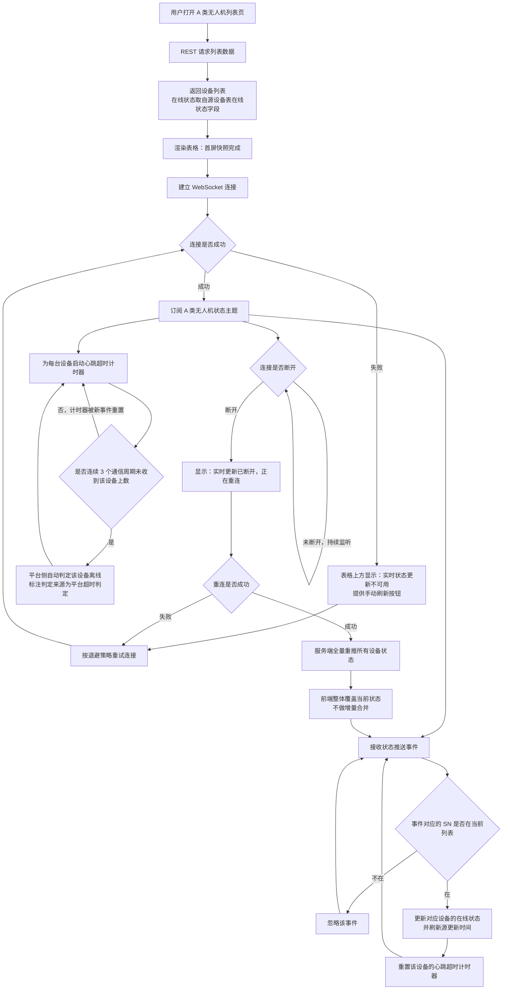

# PRD：装备管理 / A 类无人机管理

| 项 | 内容 |
|---|---|
| 文档版本 | V3.0 |
| 编制日期 | 2026-07-29 |
| 所属产品 | 中石油尼日尔公司上游油田项目 — 数智安防应急指挥中心（平台） |
| 所属端 | PC 后台 |
| 所属模块 | 装备管理 → A 类无人机管理 |
| 页面架构 | 独立列表页 + 独立详情页（不与其他装备类型共用页面） |
| 上游依据 | `应急指挥中心 (1).xmind`、`N16-PC后台功能点明细.md`、`油田安防中心数据资源.md`、2026-07-25 业主答复 6 项、**2026-07-29 业主答复：A 类无人机主数据由统一数据源（航天中台）提供，全量共 4 条记录；在线状态由航天中台全局判断；飞行状态为飞行中/未飞行两种；累计里程单位米、累计航时单位秒；停入时间为进入机场/停机位时间；最近飞行时间为最近起飞时间** |
| 状态 | 待评审 |

---

## 0. 相对 V2.0 的变更说明

2026-07-29 业主明确：**A 类无人机主数据不再是 3 个基础站各自注册、共 12 条源记录，而是由一个统一数据源提供，其中仅 4 条无人机记录，与 4 架实体飞机一一对应。** 该结论推翻了 V2.0 的核心架构前提，本版据此重写。

| 变更类型 | V2.0 设计 | V3.0 设计 |
|---|---|---|
| 数据源模型 | 3 张源设备表 × 4 条 = 12 条源记录 | 统一数据源 1 张设备表 = 4 条源记录 |
| 归一层 | 按 SN 将 12 条归一为 4 架逻辑飞机 | **整体删除**。源记录与平台设备记录 1:1，无归一 |
| 主源选定 | 多源冲突消解逻辑 | **整体删除**。唯一源记录即唯一数据依据 |
| 多源冲突 | 冲突检测、冲突标记、多站对比视图、上报数据质量问题 | **整体删除**。单一源不存在同字段多取值 |
| 数据可信标注 | 逐条标注数据来源与时间戳 | 简化为单一来源标识 + 最后更新时间 |
| 「部分站源记录缺失」态 | 1-2 站源记录消失时的黄标与逐站快照 | **删除**，替换为「源系统设备清单变更」提示（E-12） |
| 可服务营地 | 由注册基础站集合自动推导 + 人工校准 + 恢复自动推导 | 纯平台扩展字段，建档时默认为全部启用态营地，之后人工维护 |
| 累计飞行数据 | 分 3 站明细行 + 合计行 + 三倍重复计数风险说明 | 单一口径 3 项指标（总架次/总里程/总航时），平台不二次汇总 |
| 详情页区块 | 含「多站注册关系」区块 | **删除该区块** |

**仍未确认、影响本版的关键前提：** 无人机**任务数据**与**飞行数据（累计里程、架次、航时）**是否与主数据同属该统一数据源，尚待业主答复。本版「同源单一数据源」落盘，并在 Q-01 写明若为独立/多数据源需追加的设计。相关接口契约在 Q-01 答复前不冻结。

---

## 1. 文档元数据与边界

### 1.1 需求背景

A 类无人机采用固定机场/地面站起降模式，全项目共 **4 架**实体飞机，覆盖 Jaouro、Koulele、Dibeilla 三个营地的飞行任务。其主数据由一个统一数据源集中管理并对平台开放，**源侧 4 条记录与 4 架实体飞机一一对应**，不存在跨系统重复注册。

平台不是这批设备的权威源，也不重复建设源系统已有的飞控与任务能力。本模块要解决的是源系统之外的问题：

| 现状问题 | 业务影响 |
|---|---|
| A 类无人机与其余 7 类装备分散在不同源系统，无统一台账 | 应急场景下无法在一处判断"当前可用的应急资源有哪些" |
| 源系统只提供设备主数据，缺少平台侧管理属性（责任人、是否上屏、显示图标、运维备注） | 大屏图层无法配置、责任归属无处落账、预案无法按装备编组 |
| 源系统接口中断、数据长时间不更新对使用方不可见 | 值班人员把"接口断了"误读为"设备离线"，调度决策依据失真 |
| 无人机实时视频与状态需登录源系统查看 | 飞行中态势掌握滞后 |
| 累计飞行数据无统一入口 | 设备保养与寿命评估缺少数据底座 |

本模块的定位：**A 类无人机的统一只读台账 + 平台侧管理属性维护 + 接入健康可见 + 实时状态与视频聚合入口**。

### 1.2 核心指标

| 指标 | 定义 | 目标值 |
|---|---|---|
| 台账完整度 | 平台可见 A 类无人机数 ÷ 源系统设备清单条数 | 100%（4/4），不允许出现 SN 重复行或缺行 |
| 平台扩展信息完整率 | 已填写责任单位与责任人的设备数 ÷ 总设备数 | ≥ 90% |
| 首屏加载时长 | 列表页从请求发出到表格渲染完成（4 条数据量级） | ≤ 2 秒 |
| 离线判定时延 | 设备实际断连到页面标记离线 | ≤ 3 个通信周期 + 5 秒 |

### 1.3 与现有模块的集成关系

| 关联模块 | 关系方向 | 具体依赖内容 |
|---|---|---|
| 系统管理 → 数据字典与配置 | 本模块**依赖** | 飞行状态字典（源编码→中文显示值映射）、地面站字典。字典未配置的源值本模块显示"未知（源值）" |
| 人员管理 → 营地与部门 | 本模块**依赖** | 「可服务营地」字段与营地筛选项的候选值来源，仅取启用态营地 |
| 系统管理 → 动态图标设置 | 本模块**依赖** | A 类无人机在大屏的显示图标 PNG |
| 系统管理 → 图层资源管理 | 本模块**依赖** | 营地边界数据，用于地面站选点时的营地归属校验 |
| 装备管理 → A 类地面站管理 | **双向关联** | 本模块的"当前地面站"引用地面站台账；地面站台账的"停放无人机"反向引用本模块 |
| 实时监控中心 → 无人机监控 | 本模块**跳转至** | 携带 `drone_id` 跳转，由实时监控中心承载完整 GIS、航线、多路视频并发 |
| 任务中心 → 无人机巡检任务 | 本模块**跳转至** | 详情页任务列表提供"查看全部任务"入口，跳转至任务中心并按本机 SN 预筛选 |
| 统计分析 → 设备运行分析 | 本模块**提供数据** | 在线率、故障率、无人机任务统计（总任务/里程/航时）的数据底座 |
| 大屏 → 安防态势综合驾驶舱（首页） | 本模块**提供数据** | "A类无人机/机场"图层的图标、坐标；"应急资源可用性"卡片的"无人机在线总数" |
| 大屏 → 实时监控中心 Tab | 本模块**提供数据** | "A类无人机"图层实时位置点及点击后的电量、任务、航线信息 |

### 1.4 本期范围（In Scope）

| 编号 | 能力 |
|---|---|
| IS-01 | A 类无人机列表：同步源系统设备清单，分页展示 |
| IS-02 | 列表筛选：SN、名称、飞行状态、在线状态、可服务营地 |
| IS-03 | 详情页：状态摘要、基础信息（源主数据）、累计飞行数据、实时视频、巡检任务、轻量位置预览 |
| IS-04 | 平台扩展信息维护：可服务营地、显示图标、责任单位/责任人、是否大屏展示、运维备注 |
| IS-05 | 设备生命周期管理：人工停用/启用、人工归档/恢复 |
| IS-06 | WebSocket 实时状态更新：首屏 REST 快照 + WS 增量 + 断线重连全量覆盖 + 3 周期超时判离线 |
| IS-07 | 飞行中实时视频播放（仅播放，不控制） |
| IS-08 | 跳转实时监控中心、跳转任务中心 |
| IS-09 | 全量异常处理：空态、视频异常、坐标异常、字典未映射 |
| IS-10 | 操作审计：扩展信息编辑、停用/启用、归档确认、视频访问均留痕 |

### 1.5 本期不做（Out of Scope）

| 编号 | 不做项 | 原因 |
|---|---|---|
| OS-01 | 无人机主数据的新增、编辑、删除 | 源系统为权威源，平台无写权限 |
| OS-02 | 飞行控制：起飞、降落、返航、悬停、航向调整 | 明确不接入 |
| OS-03 | 云台控制：转向、变焦、调焦 | A 类无人机源系统未提供该能力 |
| OS-04 | 任务创建、编辑、取消、重飞、航线规划与航点编辑 | 源系统独有能力，平台只读 |
| OS-05 | 完整 GIS 地图、航线绘制、轨迹回放 | 由实时监控中心与任务中心承载，避免能力重复 |
| OS-06 | 历史视频录像回看、录像下载、抓拍 | 源系统能力未确认（见 Q-12） |
| OS-07 | 平台自行计算或修正累计架次/里程/航时 | 累计值由源系统统计，平台不二次汇总或修正 |
| OS-08 | 列表批量导出、批量操作 | 设备数据敏感，且当前数据量为 4 条无批量场景 |
| OS-09 | 源端设备增减的平台侧流程 | 源系统负责设备注册与注销，平台自动同步新增记录，检测到清单变化时提示用户（E-12） |
| OS-10 | 无人机保养计划、故障维修工单、备件管理 | 属设备运维域，本期装备管理仅做台账 |
| OS-11 | 电池台账与循环次数管理 | 源系统未提供 |
| OS-12 | 跨数据源的设备去重与冲突消解 | 主数据已为单一权威源，暂不存在多源场景。若飞行数据/任务来自独立源（待 Q-01 确认），需补充去重规则 |

---

## 2. 业务概念与术语

| 术语 | 精确定义 | 反例（避免混淆） |
|---|---|---|
| **A 类无人机** | 采用固定机场/地面站起降、由源系统统一管理的无人机。与 C 类无人机（机巢起降）在设备形态、数据结构、管理系统上完全独立 | 不含 C 类无人机；不含反无系统探测到的第三方无人机 |
| **源系统** | 全项目 4 架 A 类无人机的权威数据来源，通过 **Kafka 实时推送**设备主数据、状态、飞行数据与任务数据。**已确认为航天中台**，负责采集基础站数据并统一管理在线状态判定 | 不是基础站（基础站无 A 类无人机独立设备表）；不是平台本身 |
| **源记录** | 源系统设备表中的一行数据，与一架实体飞机一一对应。本项目共 4 条 | 不等于"归一后逻辑飞机"（V3.0 已无归一层） |
| **设备记录** | 平台设备台账中的一条记录，按源记录 SN 幂等建立，1:1 对应。本项目共 4 条 | 与源记录数量恒一致（除非源端新增/删除设备） |
| **可服务营地** | 平台扩展字段，多值，记录该机可执行任务的营地集合。建档时默认为全部启用态营地，之后人工维护 | 不由任何源字段推导；不随飞机转场变化 |
| **当前所在营地** | 由"当前地面站"所属营地推导出的单值字段，随飞机转场实时变化。仅展示，不用于筛选 | 不用于筛选，避免筛选结果随转场跳变 |
| **当前地面站** | 该飞机当前关联的 A 类地面站/机场，取值来自源系统 | 不等于机巢（机巢属 C 类无人机） |
| **飞行状态** | 源系统提供的飞机飞行阶段语义状态。**已确认仅两种：飞行中（创建任务时变更）/ 未飞行（任务完结时变更）** | 与"在线状态"是两个独立维度，不可互相推导 |
| **在线状态** | 设备与源系统之间的通信可达性，取值：在线 / 离线 / 未知。**由航天中台判断**：连续 3 个采集周期未收到设备数据即判定为离线 | 不代表飞机能否执行任务；离线 ≠ 故障；与飞行状态完全独立 |
| **管理状态** | 该设备在平台的生命周期状态，由平台维护。取值：正常 / 已停用 / 已归档。详见 3.2 | 与飞行状态、在线状态是三个独立维度 |
| **最后更新时间** | `last_updated_at`，平台最后一次收到该设备 Kafka 消息的时间，用于排查与展示 | 不是用户打开页面的时间 |
| **平台扩展信息** | 平台独立存储、可编辑、同步时不被源数据覆盖的一组自有字段 | 不含任何源系统主数据字段 |
| **架次** | 一次完整的起飞至降落，由源系统统计 | 不等于巡检任务数（架次含非任务飞行如测试、转场） |

---

## 3. 核心流程与状态机

### 3.1 数据同步主流程（Kafka 推送模式）



**图注：** Kafka 推送模式下，源记录与平台设备记录 1:1 幂等建立。在线状态由航天中台判定（连续 3 个采集周期无数据即离线），平台前端通过 WebSocket 订阅实时更新。

### 3.2 设备管理状态机

平台维护的设备生命周期状态。飞行状态与在线状态由源系统产生，平台不驱动。



**状态定义与业务后果：**

| 状态 | 判定条件 | 列表默认可见 | 大屏可见 | 计入"无人机在线总数" | 可执行动作 |
|---|---|---|---|---|---|
| 正常 | 默认状态，正常使用中 | 是 | 是（若"是否上屏"为真） | 按在线状态计入 | 编辑扩展信息、停用、归档 |
| 已停用 | 管理员手动停用（如维修、报废待处理） | 否，需勾选"显示已停用"才可见 | 否 | 不计入 | 启用、归档 |
| 已归档 | 永久归档（如设备退役） | 否，仅在归档库可见 | 否 | 不计入 | 从归档库恢复 |

**关键约束：**

1. **管理状态与在线状态独立**："正常"状态的设备可以是在线或离线，"已停用"的设备仍可能收到源系统推送的在线状态。
2. **不物理删除**：已归档记录永久保留，保留完整源记录快照与操作审计，供责任追溯。
3. **扩展信息不随主数据同步覆盖**：设备记录进入任何管理状态都不影响扩展信息的存续。

### 3.3 在线状态更新流程（WebSocket 链路）



**图注：** 订阅建立后（节点 I）派生三条并行轨道——① 事件接收与状态更新（J→K→M→N）；② 每设备独立的心跳超时计时（V→O→P）；③ 连接健康监测与断线重连（Q→R→S→T→U）。三者并发运行，不构成顺序依赖。

**WS 规则汇总（业主已确认，全平台装备类型通用）：**

| 规则项 | 确认结论 | PRD 落地要求 |
|---|---|---|
| 上线/离线事件推送 | 只要设备有在线离线状态就会推送 | 前端订阅后即可接收，无需轮询 |
| 首屏初始快照来源 | 直接从源系统设备表的在线状态字段获取 | 首屏走 REST，不等 WS 首帧，避免白屏 |
| 重连后行为 | 服务端全量重推 | 前端整体覆盖，禁止增量合并（避免脏状态残留） |
| 心跳超时判定 | 连续 3 个通信周期未上数则判离线 | 平台默认规则；页面需区分"源系统推送的离线"与"平台超时判定的离线" |
| 规则通用性 | 全平台通用，用户未单独配置时按默认 3 周期 | 超时倍数与通信周期做成系统配置项，支持按设备类型/单设备覆盖 |
| A 类特殊性 | A 类可能用飞行状态字段代偿表示在线状态 | **待确认**（见 Q-04）。PRD 按在线/飞行两个独立维度设计，映射关系配置化 |

---

## 4. 核心功能矩阵

### 4.1 列表页功能

| 编号 | 动作名称 | 触发位置 | 前置条件 / 受控状态 | 业务结果概述 |
|---|---|---|---|---|
| F-01 | 查询 | 筛选区主按钮 / 文本框回车 | 无 | 按当前筛选条件检索设备，重置至第 1 页，保留每页条数设置 |
| F-02 | 重置 | 筛选区次按钮 | 至少 1 项筛选条件非默认值时可点，否则置灰 | 清空全部筛选条件，回到第 1 页并自动重新检索 |
| F-03 | 显示已停用 | 筛选区复选框 | 仅"装备管理员"及以上角色可见 | 勾选后列表额外包含"已停用"状态的设备，行底色置灰并显示"已停用"标签 |
| F-04 | 查看详情 | 行内"名称"链接 / "SN"链接 / 行末"详情"按钮 | 该设备管理状态 ≠ 已归档 | 进入详情页，记录来源页筛选条件与页码用于返回还原 |
| F-05 | 手动刷新 | 表格右上角图标按钮 | 无 | 重新发起 REST 请求覆盖当前页数据；刷新期间按钮置为加载态并禁用，防重复提交 |
| F-06 | 重连实时更新 | WS 断开告警条内按钮 | 仅在 WS 连接断开时显示 | 主动发起 WS 重连；成功后服务端全量重推状态，前端整体覆盖 |
| F-07 | 切换每页条数 | 分页区下拉 | 无 | 在 20/50/100 间切换，切换后回到第 1 页 |
| F-08 | 翻页 | 分页区页码 / 上一页 / 下一页 / 首页 / 末页 | 目标页码在有效范围内 | 加载目标页数据，筛选条件保持不变 |
| F-09 | 复制 SN | 行内 SN 悬浮时出现的复制图标 | 无 | 将完整 SN 写入剪贴板，右上角吐司提示"已复制"，2 秒后自动消失 |
| F-10 | 悬浮查看累计数据 | 行内 SN 悬浮 | 无 | 浮层显示该机累计架次/里程/航时，数据来源口径说明，无需点开详情 |

### 4.2 详情页功能

| 编号 | 动作名称 | 触发位置 | 前置条件 / 受控状态 | 业务结果概述 |
|---|---|---|---|---|
| F-13 | 刷新数据 | 页头工具栏按钮 | 无 | 重新拉取本机源数据、扩展信息、视频可用性与任务列表；不向源系统下发任何设备动作。刷新后更新页面"最后刷新时间" |
| F-14 | 编辑扩展信息 | 扩展信息区"编辑"按钮 | 用户具备"A 类无人机扩展信息编辑"操作权限；管理状态 ≠ 已归档 | 区块切换为表单编辑态，显示"保存""取消"；源系统信息区在编辑态下保持只读不受影响 |
| F-15 | 保存扩展信息 | 编辑态"保存"按钮 | 全部字段校验通过；至少 1 个字段有变更，否则按钮置灰 | 仅写入平台扩展信息表，不回写源系统；保存成功后区块回到只读态，吐司提示"保存成功"，写入操作审计 |
| F-16 | 取消编辑 | 编辑态"取消"按钮 | 无 | 有未保存变更时弹二次确认弹窗"放弃未保存的修改？"；确认后丢弃变更并回到只读态 |
| F-17 | 播放实时视频 | 实时视频区播放按钮 | 同时满足：具备视频查看权限 + 飞行状态为飞行中 + 源返回可用流 + 浏览器支持播放协议 | 后端签发短时效播放凭证并起流；写入视频访问审计 |
| F-18 | 重新连接视频 | 视频断流提示内按钮 | 视频区处于断流或超时状态 | 重新获取播放凭证并起流；自动重连达上限后仅保留手动入口，不再自动请求 |
| F-19 | 视频全屏 / 静音 | 视频播放器控制条 | 视频正在播放 | 仅前端播放器行为，不产生任何后端调用 |
| F-20 | 前往实时监控中心 | 页头工具栏按钮 | 用户具备实时监控中心访问权限，否则按钮置灰并悬浮提示"无实时监控中心访问权限" | 携带 `assetType=A_UAV` 与 `droneId` 跳转，目标页自动切至无人机监控场景并定位该机 |
| F-21 | 查看全部任务 | 巡检任务区右上角链接 | 用户具备任务中心访问权限 | 跳转任务中心并按本机 SN 预筛选，用于承载全量任务分析 |
| F-22 | 任务列表筛选 | 巡检任务区状态下拉 | 任务总数 > 0 | 按任务状态过滤本机任务，仅影响任务区，不影响页面其他区块 |
| F-23 | 任务列表翻页 | 巡检任务区分页 | 任务总数 > 每页条数 | 加载目标页任务，默认 10 条/页 |
| F-24 | 停用 | 页头工具栏"更多"菜单 | 具备"装备停用"操作权限；管理状态 = 正常 | 弹二次确认弹窗，须填写停用原因（必填，≤200 字符）；确认后管理状态置"已停用"，该机从列表默认视图与大屏图层移除，不再计入在线总数 |
| F-25 | 启用 | 页头工具栏"更多"菜单 | 具备"装备停用"操作权限；管理状态 = 已停用 | 弹二次确认弹窗"确认启用该无人机？启用后设备将恢复正常使用。"；确认后管理状态置"正常"，恢复列表与大屏可见 |
| F-26 | 归档 | 页头工具栏"更多"菜单 | 具备"装备归档"操作权限；管理状态 ∈ {正常, 已停用} | 弹二次确认弹窗并展示影响说明；确认后管理状态置"已归档"，保留完整源记录快照与审计，不物理删除 |
| F-27 | 从归档库恢复 | 归档库列表行内按钮 | 具备"装备归档"操作权限；管理状态 = 已归档 | 恢复为"正常"，从归档库移回主列表 |

### 4.3 明确不提供的动作

以下动作在页面上**不存在任何入口**，且后端接口同样不开放，不依赖前端隐藏：

| 不提供的动作 | 原因 |
|---|---|
| 新增无人机 / 编辑主数据 / 删除无人机 | 源系统为权威源，平台无写权限 |
| 起飞 / 降落 / 返航 / 悬停 / 航向调整 | 飞行控制明确不接入 |
| 云台转向 / 变焦 / 调焦 | A 类无人机源系统未提供该能力 |
| 创建 / 编辑 / 取消 / 重飞任务、编辑航线航点 | 源系统独有能力 |
| 视频录像 / 下载 / 抓拍 | 源系统能力未确认，本期不做 |
| 修正累计架次 / 里程 / 航时 | 累计值由源系统统计，平台不得修正 |
| 批量导出 / 批量停用 / 批量归档 | 设备数据敏感且当前量级无批量场景 |

---

## 5. 页面布局与交互逻辑

### 5.1 列表页

#### 5.1.1 布局骨架

```
┌──────────────────────────────────────────────────────────────────────────────┐
│ 装备管理 / A 类无人机管理                                                     │
├──────────────────────────────────────────────────────────────────────────────┤
│ A 类无人机管理                                                     [⟳ 刷新] │
├──────────────────────────────────────────────────────────────────────────────┤
│ SN [__________]  名称 [__________]  飞行状态 [全部 ▼]  在线状态 [全部 ▼]      │
│ 可服务营地 [全部 ▼]  □ 显示已停用                     [重置]  [查询]      │
├──────────────────────────────────────────────────────────────────────────────┤
│ 名称 │ SN   │ 型号 │飞行│在线│可服务│地面站│架次│里程│航时│更新│操作│
│UAV-01│A-001⧉│XX-1  │空闲│●在线│J/K/D │Jaouro│ 67 │206km│19h│12:03│详情│
│UAV-02│A-002⧉│XX-1  │空闲│●在线│J/K/D │Koul..│ 45 │156km│13h│12:01│详情│
│UAV-03│A-003⧉│XX-2  │未知│○离线│J/K/D │  --  │ 12 │ 89km│ 8h│09:12│详情│
│UAV-04│A-004⧉│XX-2  │空闲│◐未知│J/K/D │Dibei.│ 38 │178km│15h│11:58│详情│
├─────────────────────────────────────────────────────────────────────────────┤
│ 共 4 条                                    < 1 >          [20 条/页 ▼]        │
└──────────────────────────────────────────────────────────────────────────────┘
                                              ⧉ = 悬浮出现的复制图标
```

**列宽说明：** 增加累计飞行数据列后表格宽度增加，需横向滚动查看全部列。累计数据采用紧凑格式（架次不带单位、里程用km、航时用h）以节省空间。

#### 5.1.2 筛选项字段规则

| 筛选项 | 控件 | 必填 | 默认值 | 限制规则 | 数据来源 |
|---|---|---|---|---|---|
| SN | 单行文本框 | 否 | 空 | 最大 64 字符；模糊匹配；提交前去首尾空格；禁止输入 `<>` 等标签字符 | 用户输入 |
| 名称 | 单行文本框 | 否 | 空 | 最大 100 字符；模糊匹配；提交前去首尾空格 | 用户输入 |
| 飞行状态 | 单选下拉 | 否 | 全部 | 选项 = "全部" + 飞行状态字典全集（**已确认：飞行中/未飞行**）+ "未知"。字典为空时下拉仅剩"全部"与"未知"并悬浮提示"飞行状态字典未配置" | 系统管理→数据字典 |
| 在线状态 | 单选下拉 | 否 | 全部 | 固定 4 项：全部 / 在线 / 离线 / 未知 | 系统内置枚举 |
| 可服务营地 | 单选下拉 | 否 | 全部 | 选项 = "全部" + 启用态营地（本期 Jaouro / Koulele / Dibeilla）。命中规则：该机可服务营地集合**包含**所选营地 | 人员管理 → 营地与部门 |
| 显示已停用 | 复选框 | 否 | 未勾选 | 仅"装备管理员"及以上角色可见 | 用户选择 |

#### 5.1.3 表格列规则

| 序号 | 列名 | 字段 | 展示规则 | 排序 |
|---|---|---|---|---|
| 1 | 名称 | `aircraft_name` | 为空显示 `--`；超 20 字符省略并悬浮显示完整值；点击进入详情 | 否 |
| 2 | SN | `drone_sn` | 等宽字体展示；超出 18 字符时省略并悬浮显示完整值；悬浮出现复制图标；点击进入详情 | 否 |
| 3 | 型号 | `model` | 为空显示 `--`（源是否提供见 Q-06） | 否 |
| 4 | 飞行状态 | `flight_status` | 按字典映射为彩色文字标签（文字+颜色双编码）；未映射源值显示"未知"并悬浮显示原始源编码 | 否 |
| 5 | 在线状态 | `online_status` | 圆点+文字：● 在线（绿）/ ○ 离线（灰）/ ◐ 未知（灰）。若为平台超时判定的离线，悬浮提示"设备长时间未响应" | 否 |
| 6 | 可服务营地 | `serviceable_camps` | 格式 `J/K/D(3)`，悬浮显示全称列表。仅 1 个营地时直接显示营地全称；字段名旁 ⓘ 提示"平台维护字段，可在详情页编辑" | 否 |
| 7 | 当前地面站 | `ground_station_name` | 为空显示 `--`；超 12 字符省略并悬浮显示完整值 | 否 |
| 8 | 总架次 | `total_sorties` | 整数，千分位分隔；为空显示 `--` | 否 |
| 9 | 总里程 | `total_flight_distance_m` | 换算为 km 保留 2 位小数，如 `205.90 km`；为空显示 `--` | 否 |
| 10 | 总航时 | `total_flight_duration_sec` | 格式化为 `Xh Xm`，不足 1 分钟显示 `<1m`；为空显示 `--` | 否 |
| 11 | 更新时间 | `last_updated_at` | 格式 `HH:mm:ss`（当日）/ `MM-DD HH:mm`（非当日）；统一按项目业务时区展示；悬浮显示完整时间与原始时区 | 默认按此列倒序 |
| 12 | 操作 | — | 仅"详情" | — |

**行级状态标签叠加规则**（可同时出现多个，按下列顺序自左向右排列）：

| 标签 | 触发条件 | 视觉 |
|---|---|---|
| 已停用 | 管理状态 = 已停用（需勾选"显示已停用"） | 灰色实心标签 + 整行底色置灰 |

#### 5.1.4 列表页联动规则

| 触发动作（A） | 响应对象（B） | 联动行为 |
|---|---|---|
| 任一筛选项值改变 | 重置按钮 | 由置灰变为可点击 |
| 全部筛选项恢复默认值 | 重置按钮 | 变为置灰 |
| 点击查询 | 分页页码 | 强制重置为第 1 页；每页条数保持不变 |
| 点击查询 | 查询按钮 | 置为加载态并禁用；若上一次请求未返回则取消上一次请求，仅采纳最新一次结果 |
| 点击重置 | 全部筛选项 + 分页 | 筛选项清空为默认值，页码回到第 1 页，自动触发一次检索 |
| 切换每页条数 | 分页页码 | 强制回到第 1 页 |
| 勾选/取消"显示已停用" | 列表数据 + 分页 | 立即重新检索并回到第 1 页 |
| WS 推送状态变更 | 对应行的在线状态、更新时间 | 仅更新该行相关单元格，不整表重渲染；不改变当前排序与页码；变更单元格闪烁高亮 1.5 秒 |
| WS 推送状态变更 | 分页与筛选结果 | **不**因状态变化而自动移出/移入列表。即使该机已不满足当前在线状态筛选条件，仍保留在当前页并附"状态已变更，刷新后生效"提示 |
| WS 连接断开 | 告警条 + 在线状态列 | 显示"实时更新已断开"告警条；在线状态列整列附"非实时"灰色提示 |
| WS 重连成功 | 全部行的在线状态 | 服务端全量重推，前端整体覆盖，清除"非实时"提示 |
| 心跳超时判定触发 | 对应行在线状态 | 置为"离线"，并标注判定来源（虚线下划线+悬浮提示"设备长时间未响应"） |
| 从详情页返回 | 筛选条件 + 页码 + 滚动位置 | 全部还原至进入详情前的状态 |
| 浏览器刷新 / 从菜单重新进入 | 筛选条件 + 页码 | 恢复默认值，不做持久化 |

### 5.2 详情页

#### 5.2.1 布局骨架

```
┌──────────────────────────────────────────────────────────────────────────────┐
│ 装备管理 / A 类无人机管理 / UAV-01                                            │
├──────────────────────────────────────────────────────────────────────────────┤
│ UAV-01   SN: A-001 ⧉                     [⟳ 刷新数据] [前往实时监控中心] [更多▾]│
│ 飞行状态：空闲中  │ 在线状态：● 在线  │ 源更新：2026-07-29 12:03:11           │
├────────────────────────────────────┬─────────────────────────────────────────┤
│ ┌─ 基础信息（源系统，只读）──────┐ │ ┌─ 实时视频 ──────────────────────────┐ │
│ │ 飞机名称 / SN / 型号            │ │ │                                     │ │
│ │ 飞行状态 / 在线状态             │ │ │   飞行中方可播放，当前未飞行         │ │
│ │ 停入时间 / 最近飞行时间         │ │ │                                     │ │
│ │ 当前地面站 / 当前所在营地       │ │ └─────────────────────────────────────┘ │
│ │ 源更新 / 同步时间               │ │ ┌─ 位置预览（轻量）───────────────────┐ │
│ │ ─────────────────────────────── │ │ │ 位置类型：当前地面站位置             │ │
│ │ 累计飞行数据（着重显示）        │ │ │ [小尺寸不可编辑底图]                 │ │
│ │  总架次   总里程    总航时       │ │ │ 坐标 / 更新时间 / 营地               │ │
│ │    67   205.90km   19h35m       │ │ └─────────────────────────────────────┘ │
│ │ 数据更新：2026-07-29 12:03      │ │                                         │
│ └─────────────────────────────────┘ │                                         │
│ ┌─ 平台扩展信息 ──────── [编辑] ─┐ │                                         │
│ │ 可服务营地 / 显示图标           │ │                                         │
│ │ 责任单位 / 责任人               │ │                                         │
│ │ 是否大屏展示 / 运维备注         │ │                                         │
│ └─────────────────────────────────┘ │                                         │
├────────────────────────────────────┴─────────────────────────────────────────┤
│ ┌─ 巡检任务 ──────────── 任务状态[全部▼]  [查看全部任务] ──────────────────┐ │
│ │ 任务编号 │ 任务状态 │ 开始时间 │ 结束时间 │ 已飞时长                       │ │
│ │ T-2026.. │ 执行中   │ 11:40    │   --     │ 23m                            │ │
│ │                                          共 12 条  < 1 2 >  [10 条/页▼] │ │
│ └───────────────────────────────────────────────────────────────────────────┘ │
└──────────────────────────────────────────────────────────────────────────────┘
```

**说明：** 累计飞行数据融入基础信息卡片底部，保持横向KPI布局和着重显示的视觉效果。

#### 5.2.2 基础信息区字段规则（源系统，全部只读）

| 字段 | 取值来源 | 展示规则 | 空值处理 |
|---|---|---|---|
| 飞机名称 | `aircraft_name` | 文本 | `--` |
| SN | `drone_sn` | 等宽字体，支持复制 | 不可为空（为空则该源记录不入库，E-11） |
| 型号 | `model` | 文本 | `--` |
| 飞行状态 | `flight_status` | 字典映射标签。**已确认两种：飞行中/未飞行**；未映射显示"未知（源值：xxx）" | 显示"未知" |
| 在线状态 | `online_status` | 圆点+文字；长时间未响应的离线加虚线下划线并悬浮说明"设备长时间未响应" | 显示"未知" |
| 停入时间 | `parked_at` | `YYYY-MM-DD HH:mm:ss`；字段名旁加 ⓘ 悬浮说明"进入机场/停机位时间" | `--` |
| 最近飞行时间 | `last_flight_at` | `YYYY-MM-DD HH:mm:ss`；字段名旁加 ⓘ 悬浮说明"最近起飞的时间" | `--` |
| 当前地面站 | `ground_station_name` | 文本；点击可跳转 A 类地面站管理详情（若该地面站已在台账中） | `--` |
| 当前所在营地 | 由当前地面站所属营地推导 | 文本 + 悬浮说明"由当前地面站 xxx 推导" | 当前地面站为空时显示 `--` |
| 最后更新时间 | `last_updated_at` | `YYYY-MM-DD HH:mm:ss` + 原始时区悬浮 | 不可为空 |
| **累计飞行数据** | — | **以下3项采用横向KPI布局，着重显示（大字号数值）** | — |
| 总架次 | `total_sorties` | 整数，千分位分隔 | 缺失显示 `--`；负数或非数字显示"数据异常"（E-13） |
| 总里程 | `total_flight_distance_m` | 换算为 km 保留 2 位小数，如 `205.90 km` | 同上 |
| 总航时 | `total_flight_duration_sec` | 格式化为 `Xh Xm`，不足 1 分钟显示 `<1 分钟` | 同上 |

**约束：** 平台**不得**根据任务明细二次汇总累计指标。源累计值与任务汇总不一致时仅展示源值并记录数据质量问题（D-07）。

#### 5.2.3 平台扩展信息区字段规则（可编辑）

| 字段 | 控件 | 必填 | 默认值 | 限制规则 | 数据来源 |
|---|---|---|---|---|---|
| 可服务营地 | 多选下拉 | 是 | 建档时为全部启用态营地（本期 4 项：Jaouro/Koulele/Dibeilla/Agadem） | 至少选 1 项；选项来自人员管理 → 营地与部门（仅启用态）。**纯人工维护，源数据同步不覆盖** | 营地与部门 + 用户维护 |
| 显示图标 | 图标选择器 | 否 | 系统默认 A 类无人机图标 | 仅可从"动态图标设置"已上传的 PNG 中选择，不在本页上传 | 系统管理→动态图标设置 |
| 责任单位 | 单行文本框 | 否 | 空 | 最大 50 字符 | 用户输入 |
| 责任人 | 人员选择器 | 否 | 空 | 从人员台账中单选；被选人员在人员台账中停用时，此处显示原值并附"该人员已停用"提示 | 人员管理→人员台账 |
| 是否大屏展示 | 开关 | 是 | 开 | 关闭后该机不出现在大屏任何图层，但仍在 PC 后台列表可见 | 用户设置 |
| 运维备注 | 多行文本域 | 否 | 空 | 最大 500 字符，显示实时字数计数 `n/500` | 用户输入 |

**约束：** 扩展信息独立存储，源数据同步时**不覆盖**任何扩展字段。设备进入"已归档"后扩展信息转为只读并保留。

#### 5.2.4 详情页联动规则

| 触发动作（A） | 响应对象（B） | 联动行为 |
|---|---|---|
| 点击"编辑" | 扩展信息区 | 切换为表单态，显示"保存""取消"；"编辑"按钮隐藏 |
| 进入编辑态 | 基础信息区 / 任务区 | 保持只读，不受影响，不置灰 |
| 进入编辑态 | 页头"刷新数据"按钮 | 置灰并悬浮提示"请先保存或取消编辑"，防止刷新冲掉未保存内容 |
| 编辑态下任一字段变更 | "保存"按钮 | 由置灰变为可点击 |
| 编辑态下全部字段恢复原值 | "保存"按钮 | 回到置灰 |
| 保存成功 | 扩展信息区 + 大屏数据 | 区块回只读态；若"是否大屏展示"或"显示图标"变更，大屏在下一个刷新周期生效 |
| 飞行状态由飞行中变为非飞行中 | 实时视频区 | 停止请求新；已在播放的流断开后显示"无人机已结束飞行"，不保留伪直播画面 |
| 飞行状态由非飞行中变为飞行中 | 实时视频区 | 区块由占位提示变为"视频流准备中"，自动尝试起流 1 次；失败后转为手动重试入口 |
| 在线状态变为离线 | 实时视频区 | 立即停止播放并释放连接，显示"设备已离线" |
| 用户视频权限被撤回（会话中） | 实时视频区 | 停止播放，区块替换为"暂无实时视频查看权限"，不再请求流地址 |
| 当前地面站变更 | 当前所在营地 + 位置预览区 | 当前所在营地按新地面站重新推导；位置预览的坐标与位置类型同步更新 |
| 无坐标数据 | 位置预览区 | 不渲染空白地图，替换为文本卡片显示当前地面站与营地，并提示"暂无可用坐标" |
| 任务区筛选状态变更 | 任务列表 + 任务分页 | 仅重新加载任务数据并回到第 1 页，不影响页面其他区块 |
| 管理状态 = 已停用 | 页头 + 全部操作按钮 | 页头显示"已停用"灰色标签与停用原因；"编辑"可用，"更多"菜单中"停用"替换为"启用" |
| 管理状态 = 已归档 | 全页 | 全部编辑与操作入口隐藏，仅保留"返回列表"；页头显示"已归档"标签与归档时间、操作人 |
| 点击"前往实时监控中心"但无权限 | 按钮 | 置灰并悬浮提示"无实时监控中心访问权限"，不发起跳转 |

---

## 6. 数据字段完整定义

### 6.1 数据对象与主权划分

| 对象 | 权威数据源 | 平台可写性 | 说明 |
|---|---|---|---|
| A 类无人机设备记录（源主数据部分） | 统一数据源 | 只读 | 一条源记录对应一架实体飞机，1:1 |
| 管理状态 | 平台 | 可写（仅该字段） | 平台管理的设备生命周期状态：正常/已停用/已归档 |
| 平台扩展信息 | 平台 | 全量可写 | 独立字段组，同步时不被覆盖 |
| 位置数据 | 统一数据源 | 只读 | 无接口时不展示 |
| 实时视频流元数据 | 统一数据源 / 平台视频网关 | 只读 | 播放凭证由后端签发 |
| 巡检任务 | 统一数据源（是否同源待 Q-01 确认） | 只读 | 幂等按来源标识落库 |

### 6.2 设备台账字段（`a_uav_device`）

**源主数据字段（同步自统一数据源，只读）：**

| 字段名 | 中文名 | 类型/格式 | 必填 | 说明 |
|---|---|---|---|---|
| `device_pk` | 设备主键 | UUID | 是 | 平台内部主键，对外路由与鉴权使用 |
| `source_system_code` | 数据来源编码 | String(64) | 是 | 航天中台数据源编码 |
| `source_record_id` | 源记录 ID | String(128) | 建议是 | 与 `source_system_code` 组成幂等键 |
| `drone_sn` | 无人机 SN | String(64) | 是 | 业务唯一标识。为空则不入库（E-11） |
| `aircraft_name` | 飞机名称 | String(100) | 否 | — |
| `model` | 型号 | String(100) | 否 | 接口是否提供待确认（Q-06） |
| `flight_status_code` | 飞行状态源编码 | String(64) | 否 | 保存原始编码，不改写 |
| `flight_status` | 飞行状态显示值 | String(100) | 否 | 字典映射。**已确认两种：飞行中/未飞行** |
| `online_status` | 在线状态 | Enum | 否 | `ONLINE` / `OFFLINE` / `UNKNOWN`。**由航天中台全局判断** |
| `online_status_source` | 在线状态判定来源 | Enum | 是 | `SOURCE_PUSH` / `PLATFORM_TIMEOUT`，用于页面视觉区分 |
| `parked_at` | 停入时间 | Datetime ISO8601 | 否 | **已确认口径：进入机场/停机位时间** |
| `last_flight_at` | 最近飞行时间 | Datetime ISO8601 | 否 | **已确认口径：最近起飞的时间** |
| `total_sorties` | 总架次 | Integer ≥0 | 否 | 源系统统计，平台不修正 |
| `total_flight_distance_m` | 总里程 | Decimal ≥0，米 | 否 | **已确认源单位：米** |
| `total_flight_duration_sec` | 总航时 | Integer ≥0，秒 | 否 | **已确认源单位：秒** |
| `ground_station_id` | 当前地面站 ID | String(128) | 否 | 关联 A 类地面站台账 |
| `ground_station_name` | 当前地面站名称 | String(100) | 否 | — |
| `last_updated_at` | 最后更新时间 | Datetime ISO8601 | 是 | 平台最后一次收到该设备 Kafka 消息的时间，须保留原时区 |

**平台侧字段（平台维护，可写）：**

| 字段名 | 中文名 | 类型/格式 | 必填 | 说明 |
|---|---|---|---|---|
| `management_status` | 管理状态 | Enum | 是 | `NORMAL` / `DISABLED` / `ARCHIVED` |
| `disabled_reason` | 停用原因 | String(200) | 条件必填 | `management_status=DISABLED` 时必填 |
| `disabled_by` / `disabled_at` | 停用人 / 停用时间 | String / Datetime | 条件必填 | 同上 |
| `archived_by` / `archived_at` | 归档人 / 归档时间 | String / Datetime | 条件必填 | `management_status=ARCHIVED` 时必填 |
| `current_camp_code` | 当前所在营地 | String(32) | 否 | 由 `ground_station_id` 所属营地推导；单值，仅展示不用于筛选 |

### 6.3 平台扩展信息字段（`a_uav_extension`，可写）

| 字段名 | 中文名 | 类型/格式 | 必填 | 默认值 | 说明 |
|---|---|---|---|---|---|
| `device_pk` | 关联设备 | UUID | 是 | — | 外键，一对一 |
| `serviceable_camps` | 可服务营地 | Array<String> | 是 | 建档时为全部启用态营地 | 至少 1 项；纯人工维护，同步不覆盖；用于列表营地筛选 |
| `display_icon_id` | 显示图标 | String(64) | 否 | 系统默认 A 类图标 | 引用动态图标设置；被删除时回退默认（E-26） |
| `responsible_org` | 责任单位 | String(50) | 否 | 空 | — |
| `responsible_person_id` | 责任人 | String(64) | 否 | 空 | 引用人员台账；人员停用时保留原值并提示（E-25） |
| `show_on_bigscreen` | 是否大屏展示 | Boolean | 是 | true | 关闭后不出现在大屏任何图层 |
| `ops_remark` | 运维备注 | String(500) | 否 | 空 | — |
| `updated_by` / `updated_at` | 最近修改人 / 时间 | String / Datetime | 是 | — | 写入操作审计 |

### 6.4 位置、视频、任务字段

**位置（`a_uav_position`，只读）**

| 字段名 | 中文名 | 类型/格式 | 必填 | 说明 |
|---|---|---|---|---|
| `position_type` | 位置类型 | Enum | 否 | `REALTIME_AIRCRAFT` / `LAST_AIRCRAFT` / `GROUND_STATION`，页面须明示 |
| `longitude` / `latitude` | 经度 / 纬度 | Decimal(10,7) | 否 | 须成对出现且合法范围内，否则不落点（E-14） |
| `altitude_m` | 高度 | Decimal，米 | 否 | 需明确相对高度或海拔 |
| `coordinate_system` | 坐标系 | String(32) | 有坐标时必填 | 未知时不与底图叠加（E-15） |
| `position_updated_at` | 位置更新时间 | Datetime | 否 | 判断实时性 |

**视频（`a_uav_stream`，只读）**

| 字段名 | 中文名 | 类型/格式 | 必填 | 说明 |
|---|---|---|---|---|
| `stream_id` | 视频流标识 | String(128) | 是 | — |
| `stream_status` | 流状态 | Enum | 是 | `AVAILABLE` / `PREPARING` / `INTERRUPTED` / `UNAVAILABLE` / `UNKNOWN` |
| `playback_url` | 临时播放地址 | URL | 条件必填 | 短时效；禁止进入列表接口、前端日志、本地存储（E-54、E-55） |
| `protocol` | 播放协议 | String(32) | 否 | 待确认（Q-11） |
| `token_expired_at` | 凭证过期时间 | Datetime | 否 | 到期前后端刷新（E-48） |
| `error_code` / `error_message` | 异常码 / 摘要 | String(64) / String(500) | 否 | 前端映射为友好提示，不暴露内部信息 |

**巡检任务（`a_uav_task`，只读）**

| 字段名 | 中文名 | 类型/格式 | 必填 | 说明 |
|---|---|---|---|---|
| `task_pk` | 任务主键 | UUID | 是 | 平台内部主键 |
| `source_system_code` | 数据来源编码 | String(64) | 是 | 与 `source_task_id` 组成幂等键；任务是否与主数据同源待 Q-01 确认 |
| `source_task_id` | 源任务 ID | String(128) | 建议是 | — |
| `drone_sn` | 无人机 SN | String(64) | 是 | 关联设备 |
| `task_status_code` / `task_status` | 任务状态编码 / 显示值 | String(64) / String(100) | 否 | 字典映射；未知不强行归类 |
| `started_at` / `ended_at` | 开始 / 结束时间 | Datetime | 否 | 结束早于开始时标记数据异常，不自动修正（E-13） |
| `flown_duration_sec` | 已飞时长 | Integer ≥0，秒 | 否 | 口径由源系统负责 |

### 6.5 幂等与唯一性规则

| 层级 | 唯一键 | 说明 |
|---|---|---|
| 设备记录 | `drone_sn` | 全局唯一。业主已确认 SN 为唯一无人机标识 |
| 源记录（幂等落库） | `source_system_code` + `source_record_id` | 缺少源 ID 时临时用 `source_system_code` + `drone_sn` |
| 扩展信息 | `device_pk` | 一对一 |
| 巡检任务 | `source_system_code` + `source_task_id` | 若任务来自独立源，需补充跨源去重规则（待 Q-01） |

### 6.6 通用展示与校验规则

| 编号 | 规则 |
|---|---|
| D-01 | 所有文本字段转义后展示，防止脚本注入 |
| D-02 | 空值统一显示 `--`；**禁止**用 `0` 替代未知累计值 |
| D-03 | 数据异常（负数、非数字、时间倒挂）显示"数据异常"，与 `--` 视觉区分，且不参与排序与合计 |
| D-04 | 所有源时间保留原时区或 UTC 偏移，前台按项目统一业务时区展示（时区取值待 Q-17） |
| D-05 | 里程页面统一换算为 km 保留 2 位小数；航时统一格式化为 `Xh Xm`，不足 1 分钟显示 `<1 分钟` |
| D-06 | 未识别的状态源编码显示"未知（源值：xxx）"并触发字典治理告警，**禁止**归入任何已知状态 |
| D-07 | 平台**不得**根据任务明细二次汇总累计指标；源累计值与任务汇总不一致时仅展示源值并记录数据质量问题 |

---

## 7. 边界与异常处理

### 7.1 数据校验类

| 编号 | 场景 | 校验规则 | 处理策略 |
|---|---|---|---|
| E-11 | SN 为空或非法 | 非空、≤64 字符 | 该源记录不入库，写入数据质量日志并触发接入告警 |
| E-12 | 源系统设备清单条数变化 | 源侧新增 SN 时触发 | 新增：自动建档，管理状态置"正常"，默认扩展信息。**注：Kafka 模式下无法检测设备删除（只能靠长时间离线推断），此规则仅覆盖新增场景** |
| E-13 | 累计值为负数或非数字 | 架次为 ≥0 整数；里程、航时为 ≥0 数值 | 该字段显示"数据异常"（非 `--`），不参与任何计算，写入数据质量日志 |
| E-14 | 任务结束时间早于开始时间 | `ended_at` ≥ `started_at` | 该任务行标记"数据异常"，时间原样展示不自动修正，写入数据质量日志 |
| E-15 | 经纬度缺失或非法 | 经度 `[-180,180]`、纬度 `[-90,90]`，须成对出现 | 不落点，位置预览区显示"位置数据异常"；仅一个有值视为无效 |
| E-16 | 坐标系未知 | 提供坐标时 `coordinate_system` 必填 | 不与平台底图叠加；位置预览显示坐标文本 + "坐标系未知，暂不落图" |
| E-17 | 时间解析失败 | 符合 ISO 8601 | 显示"数据异常"，写入数据质量日志，不参与排序 |
| E-18 | 飞行状态源编码未映射 | 存在于飞行状态字典 | 显示"未知（源值：xxx）"，触发字典治理提醒；**禁止**归入任何已知状态 |
| E-19 | 扩展信息字段超长 | 责任单位 ≤50、运维备注 ≤500 | 输入时硬截断并显示字数计数；提交前二次校验，失败时字段下方红字提示且不提交 |
| E-20 | 可服务营地清空 | 至少 1 项 | "保存"按钮置灰，字段下方红字"可服务营地至少选择 1 个营地" |

### 7.2 破坏性操作与引用完整性

| 编号 | 操作 | 二次确认 | 弹窗内容要求 | 引用完整性保护 |
|---|---|---|---|---|
| E-23 | 停用 | 是 | 标题"确认停用该无人机？"；正文列出影响：① 从列表默认视图移除 ② 从大屏全部图层移除 ③ 不再计入"无人机在线总数" ④ 历史任务与统计数据保留；**必填**停用原因（≤200 字符）；按钮"确认停用"（危险色）/"取消" | 停用不影响历史巡检任务、统计分析历史数据、已生成的日报周报 |
| E-24 | 启用 | 是 | 标题"确认启用该无人机？"；正文说明启用后将恢复列表与大屏可见 | — |
| E-25 | 确认归档 | 是 | 标题"确认归档该无人机？"；正文列出：① 归档后不可在列表与大屏查看，仅在归档库可见 ② 源记录快照与操作审计永久保留 ③ 可从归档库恢复；按钮"确认归档"（危险色）/"取消" | 归档不物理删除，历史任务、统计、审计全部保留可查 |
| E-26 | 从归档库恢复 | 是 | 标题"确认恢复该无人机？"；正文说明恢复后管理状态置"正常" | — |
| E-27 | 取消编辑（有未保存变更） | 是 | 标题"放弃未保存的修改？"；正文列出已变更的字段名清单；按钮"放弃修改"（危险色）/"继续编辑" | — |
| E-28 | 责任人在人员台账被停用 | — | — | 本模块保留原值展示并附"该人员已停用"黄色提示，**不自动清空**；编辑时该人员不出现在可选列表中，需用户主动更换 |
| E-29 | 显示图标在动态图标设置中被删除 | — | — | 回退为系统默认 A 类无人机图标，详情页提示"原图标已被删除，已回退默认图标" |
| E-30 | 当前地面站在地面站台账中不存在 | — | — | 字段原样显示源系统返回的名称文本，但不提供跳转链接，悬浮提示"该地面站未在台账中登记" |

### 7.3 WebSocket 状态更新异常

| 编号 | 场景 | 页面反馈 |
|---|---|---|
| E-31 | WS 建连失败 | 表格上方提示"实时状态更新不可用，当前为静态快照"+ "重连"按钮；在线状态列整列附"非实时"灰色提示。按退避策略自动重试 |
| E-32 | WS 中途断开 | 提示"实时更新已断开，正在重连…"；重连成功后服务端全量重推，前端整体覆盖并清除提示 |
| E-33 | 心跳超时判离线 | 在线状态置"离线"+ 虚线下划线；悬浮说明"由航天中台判定（连续 3 个采集周期未上数）" |

### 7.4 列表与详情通用异常

| 编号 | 场景 | 页面反馈 |
|---|---|---|
| E-38 | 列表请求超时/失败 | 表格区显示"加载失败，请重试"+ "重新加载"按钮，保留筛选条件。**禁止**将失败渲染为"共 0 条" |
| E-39 | 有筛选条件且无结果 | 空态插图 + "未查询到符合条件的 A 类无人机" + "清空筛选"按钮 |
| E-38 | 无任何数据（无筛选条件） | 空态插图 + "暂无 A 类无人机数据" |
| E-41 | 分页越界（当前页因数据变化变空） | 自动回退至最后一个有效页并提示"数据已更新，已跳转至第 n 页" |
| E-42 | 详情对象不存在 / 已归档 / 无权访问 | 全页替换为提示"该无人机不存在、已归档或您无访问权限"+ "返回列表"。**禁止**展示缓存数据冒充有效对象 |
| E-43 | 直接篡改 URL 中的设备 ID 越权 | 后端强制校验数据权限，返回 403，前端显示"无权访问该设备" |
| E-44 | 字段值超长撑破表格 | 省略号截断 + 悬浮完整值，禁止撑破布局或换行导致行高跳变 |
| E-45 | 首屏加载中 | 表格区骨架屏，**不使用**全屏遮罩；筛选区可正常操作 |
| E-46 | 详情区块部分加载失败 | 各区块独立加载，单区块失败仅该区块显示"加载失败，重试"，不拖垮整页 |

### 7.5 视频异常

| 编号 | 场景 | 页面反馈 |
|---|---|---|
| E-47 | 飞行状态非飞行中 | 占位提示"无人机当前未飞行，实时视频仅在飞行中可查看"，不请求流地址 |
| E-48 | 飞行中但流未就绪 | "视频流准备中"+ 手动"重试"按钮 |
| E-49 | 视频断流/超时 | 显示断流原因（可获得时）+ "重新连接"；自动重连上限 3 次，达上限后仅保留手动入口，停止自动请求 |
| E-50 | 无视频查看权限 | 显示"暂无实时视频查看权限"，**不请求**流地址 |
| E-51 | 播放凭证过期 | 后端重新签发短时效凭证，前端无感重连；**禁止**在前端长期保存明文播放地址 |
| E-52 | 浏览器不支持播放协议 | 提示"当前浏览器不支持该视频协议，请更换受支持浏览器或前往实时监控中心查看" |
| E-53 | 视频异常时其他区块 | 视频异常**不得**阻塞基础信息、累计数据、任务列表的展示 |
| E-54 | 离开页面/切换设备 | 立即停止拉流并释放连接，避免并发占用 |

### 7.6 权限与安全边界

| 编号 | 要求 |
|---|---|
| E-55 | 前端不出现新增/编辑主数据/删除/飞控/云台/任务下发入口；**后端接口同样不开放**，不依赖前端隐藏 |
| E-56 | 用户仅可访问其数据权限范围内的营地数据；跨营地访问由后端强制拦截 |
| E-57 | 视频播放地址仅在鉴权通过后按需签发，**禁止**作为列表字段批量下发 |
| E-58 | 视频播放地址与令牌禁止写入浏览器控制台日志、前端埋点、本地存储 |
| E-59 | 以下动作写入操作审计：扩展信息编辑（含变更前后值）、停用/启用（含原因）、归档/恢复、视频访问 |
| E-60 | 详情页明确标识"主数据来源：A 类无人机统一数据源，平台仅同步与展示" |
| E-61 | 扩展信息编辑权限与装备停用/归档权限分离为 3 个独立操作权限点，不可合并为单一"装备管理"权限 |
| E-62 | **可服务营地**字段作为只读可见性的补充维度（被服务方可查看保障设备状态），但**不作为管理权（编辑扩展信息/停用/归档）判定依据**；管理权由设备所属营地 + 责任单位确定，防止通过编辑业务字段实现越权 |

### 7.7 角色权限矩阵

| 角色 | 列表查询 | 查看详情 | 编辑扩展信息 | 停用/启用 | 确认归档/恢复 | 实时视频 | 跳转实时监控 |
|---|---|---|---|---|---|---|---|
| 安保系统管理员 | ✓ | ✓ | ✓ | ✓ | ✓ | 按视频权限 | ✓ |
| 装备管理员 | ✓ | ✓ | ✓ | ✓ | ✓ | 按视频权限 | ✓ |
| 应急指挥长 | ✓ | ✓ | ✗ | ✗ | ✗ | ✓ | ✓ |
| 安保值班组长 | ✓ | ✓ | ✗ | ✗ | ✗ | ✓ | ✓ |
| 安保值班人员 | ✓ | ✓ | ✗ | ✗ | ✗ | 按视频权限 | ✓ |
| 审阅/访客 | 按授权营地 | 按授权营地 | ✗ | ✗ | ✗ | 默认 ✗ | 按权限 |

---

## 8. 待确认问题清单

### 8.1 P0 — 阻塞开发，需业主/金信答复后方可编码

| 编号 | 问题 | 影响范围 | 当前 PRD 处理方式 |
|---|---|---|---|
| Q-01 | **无人机任务数据与飞行数据（累计里程、架次、航时）是否与主数据同属该统一数据源？** 若为独立源或多个源，任务/飞行数据是否存在跨源重复记录（同一次飞行被多个源各记一条） | 累计飞行数据展示口径（是否需分源标注）、任务列表是否需显示"数据来源"列并做跨源去重、OS-12 是否需转为 IS | 按单一数据源设计：累计数据展示 3 项 KPI 卡片，任务列表"数据来源"列仅在源间存在差异时有业务含义。**此项未确认前，飞行数据与任务相关的接口契约不冻结** |
| Q-02 | **统一数据源的系统归属与名称是什么？**（金信平台某模块？第三方无人机管理系统？） | 详情页数据来源标识文案、接入配置 | **已确认**：航天中台。负责采集基础站数据并对平台开放。A 类无人机的在线状态由航天中台全局判断（见 Q-04） |
| Q-03 | **飞行状态完整枚举是什么？** 目前仅确认"空闲中"一项，其余需金信提供全集及各值语义（是否含飞行中、起飞中、降落中、故障、维护等） | 筛选下拉选项、状态标签颜色、实时视频开放条件（必须能识别"飞行中"） | **已确认两种状态：飞行中 / 未飞行**。飞行中：创建任务时变更；未飞行：任务完结时变更。字典驱动，前端不硬编码 |
| Q-04 | **A 类无人机是否用飞行状态字段代偿表示在线状态？** 业主此前提示"A 类使用的是飞行状态表示的需与金信确认" | 在线状态列取值来源、心跳超时判定对象、"无人机在线总数"统计口径 | **已确认**：在线状态由航天中台全局判断，不由基础站提供，也不与飞行状态关联。可在【设备配置/驱动配置】中设置"通讯超时时间(s)"，超时即视作离线，不填写默认按采集时长 3 倍。飞行状态与在线状态是两个独立维度 |
| Q-05 | **通信周期具体为多少秒？** 心跳超时 = 3 × 通信周期，此参数决定离线判定时延 | 离线判定时延指标、系统配置默认值 | 做成系统配置项，支持按设备类型与单设备覆盖；PRD 暂不写死数值 |
| Q-06 | **统一数据源是否提供型号字段？** 现有资料未明确 | 列表"型号"列 | 已按提供设计；若不提供则删除该列 |
| Q-07 | **累计里程与航时的源单位分别是什么？**（米/千米；秒/分钟/小时） | 单位换算与展示精度，错误换算会导致数据偏差千倍 | **已确认**：总里程源单位是**米**，总航时源单位是**秒**。数据库统一存米与秒，前端换算为 km（保留 2 位小数）与"Xh Xm" |
| Q-08 | **"停入时间"的准确业务定义？** 是进入机场/停机位时间、停机时间，还是注册入库时间 | 基础信息区字段中文名与用户理解 | **已确认**：进入机场/停机位时间 |
| Q-09 | **"最近飞行时间"的口径？** 最近一次起飞、降落还是任务结束时间 | 该字段语义 | **已确认**：最近起飞的时间 |

### 8.2 P1 — 影响体验与跨模块联动

| 编号 | 问题 | 当前 PRD 处理方式 |
|---|---|---|
| Q-10 | 统一数据源是否提供实时经纬度、位置更新时间与坐标系？ | 位置预览优先展示无人机最后位置，无则退化为地面站位置；均无则显示文本卡片 |
| Q-11 | A 类地面站是否有独立 ID 与经纬度？一架飞机是否可在 3 营地间切换地面站？ | 已按"可切换"设计，"当前所在营地"由当前地面站推导。地面站坐标依赖 A 类地面站台账 |
| Q-12 | 实时视频接口与协议为何？是否经平台视频网关转发？凭证有效期多久？ | 按"后端签发短时效凭证 + 前端按网关能力适配"设计 |
| Q-13 | 源系统是否开放历史视频录像回看？ | 本期不做（OS-06）。若开放，建议由实时监控中心承载 |
| Q-14 | 实时监控中心的目标路由与参数规范？ | 暂定 `assetType=A_UAV` + `droneId`，需与实时监控中心 PRD 对齐 |
| Q-15 | 视频查看权限是否需细分到营地/设备级？是否需水印与访问审计留痕？ | 已设计访问审计；权限粒度暂按角色级 + 视频权限开关 |
| Q-16 | 数据新鲜度阈值为多少？是否按营地或数据类型分别配置？ | 做成系统配置项，支持分类型配置 |
| Q-17 | 源系统时间使用哪个时区？平台统一展示北京时间还是尼日尔当地时间？ | 源时间保留原时区，前台按项目统一业务时区展示，悬浮显示原始时区。**统一时区取值待确认** |
| Q-18 | 巡检任务是否有任务名称、任务类型等扩展字段？ | 当前按编号/状态/时间/时长/来源站设计，如有扩展字段可增强展示 |
| Q-19 | 是否需要列表导出？ | 本期不做（OS-08）。如需，须另行确认字段脱敏、营地数据权限与导出审批 |
| Q-20 | 每页条数 20/50/100 是否符合全平台统一分页规范？ | 暂按此设计，待全平台规范确认 |

### 8.3 P2 — 后续增强

| 编号 | 问题 |
|---|---|
| Q-21 | 是否需要累计飞行数据的趋势图（月度架次/里程变化）？建议由统计分析→设备运行分析承载 |
| Q-22 | 是否需要设备保养提醒（按累计架次或航时阈值触发）？属设备运维域，需先确认业主是否有保养制度 |
| Q-23 | 多源冲突场景（若 Q-01 确认任务/飞行数据来自独立源）：是否需要自动告警推送给装备管理员？ |
| Q-24 | 若未来新增营地并新增 A 类无人机，平台是否会自动同步新设备？当前设计已按字典化处理，无需改造 |

---

## 附录 A：页面验收要点

| 编号 | 验收项 |
|---|---|
| A-01 | 列表展示 4 条设备记录，与源系统设备清单 1:1 对应；同一 SN 不出现多行 |
| A-02 | 每条记录的"可服务营地"字段旁有 ⓘ 标识"平台维护字段，可在详情页编辑" |
| A-03 | 详情页"累计飞行数据"区显示 3 项 KPI（总架次/总里程/总航时），含统计口径说明与数据更新时间 |
| A-04 | 筛选项完整包含：SN、名称、飞行状态、在线状态、可服务营地、显示已停用、重置、查询 |
| A-05 | 按营地筛选时，命中规则为"可服务营地包含所选营地"，而非"当前所在营地等于所选营地" |
| A-06 | 列表页与详情页均不存在新增、编辑主数据、删除、飞控、云台、任务下发入口 |
| A-07 | 扩展信息可编辑并保存，保存后再次同步源数据不覆盖扩展字段 |
| A-08 | 详情页**不存在**多站注册关系区块、主源标注、多源冲突提示等 V2.0 遗留 UI 元素 |
| A-09 | 首屏在线状态来自 REST 快照，无需等待 WS 首帧即可看到状态 |
| A-10 | 断开 WS 后页面出现"实时更新已断开"提示；重连后状态被全量覆盖刷新 |
| A-11 | 连续 3 个通信周期未上数时，在线状态自动置离线并可区分"平台超时判定"与"源系统推送" |
| A-12 | 停用需填写原因，停用后该机从列表默认视图与大屏移除，勾选"显示已停用"可见 |
| A-13 | 归档后设备仅归档库可见，历史任务与审计完整保留 |
| A-14 | 飞行中且满足权限与流可用时可播放视频；其余情况均有对应准确提示 |
| A-16 | 视频异常不影响基础信息、累计数据、任务列表的正常展示 |
| A-17 | 位置预览无坐标时不渲染空白地图，改为文本卡片 |
| A-18 | 从详情返回列表可还原筛选条件、页码与滚动位置 |
| A-19 | 请求失败时显示"加载失败，请重试"，不显示"共 0 条" |
| A-20 | 页面明确标识"主数据来源：A 类无人机统一数据源，平台仅同步与展示" |
| A-21 | 未映射的飞行状态源值显示"未知（源值：xxx）"，不被归入任何已知状态 |
| A-22 | 篡改 URL 中设备 ID 访问越权设备时返回 403 并提示无权访问 |
| A-23 | 检测到源系统设备清单新增/减少时，列表页顶部显示非阻断提示条 |

## 附录 B：非功能验收要点

| 编号 | 要求 |
|---|---|
| B-01 | 列表查询、筛选、分页全部在服务端完成，前端不做设备筛选或合并逻辑 |
| B-02 | 列表接口不返回视频流地址与位置轨迹等大体积数据 |
| B-03 | 源数据同步具备幂等性，按 `source_system_code + source_record_id` 去重 |
| B-04 | 只读边界由后端强制校验，不依赖前端隐藏按钮 |
| B-05 | 实时视频按需拉流，离开页面或切换设备后及时释放连接 |
| B-06 | 详情页各区块可分接口并行加载，单区块失败不影响其他区块 |
| B-07 | 深色主题下正文与背景对比度满足可读性；状态一律"文字 + 颜色/图标"双编码，不允许仅靠颜色表达 |
| B-08 | 键盘焦点可见，筛选区与表格支持键盘导航 |
| B-09 | 适配项目 PC 后台主流分辨率；窄视口下表格允许横向滚动，不压缩至不可读 |
| B-10 | 时间、单位、状态口径在列表、详情、大屏、统计分析间保持全局一致 |
| B-11 | 数据质量日志与接入告警可在系统管理→外部数据接入管理中查询到明细 |
