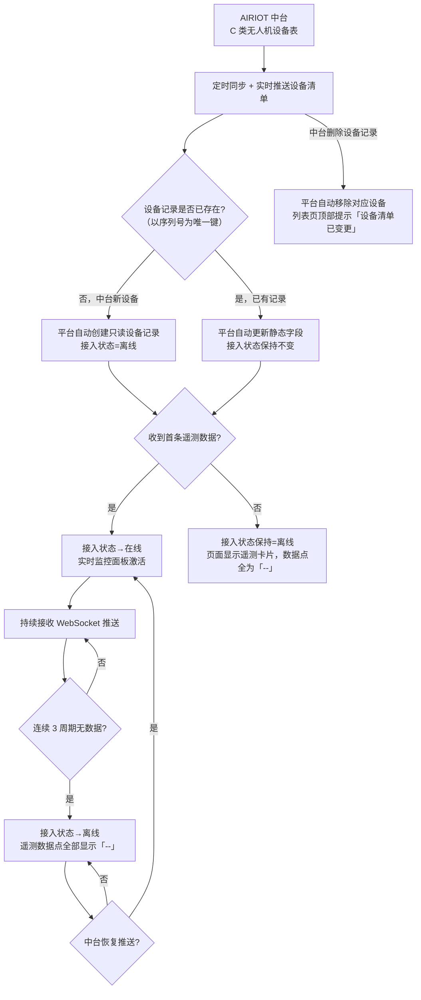
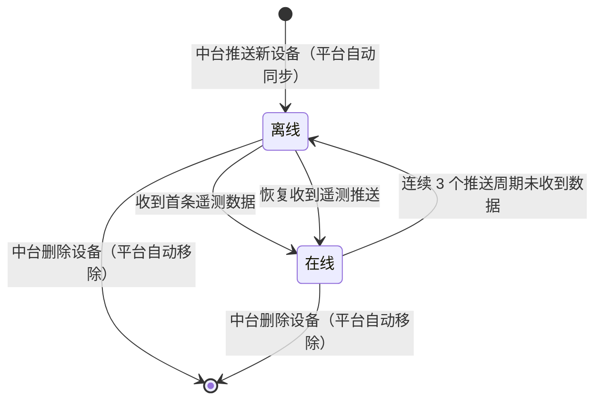

# PRD：装备管理 / C 类无人机管理

| 项 | 内容 |
|---|---|
| 文档版本 | V1.2 |
| 编制日期 | 2026-08-02 |
| 所属产品 | 中石油尼日尔公司上游油田项目 — 数智安防应急指挥中心（平台） |
| 所属端 | PC 后台 |
| 所属模块 | 装备管理 → C 类无人机管理 |
| 页面架构 | 独立列表页 + 独立详情页（不与其他装备类型共用页面） |
| 上游依据 | `应急指挥中心 (1).xmind`、`N16-PC后台功能点明细.md`、中台字段导出 `导出-数据点.xlsx`（66 个数据点全量） |
| 状态 | 待评审 |

---

## 1. 文档元数据与边界

### 1.1 需求背景

C 类无人机为**多旋翼短航程机型**，**各营地自用、就近部署**，每个营地独立持有并维护本营地的 C 类无人机资产，不跨营地共享。与 A 类无人机（固定翼、跨营地统一管理、外部权威源）完全独立，两者不共享设备台账、管理流程、页面及数据源。

C 类无人机经由 DJI 机巢部署，遥测数据通过 **AIRIOT 中台**采集后实时推送至平台。**C 类无人机的设备清单与所有字段均由 AIRIOT 中台管理，平台对 C 类无人机数据无任何写权限**，仅做只读同步、聚合展示与历史查询。

| 现状问题 | 业务影响 |
|---|---|
| C 类无人机分散各营地，缺统一台账 | 应急资源盘点遗漏 C 类无人机，调度依据不完整 |
| 中台接入状态对平台不可见 | 断连/离线无感知，调度决策依据失真 |
| 红外/激光/AI 实时数据散落中台，无聚合视图 | 现场侦察数据获取效率低，指挥员掌握态势滞后 |
| 无历史遥测数据查询入口 | 事后复盘与设备健康评估缺乏数据支撑 |

### 1.2 核心指标

| 指标 | 定义 | 目标值 |
|---|---|---|
| 台账完整度 | 平台同步的 C 类无人机数 ÷ 中台设备清单条数 | 100%，不允许平台与中台设备数不一致 |
| 实时数据刷新延迟 | 中台推送至页面显示的端到端延迟 | ≤ 3 秒 |
| 首屏加载时长 | 列表页请求发出至表格渲染完成 | ≤ 2 秒 |
| 离线判定时延 | 设备实际断连至页面标记「离线」 | ≤ 3 个通信周期 + 5 秒 |


### 1.3 与现有模块的集成关系

| 关联模块 | 关系方向 | 具体依赖内容 |
|---|---|---|
| 人员管理 → 营地与部门 | 本模块**依赖** | 列表页「所属营地」**筛选项**的候选值来源（仅取启用态营地）。注：设备自身的所属营地由 AIRIOT 中台同步，为只读字段（见 §5 表格列定义），本模块不提供营地选择器 |
| 系统管理 → 机型字典 | 本模块**依赖** | 「机型」字段的可选值来源；机型的「红外能力」标记决定实时监控面板是否显示红外分组 |
| AIRIOT 中台 | 本模块**依赖** | **C 类设备清单（名称/序列号/营地/机巢/机型）的权威数据源**；66 个遥测数据点的 WebSocket 实时推送 + REST 快照接口；设备增减由中台负责，平台自动同步 |
| 实时监控中心 → 无人机监控 | 本模块**跳转至** | 携带设备 ID 跳转，完整 GIS、航线、视频由监控中心承载 |
| 装备管理 → 机巢管理 | **松散关联** | C 类无人机的「机巢」字段由 AIRIOT 中台同步，本模块只读展示（列表列 + 详情基本信息）；机巢自身台账（环境传感器、舱门、电源等）独立维护，不在本模块范围内 |
| 大屏 → 安防态势综合驾驶舱 | 本模块**提供数据** | C 类无人机图层（经纬度 + 接入状态 + 飞行状态） |
| 统计分析 → 设备运行分析 | 本模块**提供数据** | 在线率、告警次数统计底座 |

### 1.4 本期范围（In Scope）

| 编号 | 能力 |
|---|---|
| IS-01 | 列表页：分页展示 + 多条件筛选（营地、机型、接入状态、飞行状态分组） |
| IS-02 | 详情页：单页展示设备基本信息（6 个静态字段）+ 66 个遥测数据点（13 个功能分组），**无 Tab 切换** |
| IS-03 | WebSocket 实时更新：首屏 REST 快照 + WS 增量推送 + 断线重连全量覆盖 + 3 周期超时判离线 |
| IS-04 | 跳转实时监控中心（携带设备 ID） |
| IS-05 | 全量异常处理：空态、中台连接异常、数据点超时、枚举未映射 |
| IS-06 | 中台设备清单变更检测：中台新增/删除设备时平台自动同步，清单变更时在列表页顶部提示 |

### 1.5 本期不做（Out of Scope）

| 编号 | 不做项 | 原因 |
|---|---|---|
| OS-01 | C 类无人机主数据新增、编辑、删除 | AIRIOT 中台为权威源，平台对 C 类设备数据无写权限 |
| OS-02 | 平台侧扩展信息维护（如责任人、运维备注等附加字段） | 平台不写任何 C 类数据，扩展信息统一由中台管理 |
| OS-03 | 飞行控制（起飞/降落/返航/航向调整） | 平台不接入飞控 |
| OS-04 | 任务创建、航线规划、航点编辑 | 属任务中心职责范围 |
| OS-05 | 完整 GIS 与轨迹回放 | 由实时监控中心承载，避免能力重复 |
| OS-06 | 历史视频录像回看与下载 | 中台存储能力未确认，本期不做 |
| OS-07 | 电池台账与循环次数管理 | 中台未提供独立电池标识字段 |
| OS-08 | 机巢状态监控 | 机巢为独立设备类型，有独立台账页面 |
| OS-09 | 云台控制（方向、变焦、调焦） | 平台不接入飞控 |
| OS-10 | 历史遥测数据查询（按时间范围 + 折线图 + 数据表） | 本期台账管理为主，统计分析由专项菜单承载 |

---


## 2. 业务概念与术语

| 术语 | 精确定义 | 反例（避免混淆） |
|---|---|---|
| **C 类无人机** | 多旋翼短航程机型，各营地自用，经 DJI 机巢部署，设备清单由 AIRIOT 中台管理，平台只读同步 | 不含 A 类（固定翼跨营地）；不含反无系统探测到的第三方无人机 |
| **机巢** | C 类无人机的自动起降/充电/存放装置，为独立设备类型，有独立台账。无人机与机巢的绑定关系由 AIRIOT 中台维护，本模块只读展示机巢名称 | 机巢 ≠ A 类无人机的地面站；本模块不展示机巢自身运行状态 |
| **AIRIOT 中台** | C 类无人机的权威数据源，负责设备清单管理（名称/序列号/营地/机巢/机型）及 66 个遥测数据点的采集与推送。平台对中台数据**只读** | 平台不是中台数据的权威方，中台数据变更时平台自动同步 |
| **遥测数据点** | 中台实时推送的 66 个运行时参数，全部只读，平台不可写入 | 遥测数据点 ≠ 设备静态字段；两者均只读 |
| **接入状态** | 平台计算的设备通信可达性状态（唯一由平台维护的派生字段）。取值：在线 / 离线。判定逻辑见 §3.2 | 接入状态 ≠ 飞行状态；离线不代表故障（告警信息由遥测数据点 `alarm_status` 独立展示） |
| **飞行状态** | `mode_code` 字段的实时展示语义，共 39 种原始取值。页面筛选时聚合为 4 大分组（见 §3.3） | 飞行状态由中台实时推送，平台不计算；飞行状态 ≠ 接入状态 |
| **设备静态字段** | 从中台同步的只读设备描述信息：名称、序列号、所属营地、机巢、机型、固件版本。平台展示但不可修改，中台更新时平台自动覆盖 | 不含任何遥测数据点；不可在平台侧编辑 |
| **固件版本** | 无人机当前运行的固件版本号，由**机巢驱动**采集后经 AIRIOT 中台同步至平台。属设备静态字段，仅在固件升级后变更，非实时遥测数据 | 不是遥测数据点，不随 WS 周期推送；固件版本 ≠ 机巢自身固件版本 |
| **机型** | C 类无人机的具体型号（如 DJI M30T、DJI M30），从中台同步，决定实时监控面板是否渲染红外相机分组 | 机型数据来自中台，平台不维护机型字典 |
| **红外能力** | 平台根据机型名称判断（内置映射规则）的布尔标记。具备红外能力的机型显示「红外相机」分组（10 个数据点），否则隐藏 | 内置映射规则在平台前端维护，不依赖中台字段 |
| **无效数据点** | 超出业务范围、异常或从未推送的数据点。展示为「--」，不显示上次值 | 不展示 0，0 是合法的遥测值 |

---

## 3. 核心流程与状态机

### 3.1 数据同步主流程（中台推送模式）




### 3.2 设备接入状态机



**防误判铁律（接口不可达）**：中台接口不可达（HTTP 超时/5xx）时，平台**不得**将设备判为离线。此场景下接入状态保持原值，页面顶部展示「中台连接异常，数据可能不是最新」全局提示条（黄色），直至接口恢复正常。

**告警与接入状态解耦**：设备告警状态由遥测数据点 `alarm_status` 独立展示（详情页 G01 核心状态卡片），不再占用接入状态维度。在线设备可能有告警（`alarm_status=1`），离线设备的告警状态不可见（数据点为 `null`）。

### 3.3 飞行状态（mode_code）枚举与 UI 分组

`mode_code` 共 39 种原始值，页面筛选时聚合为以下 4 个分组：

| 筛选分组 | 覆盖的 mode_code 值（label） | 列表状态标签颜色 |
|---|---|---|
| 地面待机 | 待机(0)、起飞准备(1)、起飞准备完毕(2)、未连接(14) | 灰色 |
| 飞行中 | 手动飞行(3)、自动起飞(4)、航线飞行(5)、全景拍照(6)、智能跟随(7)、ADS-B 躲避(8)、APAS(15)、虚拟摇杆(16)、矩形(17)、多边形(18)、倾斜摄影(19)、精准复拍(21)、延时摄影(22)、环绕(23)、螺旋(25)、超清(26)、智能图传打点(27)、红外光跟踪(28)、智能任务航带(29)、智能任务仿地(30)、智能任务环绕(31)、全景智能检测(32)、安防智能检测(33)、快速任务(37)、建模环综(38)、kml 航线(39) | 绿色 |
| 返航/降落 | 自动返航(9)、自动降落(10)、强制降落(11)、三桨叶降落(12) | 蓝色 |
| 特殊/异常 | 升级中(13)、gps 逃逸(34)、异常模式(35)、蜂群编队(36)、保留字段(20)、24（枚举中缺失，显示原始值） | 红色 |

> **展示规则**：详情页实时监控面板显示 `mode_code` 的完整 label 文本，不做二次聚合。
> **未映射处理**：若推送值不在上表枚举范围内，显示「未知（原始值）」，不报错。

---


## 4. 核心功能矩阵

| 操作名称 | 触发位置 | 前置条件 / 受控状态 | 业务结果摘要 |
|---|---|---|---|
| 查看设备列表 | 模块入口 | 无前置限制 | 展示从中台同步的全量 C 类无人机，分页，支持多条件筛选与关键字搜索 |
| 查看设备详情 | 列表行点击 / 行操作「详情」 | 无前置限制 | 跳转详情页，单页展示设备基本信息（顶部紧凑区）+ 13 组遥测卡片；无 Tab 切换；所有内容只读 |
| 跳转实时监控中心 | 详情页右上角「进入全屏监控」按钮 | 接入状态=在线 | 新标签页打开实时监控中心，携带 `device_id` 参数 |
| 筛选 | 列表页筛选栏 | 无前置限制 | 多条件 AND 组合筛选：营地、机型、接入状态（多选）、飞行状态分组（多选） |
| 关键字搜索 | 列表页搜索框 | 无前置限制 | 模糊匹配设备名称和序列号（OR 关系），debounce 300ms |

---


## 5. 页面布局与交互逻辑

### 5.1 设备列表页

#### 5.1.1 页面布局骨架

```
┌──────────────────────────────────────────────────────────────────┐
│ 面包屑：装备管理 / C 类无人机管理                                   │
├───────────────────────────────┬──────────────────────────────────┤
│ [所属营地 ▼] [机型 ▼]          │                  [🔍 名称/序列号] │
│ [接入状态 ▼] [飞行状态分组 ▼]  │                       [重置筛选]  │
├───────────────────────────────┴──────────────────────────────────┤
│ 设备名称 | 序列号 | 所属营地 | 机巢 | 机型 | 接入状态 | 飞行状态 | 操作 │
│ ─────────────────────────────────────────────────────────────── │
│ 行数据…                                              │ 详情      │
│ 行数据…                                              │ 详情      │
├──────────────────────────────────────────────────────────────────┤
│                                            共 XX 条  < 1 2 3 … > │
└──────────────────────────────────────────────────────────────────┘
```

#### 5.1.2 列表列定义

| 列名 | 字段来源 | 宽度 | 排序 | 说明 |
|---|---|---|---|---|
| 设备名称 | 档案字段 | 160px | 支持 | 超出显示省略号，hover 展示完整名称 |
| 序列号 | 档案字段 | 220px | 支持 | 等宽字体展示；超出截断，hover 悬浮显示完整序列号（Tooltip） |
| 所属营地 | 档案字段 | 120px | 支持 | 营地名称 |
| 机巢 | 档案字段（中台同步） | 150px | 支持 | 机巢名称；设备未绑定机巢时显示「--」 |
| 机型 | 档案字段 | 120px | 支持 | 机型名称 |
| 接入状态 | 平台计算 | 100px | 支持 | 彩色状态徽章：在线=绿、离线=灰 |
| 飞行状态 | `mode_code` 实时值 | 120px | 不支持 | 显示完整 label；接入状态=离线时显示「--」 |
| 操作 | — | 80px | — | 「详情」文字链；无编辑、无删除 |

#### 5.1.3 筛选联动规则

| 筛选项 | 组件 | 数据来源 | 联动说明 |
|---|---|---|---|
| 所属营地 | 多选下拉 | 营地与部门（启用态） | 多选，OR 关系 |
| 机型 | 多选下拉 | 机型字典 | 多选，OR 关系 |
| 接入状态 | 多选下拉 | 固定枚举：在线/离线 | 多选，OR 关系 |
| 飞行状态分组 | 多选下拉 | 固定：地面待机/飞行中/返航降落/特殊异常 | 多选，OR；仅筛选接入状态=在线的设备 |
| 关键字 | 输入框 | — | 模糊匹配设备名称 OR 序列号；实时触发（debounce 300ms） |

---


### 5.2 设备详情页（无 Tab，单页滚动）

#### 5.2.1 页面布局骨架

```
┌──────────────────────────────────────────────────────────────────┐
│ 面包屑：装备管理 / C 类无人机管理 / {设备名称}                       │
│ ● 在线  🟢 飞行中                         [进入全屏监控] [返回列表] │
├──────────────────────────────────────────────────────────────────┤
│ ┌── 设备基本信息（只读，来自中台同步）──────────────────────────┐  │
│ │ 序列号：DJI-XXXXXXX  所属营地：Jaouro                        │  │
│ │ 机巢：Jaouro 1 号机巢  机型：DJI M30T                        │  │
│ │ 固件版本：v04.01.0203                                        │  │
│ │ 最后同步时间：2026-08-02 11:30:05                           │  │
│ └─────────────────────────────────────────────────────────────┘  │
│ 数据最后更新：11:30:08  ● 实时                         [手动刷新] │
├──────────────────────────────────────────────────────────────────┤
│ ┌─ G01 核心状态 ┐  ┌─ G02 飞行数据 ┐  ┌─ G03 电量续航 ┐          │
│ ┌─ G04 主位置 ──┐  ┌─ G05 RTK定位 ─┐  ┌─ G06 姿态/云台┐          │
│ ┌─ G07 飞行限制 ┐  ┌─ G08 存储 ────┐  ┌─ G09 信号通信 ┐          │
│ ┌─ G10 避障 ────┐  ┌─ G11 光学相机 ┐  ┌─ G12 激光测距 ┐          │
│ ┌─ G13 红外相机（仅具备红外能力的机型显示）─────────────────────┐  │
└──────────────────────────────────────────────────────────────────┘
```

**遥测卡片显示规则**：
- 接入状态=离线时：遥测卡片正常渲染，所有数据点值显示「--」，卡片区顶部提示「设备已离线，数据停止更新」
- 接入状态=在线时：遥测卡片实时更新，WS 增量推送

#### 5.2.2 设备静态字段说明

| 字段名 | 数据来源 | 可写性 | 说明 |
|---|---|---|---|
| 设备名称 | AIRIOT 中台同步 | 只读 | 显示在页面标题行；中台变更后平台自动覆盖 |
| 序列号 | AIRIOT 中台同步 | 只读 | 等宽字体展示；作为设备唯一标识与中台记录匹配 |
| 所属营地 | AIRIOT 中台同步 | 只读 | 显示中台原始营地名称 |
| 机巢 | AIRIOT 中台同步 | 只读 | 该无人机当前绑定的机巢名称，展示位置在「所属营地」与「机型」之间；未绑定机巢时显示「--」。仅展示名称，机巢自身状态不在本模块 |
| 机型 | AIRIOT 中台同步 | 只读 | 决定是否显示 G13 红外相机分组（见 §2 术语「红外能力」） |
| 固件版本 | **机巢驱动**采集 → AIRIOT 中台同步 | 只读 | 无人机当前固件版本号，展示位置在「机型」与「最后同步时间」之间；等宽字体展示。**数据点来自机巢驱动**，仅在固件升级后变更，不随遥测周期刷新；机巢驱动未上报或设备未绑定机巢时显示「--」 |
| 最后同步时间 | 平台计算 | 只读 | 平台最后一次从中台成功同步静态字段的时间戳 |

#### 5.2.3 遥测数据点分组定义（全量 66 个）

**通用展示规则**
- 所有数据点值超时（最后推送时间距当前 > 3 个通信周期）：值区域显示「--」，不显示上次缓存值。
- 枚举字段：按中台配置的 label 文本显示；推送值不在枚举范围内则显示「未知（{原始值}）」。
- 经纬度字段（`latitude`/`longitude`/`position_state_rtk_lat`/`position_state_rtk_lon`/`measure_target_latitude`/`measure_target_longitude`）：展示方式为「DD.DDDDDD°」保留 6 位小数，中台原始值为 slice 格式时由前端解析转换。
- 数值字段：若中台有 `小数位数` 配置则按配置保留；否则保留 2 位小数。

---

**G01 — 核心状态**（4 个数据点）

| 数据点标识 | 显示名称 | 单位 | 枚举值 | 展示样式 |
|---|---|---|---|---|
| `mode_code` | 无人机状态 | — | 见 §3.3 全量 39 种，按 label 显示 | 彩色徽章：飞行中=绿、地面待机=灰、返航降落=蓝、特殊异常=红 |
| `alarm_status` | 告警状态 | — | 0=未告警 / 1=有告警 | 徽章：未告警=绿、有告警=红（有告警时整个分组卡片标题行加红色高亮边） |
| `activation_time` | 无人机激活时间 | — | — | 日期时间格式：`YYYY-MM-DD HH:mm:ss` |
| `total_flight_time` | 累计飞行时长 | s | — | 自动换算展示：`X 小时 X 分 X 秒`；原始值单位秒保留在 tooltip 中 |

**G02 — 飞行数据**（6 个数据点）

| 数据点标识 | 显示名称 | 单位 | 展示规则 |
|---|---|---|---|
| `elevation` | 相对起飞点高度 | m | 保留 1 位小数 |
| `height` | 海拔高度 | m | 保留 1 位小数 |
| `hae` | 椭球高 | m | 保留 2 位小数；tooltip 说明「WGS-84 椭球高，与海拔高度有差异」 |
| `horizontal_speed` | 水平速度 | m/s | 保留 1 位小数 |
| `vertical_speed` | 垂直速度 | m/s | 保留 1 位小数；正值=上升，负值=下降，前端不额外标注方向 |
| `home_distance` | 距离 Home 点 | m | 保留 0 位小数（取整） |

**G03 — 电量续航**（2 个数据点）

| 数据点标识 | 显示名称 | 单位 | 展示规则 |
|---|---|---|---|
| `battery_capacity_percent` | 剩余电量 | % | 进度条 + 数值；≤20% 时进度条变红色，≤10% 时整体分组卡片标题行加红色高亮边 |
| `battery_remain_flight_time` | 剩余飞行时间 | s | 换算展示：`X 分 X 秒` |

**G04 — 主位置**（2 个数据点）

| 数据点标识 | 显示名称 | 单位 | 展示规则 |
|---|---|---|---|
| `latitude` | 纬度 | — | DD.DDDDDD° 格式，6 位小数 |
| `longitude` | 经度 | — | DD.DDDDDD° 格式，6 位小数 |


**G05 — RTK 精准定位**（12 个数据点）

| 数据点标识 | 显示名称 | 单位 | 枚举值 / 展示规则 |
|---|---|---|---|
| `position_state_coordinate_sys` | 坐标系 | — | 0=WGS84 / 1=RTK 移动站 |
| `position_state_calibration` | 校准状态 | — | 无枚举，显示原始值；中台未配置映射 |
| `position_state_fix_sta` | RTK fix 状态 | — | 0=未 fix / 1=fix |
| `position_state_gps_number` | GPS 搜星数量 | — | 整数展示 |
| `position_state_quality` | 搜星档位 | — | 1=1 档 / 2=2 档 / 3=3 档 / 4=4 档 / 5=5 档 |
| `position_state_rtk_number` | RTK 搜星数量 | — | 整数展示 |
| `position_state_rtk_hgt` | RTK 高度 | m | 保留 2 位小数 |
| `position_state_rtk_lat` | RTK 纬度 | — | DD.DDDDDD° 格式，slice 原始值前端解析 |
| `position_state_rtk_lon` | RTK 经度 | — | DD.DDDDDD° 格式，slice 原始值前端解析 |
| `position_state_rtk_inpos` | RTK 模块是否在位置 | — | 0=没有在位置 / 1=在位置 |
| `position_state_rtk_used` | RTK 使用状态 | — | 0=没有使用 / 1=在使用 |
| `position_state_is_fixed` | 是否收敛 | — | 0=未开始 / 1=收敛中 / 2=收敛成功 / 3=收敛失败；收敛失败时文字标红 |

**G06 — 姿态/云台**（6 个数据点）

| 数据点标识 | 显示名称 | 单位 | 展示规则 |
|---|---|---|---|
| `attitude_head` | 偏航轴角度（机身） | ° | 保留 1 位小数；范围 -180~180 |
| `attitude_pitch` | 俯仰轴角度（机身） | ° | 保留 1 位小数 |
| `attitude_roll` | 横滚轴角度（机身） | ° | 保留 1 位小数 |
| `gimbal_pitch` | 云台俯仰轴角度 | ° | 保留 1 位小数 |
| `gimbal_roll` | 云台横滚轴角度 | ° | 保留 1 位小数 |
| `gimbal_yaw` | 云台偏航轴角度 | ° | 保留 1 位小数 |

**G07 — 飞行限制**（6 个数据点）

| 数据点标识 | 显示名称 | 单位 | 枚举值 / 展示规则 |
|---|---|---|---|
| `height_limit` | 无人机限高 | m | 整数展示 |
| `distance_limit` | 限远距离 | m | 整数展示 |
| `distance_limit_state` | 限远是否开启 | — | 0=未设置 / 1=已设置 |
| `is_near_distance_limit` | 是否接近限制距离 | — | 0=未达到 / 1=接近（值=1 时文字标黄警示） |
| `is_near_area_limit` | 是否接近区域限制 | — | 无枚举，显示原始值（0/1 或其他）；值非 0 时文字标黄警示 |
| `is_near_height_limit` | 是否接近高度限制 | — | 无枚举，显示原始值；值非 0 时文字标黄警示 |

**G08 — 存储**（3 个数据点）

| 数据点标识 | 显示名称 | 单位 | 展示规则 |
|---|---|---|---|
| `storage_type` | 存储类型 | — | 无枚举，显示原始值；中台未配置映射 |
| `storage_total` | 存储总容量 | KB | 自动换算：≥1048576 显示 GB，≥1024 显示 MB，否则显示 KB，保留 1 位小数 |
| `storage_used` | 已使用容量 | KB | 同上换算规则；额外显示使用率进度条（used/total）；使用率 ≥ 90% 时进度条标红 |

**G09 — 信号/通信**（5 个数据点）

| 数据点标识 | 显示名称 | 单位 | 展示规则 |
|---|---|---|---|
| `wireless_link_4g_uav_quality` | 无人机 4G 信号质量 | — | 整数展示；可选信号格图标（0-5 格） |
| `air_link_signal_strength` | 图传信号强度 | — | 整数展示 |
| `night_lights_state` | 夜航灯状态 | — | 0=关闭 / 1=打开 |
| `rid_state` | RID 状态 | — | 无枚举，无中文名（中台原始标识即 rid_state），显示原始值；tooltip 说明「无人机广播身份标识状态，具体枚举由中台补充配置」 |
| `remote_id_status` | RemoteId 工作状态 | — | 0=关闭 / 1=开启 / 3=自检异常（3 时文字标红） |

**G10 — 避障**（3 个数据点）

| 数据点标识 | 显示名称 | 单位 | 枚举值 |
|---|---|---|---|
| `obstacle_avoidance_downside` | 下方避障 | — | 0=关闭 / 1=打开 |
| `obstacle_avoidance_horizon` | 水平避障 | — | 0=关闭 / 1=打开 |
| `obstacle_avoidance_upside` | 上方避障 | — | 0=关闭 / 1=打开 |


**G11 — 光学相机**（2 个数据点）

| 数据点标识 | 显示名称 | 单位 | 展示规则 |
|---|---|---|---|
| `zoom_factor` | 可见光变焦倍数 | — | 保留 1 位小数；显示为「{值}x」 |
| `ai_enable_func` | AI 识别启用状态 | — | 0=关闭 / 1=开启 |

**G12 — 激光测距**（5 个数据点）

| 数据点标识 | 显示名称 | 单位 | 展示规则 |
|---|---|---|---|
| `measure_target_error_state` | 激光测距开关 | — | 0=关闭 / 1=开启；关闭时本分组其余 4 个数据点显示「--（激光测距已关闭）」 |
| `measure_target_distance` | 测距目标距离 | m | 保留 1 位小数 |
| `measure_target_longitude` | 测距目标经度 | — | DD.DDDDDD° 格式，slice 原始值前端解析 |
| `measure_target_latitude` | 测距目标纬度 | — | DD.DDDDDD° 格式，slice 原始值前端解析 |
| `measure_target_altitude` | 测距目标高度 | m | 保留 1 位小数 |

**G13 — 红外相机**（10 个数据点）⚠️ 仅机型具备红外能力时显示此分组，否则整个分组卡片隐藏

| 数据点标识 | 显示名称 | 单位 | 展示规则 |
|---|---|---|---|
| `infrared_camera_average_temp` | 平均温度 | °C | 保留 1 位小数 |
| `infrared_camera_center_temp` | 中心温度 | °C | 保留 1 位小数 |
| `infrared_camera_cold_temp` | 最低温度 | °C | 保留 1 位小数；蓝色文字 |
| `infrared_camera_hot_temp` | 最高温度 | °C | 保留 1 位小数；橙红色文字 |
| `infrared_camera_touch_temp` | 表面温度 | °C | 保留 1 位小数 |
| `infrared_camera_cold_x` | 最低温点 X 坐标 | px | 整数，与 `cold_y` 配对展示为「({x}, {y})」 |
| `infrared_camera_cold_y` | 最低温点 Y 坐标 | px | 整数，与 `cold_x` 配对展示 |
| `infrared_camera_hot_x` | 最高温点 X 坐标 | px | 整数，与 `hot_y` 配对展示为「({x}, {y})」 |
| `infrared_camera_hot_y` | 最高温点 Y 坐标 | px | 整数，与 `hot_x` 配对展示 |
| `infrared_camera_zoom_factor` | 红外变焦倍数 | — | 保留 1 位小数；显示为「{值}x」 |

---

## 6. 边界情况与异常处理

### 6.1 中台同步异常

| 编号 | 触发场景 | 处理方式 |
|---|---|---|
| E-01 | 中台新增设备，但序列号已存在于平台（重复同步） | 幂等处理：以序列号为唯一键，更新已有记录的静态字段，不创建重复行 |
| E-02 | 中台删除设备 | 平台自动从列表移除该设备；列表页顶部短暂提示「设备清单已变更：{设备名称} 已被中台移除」（5 秒后自动消失） |
| E-03 | 中台修改设备静态字段（名称/序列号/营地/机巢/机型/固件版本） | 平台自动用中台最新值覆盖；详情页「最后同步时间」更新。机巢改绑或解绑同样即时生效，平台不保留历史绑定关系；固件升级后版本号自动更新，平台不保留历史版本记录 |
| E-04 | 中台推送的机型名称在平台内置红外能力映射表中未找到 | G13 红外分组隐藏；详情页遥测区顶部提示「当前机型（{机型名}）的红外能力未知，如需显示红外数据请联系平台管理员更新映射表」 |
| E-05 | 中台设备同步接口不可达 | 平台已有设备记录保持不变，接入状态不受影响；列表页顶部黄色提示条「中台设备清单同步异常，显示的设备列表可能不是最新」 |
| E-14 | 设备未绑定机巢（中台机巢字段为空） | 列表「机巢」列与详情「机巢」字段均显示「--」，不阻断其他字段展示，不产生告警 |
| E-15 | 中台推送的机巢标识在平台机巢台账中无对应记录 | 降级显示中台原始标识值，不显示为空、不报错；平台不因此判定数据异常 |
| E-16 | 机巢驱动未上报固件版本（含设备未绑定机巢的情形） | 详情页「固件版本」显示「--」，不阻断其他字段展示，不产生告警 |

### 6.2 实时数据异常

| 编号 | 触发场景 | 处理方式 |
|---|---|---|
| E-06 | WebSocket 连接断开 | 页面顶部黄色提示条「实时数据连接已断开，正在重连…」；后台自动重连，重连成功后立即请求 REST 快照刷新全量数据，提示条自动消失 |
| E-07 | 中台接口不可达（HTTP 5xx / 超时） | 顶部黄色提示条「中台连接异常，数据可能不是最新」；**不将设备标记为离线**；恢复后提示条消失 |
| E-08 | 连续 3 个通信周期未收到设备数据（非接口不可达） | 接入状态变更为「离线」；遥测卡片所有数据点值显示「--」，卡片区顶部显示「设备已离线，数据停止更新」 |
| E-09 | `mode_code` 推送值不在枚举表中 | 显示「未知（{原始值}）」，不报错、不阻断页面渲染 |
| E-10 | 红外相机数据全部为 null/空（机型具备红外能力但设备未挂载红外负载） | 红外分组卡片正常显示，各字段值显示「--」，tooltip 说明「暂无数据，请确认设备是否挂载红外相机」 |
| E-11 | 激光测距已关闭（`measure_target_error_state`=0）时其余测距数据推送为空 | 测距目标距离/经度/纬度/高度全部显示「--（激光测距已关闭）」 |

### 6.3 列表空态

| 编号 | 触发场景 | 展示内容 |
|---|---|---|
| E-12 | 中台尚无 C 类无人机设备（全局空态） | 空态图示 + 「暂无 C 类无人机，设备清单由 AIRIOT 中台管理，请确认中台是否已录入设备」 |
| E-13 | 筛选/搜索无结果 | 空态图示 + 「未找到符合条件的设备，请调整筛选条件」 + 「重置筛选」链接 |

---

*文档结束。版本 V1.2，2026-08-02，待评审。*


