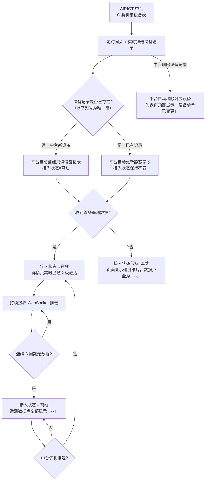
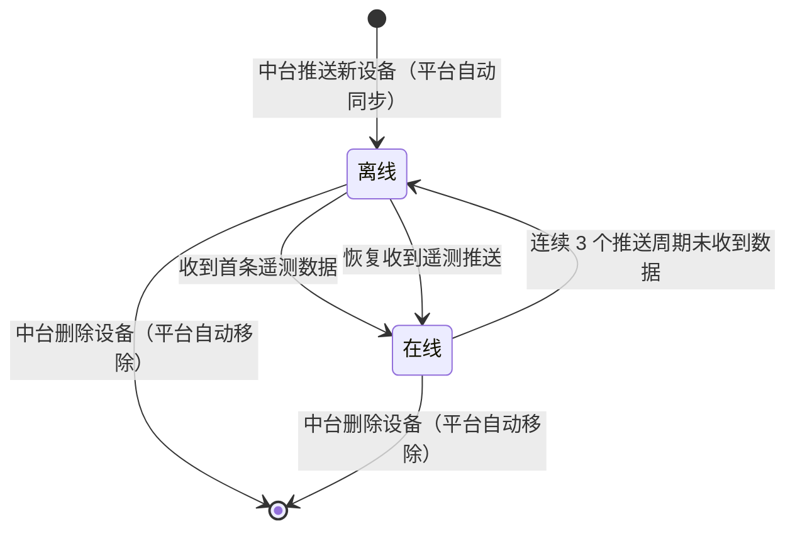

# PRD — 装备管理 · C 类机巢管理

| 项 | 内容 |
|---|---|
| 文档版本 | V1.0 |
| 编制日期 | 2026-08-13 |
| 所属产品 | 中石油尼日尔公司上游油田项目 — 数智安防应急指挥中心（平台） |
| 所属端 | PC 后台 |
| 所属模块 | 装备管理 → C 类机巢管理 |
| 页面架构 | 独立列表页 + 独立详情页（不与其他装备类型共用页面） |
| 上游依据 | `应急指挥中心 (1).xmind`、`N16-PC后台功能点明细.md`、中台字段导出 `导出-数据点 (1).xlsx`（29 个遥测数据点） |
| 状态 | 待评审 |

---

## 1. 文档元数据与边界

### 1.1 需求背景

C 类机巢为 **DJI 自动机场**（Dock），是 C 类无人机的自动起降/充电/存放装置，各营地独立部署，每个营地持有并维护本营地的机巢资产。机巢经由 **AIRIOT 中台**采集遥测数据后实时推送至平台。

**机巢的设备清单与所有字段均由 AIRIOT 中台管理，平台对机巢数据无任何写权限**，仅做只读同步、聚合展示与实时监控。

| 现状问题 | 业务影响 |
|---|---|
| 机巢分散各营地，缺统一台账 | 应急资源盘点遗漏机巢，调度依据不完整 |
| 中台接入状态对平台不可见 | 断连/离线无感知，调度决策依据失真 |
| 环境监测、电池、舱盖等实时数据散落中台，无聚合视图 | 现场设备状态获取效率低，指挥员掌握态势滞后 |
| 无历史遥测数据查询入口 | 事后复盘与设备健康评估缺乏数据支撑 |

### 1.2 核心指标

| 指标 | 定义 | 目标值 |
|---|---|---|
| 台账完整度 | 平台同步的机巢数 ÷ 中台设备清单条数 | 100%，不允许平台与中台设备数不一致 |
| 实时数据刷新延迟 | 中台推送至页面显示的端到端延迟 | ≤ 3 秒 |
| 首屏加载时长 | 列表页请求发出至表格渲染完成 | ≤ 2 秒 |
| 离线判定时延 | 设备实际断连至页面标记「离线」 | ≤ 3 个通信周期 + 5 秒 |

### 1.3 与现有模块的集成关系

| 关联模块 | 关系方向 | 具体依赖内容 |
|---|---|---|
| 人员管理 → 营地与部门 | 本模块**依赖** | 列表页「所属营地」**筛选项**的候选值来源（仅取启用态营地）。注：设备自身的所属营地由 AIRIOT 中台同步，为只读字段 |
| AIRIOT 中台 | 本模块**依赖** | **机巢设备清单（名称/序列号/营地/固件版本/位置）的权威数据源**；29 个遥测数据点的 WebSocket 实时推送 + REST 快照接口；设备增减由中台负责，平台自动同步 |
| 实时监控中心 → 机巢监控 | 本模块**跳转至** | 携带机巢 ID 跳转，完整 GIS、视频、环境监控由监控中心承载 |
| 装备管理 → C 类无人机管理 | **松散关联** | 机巢与 C 类无人机为绑定关系，机巢字段包含无人机在线状态（`drone_online_state`）；无人机详情页有机巢字段 |
| 大屏 → 安防态势综合驾驶舱 | 本模块**提供数据** | 机巢图层（经纬度 + 接入状态 + 舱盖状态） |
| 统计分析 → 设备运行分析 | 本模块**提供数据** | 在线率、告警次数统计底座 |

### 1.4 本期范围（In Scope）

| 编号 | 能力 |
|---|---|
| IS-01 | 列表页：分页展示 + 多条件筛选（营地、接入状态） |
| IS-02 | 详情页：单页展示设备基本信息（9 个字段）+ 29 个遥测数据点（6 个功能分组），**无 Tab 切换** |
| IS-03 | WebSocket 实时更新：首屏 REST 快照 + WS 增量推送 + 断线重连全量覆盖 + 3 周期超时判离线 |
| IS-04 | 跳转实时监控中心（携带机巢 ID） |
| IS-05 | 查看位置：机巢位置 + 备降点位置（GIS Modal，只读） |
| IS-06 | 全量异常处理：空态、中台连接异常、数据点超时、枚举未映射 |
| IS-07 | 中台设备清单变更检测：中台新增/删除设备时平台自动同步，清单变更时在列表页顶部提示 |

### 1.5 本期不做（Out of Scope）

| 编号 | 不做项 | 原因 |
|---|---|---|
| OS-01 | 机巢主数据新增、编辑、删除 | AIRIOT 中台为权威源，平台对机巢设备数据无写权限 |
| OS-02 | 平台侧扩展信息维护（如责任人、运维备注等附加字段） | 平台不写任何机巢数据，扩展信息统一由中台管理 |
| OS-03 | 机巢远程控制（开舱盖、关舱盖、启动充电、推出归中杆等） | 平台不接入机巢控制指令 |
| OS-04 | 历史遥测数据查询（按时间范围 + 折线图 + 数据表） | 本期台账管理为主，统计分析由专项菜单承载 |
| OS-05 | 机巢告警规则配置 | 告警规则由中台管理 |
| OS-06 | 机巢与无人机的绑定关系管理 | 绑定关系由中台维护 |
| OS-07 | 备降点标记/修改 | 平台完全只读，备降点由中台或机巢驱动配置 |
| OS-08 | 机巢视频监控（舱内摄像头画面） | 由实时监控中心承载 |

---

## 2. 业务概念与术语

| 术语 | 精确定义 | 反例（避免混淆） |
|---|---|---|
| **C 类机巢** | DJI 自动机场（Dock），C 类无人机的自动起降/充电/存放装置，各营地独立部署，设备清单由 AIRIOT 中台管理，平台只读同步 | 机巢 ≠ A 类无人机的地面站；不含第三方厂商的机巢设备 |
| **AIRIOT 中台** | 机巢的权威数据源，负责设备清单管理（名称/序列号/营地/固件版本/位置）及 29 个遥测数据点的采集与推送。平台对中台数据**只读** | 平台不是中台数据的权威方，中台数据变更时平台自动同步 |
| **遥测数据点** | 中台实时推送的 29 个运行时参数，全部只读，平台不可写入 | 遥测数据点 ≠ 设备静态字段；两者均只读 |
| **接入状态** | 平台计算的机巢通信可达性状态（唯一由平台维护的派生字段）。取值：在线 / 离线。判定逻辑见 §3.2 | 接入状态 ≠ 无人机在线状态；离线不代表故障（告警信息由遥测数据点 `alarm_state` 独立展示） |
| **设备静态字段** | 从中台同步的只读设备描述信息：名称、序列号、所属营地、经度、纬度、固件版本。平台展示但不可修改，中台更新时平台自动覆盖 | 不含任何遥测数据点；不可在平台侧编辑 |
| **固件版本** | 机巢当前运行的固件版本号，由**机巢驱动**采集后经 AIRIOT 中台同步至平台。属设备静态字段，仅在固件升级后变更，非实时遥测数据 | 不是遥测数据点，不随 WS 周期推送 |
| **备降点** | 无人机备用降落位置，包含经纬度 + 安全降落高度，由中台或机巢驱动配置，平台只读展示 | 备降点 ≠ 机巢自身位置；备降点用于无人机异常返航 |
| **舱盖/归中杆** | 机巢物理组件状态。舱盖=机巢顶盖（关闭/打开/半开/异常）；归中杆=无人机起降定位杆（已回收/已推开/半开/异常） | 舱盖状态 ≠ 机巢在线状态；归中杆状态 ≠ 无人机在舱状态 |
| **无人机在舱状态** | 布尔字段 `drone_in_dock`，表示无人机是否停放在机巢内（舱内/舱外） | 舱内 ≠ 充电中；舱外 ≠ 飞行中 |
| **备用电池** | 机巢自带的备用电源，用于市电断电时维持机巢基础功能，包含剩余电量/温度/电压/开关状态 4 个遥测数据点 | 备用电池 ≠ 无人机电池；两者独立监控 |
| **无效数据点** | 超出业务范围、异常或从未推送的数据点。展示为「--」，不显示上次值 | 不展示 0，0 是合法的遥测值 |

---

## 3. 核心流程与状态机

### 3.1 数据同步主流程（中台推送模式）



### 3.2 机巢接入状态机



**防误判铁律（接口不可达）**：中台接口不可达（HTTP 超时/5xx）时，平台**不得**将设备判为离线。此场景下接入状态保持原值，页面顶部展示「中台连接异常，数据可能不是最新」全局提示条（黄色），直至接口恢复正常。

**告警与接入状态解耦**：设备告警状态由遥测数据点 `alarm_state` 独立展示（详情页基本信息区块），不再占用接入状态维度。在线设备可能有告警，离线设备的告警状态不可见（数据点为 `null`）。

---

## 4. 核心功能矩阵

| 动作名称 | 触发位置 | 前置条件 / 受控状态 | 业务结果概述 |
|---|---|---|---|
| 进入机巢列表页 | 顶部菜单「装备管理 → C 类机巢管理」 | 用户具备装备管理菜单权限 | 加载全量快照并建立实时连接，默认按名称升序展示第 1 页 |
| 按营地筛选 | 筛选栏 · 所属营地多选下拉框 + 「搜 索」按钮 | 营地选项来源于启用态营地 | 按选中营地过滤，结果重置到第 1 页；空选等同于不限该条件 |
| 按在线状态筛选 | 筛选栏 · 在线状态单选下拉框 | 选项固定为「全部 / 在线 / 离线」 | 选中后不自动查询，需点击「搜 索」生效；结果重置到第 1 页 |
| 重置筛选 | 筛选栏 · 「重 置」按钮 | 无 | 营地清空、在线状态回到「全部」，立即以无条件重新查询并回到第 1 页 |
| 翻页 | 表格右下角分页器 | 总条数 > 每页条数时可用 | 加载目标页数据，筛选条件保持不变 |
| 查看备降点 | 列表备降点列 · 「查看」链接 | 该机巢已配置备降点坐标 | 弹出 GIS Modal（80%宽、80vh高），地图定位备降点，底部显示经纬度（只读） |
| 进入详情页 | 列表操作列 · 「详情」按钮 | 无 | 跳转详情页，路由 `/equipment/c-nest/:id`，加载设备静态字段 + 遥测数据，建立 WS 实时推送 |
| 查看机巢位置 | 详情页工具栏 · 「查看位置」按钮 | 无 | 弹出 GIS Modal，地图定位机巢坐标，底部显示经纬度（只读） |
| 查看备降点（详情页） | 详情页备降点配置卡片 · 「📍 查看」链接 | 已配置备降点坐标 | 弹出 GIS Modal，地图定位备降点，底部显示经纬度（只读） |
| 进入实时监控 | 详情页工具栏 · 「进入实时监控」按钮 | 无 | 携带机巢 ID 跳转实时监控中心 → 机巢监控页面 |
| 手动刷新 | 详情页工具栏 · 「手动刷新」按钮 | 无 | 立即请求 REST 快照刷新全量数据，刷新后显示 Toast「数据已更新」 |
| 返回列表 | 详情页工具栏 · 「返回列表」链接 | 无 | 关闭 WebSocket，跳转回列表页 |
| 接收实时状态更新 | 系统自动（WebSocket） | 长连接处于已建立状态 | 按机巢 ID 定位，局部刷新变更字段，不打断用户正在进行的操作 |
| 断线重连与状态对齐 | 系统自动 | WebSocket 断开 | 每 5 秒重连一次；连接恢复后立即重新拉取全量快照，以快照结果**整体覆盖**本地状态 |
| 重试加载 | 列表加载失败占位区 · 「重试」按钮 | 仅在请求失败态可见 | 重新发起当前筛选条件下的列表请求 |
| 离开页面清理 | 切换页签 / 路由跳转 / 关闭标签页 | 无 | 关闭 WebSocket、清除全部定时器，释放监听 |

> 矩阵中不含任何增、删、改类动作，与 §1.4 权限边界一致。

---

## 5. 页面布局与交互逻辑

### 5.1 列表页骨架

```
┌──────────────────────────────────────────────────────────────────────────────────┐
│ 顶部主导航： 实时态势 │ 反无系统 │ 摄像头监控 │ C类无人机 │ A类无人机 │ [系统管理] │
├────────────┬─────────────────────────────────────────────────────────────────────┤
│            │  ┌────────┬──────────┬──────────┬──────────┬────────┬──────────┐   │
│  用户管理   │  │ 反无设备│ 摄像头设备│ A类无人机 │ A类地面站 │[C类机巢]│ C类无人机│  │
│ ▸[设备管理] │  └────────┴──────────┴──────────┴──────────┴────────┴──────────┘   │
│  区域管理   │                                                                     │
│            │  ┌───────────────────────────────────────────────────────────────┐ │
│            │  │ 所属营地 [全部 ▾]  在线状态 [全部 ▾]  [搜 索] [重 置]          │ │
│            │  └───────────────────────────────────────────────────────────────┘ │
│            │                                                                     │
│            │  ┌───────────────────────────────────────────────────────────────┐ │
│            │  │名称│序列号│营地│状态│备降点│固件版本│操作│                     │ │
│            │  ├───────────────────────────────────────────────────────────────┤ │
│            │  │Koulele-Nest-01│SN001│Koulele│在线│查看│v1.2.3│详情│            │ │
│            │  │Dibeilla-Nest-02│SN002│Dibeilla│离线│--│v1.2.1│详情│           │ │
│            │  │ …│  …    │  …   │ … │ … │ … │ …     │                         │ │
│            │  └───────────────────────────────────────────────────────────────┘ │
│            │                                                                     │
│            │                                         ‹  [1]  2  3  ›   共 N 条   │
└────────────┴─────────────────────────────────────────────────────────────────────┘
```

> 全局中断提示条（仅异常态出现）插入位置：页签行与筛选栏之间，通栏展示，高度 40px。

### 5.2 筛选栏字段规则

| 字段 | 控件类型 | 是否必填 | 默认值 | 取值/限制规则 | 数据来源 |
|---|---|---|---|---|---|
| 所属营地 | 多选下拉框 | 否 | 空（全部） | 候选值来自「人员管理 → 营地与部门」模块启用态营地；支持全选/清空；选中后需点击「搜 索」生效 | 营地管理模块 |
| 在线状态 | 单选下拉框 | 否 | 全部 | 固定三项：全部 / 在线 / 离线。不支持多选、不可清空为空值 | 前端硬编码 |
| 搜 索 | 主按钮 | —— | —— | 常态可点击；请求进行中显示 loading 且禁用，防重复提交 | —— |
| 重 置 | 次按钮 | —— | —— | 常态可点击；请求进行中禁用 | —— |

**筛选逻辑约定**：所属营地与在线状态之间为 **AND（交集）** 关系。两项均为空/全部时，返回全部设备。

### 5.3 表格列定义

| 序号 | 列名 | 数据字段 | 数据类型 | 列宽 | 对齐 | 排序 | 空值/异常渲染 |
|---|---|---|---|---|---|---|---|
| 1 | 名称 | `name` | 字符串 | 200px | 左 | 默认升序，支持点击切换升/降序 | 主键，恒不为空 |
| 2 | 序列号 | `serial_number` | 字符串 | 180px | 左 | 不支持 | 超出列宽以 `…` 截断，悬浮显示完整序列号 Tooltip |
| 3 | 所属营地 | `camp` | 字符串 | 140px | 左 | 不支持 | 关联营地档案取名称；关联失败时显示原始 ID 并置灰 |
| 4 | 在线状态 | 接入状态（平台计算） | 枚举 | 100px | 居中 | 不支持 | `在线` 显示绿色 StatusTag(ok)，`离线` 显示红色 StatusTag(danger) |
| 5 | 备降点 | `alternate_land_point_configured` + 坐标 | 布尔 + 数值 | 100px | 居中 | 不支持 | 已配置且有坐标：显示「查看」链接（点击弹出 GIS Modal）；未配置或无坐标：显示 `--` |
| 6 | 固件版本 | `firmware_version` | 字符串 | 120px | 左 | 不支持 | 空值显示 `--` |
| 7 | 操作 | `action` | - | 120px | 居中 | 不支持 | 固定右侧；包含「详情」按钮 |

**表格通用规则**

| 项 | 规则 |
|---|---|
| 行高 | 65px，固定 |
| 表头 | 吸顶固定，随内容区横向滚动同步 |
| 斑马纹 | 不使用 |
| 行悬浮 | 整行背景高亮，鼠标指针为默认箭头（非手型，强调不可点击） |
| 行点击 | 无任何响应 |
| 勾选框 | 不提供 |
| 操作列 | 提供，固定在右侧，宽度 120px，包含「详情」按钮 |
| 横向滚动 | 列总宽超出容器时出现横向滚动条，名称与序列号两列左侧冻结 |
| 每页条数 | 20 条/页，底部提供每页条数切换器（可选 10/20/50/100） |
| 分页器 | 右下角，展示页码与总条数；总条数 ≤ 当前每页条数时分页器隐藏 |
| 默认排序 | `名称` 升序 |

### 5.4 联动规则表

| 触发条件 | 联动对象 | 联动行为 |
|---|---|---|
| 用户切换「所属营地」下拉选项 | 表格数据 | **不自动查询**，需点击「搜 索」后生效 |
| 用户切换「在线状态」下拉选项 | 表格数据 | **不自动查询**，需点击「搜 索」后生效 |
| 用户点击「搜 索」 | 分页器 | 强制重置到第 1 页 |
| 用户点击「重 置」 | 所属营地、在线状态、分页器 | 两者同时复位（空、全部），并立即触发一次无条件查询，回到第 1 页 |
| 列表请求进行中 | 「搜 索」「重 置」按钮、分页器 | 全部置为禁用态，表格区展示骨架屏 |
| 列表请求进行中 | WebSocket 增量消息 | 暂存于缓冲队列，待新列表渲染完成后按机巢 ID 匹配补齐；匹配不到的消息直接丢弃 |
| 收到某机巢增量推送 | 该机巢所在行的对应单元格 | 仅局部更新变更字段，触发一次 800ms 的背景色高亮渐隐动效；不重排行序、不重置滚动位置 |
| 收到的增量推送对应机巢不在当前页/当前筛选结果中 | 表格 | 静默丢弃，不做任何提示，不自动跳页 |
| WebSocket 断开 | 全局提示条 | 表格上方出现黄色提示条：「实时数据连接已断开，正在重连…」 |
| WebSocket 重连成功 | 全局提示条、表格数据 | 提示条自动消失；立即拉取全量快照并**整体覆盖**本地状态（而非增量合并） |
| 「所属营地」关联的营地在营地管理中被删除 | 该行营地列 | 显示原始营地 ID 并置灰，Tooltip 提示「所属营地档案已不存在」；该行其余数据正常展示，不隐藏该行 |

### 5.5 详情页布局

**页面结构**（单栏布局）：

```
┌──────────────────────────────────────────────────────────────────┐
│  [进入实时监控]  [查看位置]  [手动刷新]  [返回列表]              │  ← 工具栏
├──────────────────────────────────────────────────────────────────┤
│  ⚠ 机巢已离线，数据停止更新（仅设备离线时显示）                    │  ← 离线提示条
├──────────────────────────────────────────────────────────────────┤
│  【基本信息】  AIRIOT 中台 · 只读                                 │
│  名称: Koulele-Nest-01       序列号: SN001                        │
│  所属营地: Koulele           固件版本: v1.2.3                      │
│  机巢位置: 2.635800°, 13.314400°                                  │
│  在线状态: 🟢 在线           报警状态: 正常                        │
│  无人机在线: 🟢 在线         最后更新: 2026-08-13 14:23:15        │
├─────────────────┬─────────────────┬─────────────────────────────┤
│ 【机巢状态】     │ 【环境监测】     │ 【电池信息】                 │  ← 3栏网格
│ 舱盖状态: 🟢 关闭│ 环境温度: 32℃   │ 无人机电池: 85%              │
│ 归中杆: 🟢 已回收│ 环境湿度: 45%RH │ 备用电池: 90%                │
│ 无人机在舱: 🟢 舱内│ 舱内温度: 28℃  │ 备用电池温度: 25℃           │
│ 充电状态: 🔵 充电中│ 舱内湿度: 40%RH│ 备用电池电压: 12.5v          │
│                 │ 风速: 3.2m/s    │ 备用电池开关: 🔵 打开         │
│                 │ 降雨量: 无雨     │                              │
├─────────────────┼─────────────────┼─────────────────────────────┤
│ 【备降点配置】   │ 【存储信息】     │ 【摄像头功能】               │
│ 配置状态: 已配置 │ 存储总容量: 512GB│ AI识别: 🔵 开启              │
│ 备降点经度: 2.636│ 已使用: 128GB   │ 变焦倍数: 2.5x               │
│ 备降点纬度: 13.31│                 │ 红外变焦: 1.0x               │
│ 安全高度: 50m    │                 │                              │
│ 📍 查看          │                 │                              │
└─────────────────┴─────────────────┴─────────────────────────────┘
```

**页头工具栏**（4 个操作，从左到右）：
1. **进入实时监控**（主按钮，primary）：跳转实时监控中心 → 机巢监控页面
2. **查看位置**（次按钮）：弹出 GIS Modal，显示机巢位置
3. **手动刷新**（次按钮）：立即请求 REST 快照刷新全量数据
4. **返回列表**（链接按钮）：关闭 WS，跳转回列表页

**基本信息区块**（9 个字段）：
- 布局：`.of-kv` 网格（`grid-template-columns: 140px 1fr`）
- 右上角标签：`<StatusTag tone="info">AIRIOT 中台 · 只读</StatusTag>`
- 字段列表：
  1. 名称（`name`）
  2. 序列号（`serial_number`）
  3. 所属营地（`camp`，关联营地名称）
  4. 固件版本（`firmware_version`）
  5. 机巢位置（`longitude`, `latitude`，格式 `DD.DDDDDD°`）
  6. 在线状态（接入状态，StatusTag）
  7. 报警状态（`alarm_state`，纯文本或映射后文本）
  8. 无人机在线状态（`drone_online_state`，StatusTag）
  9. 最后更新时间（本地时间，格式 `YYYY-MM-DD HH:mm:ss`）

**遥测卡片分组**（6 个卡片，3 列网格布局 `grid-template-columns: repeat(3, 1fr)`）：

1. **机巢状态**（4 个字段）：
   - 舱盖状态（`cover_state`）：关闭=ok/绿色，打开=info/蓝色，半开=pending/橙色，异常=danger/红色
   - 归中杆（`putter_state`）：已回收=ok/绿色，已推开=info/蓝色，半开=pending/橙色，异常=danger/红色
   - 无人机是否在舱（`drone_in_dock`）：舱内=ok/绿色，舱外=pending/橙色
   - 充电状态（`drone_charge_state`）：充电中=info/蓝色，未充电=mute/灰色

2. **环境监测**（6 个字段）：
   - 环境温度（`environment_temperature`，单位 ℃）
   - 环境湿度（`environment_humidity`，单位 %RH）
   - 舱内温度（`temperature`，单位 ℃）
   - 舱内湿度（`humidity`，单位 %RH）
   - 风速（`wind_speed`，单位 m/s）
   - 降雨量（`rainfall`，纯文本：无雨/小雨/中雨/大雨）

3. **电池信息**（5 个字段）：
   - 无人机电池剩余电量（`drone_capacity_percent`，单位 %）
   - 备用电池剩余电量（`backup_battery_remain_cap`，单位 %）
   - 备用电池温度（`backup_battery_temperature`，单位 ℃）
   - 备用电池电压（`backup_battery_voltage`，单位 v）
   - 备用电池开关状态（`backup_battery_switch`）：打开=info/蓝色，关闭=mute/灰色

4. **备降点配置**（4 个字段 + 操作链接）：
   - 配置状态（`alternate_land_point_configured`，布尔映射：已配置/未配置）
   - 备降点经度（`alternate_land_point_longitude`，格式 `DD.DDDDDD°`）
   - 备降点纬度（`alternate_land_point_latitude`，格式 `DD.DDDDDD°`）
   - 安全降落高度（`alternate_land_point_safe_land_height`，单位 m）
   - 操作：已配置时显示「📍 查看」链接，点击弹出 GIS Modal 定位备降点；未配置时不显示链接

5. **存储信息**（2 个字段）：
   - 存储总容量（`storage_total`，单位 kb，换算为 GB 展示：`(storage_total / 1024 / 1024).toFixed(2)` GB）
   - 存储已使用容量（`storage_used`，单位 kb，换算为 GB 展示）

6. **摄像头功能**（3 个字段）：
   - AI 识别启用状态（`ai_enable_func`）：开启=info/蓝色，关闭=mute/灰色
   - 变焦倍数（`zoom_factor`，格式 `X.Xx`，保留 1 位小数）
   - 红外相机变焦倍数（`infrared_camera_zoom_factor`，格式 `X.Xx`，保留 1 位小数）

### 5.6 GIS Modal 规格（位置查看弹窗）

**触发方式**：
- 列表页：点击备降点列「查看」链接
- 详情页：点击工具栏「查看位置」按钮（查看机巢位置）
- 详情页：点击备降点配置卡片「📍 查看」链接（查看备降点位置）

**弹窗规格**：
- 宽度：80%（响应式）
- 高度：80vh
- 标题：`机巢位置 — {机巢名称}` 或 `备降点位置 — {机巢名称}`
- 无关闭按钮（`:closable="false"`）
- 无默认 footer（`:footer="null"`）

**布局结构**：

| 区域 | 高度 | 说明 |
|------|------|------|
| 地图区域 | flex: 1 | 浅灰色背景（#f0f0f0），居中显示占位提示"[ 地图组件待集成 ]"；待集成 GIS 后展示地图与标记点 |
| 底部操作栏 | 固定高度 | 深色背景（#1f1f1f）、边框（#303030）；左侧显示机巢名称与经纬度文本（只读），右侧显示关闭按钮 |

**底部操作栏布局**：

| 位置 | 内容 | 说明 |
|------|------|------|
| 左侧 | 机巢/备降点名称（白色加粗） | 显示当前查看的位置名称 |
| 中间 | 经度/纬度文本 | 格式 `经度: DD.DDDDDD°, 纬度: DD.DDDDDD°`，6 位小数，只读（无输入框） |
| 右侧 | 关闭按钮 | 关闭弹窗 |

**交互规则**：
- 打开弹窗时，地图中心自动定位到目标坐标（机巢位置或备降点位置）
- 底部显示坐标文本，只读，无编辑功能
- 点击关闭按钮，弹窗关闭

**地图占位提示**：
```
[ 地图组件待集成 ]
显示机巢/备降点位置标记点
```

---

## 6. 边界情况与异常处理

### 6.1 空状态

| 场景 | 判定条件 | 页面表现 |
|---|---|---|
| 系统内无任何机巢 | 无筛选条件时返回 0 条 | 表格区居中展示空状态插图 + 文案「暂无 C 类机巢。设备清单由 AIRIOT 中台管理，请联系系统管理员核查同步状态。」分页器隐藏 |
| 筛选无结果 | 存在筛选条件时返回 0 条 | 表格区居中展示空状态插图 + 文案「未找到符合条件的设备」+ 「重置筛选条件」文字按钮，点击等效于「重 置」 |
| 营地列表为空 | 营地管理接口返回 0 条 | 营地列直接显示机巢原始 `camp` 值，不阻塞表格渲染 |

### 6.2 实时数据异常

| 编号 | 触发场景 | 处理方式 |
|---|---|---|
| E-01 | WebSocket 连接断开 | 页面顶部黄色提示条「实时数据连接已断开，正在重连…」；后台自动重连，重连成功后立即请求 REST 快照刷新全量数据，提示条自动消失 |
| E-02 | 中台接口不可达（HTTP 5xx / 超时） | 顶部黄色提示条「中台连接异常，数据可能不是最新」；**不将设备标记为离线**；恢复后提示条消失 |
| E-03 | 连续 3 个通信周期未收到设备数据（非接口不可达） | 接入状态变更为「离线」；详情页遥测卡片所有数据点值显示「--」，卡片区顶部显示红色提示条「机巢已离线，数据停止更新」 |
| E-04 | 枚举字段推送值不在映射表中 | 显示「未知（{原始值}）」，不报错、不阻断页面渲染 |
| E-05 | 数值字段为 null/undefined | 显示「--」 |
| E-06 | 备降点未配置（`alternate_land_point_configured`=false 或坐标为空） | 列表备降点列显示「--」；详情页备降点配置卡片显示「未配置」，经纬度/高度字段显示「--」，不显示「📍 查看」链接 |

### 6.3 网络与服务异常

| 场景 | 判定条件 | 处理策略 |
|---|---|---|
| 列表接口首次加载失败 | HTTP 非 2xx 或超时（10 秒） | 表格区展示失败占位：「数据加载失败」+「重试」按钮。不自动重试，不弹全局 Toast |
| 列表接口翻页/筛选时失败 | 同上 | 保留当前已渲染数据不清空，顶部弹出 Toast「加载失败，请重试」，持续 3 秒；分页器与筛选按钮恢复可用 |
| 营地接口失败 | HTTP 非 2xx 或超时 | 静默失败，营地列降级显示原始 ID；不影响主流程，不弹提示 |
| WebSocket 建立失败 | 握手失败 | 展示全局中断提示条，按 5 秒固定间隔无限重连；每次重连不重复弹 Toast |
| WebSocket 中途断开 | onclose / onerror | 同上；详情页遥测数据保持最后已知状态，不清空 |
| 第三方接口整体不可达 | REST 连续 3 次失败 或 WS 断开超过 60 秒 | 提示条文案升级为「与 AIRIOT 中台连接中断，当前为历史快照数据，更新于 YYYY-MM-DD HH:mm:ss」，底色由黄色转红色。**设备维持最后已知状态，严禁批量判离线**。接入状态由中台判定，平台不执行本地判定逻辑 |
| 服务恢复 | 任意一次 REST 或 WS 重连成功 | 提示条消失，立即全量快照覆盖，页面右上角弹出 Toast「实时同步已恢复」持续 2 秒 |
| 增量推送消息格式非法 | JSON 解析失败或缺少机巢 ID | 丢弃该条消息，控制台记录 warn 日志，不中断长连接 |
| 推送频率过高 | 单机巢 1 秒内收到多条推送 | 前端按机巢 ID 做 500ms 节流合并，仅渲染最后一次状态 |

### 6.4 引用完整性

| 场景 | 处理策略 |
|---|---|
| 第三方系统删除了某机巢 | 下一次全量快照中该机巢消失，前端整行移除；若用户当前正停留在该机巢所在页且该页因此变空，自动回退至前一页 |
| 第三方系统新增了某机巢 | 下一次全量快照中出现，按当前排序规则插入；若不符合当前筛选条件则不展示 |
| 机巢关联的营地被删除 | 见 §5.4 联动规则，机巢行保留，营地列降级展示 |
| 用户停留在第 5 页时数据总量缩减至 2 页 | 请求返回空列表且总页数 < 当前页，自动跳转至最后一页并重新请求 |
| 用户在详情页，该机巢被中台删除 | 下一次 WS 推送或手动刷新时，检测到设备不存在，展示 403 占位页「该机巢已从中台移除」+ 「返回列表」按钮 |

### 6.5 权限与越权

| 场景 | 处理策略 |
|---|---|
| 用户无「装备管理」菜单权限 | 左侧菜单不渲染「设备管理」入口；直接访问 URL 时展示 403 页面 |
| 用户通过接口调试工具尝试对机巢发起写操作 | 后端统一拒绝并返回 403，前端无相应入口 |
| 登录态失效 | 列表或 WS 返回 401 时，清除本地会话并跳转登录页，不展示中断提示条 |

### 6.6 极端数据量

| 场景 | 处理策略 |
|---|---|
| 机巢总数 > 500 | 服务端分页已保证单页 20 条，前端不做虚拟滚动 |
| 单机巢名称超过 50 字符 | 列内截断 + Tooltip，不撑开列宽 |
| 全部机巢同时离线 | 由中台推送各机巢的离线状态，平台逐条渲染；不执行批量本地判定 |
| 同一秒内收到全部机巢的推送 | 按 §6.3 节流规则合并渲染，单帧最多重绘一次表格 |

---

## 附录 A：字段与表定义映射对照

| 页面字段名 | 表定义 key | 表定义 title | 数据类型 | 本期是否展示 |
|---|---|---|---|---|
| 名称 | `name` | 名称 | 字符串 | ✅ 列表 + 详情 |
| 序列号 | `serial_number` | 序列号 | 字符串 | ✅ 列表 + 详情 |
| 所属营地 | `camp` | 营地 | 字符串 | ✅ 列表 + 详情 |
| 固件版本 | `firmware_version` | 固件版本 | 字符串 | ✅ 列表 + 详情 |
| 机巢位置（经度） | `longitude` | 经度 | 数值 | ✅ 详情基本信息 + GIS Modal |
| 机巢位置（纬度） | `latitude` | 纬度 | 数值 | ✅ 详情基本信息 + GIS Modal |
| 在线状态 | 接入状态（平台计算） | 机巢接入状态 | 枚举 | ✅ 列表 + 详情 |
| 报警状态 | `alarm_state` | 报警状态 | 字符串/枚举 | ✅ 详情基本信息 |
| 无人机在线状态 | `drone_online_state` | 无人机在线状态 | 枚举 | ✅ 详情基本信息 |
| 舱盖状态 | `cover_state` | 舱盖状态 | 枚举 | ✅ 详情-机巢状态 |
| 归中杆 | `putter_state` | 归中杆 | 枚举 | ✅ 详情-机巢状态 |
| 无人机是否在舱 | `drone_in_dock` | 无人机是否在舱 | 枚举 | ✅ 详情-机巢状态 |
| 充电状态 | `drone_charge_state` | 无人机充电状态 | 枚举 | ✅ 详情-机巢状态 |
| 环境温度 | `environment_temperature` | 环境温度 | 数值 | ✅ 详情-环境监测 |
| 环境湿度 | `environment_humidity` | 环境湿度 | 数值 | ✅ 详情-环境监测 |
| 舱内温度 | `temperature` | 舱内温度 | 数值 | ✅ 详情-环境监测 |
| 舱内湿度 | `humidity` | 舱内湿度 | 数值 | ✅ 详情-环境监测 |
| 风速 | `wind_speed` | 风速 | 数值 | ✅ 详情-环境监测 |
| 降雨量 | `rainfall` | 降雨量 | 枚举 | ✅ 详情-环境监测 |
| 无人机电池剩余电量 | `drone_capacity_percent` | 无人机电池剩余电量 | 数值 | ✅ 详情-电池信息 |
| 备用电池剩余电量 | `backup_battery_remain_cap` | 备用电池剩余电量 | 数值 | ✅ 详情-电池信息 |
| 备用电池温度 | `backup_battery_temperature` | 备用电池温度 | 数值 | ✅ 详情-电池信息 |
| 备用电池电压 | `backup_battery_voltage` | 备用电池电压 | 数值 | ✅ 详情-电池信息 |
| 备用电池开关状态 | `backup_battery_switch` | 备用电池开关状态 | 枚举 | ✅ 详情-电池信息 |
| 备降点配置状态 | `alternate_land_point_configured` | 备降点-配置状态 | 布尔 | ✅ 列表 + 详情-备降点配置 |
| 备降点经度 | `alternate_land_point_longitude` | 备降点-经度 | 数值 | ✅ 详情-备降点配置 + GIS Modal |
| 备降点纬度 | `alternate_land_point_latitude` | 备降点-纬度 | 数值 | ✅ 详情-备降点配置 + GIS Modal |
| 安全降落高度 | `alternate_land_point_safe_land_height` | 备降点-安全降落高度 | 数值 | ✅ 详情-备降点配置 |
| 存储总容量 | `storage_total` | 存储总容量 | 数值 | ✅ 详情-存储信息 |
| 存储已使用容量 | `storage_used` | 存储已使用容量 | 数值 | ✅ 详情-存储信息 |
| AI 识别启用状态 | `ai_enable_func` | AI识别启用状态 | 枚举 | ✅ 详情-摄像头功能 |
| 变焦倍数 | `zoom_factor` | 变焦倍数 | 数值 | ✅ 详情-摄像头功能 |
| 红外相机变焦倍数 | `infrared_camera_zoom_factor` | 红外相机-变焦倍数 | 数值 | ✅ 详情-摄像头功能 |

## 附录 B：待确认事项

| 编号 | 事项 | 当前 PRD 采用的假设 | 影响面 |
|---|---|---|---|
| TBD-01 | 实时监控中心的机巢监控页面路由 | 占位为 `/monitor/nest/:id`，待监控中心开发时确认 | 详情页「进入实时监控」按钮的跳转目标 |
| TBD-02 | 机巢与 C 类无人机的关联关系字段标识 | 假设机巢遥测数据中包含关联的无人机 ID（或通过中台接口获取） | 用于跳转监控时确定目标无人机 |

> **所有其他设计决策已闭环，本 PRD 可直接进入开发排期。**

---

*文档结束。版本 V1.0，2026-08-13，待评审。*
