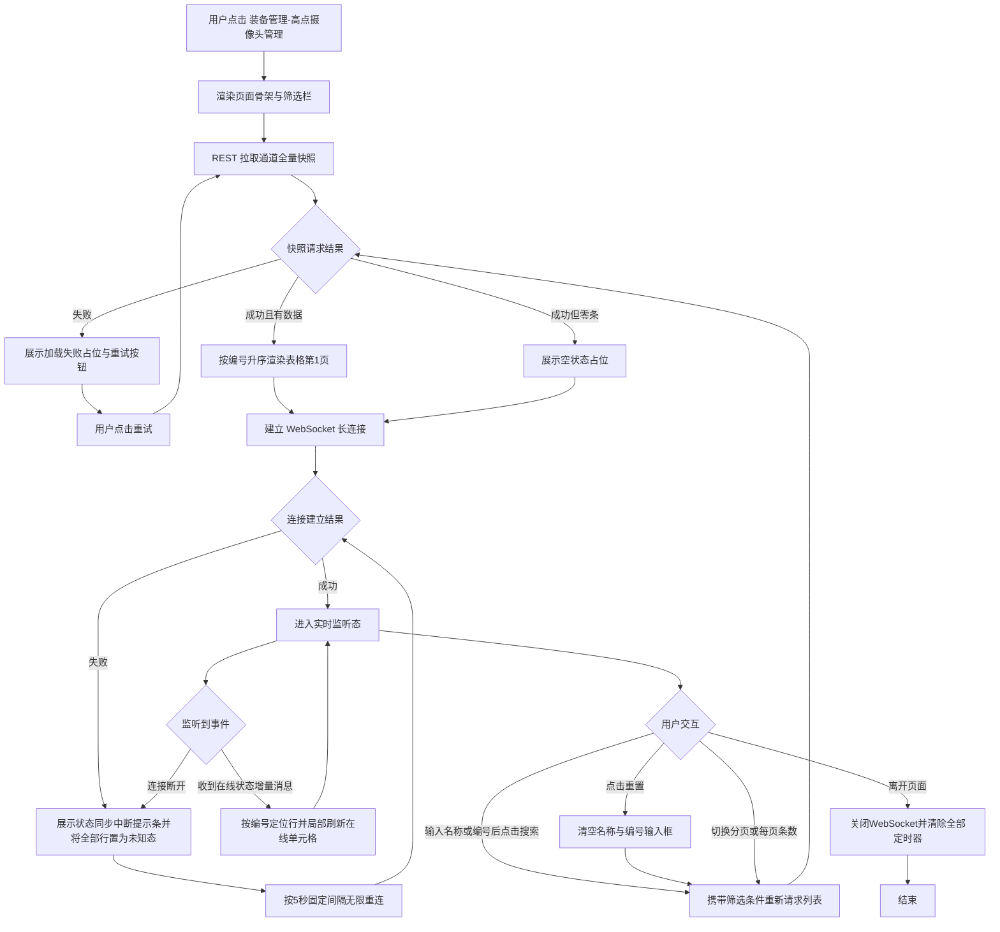

# PRD — 装备管理 · 高点摄像头管理

| 项 | 内容 |
|---|---|
| 文档版本 | v1.2 |
| 创建日期 | 2026-08-03 |
| 最后更新 | 2026-08-10 |
| 所属模块 | 装备管理 → 高点摄像头管理 |
| 文档状态 | 待评审 |
| 参考基线 | 现网 AIRIOT 平台「系统管理-设备管理-摄像头设备」页面截图（172.30.1.20:3030） |
| 页面形态 | 装备管理下的**独立菜单页**，页内无任何页签（Tab）分组 |
| 能力定级 | **只读台账**（平台不具备增、删、改能力） |
| 重要变更 | v1.1：从"按通道展示"调整为"按物理设备展示"，多个通道聚合为一行 |
---
## 1. 文档元数据与边界
### 1.1 需求背景
海外油田现场安保平台的感知层设备绝大部分由第三方系统建设与管理。高点摄像头由第三方视频系统统一纳管，其通道注册、参数配置、云台控制、录像存储等能力全部沉淀在第三方系统内，平台侧不承担任何建档与运维职责。
本模块的唯一目标是：**为指挥人员提供一份高点摄像头设备的实时状态总览台账**，用于回答三个问题——
1. 现场共有多少台高点摄像头设备、分别部署在哪个营地；
2. 每台设备的通道此刻是否在线（用于快速定位"某路画面调不出来"的根因）；
3. 每台设备的地理位置，便于在地图上标注与定位。
### 1.2 核心指标
| 指标 | 定义 | 目标值 |
|---|---|---|
| 状态时延 | 中台推送通道在线状态变更 → 平台页面单元格刷新的端到端耗时 | ≤ 3 秒（P95） |
| 首屏加载时长 | 进入页面 → 表格首行渲染完成 | ≤ 1.5 秒（P95，100 条数据内） |
| 状态准确率 | 平台展示的「在线」与中台推送真值一致的比例 | 100%（平台仅做透传，不得引入本地推导） |
| 误判离线率 | 因平台侧链路问题导致的错误离线判定占比 | 0%（平台不执行任何本地离线判定） |
### 1.3 与既有模块的依赖关系
| 依赖方向 | 模块 | 依赖内容 | 失效影响 |
|---|---|---|---|
| 上游 | 中台（数据转发层） | 通道主数据（名称、编号）与在线状态（REST 快照 + WebSocket 增量） | 本页面无数据可展示，降级为异常态（见 §6.3） |
| 上游 | 第三方视频系统 | 通道的原始注册信息与真实在线状态，经中台转发 | 中台无数据可转发，平台表现同上 |
| 平级 | 装备管理其余设备页（反无设备、A类无人机、A类地面站、C类机巢、C类无人机等） | 共用列表页视觉规范、共用 WebSocket 设备状态链路协议 | 无 |
| 下游 | 无 | 本模块不向任何模块输出数据 | —— |
> **架构约束**：依据既有决策，装备管理下各类设备各自独立页面。本 PRD 仅覆盖「高点摄像头管理」单页，不涉及任何其它设备类型页面。
### 1.4 权限边界（红线）
| 能力 | 平台是否具备 | 说明 |
| 新增通道 | ❌ 否 | 通道档案由第三方视频系统创建，平台经中台同步发现 |
| 编辑通道 | ❌ 否 | 含名称、编号在内的全部字段，平台无任何可写字段 |
| 删除通道 | ❌ 否 | 第三方系统删除后，平台通过下一次全量快照感知并移除 |
| 启用/禁用通道 | ❌ 否 | 不提供该操作入口 |
| 批量操作 | ❌ 否 | 表格不提供勾选框 |
| 导入/导出 | ❌ 否 | 本期不做 |
| 视频预览/云台控制/录像回放 | ❌ 否 | 归属「摄像头监控」模块，本页面不提供任何跳转或播放入口 |
| 查询/筛选/分页 | ✅ 是 | 纯查询交互，不改变任何数据 |
| 实时状态监控 | ✅ 是 | 被动接收中台推送，只读 |
> **本页面为纯只读页面。任何形态的写操作入口（新增按钮、行操作列、右键菜单、双击编辑、拖拽排序、状态开关）均不得出现。**
### 1.5 本期范围外（Out of Scope）
| 项 | 不做的原因 |
| 通道详情抽屉/弹窗 | 参考基线页面无详情入口，且平台侧无额外字段可展示 |
| 视频实时预览、历史录像回放、云台控制 | 归属「摄像头监控」模块，本页面为纯台账 |
| 安装位置、所属区域、IP、型号、厂商、分辨率、码流 | 参考基线前台未呈现，中台是否转发未确认，本期不展示、不处理 |
| 通道按物理设备归并（如把「可见光通道」「热成像通道」聚合为一台双光谱球机） | 中台按通道粒度转发，平台不做归并推导，避免编造设备关系（见附录 B · TBD-01） |
| 平台侧扩展信息（备注、分组、自定义标签） | 平台无任何写能力，本期不引入扩展信息区块 |
| 离线告警、离线时长统计、在线率报表 | 归属中台事件台账与统计模块 |
| 地图视图 / 列表-地图双模式切换 | 参考基线为纯表格页 |
| 列显隐自定义、列宽拖拽记忆、排序交互 | 本期使用固定三列配置，不提供列排序 |
| 多语言（法语）切换 | 本期不实现 |
## 2. 业务概念与术语
| 术语 | 精确定义 |
| **高点摄像头** | 架设于营地高点（塔架、桅杆、高层建筑顶）用于大范围周界监视的摄像设备。其在第三方视频系统中不以"整机"为单位注册，而以**通道**为单位注册。 |
| **通道（Channel）** | 第三方视频系统中一个可独立寻址的视频码流单元。**平台按设备维度展示，通道作为设备的子信息聚合展示**。**平台按设备维度展示，通道作为设备的子信息聚合展示**，是本页面表格的**一行**。一台双光谱高点摄像头通常注册为两条独立通道（例：`可见光通道`、`热成像通道`），二者拥有各自独立的编号与各自独立的在线状态。 |
| **可见光通道** | 输出可见光谱视频码流的通道。术语取自第三方系统原始命名，平台不做改写。 |
| **热成像通道** | 输出红外热成像视频码流的通道。术语取自第三方系统原始命名，平台不做改写。 |
| **名称** | 通道在第三方视频系统中的注册名称，经中台原样转发。平台只读展示，不做任何翻译、拼接或美化。 |
| **编号** | 通道在第三方视频系统中的全局唯一标识符，形如 `205qy8h7uwh5yijp43q89uqt45h` 的不透明字符串。它是平台定位表格行、匹配增量推送消息的**唯一主键**。 |
| **在线** | 中台基于第三方视频系统数据源判定并推送的通道通信链路可达性，二值：在线 / 离线。**平台被动接收，不执行任何本地判定逻辑。** |
| **未知态** | 平台与中台之间链路中断期间，全部通道进入的第三方状态。它**不等于离线**，仅表示"平台此刻无法确认真实状态"，页面保留最后已知值并置灰。 |
| **全量快照** | 通过 REST 接口一次性拉取的全部通道当前名称、编号与在线状态，用于首屏渲染、筛选查询与断线重连后的状态对齐。 |
| **增量推送** | 通过 WebSocket 接收的单通道状态变更消息，以 `编号` 为匹配键。 |
| **链路中断** | WebSocket 断开，或 REST 连续 3 次请求失败。判定主体为平台前端，判定结果**仅用于切换页面呈现态，绝不用于改写任何通道的在线/离线值**。 |
| **物理设备** | 一台实际部署在现场的高点摄像头硬件，通常为双光谱球机（可见光 + 热成像）。一台物理设备在第三方视频系统中注册为多条独立通道。 |
| **设备归并** | 将多个通道聚合为一个物理设备的逻辑关系，由中台通过关联字段（如营地ID、设备组标识）提供，平台不做推导。原型阶段按 `deviceGroup` 字段分组。 |
| **所属营地** | 设备部署的营地信息，由中台提供，用于设备归并和筛选。 |
| **位置信息** | **设备**部署的地理坐标，该设备下所有通道共享同一位置（经度、纬度），由用户在平台侧通过地图选点或手动输入设置。本信息为**平台扩展信息**，不来源于第三方视频系统，仅用于平台内部地图展示与定位。 |
## 3. 核心流程与状态机
### 3.1 页面主流程

### 3.2 通道在线状态机
stateDiagram-v2
    [*] --> 未知: 页面初始化
    未知 --> 在线: 全量快照 online=true
    未知 --> 离线: 全量快照 online=false
    在线 --> 离线: 中台增量推送 online=false
    离线 --> 在线: 中台增量推送 online=true
    在线 --> 未知: 平台与中台链路中断
    离线 --> 未知: 平台与中台链路中断
    未知 --> 在线: 链路恢复后快照为 true
    未知 --> 离线: 链路恢复后快照为 false
    在线 --> [*]: 第三方系统已移除该通道
    离线 --> [*]: 第三方系统已移除该通道
    未知 --> [*]: 用户离开页面
> **防误判铁律（本页面最高优先级规则）**
> 1. 平台**永不**基于心跳超时、请求失败次数、页面停留时长等任何本地信号，把通道判定为「离线」。
> 2. 链路中断时，全部通道统一进入「未知」态并保留最后已知值置灰，**严禁批量渲染为离线**。
> 3. 「在线 / 离线」二值的唯一来源是中台推送报文，平台只做透传渲染。
### 3.3 数据链路时序
sequenceDiagram
    participant TP as 第三方视频系统
    participant MW as 中台
    participant FE as 平台前端
    TP->>MW: 通道主数据与在线状态变更
    FE->>MW: REST 请求全量快照
    MW-->>FE: 返回全部通道的名称/编号/在线状态
    FE->>MW: 建立 WebSocket 长连接
    MW-->>FE: 推送单通道在线状态增量
    Note over FE: 以编号为键定位行，局部刷新在线单元格
    MW--xFE: 链路中断
    Note over FE: 全部行置为未知态并置灰，严禁批量判离线
    FE->>MW: 每 5 秒发起一次重连
    MW-->>FE: 重连成功
    FE->>MW: 立即重新拉取全量快照
    MW-->>FE: 返回快照，整体覆盖本地状态（非增量合并）
## 4. 核心功能矩阵
| 动作名称 | 触发位置 | 前置条件 / 受控状态 | 业务结果概述 |
| 进入高点摄像头管理页 | 左侧菜单 · 装备管理 → 高点摄像头管理 | 用户具备装备管理菜单权限 | 加载全量快照并建立 WebSocket 长连接，默认按编号升序展示第 1 页 |
| 按名称搜索 | 筛选栏 · 名称输入框 + 「搜 索」按钮 | 输入内容长度 0–64 字符 | 按名称模糊匹配过滤，结果重置到第 1 页；空输入等同于不限该条件 |
| 按编号搜索 | 筛选栏 · 编号输入框 + 「搜 索」按钮 | 输入内容长度 0–64 字符 | 按编号模糊匹配过滤，结果重置到第 1 页；空输入等同于不限该条件 |
| 回车快捷搜索 | 名称或编号输入框获焦时按 Enter | 同上 | 等效于点击「搜 索」按钮 |
| 重置筛选 | 筛选栏 · 「重 置」按钮 | 无 | 名称与编号同时清空，立即以无条件重新查询并回到第 1 页 |
| 手动刷新数据 | 筛选栏 · 「搜 索」或「重 置」按钮 | 无 | 本页面不设独立刷新按钮，「搜 索」与「重 置」即为手动重新拉取快照的入口 |
| 翻页 | 表格右下角分页器 | 总条数 > 当前每页条数时可用 | 加载目标页数据，筛选条件保持不变 |
| 切换每页条数 | 表格右下角每页条数切换器 | 无 | 可选 10 / 20 / 50 / 100，切换后强制回到第 1 页 |
| 复制编号 | 编号单元格悬浮时出现的复制图标 | 该行编号非空 | 将完整编号写入剪贴板，弹出 Toast「已复制」持续 1.5 秒；不产生任何数据变更 |
| 接收实时状态更新 | 系统自动（WebSocket） | 长连接处于已建立状态 | 以编号定位对应行，局部刷新「在线」单元格，不打断用户正在进行的滚动或输入 |
| 断线重连与状态对齐 | 系统自动 | WebSocket 断开 | 每 5 秒重连一次，不限次数；连接恢复后立即重新拉取全量快照，以快照结果**整体覆盖**本地状态 |
| 重试加载 | 列表加载失败占位区 · 「重试」按钮 | 仅在首次加载失败态可见 | 重新发起当前筛选条件下的列表请求 |
| 查看位置 | 表格操作列 · 「查看位置」按钮 | 无 | 打开位置查看弹窗（80%宽、80vh高），弹窗标题为「设备位置 — [设备名称]」；地图区域显示设备位置坐标（若已设置）；底部操作栏仅包含「关闭」按钮；位置信息只读展示，不支持编辑 |
| 离开页面清理 | 切换菜单 / 路由跳转 / 关闭标签页 | 无 | 关闭 WebSocket、清除全部定时器与节流缓冲队列 |
> 矩阵中不含任何增、删、改类动作，与 §1.4 权限边界一致。「复制编号」为纯客户端行为，不触达任何接口。
## 5. 页面布局与交互逻辑
### 5.1 页面骨架
┌──────────────────────────────────────────────────────────────────────────────────────┐
│                                                                                      │
│  ┌────────────────────────────────────────────────────────────────────────────────┐ │
│  │ 设备名称 [请输入设备名称  ]  营地名称 [请输入营地名称  ]  [搜 索]  [重 置]     │ │
│  └────────────────────────────────────────────────────────────────────────────────┘ │
│  │ 设备名称   │ 所属营地   │ 通道         │ 经纬度           │ 在线        │ 操作   │ │
│  ├────────────────────────────────────────────────────────────────────────────────┤ │
│  │ 东南角高点  │ WAPCO总部  │ [可见光][热成像]│ 13.513500,2.114200│ 2/2通道在线 │标记 查看│ │
│  │ 西北角高点  │ WAPCO总部  │ [可见光][热成像]│ 13.514500,2.110800│ 1/2通道在线 │标记 查看│ │
│  │  …        │  …        │  …          │  …              │  …         │  …    │ │
│                           共 N 条  [20条/页 ▾]   ‹  [1]  2  3  ›                      │
└──────────────────────────────────────────────────────────────────────────────────────┘
> **布局约定**
> - 页面骨架仅展示**本页面内容区**，不包含系统级顶部导航与左侧菜单（由全局框架统一管理）。
> - 页面内**不设任何页签（Tab）**，高点摄像头管理为装备管理下的独立菜单页。
> - 全局中断提示条（仅异常态出现）插入位置：内容区顶部、筛选栏之上，通栏展示，高度 40px。
> - 「在线」列为表格最后一列，靠右布局，与参考基线保持一致。
### 5.2 筛选栏字段规则
| 字段 | 控件类型 | 是否必填 | 默认值 | 取值 / 限制规则 | 数据来源 |
|---|---|---|---|---|---|
| 名称 | 单行文本输入框 | 否 | 空 | 最多 64 字符，超出部分硬性截断；提交前自动 trim 前后空格；支持中英文、数字、下划线、连字符；模糊匹配（包含即命中）；不区分大小写 | 用户输入 |
| 编号 | 单行文本输入框 | 否 | 空 | 最多 64 字符，超出部分硬性截断；提交前自动 trim 前后空格；模糊匹配（包含即命中）；不区分大小写 | 用户输入 |
| 搜 索 | 主按钮（蓝色实心） | —— | —— | 常态可点击；请求进行中显示 loading 并禁用，防重复提交 | —— |
| 重 置 | 次按钮（描边） | —— | —— | 常态可点击；请求进行中禁用 | —— |
**筛选逻辑约定**
| 项 | 规则 |
| 条件关系 | 名称与编号之间为 **AND（交集）** 关系 |
| 空条件语义 | 两项均为空时返回全部通道；单项为空时该项不参与过滤 |
| 生效方式 | 输入内容变化**不触发**自动查询，必须点击「搜 索」或按 Enter 才生效 |
| 匹配方式 | 均为服务端模糊匹配，前端不做本地过滤，保证分页总数准确 |
### 5.3 表格列定义
| 序号 | 列名 | 建议字段 key | 数据类型 | 列宽 | 对齐 | 排序 | 空值 / 异常渲染 |
|---|---|---|---|---|---|---|---|
| 1 | 设备名称 | `name` | 字符串 | 弹性（最小 200px） | 左 | 不支持 | 物理设备名称（去掉通道后缀），如"东南角高点"；超出列宽以 `…` 截断，悬浮显示完整名称 Tooltip |
| 2 | 所属营地 | `campName` | 字符串 | 160px | 左 | 不支持 | 由中台提供，显示营地名称；为空或 null 时显示 `--` |
| 3 | 通道 | `channels` | 数组 | 240px | 左 | 不支持 | Tag 显示，绿色=在线，灰色=离线；鼠标悬停显示通道编号；只显示通道后缀（如"可见光"、"热成像"） |
| 4 | 经纬度 | `location` | 对象 | 200px | 左 | 不支持 | 格式：`纬度, 经度`，保留6位小数；未设置显示 `--` |
| 5 | 在线 | `online` | 计算字段 | 120px | 居中 | 不支持 | 格式：`N/M通道在线`，如 `2/2通道在线`、`1/2通道在线`；链路中断时显示灰色减号 |
| 6 | 操作 | `action` | - | 100px | 居中 | 不支持 | 固定右侧；仅包含「查看位置」文字链接按钮 |
**通道列渲染规则**：
| 规则 | 说明 |
|------|------|
| 显示内容 | 从完整通道名称中提取后缀，如"东南角高点-可见光" → 显示"可见光" |
| 标签颜色 | 在线通道：绿色（`color="green"`）；离线通道：灰色（`color="default"`） |
| 悬停交互 | Tooltip 显示完整通道编号，如"编号：3a8f92be1c7d4e9ab2f5c6d8e1a3b4c5" |
| 排列方式 | a-space 横向排列，间距 8px |
**在线列渲染规则**
| 状态值 | 图标 | 颜色 | Tooltip 文案 |
| `true`（在线） | 对勾图标 | 绿色 | 在线 |
| `false`（离线） | 叉号图标 | 红色 | 离线 |
| 未知态（链路中断期间） | 减号图标 | 灰色，整体不透明度 45% | 链路中断，状态未知。最后同步于 YYYY-MM-DD HH:mm:ss |
| 枚举外的值 / null | 减号图标 | 灰色 | 状态异常，请联系管理员 |
> 「在线」列**只渲染图标，不渲染文字**，与参考基线保持一致。状态语义通过颜色 + 悬浮 Tooltip 传达。
**表格通用规则**
| 行高 | 48px，固定 |
| 表头 | 吸顶固定 |
| 斑马纹 | 不使用 |
| 行悬浮 | 整行背景高亮，鼠标指针为默认箭头（非手型，强调整行不可点击） |
| 行点击 | 无任何响应 |
| 勾选框 | 不提供 |
| 操作列 | 提供，固定在右侧，宽度100px，仅包含「查看位置」按钮 |
| 横向滚动 | 三列总宽在 1280px 视口下不溢出，不出现横向滚动条 |
| 每页条数 | 默认 20 条/页，提供切换器（10 / 20 / 50 / 100） |
| 分页器 | 右下角，展示总条数、每页条数切换器与页码；总条数 ≤ 当前每页条数时页码区隐藏，总条数文案保留 |
| 默认排序 | 服务端按 `编号` 字典序**升序**返回，保证多次请求与分页结果顺序稳定；前端不提供任何列排序交互 |
### 5.4 联动规则表
| 触发条件 | 联动对象 | 联动行为 |
| 用户修改「名称」或「编号」输入框内容 | 表格数据 | **不自动查询**，需点击「搜 索」或按 Enter 后生效 |
| 用户点击「搜 索」 | 分页器 | 强制重置到第 1 页，每页条数保持不变 |
| 用户点击「重 置」 | 名称、编号、分页器 | 三者同时复位（空、空、第 1 页），每页条数**保持用户上次选择不变**，并立即触发一次无条件查询 |
| 用户切换每页条数 | 分页器 | 强制回到第 1 页并重新请求，筛选条件保持不变 |
| 列表请求进行中 | 「搜 索」「重 置」按钮、分页器、每页条数切换器 | 全部置为禁用态，表格区展示骨架屏 |
| 列表请求进行中 | WebSocket 增量消息 | 暂存于缓冲队列，待新列表渲染完成后按编号匹配补齐；匹配不到的消息直接丢弃 |
| 收到某通道增量推送 | 该通道所在行的「在线」单元格 | 仅局部更新该单元格图标与颜色，触发一次 800ms 的背景色高亮渐隐动效；**不重排行序、不重置滚动位置、不清空用户输入框内容** |
| 收到的增量推送对应通道不在当前页或不符合当前筛选条件 | 表格 | 静默丢弃，不做任何提示，不自动跳页，不修改总条数 |
| 同一通道 1 秒内收到多条推送 | 该行「在线」单元格 | 按编号做 500ms 节流合并，仅渲染最后一次状态 |
| WebSocket 断开 | 全局提示条 | 内容区顶部出现橙色提示条：「实时状态同步已中断，正在重连…（当前展示为最后同步数据）」 |
| WebSocket 断开 | 全部通道行的「在线」列 | 统一进入「未知」态置灰（图标转灰色减号，不透明度 45%），**严禁批量渲染为离线**；「名称」「编号」两列**不置灰**，保持正常渲染 |
| 链路中断持续超过 60 秒 | 全局提示条 | 文案升级为「与视频系统连接中断，当前为历史快照数据，更新于 YYYY-MM-DD HH:mm:ss」，底色由橙色转红色 |
| WebSocket 重连成功 | 全局提示条、表格数据 | 提示条自动消失；立即拉取全量快照并**整体覆盖**本地状态（而非增量合并）；右上角弹出 Toast「实时同步已恢复」持续 2 秒 |
| 用户悬浮于「编号」单元格 | 复制图标 | 单元格右侧淡入显示复制图标；移出时淡出隐藏；图标不占用常态布局空间，不导致文本抖动 |
| 用户点击复制图标 | 剪贴板、Toast | 写入完整编号，弹出 Toast「已复制」持续 1.5 秒；写入失败时弹出 Toast「复制失败，请手动选中复制」持续 3 秒 |
| 用户离开页面 | WebSocket、定时器、节流队列 | 全部关闭并清空，不残留后台连接 |
### 5.5 位置查看弹窗
**触发方式**：
- 点击表格操作列的「查看位置」按钮
**弹窗规格**：
- 宽度：80%（响应式）
- 高度：80vh
- 标题：`设备位置 — [设备名称]`
- 无默认 footer（`:footer="null"`）
**布局结构**：
| 区域 | 高度 | 说明 |
|------|------|------|
| 地图区域 | flex: 1 | 浅灰色背景（#f0f0f0），居中显示占位提示"[ 地图组件待集成 ]"；显示设备位置坐标（若已设置）；待集成GIS后展示地图与标记点 |
| 底部操作栏 | 固定高度 | 深色背景（#1f1f1f）、边框（#303030）；右侧显示「关闭」按钮 |
**交互规则**：
- 打开弹窗时，加载设备现有位置信息（取第一个通道的位置，若设备无位置信息则显示提示）
- 位置信息只读展示，不支持编辑
- 点击关闭：关闭弹窗
**地图占位提示**：
```
[ 地图组件待集成 ]
显示设备位置标记点
📍 设备位置：[经度], [纬度]（若已设置）
```
**数据结构扩展**：
```typescript
export interface CameraChannel {
  id: string
  name: string
  online: boolean
  campId: string        // 新增：所属营地ID
  campName: string      // 新增：所属营地名称
  deviceGroup?: string  // 新增：设备组标识，用于归并
  location?: {
    latitude: number   // 纬度，-90 ~ 90
    longitude: number  // 经度，-180 ~ 180
  }
}
## 6. 边界情况与异常处理
### 6.1 空状态
| 场景 | 判定条件 | 页面表现 |
| 系统内无任何高点摄像头通道 | 无筛选条件时返回 0 条 | 表格区居中展示空状态插图 + 文案「暂无高点摄像头。通道档案由第三方视频系统维护，请联系系统管理员核查中台同步状态。」分页器隐藏 |
| 筛选无结果 | 存在筛选条件时返回 0 条 | 表格区居中展示空状态插图 + 文案「未找到符合条件的摄像头」+「重置筛选条件」文字按钮，点击等效于「重 置」 |
| 首屏加载中 | 请求未返回 | 表格区展示 5 行骨架屏，筛选栏可见但按钮禁用 |
### 6.2 数据校验与非法值
| 场景 | 处理策略 |
| 名称/编号输入超过 64 字符 | 输入框硬性截断至 64 字符，不弹提示 |
| 名称/编号输入纯空格 | 提交前 trim，等同于空条件 |
| 名称/编号含 SQL 或脚本特殊字符 | 前端不做拦截，统一由后端参数化查询处理；前端渲染返回内容时做 HTML 转义，防止 XSS |
| 单条记录缺失 `编号` | 该条记录直接过滤不渲染（无主键则无法匹配增量推送），控制台记录 error 日志；总条数以服务端返回为准，不做前端修正 |
| 单条记录缺失 `名称` | 正常渲染该行，名称列显示 `--` |
| 返回数据中存在重复 `编号` | 以最后一条为准去重渲染，控制台记录 warn 日志 |
| `在线` 字段返回布尔外的值或 null | 渲染为灰色减号 + Tooltip「状态异常，请联系管理员」，控制台记录 warn 日志，不影响整行渲染 |
| 服务端返回的总条数与实际数组长度不一致 | 分页器以服务端 `total` 为准，表格以实际数组渲染，不做互相修正 |
### 6.3 网络与服务异常
| 场景 | 判定条件 | 处理策略 |
| 列表接口首次加载失败 | HTTP 非 2xx 或超时（10 秒） | 表格区展示失败占位：「数据加载失败」+「重试」按钮。不自动重试，不弹全局 Toast |
| 列表接口翻页/筛选时失败 | 同上 | **保留当前已渲染数据不清空**，顶部弹出 Toast「加载失败，请重试」持续 3 秒；筛选按钮与分页器恢复可用；分页器页码回退至失败前的页码 |
| REST 连续 3 次请求失败 | 计数器达 3 | 判定为链路中断，展示红色中断提示条，全部行「在线」列置为未知态置灰；计数器在任意一次成功后清零 |
| WebSocket 建立失败 | 握手失败 | 展示橙色中断提示条，按 5 秒固定间隔无限重连；每次重连不重复弹 Toast、不重复播放动效 |
| WebSocket 中途断开 | onclose / onerror | 同上；全部通道「在线」列置未知态置灰 |
| 增量推送消息格式非法 | JSON 解析失败或缺少编号字段 | 丢弃该条消息，控制台记录 warn 日志，**不中断长连接、不触发重连** |
| 增量推送的编号在当前列表中不存在 | 匹配不到行 | 静默丢弃，不新增行、不提示、不触发全量刷新 |
| 推送风暴 | 单位时间内推送量超过前端渲染能力 | 按 §5.4 的 500ms/编号 节流规则合并，单帧最多重绘一次表格 |
| 服务恢复 | 任意一次 REST 或 WS 重连成功 | 提示条消失，立即全量快照整体覆盖，右上角 Toast「实时同步已恢复」持续 2 秒 |
| 用户在中断期间点击「搜 索」 | —— | 正常发起 REST 请求；若成功则同时解除中断态、刷新数据、隐藏提示条；若失败则维持中断态并按上表处理 |
### 6.4 引用完整性
| 第三方系统删除了某通道 | 下一次全量快照中该通道消失，前端整行移除；不做删除动效、不弹提示 |
| 第三方系统新增了某通道 | 下一次全量快照中出现，按编号升序插入；若不符合当前筛选条件则不展示 |
| 第三方系统修改了某通道名称 | 下一次全量快照中体现新名称；**名称变更不通过增量推送生效**（增量通道仅承载在线状态），避免主数据与状态数据混流 |
| 用户当前停留的页因数据减少而变空 | 请求返回空列表且服务端总页数 < 当前页码 | 自动跳转至最后一页并重新请求；若总条数归零则展示空状态 |
| 用户停留在第 5 页时数据总量缩减至 2 页 | 同上 | 自动跳转至第 2 页 |
| 双光谱摄像头的其中一路通道被删除 | 另一路通道正常保留展示，平台不做"整机不完整"的任何推导或提示 |
### 6.5 权限与越权
| 用户无「装备管理」菜单权限 | 左侧菜单不渲染「装备管理」入口；直接访问 URL 时展示 403 页面 |
| 用户有装备管理权限但无高点摄像头子权限 | 左侧菜单不渲染「高点摄像头管理」项；直接访问 URL 时展示 403 页面 |
| 用户通过接口调试工具尝试对通道发起写操作 | 后端统一拒绝并返回 403；前端无任何写入口，不做额外处理 |
| 登录态失效 | 列表接口或 WebSocket 返回 401 时，清除本地会话并跳转登录页；**不展示中断提示条**（避免与登录跳转叠加造成误导） |
### 6.6 极端数据量与显示
| 通道总数 > 500 | 服务端分页已保证单页最多 100 条，前端不做虚拟滚动 |
| 单通道名称超过 30 字符 | 列内截断 + Tooltip，不撑开列宽、不换行、不撑高行高 |
| 编号长度超过列宽 | 列内截断 + Tooltip + 复制图标，不换行 |
| 名称为纯空格字符串 | 渲染为 `--`，不渲染空白单元格 |
| 全部通道同时离线 | 由中台逐条推送各通道离线状态，平台逐条渲染；**不因"全部离线"触发任何本地降级或批量判定** |
| 浏览器窗口宽度 < 1280px | 表格容器出现横向滚动条，「名称」列左侧冻结；筛选栏两个输入框自动换行为两行 |
| 页面长时间后台挂起（浏览器标签页休眠） | 恢复前台时立即检测 WebSocket 状态，若已断开则触发重连并拉取全量快照覆盖 |
## 附录 A：与参考基线的字段对照
| 页面列名 | 参考基线（AIRIOT 摄像头设备页） | 建议字段 key | 本期是否展示 |
| 名称 | 名称 | `name` | ✅ |
| 编号 | 编号 | `id` | ✅ |
| 在线 | 在线 | `online` | ✅ |
| 筛选 · 设备名称 | 名称 | —— | ✅ |
| 筛选 · 编号 | 编号 | —— | ✅ |
| 位置信息 | —— | `location` | ✅（本期新增） |
| 所属营地 | —— | `campName` | ✅（本期新增） |
| 通道列表 | —— | —— | ✅（聚合展示） |
| 经纬度 | —— | `location` | ✅（本期新增） |
| 设备归并关系 | —— | `deviceGroup` 或待确认字段 | ✅（原型阶段按 deviceGroup 分组） |
| 操作列 · 查看位置 | —— | —— | ✅（本期新增，只读展示） |
| 操作列 · 查看位置 | —— | —— | ✅（本期新增） |
> 参考基线页面共 3 列 2 筛选项，本 PRD **未新增任何列与筛选项**，与用户确认的"与图片保持一致"要求完全对齐。
## 附录 B：待确认事项
| 编号 | 事项 | 当前 PRD 采用的假设 | 影响面 |
| TBD-01 | 表格行的业务粒度是"通道"而非"物理摄像头" | 依据截图中 `可见光通道` / `热成像通道` 两行独立编号，判定为通道粒度，平台不做归并 | 若后续需按物理设备归并展示，需中台补充"所属设备"字段，属新增需求 |
| TBD-02 | 「复制编号」悬浮图标是否保留 | 已写入 §4 与 §5.4。编号为 26 位不透明字符串，运维上报故障时需原样传递，故保留 | 如评审认为超出"与截图保持一致"范围，直接删除该图标即可，**不影响其余任何逻辑** |
| TBD-03 | 每页条数是否需要切换器 | 参考基线数据量仅 2 条、未见分页器，本 PRD 按通用列表规范提供（默认 20，可选 10/20/50/100） | 如确认通道总数恒定在个位数，可整体移除分页器，§5.4 中相关联动规则一并删除 |
| TBD-04 | 「在线」列头在基线截图中靠右对齐 | 已按基线保留列头右对齐、单元格居中 | 纯视觉项，可按平台统一表格规范调整 |
> 以上 4 项均为**呈现层可选项**，任一选择都不改变业务闭环。核心业务规则（只读、中台推送、平台不本地判定离线、编号为唯一主键）已全部确认，本 PRD 可直接进入开发排期。
### 附录 B.2 — 设备归并字段待确认（TBD-05）
| 编号 | 议题 | 当前方案 | 备选方案 / 评审结论 |
|------|------|----------|---------------------|
| TBD-05 | 通道与物理设备的归并关系字段 | 原型阶段按 `deviceGroup` 字段分组；生产环境需中台提供明确的设备-通道关联字段（可能是 `deviceId`、`deviceGroup`、`parentId` 等） | 待开发与中台对齐字段名 |

---

## 附录 C：修订记录

| 版本 | 日期 | 修订人 | 修订内容 |
|---|---|---|---|
| v1.0 | 2026-08-03 | 产品 | 初版，基于 AIRIOT 平台参考基线完成，按通道展示 |
| v1.1 | 2026-08-10 | 产品 | 调整展示粒度：从"按通道展示"改为"按物理设备聚合展示"，多个通道聚合为一行；新增设备归并关系字段 |
| v1.2 | 2026-08-17 | 产品 | 移除标记位置功能：①删除「标记位置」操作按钮；②位置查看弹窗改为只读展示，移除经纬度编辑输入框和保存按钮；③操作列宽度由180px调整为100px；④更新 §4 核心功能矩阵、§5.3 表格列定义、§5.5 位置弹窗交互规则、附录A字段对照；⑤同步更新原型文件 CameraList.vue |
