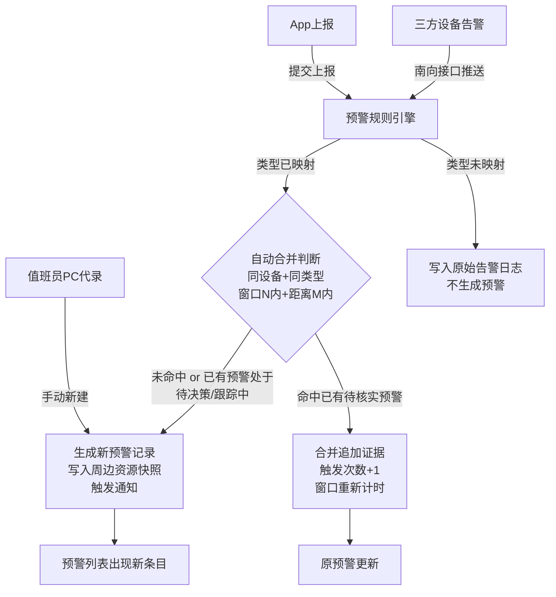
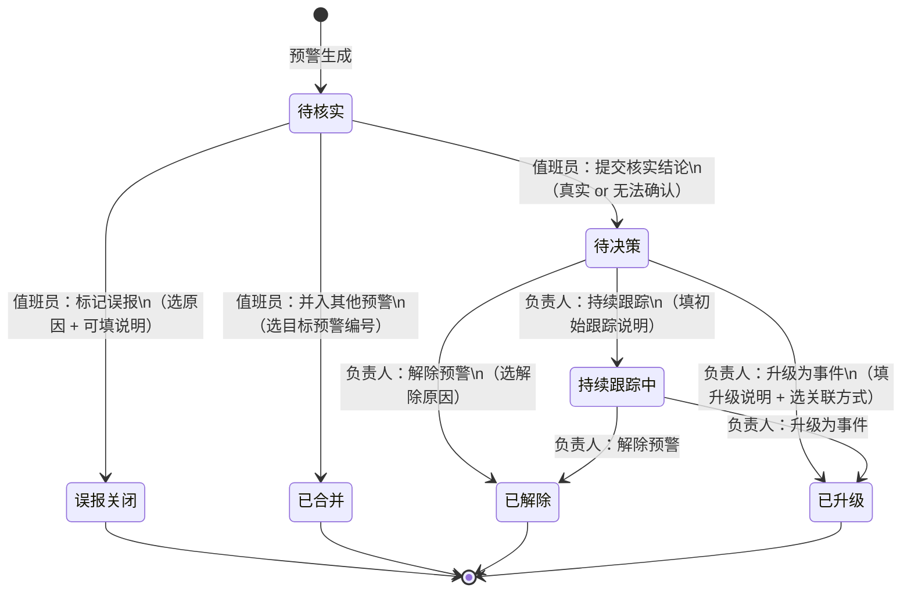
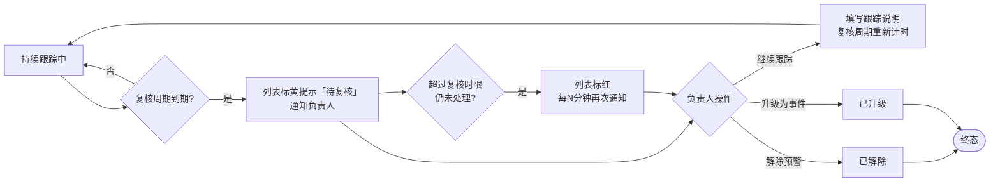
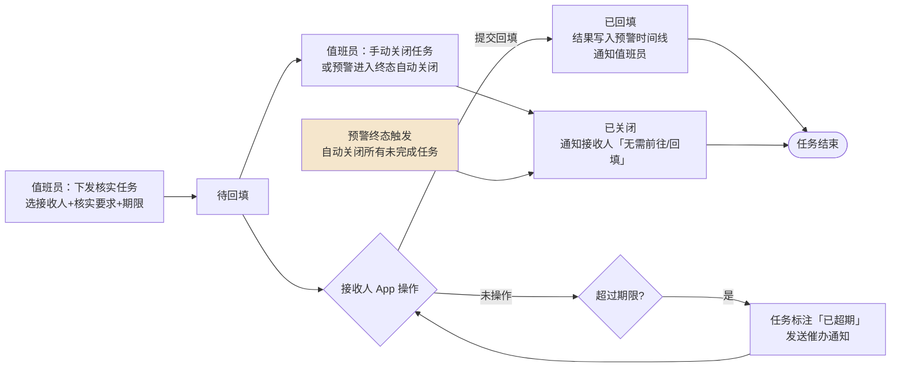

# PRD — 预警管理 · 预警工作台

| 项 | 内容 |
|---|---|
| 文档版本 | V1.0 |
| 编制日期 | 2026-09-26 |
| 所属产品 | 中石油尼日尔公司上游油田项目 — 数智安防应急指挥中心（平台） |
| 所属端 | PC 后台（主）；大屏端复用同一套研判组件，详见 `PRD-大屏-事件感知处置-预警.md` |
| 所属模块 | 业务应用 → 预警管理 → 预警工作台 |
| 页面架构 | 双层结构：列表页（PageContainer + PanelCard）+ 研判页（全屏工作区） |
| 上游依据 | `应急指挥中心 (1).xmind`、`Downloads/预警-事件-应急整体流程.drawio.xml`、2026-09-26 设计访谈 Q1–Q62 完整决策记录 |
| 状态 | 待评审 |

---

## 1. 文档元数据与边界

### 1.1 需求背景

尼日尔 N16 区块油田现场每日运营面临多源、高频的安防感知数据接入：反无人机系统、高点摄像头、CCTV、C 类无人机、车辆系统等设备实时推送告警事件，同时还有一线人员手工上报和 App 上报。缺乏统一的预警汇聚平台导致以下问题：

| 现状问题 | 业务影响 |
|---|---|
| 多源告警分散在各三方系统后台，无统一视图 | 值班员需要同时盯多个屏幕，漏看概率高 |
| 无法判断三方系统告警是否是误报 | 告警疲劳，真实威胁被淹没 |
| 核实过程无留痕，责任无法追溯 | 复盘事件时无法还原当时的处置过程 |
| 预警与事件升级之间没有系统联动 | 升级操作需要手动通知事件管理侧，口头转告易出错 |

本模块的定位：**多源预警的统一汇聚、核实决策和研判中台**，将三方设备告警、人工上报统一纳管，通过结构化的核实流程和地图研判工具，帮助值班员快速判断威胁真实性，并将确认威胁以标准化接口移交事件管理模块。

### 1.2 核心指标

| 指标 | 定义 | 目标值 |
|---|---|---|
| 待核实预警平均响应时长 | 从预警生成到值班员提交核实结论的中位时长 | 紧急档 ≤ 5 分钟（初始值，待客户确认） |
| 超时率 | 超过配置时限仍未处理的预警数 ÷ 总预警数 | ≤ 5% |
| 误报率 | 终态为「误报关闭」的预警数 ÷ 总预警数 | 基线由运营期积累，不预设目标值 |
| 预警→事件升级完整性 | 升级时传递的字段完整率（含全部证据和时间线） | 100% |

### 1.3 与既有模块的依赖关系

| 关联模块 | 关系方向 | 具体内容 |
|---|---|---|
| 三方设备（反无、高点、CCTV、C类无人机、车辆） | 本模块**读取** | 三方系统通过南向接口推送告警，平台自动映射为预警 |
| App 端 – 预警上报 | 本模块**读取** | 一线人员手工上报，平台接收并生成预警 |
| 预警规则配置 | 本模块**依赖** | 类型映射、合并规则、时限、紧急度、通知接收人等配置 |
| 人员管理 – 排班管理 | 本模块**读取** | 获取「今日值班」人员名单，用于动态通知接收人推算 |
| 系统管理 – 消息中心 | 本模块**写入** | 预警各状态变更触发站内信，详见 `PRD-系统-消息中心.md` |
| 装备管理（无人机、摄像头） | 本模块**读取** | 研判页获取周边设备的实时状态和视频流 |
| 事件管理模块 | 本模块**写出** | 升级时传递预警完整数据包，接口契约见附录 A.4 |
| SOS 独立接警池 | 平行模块 | SOS 不走预警流程；预警/事件详情可挂关联 SOS 编号 |
| 统计分析 | 本模块**提供数据** | 结构化字段支撑 S1–S9 统计，详见附录 C |

### 1.4 权限边界（红线）

| 编号 | 边界 |
|---|---|
| PB-01 | 平台**不向三方设备写回任何指令**，摄像头云台控制须在三方系统（高级站/基础站）内操作 |
| PB-02 | 预警一旦进入终态（误报关闭 / 已合并 / 已解除 / 已升级）**不可回退、不可修改** |
| PB-03 | 已升级为事件的预警**不可退回**为预警；升级错误需在事件侧关闭，另开新预警 |
| PB-04 | 事件类型和等级**不在预警侧填写**，由事件管理模块的等级辅助判定和人工确认来完成 |
| PB-05 | 预警数据**不会自动清理**，永久保留；反无实时轨迹快照按规则配置保留（默认 30 天） |

### 1.5 本期范围（In Scope）

| 编号 | 能力 |
|---|---|
| IS-01 | 三方告警自动映射为预警，按规则配置的类型映射和合并规则处理 |
| IS-02 | App 上报和值班员 PC 代录均生成预警 |
| IS-03 | 完整的预警状态机和核实决策流程 |
| IS-04 | 核实任务下发（可选），App 回填或 PC 补录两种闭环方式 |
| IS-05 | 研判页：周边摄像头（高点+CCTV）、无人机、反无目标、历史回溯、敏感区域、历史同区域预警、周边车辆/手持机共 7 个图层 |
| IS-06 | 调度卡片复用无人机监控中心能力 |
| IS-07 | 多条预警合并升级为事件或关联到已有事件 |
| IS-08 | 操作权限点配置（11 个），通知接收人单独配置 |
| IS-09 | 列表导出为 Excel，单次最多 5000 条 |
| IS-10 | 周边资源快照自动保存（支撑统计分析 S7） |

### 1.6 本期范围外（Out of Scope）

| 编号 | 内容 | 说明 |
|---|---|---|
| OS-01 | 事件管理页面 | 接口契约见附录 A.4，事件 PRD 另行设计 |
| OS-02 | SOS 接警池 | 独立体系，关联关系只挂编号 |
| OS-03 | App 端页面设计 | 本 PRD 只定义核实任务数据契约 |
| OS-04 | 统计分析页面 | 字段设计支撑统计，页面见附录 C 的待实现清单 |
| OS-05 | 云台控制（PTZ） | 归属三方系统，平台无接口 |
| OS-06 | 雷达图层 | 无 lat/lng 坐标，无 PRD，待后续规划 |
| OS-07 | 战时 / 演练模式 | 大屏 PRD 中规划，非本期 |
| OS-08 | 大屏端骨架 | 见 `PRD-大屏-事件感知处置-预警.md` |

---

## 2. 业务概念与术语

| 术语 | 精确定义 | 反例（避免误解） |
|---|---|---|
| **预警** | 平台接收到的、**尚未确认真实性**的安防威胁线索。来源可以是三方设备告警、App 上报或值班员代录。 | 预警不等于已确认威胁；未经核实的信息不能直接升级为事件 |
| **事件** | 经核实确认后的威胁，由预警升级而来，或现场直接发现后在事件管理模块直接录入。 | 事件等级（Ⅰ–Ⅳ）由事件管理模块判定，预警侧不填写 |
| **核实结论** | 值班员对预警真实性的判断结果，只有两个值：**真实**（确认存在威胁）或**无法确认**（无法判断，如无人机已离开）。核实结论是预警记录上的一个字段，不单独成为状态。 | 「无法确认」不代表误报；误报是值班员在核实时直接判定「这是设备误识别/己方目标/干扰」 |
| **研判** | 值班员在研判页调取周边多源数据（摄像头画面、反无目标、无人机、历史轨迹等），综合判断威胁真实性的过程。研判中的所有操作自动写入时间线。 | 研判不是点一个按钮；它是一个持续的调查过程 |
| **调度卡片** | 复用无人机监控中心的功能，向飞手领队推送包含预警位置、威胁描述和推荐无人机信息的调度指令（文本/图片/系统任务三种格式）。本模块只放跳转入口，不重复定义调度逻辑。 | — |
| **核实任务** | 值班员下发给一线人员的现场确认任务，**可选不强制**。一线人员通过 App 回填结果（图片/视频/文字+位置），或值班员通过手台线下联系后 PC 补录。 | 核实任务未下发不影响预警的核实和决策 |
| **已合并** | 预警被值班员手动并入另一条预警的终态。被并入的预警变为只读，其证据复制到目标预警的时间线，标注「来自 #xx 并入」。 | 已合并与已升级不同：合并是预警级别的整合，升级是向事件管理的移交 |
| **持续跟踪中** | 威胁真实但暂时无法处理（如无人机已离开区域、可疑人员在围界外徘徊），需要持续观察的中间态。不是终态。 | 持续跟踪中有复核周期，超期会触发提醒，不是「挂起忘记」 |
| **紧急程度** | 预警的两档优先级：**紧急**（需立即处理，如区域入侵、无人机威胁）和**一般**（需关注，如设备离线告警、轻微异常）。影响排序、提醒强度（紧急有声音和强提醒，一般只有列表高亮），不等同于事件等级。 | 紧急程度在预警规则配置中按类型预置，值班员可以手动修正 |
| **周边资源快照** | 预警生成时刻，系统自动记录的周边资源状态快照，包含：半径内可用摄像头数量、高点摄像头是否已对准、可调度无人机数量。用于事后的安防盲区统计分析（S7），不影响实时研判。 | — |

---

## 3. 核心流程与状态机

### 3.1 预警生成流程



**预警自动合并条件（全部满足才合并）：**
1. 同一三方设备（同 device_id）
2. 同一预警类型（类型字典中的具体类型）
3. 告警发生时间落在已有预警的「最后触发时间」起 N 分钟窗口内（N 在规则配置中按类型设置）
4. 告警位置与已有预警的位置距离 ≤ M 米（M 在规则配置中按类型设置）
5. 已有预警的当前状态为**待核实**（待决策或持续跟踪中的预警来新告警，一律新建）

**人工上报（App 和 PC 代录）不参与自动合并**，每条独立生成。重复上报由值班员手动合并。

**告警不带目标坐标时**，距离条件降级为「同一设备」，相当于把合并窗口限定在同一台设备的连续告警。高点摄像头告警回传目标坐标；CCTV 告警不带目标坐标，以设备安装点位作为预警位置，合并时按「同一设备」判断（TBD-01 已确认）。

### 3.2 预警状态机



**状态规则补充：**

| 规则 | 说明 |
|---|---|
| 不设「核实中」锁 | 值班员极少并发，不做认领锁定；所有操作记录操作人 |
| 时限计时起点 | 待核实：从预警生成时刻；待决策：从进入待决策时刻；持续跟踪复核周期：从上次复核时刻 |
| 合并不重置待核实时限 | 合并到来的新告警只刷新「最后触发时间」，不重置时限起点 |
| 修正类型和紧急程度 | 待核实、待决策、持续跟踪中三个阶段都可以修正，修正后不重新触发合并判断，修改前后值均记入时间线 |
| 终态不可逆 | 误报关闭、已合并、已解除、已升级四个终态不可回退，不可修改 |
| 升级不填事件等级 | 等级由事件管理模块判定，预警侧只传预警完整数据包 |

### 3.3 持续跟踪复核流程



### 3.4 核实任务流程



**迟到回填处理：** 接收人在离线状态填好表单，恢复网络后提交，此时任务已关闭。系统照常接收，写入预警时间线并标注「任务关闭后回填」，通知预警最后一位决策人。任务状态保持「已关闭」不变。

---

## 4. 核心功能矩阵

| 功能 | 触发位置 | 前置条件 | 业务结果 | 所需权限点 |
|---|---|---|---|---|
| 自动生成预警 | 三方告警/App上报到达 | 已配置映射规则 | 新条目进入待核实列表，触发通知 | — |
| PC代录预警 | 列表页「新建」按钮 | 具备「代录预警」权限 | 生成预警，来源记为「值班员代录」 | 代录预警 |
| 修正类型/紧急程度 | 研判页/列表行操作 | 预警处于待核实/待决策/跟踪中 | 字段更新，修改前后值记入时间线 | 核实 |
| 标记误报 | 研判页底部操作栏 | 预警处于待核实 | 进入「误报关闭」终态，触发通知 | 核实 |
| 手动合并预警 | 研判页底部操作栏 | 预警处于待核实；目标预警非终态 | 当前预警进入「已合并」终态，证据复制到目标预警 | 核实 |
| 提交核实结论 | 研判页底部操作栏 | 预警处于待核实 | 进入「待决策」，通知负责人 | 核实 |
| 下发核实任务 | 研判页「下发核实任务」按钮 | 预警处于待核实或待决策 | 生成核实任务，App 推送给接收人 | 下发核实任务 |
| PC补录现场核实 | 研判页时间线「添加补录」 | 任意非终态 | 文字/附件写入时间线，标注「PC补录」 | 补录现场核实 |
| 调取摄像头画面 | 研判页摄像头图层 | 摄像头在线；视频流可用 | 最多4路同屏播放，操作写入时间线 | 查看预警 |
| 生成调度卡片 | 研判页「调度无人机」按钮 | 有可用无人机 | 调用无人机监控中心的调度卡片功能 | 调度无人机 |
| 解除预警 | 研判页底部操作栏 | 预警处于待决策或跟踪中 | 进入「已解除」终态，选解除原因 | 决策 |
| 持续跟踪 | 研判页底部操作栏 | 预警处于待决策 | 进入「持续跟踪中」，填写初始跟踪说明 | 决策 |
| 升级为事件（单条） | 研判页底部操作栏 | 预警处于待决策或跟踪中 | 进入「已升级」，向事件管理推送数据包 | 决策 |
| 合并升级为事件 | 研判页「选择关联预警」→「合并升级」 | 所选预警全部处于待决策或跟踪中 | 全部进入「已升级」，共用一个新事件 | 决策 |
| 关联到已有事件 | 研判页底部操作栏 | 预警处于待决策或跟踪中；目标事件未关闭 | 进入「已升级」，挂载到指定事件 | 决策 |
| 追加跟踪记录 | 研判页时间线「添加跟踪记录」 | 预警处于持续跟踪中 | 文字写入时间线，不改变状态 | 跟踪维护 |
| 复核（继续跟踪） | 研判页复核提醒 | 预警处于跟踪中且复核到期 | 填写跟踪说明，复核周期重新计时 | 复核 |
| 查看时间回溯 | 研判页地图图层面板 | 预警有位置信息 | 历史轨迹和告警叠加在研判地图上 | 查看预警 |
| 导出列表 | 列表页筛选结果区 | 结果 ≤ 5000 条 | 下载 Excel 文件 | 查看预警 |

---

## 5. 页面布局与交互逻辑

### 5.1 整体架构（两级结构）

```
业务应用 → 预警管理 → 预警工作台（列表页）
                              ↓ 点击任意一行
                         研判页（全屏工作区）
                              ↓ 操作完毕
                         返回列表页（状态已刷新）
```

### 5.2 列表页布局

```
┌─────────────────────────────────────────────────────────────────┐
│  筛选栏：[营地 ▼] [来源 ▼] [类型 ▼] [紧急程度 ▼] [时间范围]  [搜索]│
│          已结束Tab特有：[终态 ▼] [超时筛选]                [导出] │
├──────────────────────────────────────────────────────────────────┤
│  Tab: [待处理 (12)] [待核实 (8)] [待决策 (3)] [持续跟踪中 (1)] [已结束] │
├───────────────────────────────────────────────────────────────────┤
│  编号    │ 紧急程度│ 类型     │ 营地   │ 来源    │ 状态    │ 时限  │ 操作 │
│  YJ-001  │ 🔴紧急  │ 区域入侵 │Jaouro  │ 反无设备│ 待核实  │ 剩4分 │ 研判 │
│  YJ-002  │ ⚪一般  │ 设备告警 │Koulele │ 高点摄像│ 待核实  │ 剩18分│ 研判 │
│  YJ-003  │ 🔴紧急  │ 无人机威胁│Jaouro │ C类无人机│ 待决策 │ 超时2分│研判│
│  ...                                                              │
└───────────────────────────────────────────────────────────────────┘
```

**Tab 说明：**

| Tab | 包含状态 | 默认排序 |
|---|---|---|
| 待处理（默认） | 待核实 + 待决策 + 复核到期的跟踪中 | 紧急 → 超时 → 有新证据/新关联 → 时间倒序 |
| 待核实 | 仅待核实 | 同上 |
| 待决策 | 仅待决策 | 同上 |
| 持续跟踪中 | 仅跟踪中 | 复核到期 → 跟踪时长降序 |
| 已结束 | 误报关闭 + 已合并 + 已解除 + 已升级 | 时间倒序，默认显示近 7 天 |

**时限列显示规则：**
- 剩余 > 5 分钟：灰色文字「剩 xx 分」
- 剩余 ≤ 5 分钟：橙色文字「剩 xx 分」
- 超时：红色文字「超时 xx 分」，行背景色加深（使用 `--of-row-bg` 变量，不改单元格背景）

**筛选栏字段规则：**

| 字段 | 类型 | 说明 |
|---|---|---|
| 营地 | 多选下拉 | 选项来自营地管理，含「营地外」选项 |
| 来源 | 多选下拉 | 反无设备 / 高点摄像头 / CCTV / C类无人机 / 车辆系统 / App上报 / 值班员代录 |
| 类型 | 多选下拉，两级 | 一级：7 大类；二级：具体类型，来自预警类型字典 |
| 紧急程度 | 单选 | 全部 / 紧急 / 一般 |
| 时间范围 | 日期范围选择器 | 默认近 7 天；已结束 Tab 可选近 30 天 / 近 3 月 / 自定义 |
| 终态（仅已结束Tab） | 多选 | 误报关闭 / 已合并 / 已解除 / 已升级 |

### 5.3 研判页布局

```
┌──────────────────────────────────────────────────────────────────────────────┐
│ 顶栏：← 返回列表  │  YJ-2026-0926-0001  区域入侵 · Jaouro营地  │  🔴紧急  │ 待核实 剩4分 │
├────────────┬────────────────────────────────────────────┬───────────────────┤
│ 待办队列   │                                            │ 概要 │证据│时间线│关联│
│ (可折叠)   │              地图 + 图层控制               │                   │
│ ──────── │                                            │ 基础信息区        │
│ YJ-001    │   预警点：脉冲动画                         │ ── 编号           │
│ 🔴 待核实  │   图层控制面板（右上悬浮）：               │ ── 来源           │
│ 区域入侵  │   [摄像头] [无人机] [反无目标]            │ ── 类型（可修正）│
│ ──────── │   [车辆/手持机] [历史回溯]               │ ── 紧急程度（可修正）│
│ YJ-003    │   [敏感区域] [历史预警]                   │ ── 营地归属       │
│ 🔴 待决策  │                                            │ ── 位置信息       │
│ 无人机威胁│   图层激活后在地图上叠加数据              │ ── 生成时间       │
│ ──────── │                                            │                   │
│           │   视频多屏区（可折叠，在地图下方）：       │ 核实结论区（待核实后显示）│
│           │   [摄像头1] [摄像头2] [摄像头3] [摄像头4] │ ── 结论值         │
│           │   ← 选自「周边摄像头」图层                │ ── 操作人+时间    │
│           │                                            │ ── 说明           │
│           │                                            │                   │
│           │                                            │ 时限状态区        │
│           │                                            │ ── 当前阶段时限   │
│           │                                            │ ── 已用时         │
├────────────┴────────────────────────────────────────────┴───────────────────┤
│ 操作栏（固定底部，按状态和权限动态显示按钮）                                 │
│ [标记误报] [并入其他预警] [下发核实任务] [PC补录] [调度无人机]  [提交核实结论→]│
└──────────────────────────────────────────────────────────────────────────────┘
```

**操作栏按钮按状态显示规则：**

| 状态 | 显示的按钮 |
|---|---|
| 待核实 | 标记误报、并入其他预警、下发核实任务、PC补录、调度无人机、提交核实结论 |
| 待决策 | 下发核实任务、PC补录、调度无人机、解除预警、持续跟踪、升级为事件、合并升级、关联已有事件 |
| 持续跟踪中（未到复核期） | PC补录、追加跟踪记录、调度无人机、解除预警、升级为事件 |
| 持续跟踪中（复核到期） | 同上，顶部加「待复核」横幅，复核按钮突出显示 |
| 终态 | 无操作按钮，只有「返回列表」 |

**待办队列：**
- 显示当前值班员有权限查看的全部「待处理」预警，最多显示 20 条，超出提示「查看全部」
- 点击切换不保存已打开研判页的操作（如已有未提交的核实结论，切换前弹二次确认弹窗）
- 每条显示：编号、紧急程度色点、类型、时限状态

### 5.4 右侧面板各 Tab 布局

#### 5.4.1 概要 Tab

显示内容如上图「概要区」描述，另加：
- 坐标来源：显示在位置信息下方，取值见 A.1 `location_source`
- 自动合并信息：「本预警由 X 条原始告警合并而来，最后触发时间：xx」
- 疑似关联预警：「与 #xx 可能关联（来源相近），点击查看」
- 周边资源快照（生成时的快照，非实时）：摄像头数 / 高点摄像头是否已对准 / 可调度无人机数

#### 5.4.2 证据 Tab

```
├─ 自动采集证据（来自三方系统推送的告警附件）
│   ├─ [图片] 高点摄像头抓拍 · 2026-09-26 14:32:18
│   ├─ [视频] C类无人机侦查画面 · 2026-09-26 14:33:05
│   └─ [数据] 反无入侵记录 #Traceid-7823 · 型号XX · 高度150m
├─ 研判截图（值班员在研判过程中手动截图）
│   └─ [图片] 高点-02 画面截图 · 2026-09-26 14:35:20 · 王某某
├─ 核实任务回填（App端回填）
│   └─ [图片×3 + 视频×1] 现场核实 · 张某某 · 2026-09-26 14:40:11 · 14:39:55@围界E-03
└─ PC补录（值班员手动补充）
    └─ 线下核实记录：手台联系李某某，确认目视到1名男性... · 2026-09-26 14:38:00
```

#### 5.4.3 时间线 Tab

按时间倒序排列全量事件记录，可按类型筛选：
- **系统事件**（灰色）：预警生成、自动合并触发（追加第N条告警）、状态变更、时限到期、复核到期、任务自动关闭
- **值班员操作**（蓝色）：打开研判页、查看某路摄像头画面、截图、调度卡片生成、下发核实任务、PC补录、提交核实结论、误报标记、并入操作、类型/紧急程度修正
- **负责人操作**（紫色）：解除、持续跟踪、升级、复核
- **外部回填**（绿色）：核实任务App回填、任务关闭后迟到回填（标注「任务关闭后回填」）

#### 5.4.4 关联 Tab

```
前序预警（同来源历史预警）：
└─ #YJ-2026-0815-0034 · 区域入侵 · 2026-08-15 · 已解除

疑似关联（系统提示，未确认）：
└─ #YJ-2026-0926-0003 · 无人机威胁 · 待核实（来源Jaouro同设备 15分钟内）[关联] [忽略]

被并入的预警（本预警作为目标时）：
└─ #YJ-2026-0926-0002 · 区域入侵 · 已合并 → 本预警

核实任务：
└─ 任务#T-001 · 张某某 · 待回填 · 期限 2026-09-26 15:30 [关闭任务]
└─ 任务#T-002 · 李某某 · 已回填 · 2026-09-26 14:40

关联事件（升级后显示）：
└─ 事件#SJ-2026-0926-0001 · 区域入侵 · 处置中 [跳转]
```

### 5.5 研判地图各图层详细规格

#### 图层① 周边摄像头

| 属性 | 高点摄像头 | CCTV |
|---|---|---|
| 筛选半径 | 有效监视距离（可见光/热成像分别配置，TBD-02）| 研判半径（按类型配置，默认 1km） |
| 地图标注 | 摄像头图标 + 实时视野扇形（实时云台方位角 + 配置的有效距离）| 摄像头图标 |
| 对准标注 | ✅已对准（绿色）/ 🔄需转向（橙色）（基于当前方位角和预警点方向计算） | — |
| 在线状态 | 在线（可点击）/ 离线（灰色，不可点击） | 同左 |
| 点击行为 | 显示摄像头名称、通道（可见光/热成像）、是否对准；「添加到视频区」按钮 | 同左，无通道区分 |
| 排序（选摄像头时） | 高点：先「已对准」再按距离；CCTV：按距离 | — |
| 视频多屏 | 最多 4 路同屏（含高点和 CCTV 混合），超出时提示先移除 | — |

#### 图层② 我方无人机和机巢

- C 类无人机：显示实时位置（有实时数据时）或「位置为驻地」（无实时数据时），标注状态（待命/充电/任务中/告警响应中/故障/离线）和电量
- A 类无人机：按实况 PRD 数据可用性，有实时位置时显示，否则标注「位置为驻地」，配合「Q-10 统一数据源是否提供实时经纬度」待确认
- 机巢：显示位置、在线状态、舱盖状态、停放无人机
- 点击：显示摘要信息 + 「生成调度卡片」按钮（跳转到无人机监控中心的调度卡片功能）

#### 图层③ 反无实时目标

- 白名单目标：置灰图标，Tooltip 标注「白名单 · 已授权」
- 疑似己方（位置与我方无人机 ≤ X 米且时间差 ≤ Y 秒，X/Y 在规则配置中设置）：橙色虚线外框 + 「疑似己方」角标，Tooltip 显示「与 C类-03 相距 120m，3 秒前」
- 未知目标：红色高亮图标
- 所有标注只作参考，不参与自动误报判定

#### 图层④ 历史回溯

时间窗：预警发生时刻 ±N 分钟（N 在规则配置中按类型设置，默认值 TBD-03）。从平台自有记录中查询：

| 数据源 | 显示方式 |
|---|---|
| 反无探测记录（按 trace_id 串点） | 轨迹折线，点序列按时间绘制，断点如实显示为多段（trace_id 稳定性 TBD-04） |
| 反无入侵记录 | 高亮标注，Tooltip 显示高度/速度/频率/告警等级 |
| 反无反制记录 | 闪电图标标注反制发生时间 |
| 反无实时轨迹落库数据（自存，30天）| 比探测记录更密集的连续轨迹，优先显示 |
| 高点摄像头 AI 事件（TBD-05） | 图钉图标，点击查看事件类型和抓拍 |
| CCTV AI 事件（TBD-05） | 同上 |
| C类无人机侦查事件（TBD-06） | 图钉图标，点击查看位置和图片 |
| 我方无人机历史航迹（A类/C类） | 蓝色虚线轨迹，标注机型 |
| 车辆历史轨迹 | 绿色轨迹线 |
| 车辆告警（出围栏/超速） | 告警图标标注 |

**播放控制器：** 播放/暂停、倍速（1x/2x/5x/10x）、时间轴拖拽，与无人机监控中心历史回放设计对齐。

#### 图层⑤ 敏感区域

- 营地边界、禁飞区、高风险区（来自营地管理 GIS 数据）
- 预警点与营地的关系文字标注：「位于 Jaouro 营地内」或「Jaouro 营地外 320m」

#### 图层⑥ 历史同区域预警（S7 支撑）

- 半径内近 30 天的历史预警以半透明圆点叠加
- 右侧面板关联 Tab 显示统计：「该区域近 30 天 X 条预警，其中误报 Y 条（Z%）」

#### 图层⑦ 周边车辆和手持机

- 显示研判半径内的在线车辆和手持终端实时位置（手持终端为设备位置，不代表具体人员身份）
- 车辆 Tooltip：车牌、状态、方向角、速度

### 5.6 PC 代录预警表单

| 字段 | 类型 | 规则 |
|---|---|---|
| 预警名称 | 文本 | 默认「营地·类型」，可修改，最多 32 个字符 |
| 预警类型 | 两级下拉 | 从预警类型字典选择 |
| 紧急程度 | 单选 | 紧急 / 一般，默认按类型预置 |
| 营地归属 | 下拉 | 来自营地管理，默认按位置推算 |
| 位置 | 地图选点 或 经纬度输入 | 可不填。填写后坐标来源为「人工地图选点」；不填则坐标来源为「无（待定位）」 |
| 信息来源说明 | 必填文本 | 例如：「张某某电话报告，对讲频道 X」，最多 200 个字符 |
| 附件 | 文件上传 | 图片/视频，单文件 ≤ 100MB |

---

## 6. 边界情况与异常处理

### 6.1 空状态处理

| 场景 | 展示文案 |
|---|---|
| 无任何预警（新部署） | 「暂无预警记录，系统运行正常」 |
| 筛选结果为空 | 「未找到符合条件的预警，尝试调整筛选条件」 |
| 研判页地图无位置 | 「该预警暂无位置信息，请在地图上选点后启用图层」 + 地图选点按钮 |
| 研判页某图层无数据 | 图层开关灰显，Tooltip 显示原因（如「研判半径内无在线摄像头」） |
| 历史回溯无数据 | 「该时段内未找到相关记录」，各数据源分别说明 |

### 6.2 数据校验

| 规则 | 说明 |
|---|---|
| 并入目标预警不能是自身 | 并入操作选择器排除当前预警 |
| 并入目标预警必须是非终态 | 已关闭/误报等终态不出现在选择器中 |
| 合并升级所选预警必须全部处于待决策或跟踪中 | 含终态预警时按钮禁用并提示 |
| 关联已有事件目标必须是未关闭事件 | 事件搜索框只返回状态非终态的事件 |
| 核实任务接收人不能为空 | 表单提交时校验 |
| 通知配置中「新预警待核实」接收人不能为空 | 规则配置保存时校验，违反时禁止保存并高亮该行 |
| 预警编号 YJ-yyyyMMdd-NNNN | 系统自动生成，不可修改，全局唯一 |

### 6.3 网络异常

| 场景 | 处理方式 |
|---|---|
| 三方推送中断 | WS 断线按《WS 设备状态链路》规则处理；研判页显示「数据源异常：×× 系统暂时无法连接，最后更新于 xx」 |
| 视频流加载失败 | 单路视频窗口显示「视频流加载失败，点击重试」，不影响其他路 |
| 提交操作失败 | Toast 错误提示，不改变预警状态，按钮可重试；操作不写入时间线 |
| 研判页地图瓦片加载失败 | 显示底色背景 + 设备点位（无地图背景仍可用），提示「地图加载失败，位置数据正常显示」 |

### 6.4 引用完整性

| 场景 | 处理方式 |
|---|---|
| 升级时事件管理接口不可用 | 操作失败，状态不变，Toast 提示「事件管理连接异常，请稍后重试」 |
| 关联的事件在操作期间被关闭 | 提交时检查，若已关闭则提示「目标事件已关闭，请重新选择」，操作取消 |
| 核实任务接收人已被注销 | App 推送失败，时间线记录「推送失败：用户 xx 已注销」，任务仍存在可由其他人处理 |

### 6.5 权限拦截

| 场景 | 处理方式 |
|---|---|
| 操作按钮无权限 | 按钮不显示（不显示为禁用，避免困惑） |
| 直接访问无权研判页 | 302 跳转列表页，Toast 提示「无查看该预警的权限」 |
| 同一预警被两人同时操作 | 后提交方收到提示「该预警已被 [xxx] 于 [xx:xx] 处理，状态已更新为 [xx]」，显示最新状态 |

### 6.6 极端数据量

| 场景 | 处理方式 |
|---|---|
| 单日预警超过 1000 条（告警风暴） | 列表虚拟滚动，「待处理」Tab 只加载最近 100 条并提示「共 xxxx 条，显示最新 100 条，请使用筛选缩小范围」 |
| 历史回溯轨迹点超过 5000 个 | 降采样显示，Tooltip 提示「已降采样显示（原始 xxxx 个点）」 |
| 导出超过 5000 条 | 弹提示「当前筛选结果共 xxxx 条，单次最多导出 5000 条，请缩小时间范围或筛选条件后重试」 |
| 视频多屏同时加载 4 路 | 低带宽时（< 10Mbps 测速结果，TBD-07）降级显示「当前网络较弱，建议减少同时播放路数」 |

---

## 附录 A：字段与接口定义

### A.1 预警主表字段（alert）

| 字段名 | 类型 | 说明 |
|---|---|---|
| alert_id | string | 系统内部 UUID |
| alert_no | string | 显示编号，格式 `YJ-yyyyMMdd-NNNN`，全局唯一 |
| alert_name | string | 最多 32 个字符，默认「营地·类型」，可修改 |
| alert_type_code | string | 预警类型编码，来自预警类型字典 |
| alert_type_name | string | 预警类型名称 |
| alert_category | string | 7 大类之一（入侵/设备告警/无人机威胁/人员求助/车辺异常/自然灾害/治安事件） |
| urgency | enum | `urgent`（紧急）/ `normal`（一般） |
| status | enum | `pending_verify`（待核实）/ `pending_decision`（待决策）/ `tracking`（持续跟踪中）/ `false_alarm`（误报关闭）/ `merged`（已合并）/ `resolved`（已解除）/ `escalated`（已升级） |
| source_type | enum | `anti_uav`（反无）/ `high_cam`（高点摄像头）/ `cctv` / `c_uav`（C类无人机）/ `vehicle`（车辆/手持）/ `app_report`（App上报）/ `manual`（值班员代录） |
| source_device_id | string | 来源设备 ID，人工上报为 null |
| source_raw_event_id | string | 三方原始告警 ID，可溯源 |
| camp_id | string | 营地归属 ID |
| camp_name | string | 营地归属名称 |
| camp_outside_meters | number | 营地外距离（米），0 表示营地内，null 表示无法计算 |
| location_lat | number | 位置纬度，null 表示「待定位」 |
| location_lng | number | 位置经度 |
| location_source | enum | 坐标来源：`device_target`（设备回传目标坐标：反无设备、高点摄像头）/ `device_site`（设备安装点位：CCTV）/ `terminal_gps`（终端实时 GPS：App 上报、车辆/手持、C类无人机）/ `manual_pick`（人工地图选点：值班员代录时选点或输入经纬度）/ `none`（无，显示「无（待定位）」）。只陈述坐标从哪来，不做精度判定，无颜色区分。多次触发合并时，坐标和坐标来源取最近一次触发的值 |
| created_at | datetime | 预警生成时间 |
| last_trigger_at | datetime | 最后一次告警触发时间（合并时更新） |
| trigger_count | number | 触发次数（合并时累加） |
| verification_result | enum | `real`（真实）/ `unconfirmed`（无法确认）/ null（未核实） |
| verification_at | datetime | 提交核实结论的时间 |
| verified_by | string | 核实操作人 user_id |
| decision_by | string | 最终决策人 user_id |
| decision_at | datetime | 决策时间 |
| resolution_reason_code | string | 解除原因编码，来自解除原因字典 |
| false_alarm_reason_code | string | 误报原因编码，来自误报原因字典 |
| merged_into_alert_id | string | 已合并终态时，指向目标预警的 alert_id |
| escalated_event_id | string | 已升级终态时，指向关联事件的 event_id |
| resource_snapshot | object | 周边资源快照，见 A.2 |
| last_review_at | datetime | 持续跟踪中最后一次复核时间 |
| created_by | string | 代录时的操作人 user_id，自动生成时为 null |
| manual_source_note | string | 代录时的信息来源说明，最多 200 个字符 |

### A.2 周边资源快照字段（resource_snapshot，嵌入 alert）

| 字段名 | 类型 | 说明 |
|---|---|---|
| snapshot_at | datetime | 快照时间（预警生成时刻） |
| radius_meters | number | 使用的研判半径 |
| cameras_total | number | 半径内摄像头总数（高点+CCTV） |
| cameras_online | number | 在线摄像头数 |
| high_cam_aimed | boolean | 至少有一台高点摄像头当前方位角已对准预警点方向（误差 ±15°） |
| drones_available | number | 可调度无人机数（待命 + 充电中，电量 > 20%） |

### A.3 核实任务字段（verify_task）

| 字段名 | 类型 | 说明 |
|---|---|---|
| task_id | string | UUID |
| alert_id | string | 关联预警 |
| assignee_user_id | string | 接收人 user_id |
| requirement | string | 核实要求，最多 200 个字符 |
| deadline | datetime | 回填期限 |
| status | enum | `pending`（待回填）/ `fulfilled`（已回填）/ `closed`（已关闭） |
| close_reason | enum | `alert_ended`（预警终态自动关闭）/ `manual`（值班员手动关闭） |
| fulfilled_at | datetime | 回填时间 |
| fulfilled_content | object | 回填内容：text、attachments（图片/视频列表）、location_lat、location_lng、fulfilled_by |
| created_at | datetime | 任务创建时间 |
| created_by | string | 下发操作人 user_id |
| late_fulfilled | boolean | 任务关闭后回填标记 |

### A.4 升级为事件接口契约

**触发时机：** 负责人点击「升级为事件」或「合并升级」并确认后，平台向事件管理模块推送以下数据包。

```json
{
  "source": "alert_escalation",
  "escalation_type": "single | merged | link_existing",
  "alert_ids": ["alert_id_1", "alert_id_2"],
  "escalation_note": "升级说明（必填）",
  "alert_data": [
    {
      // 预警主表全部字段
      "alert_id": "...",
      "timeline": [...],    // 全量时间线记录
      "attachments": [...], // 全部附件列表
      "verify_tasks": [...]  // 全部核实任务记录
    }
  ],
  "escalated_by": "user_id",
  "escalated_at": "2026-09-26T14:45:00Z",
  "target_event_id": "event_id_xxx" // 仅 link_existing 时有值
}
```

**事件侧返回值：**
```json
{
  "success": true,
  "event_id": "SJ-2026-0926-0001",
  "event_url": "/events/SJ-2026-0926-0001"
}
```

返回后，预警状态变为「已升级」，关联 Tab 显示跳转链接。

### A.5 操作权限点清单

| 权限点 Key | 中文名 | 覆盖的操作 |
|---|---|---|
| `alert.view` | 查看预警 | 工作台列表、研判页查看、历史回溯、导出 |
| `alert.create` | 代录预警 | PC 端手动新建 |
| `alert.verify` | 核实 | 提交核实结论、标记误报、并入其他预警、修正类型/紧急程度 |
| `alert.task.dispatch` | 下发核实任务 | 下发、关闭任务 |
| `alert.task.supplement` | 补录现场核实 | PC 补录文字和附件 |
| `alert.decide` | 决策 | 解除、持续跟踪、升级/合并升级/关联事件 |
| `alert.track` | 跟踪维护 | 追加跟踪记录 |
| `alert.review` | 复核 | 复核到期后「继续跟踪」（解除/升级仍需 `alert.decide`） |
| `alert.dispatch.drone` | 调度无人机 | 生成调度卡片（复用无人机监控中心） |
| `alert.rule.config` | 规则配置 | 类型字典、映射、合并、时限、半径、字典等参数 |
| `alert.notify.config` | 通知配置 | 各通知节点的接收人设置 |

**建议角色模板（初始化参考）：**

| 角色模板 | 权限点 |
|---|---|
| 值班员 | `alert.view` `alert.create` `alert.verify` `alert.task.dispatch` `alert.task.supplement` `alert.track` `alert.review` `alert.dispatch.drone` |
| 安保负责人 | 以上全部 + `alert.decide` |

---

## 附录 B：待确认事项

| 编号 | 事项 | 当前 PRD 处理方式 |
|---|---|---|
| TBD-01 | ~~CCTV 和高点摄像头的告警事件是否携带目标坐标（lat/lng）~~ | 2026-09-28 已确认：高点摄像头回传目标坐标；CCTV 以设备安装点位作为预警位置 |
| TBD-02 | 高点摄像头有效监视距离（可见光/热成像分别确认） | 在规则配置中提供配置项，初始值由厂家提供 |
| TBD-03 | 历史回溯时间窗 ±N 分钟的默认值 | 配置项，初始值待定 |
| TBD-04 | 反无系统的 trace_id 在同一次飞行中是否稳定 | 轨迹按 trace_id 串点，断点如实显示为多段 |
| TBD-05 | 高点摄像头和 CCTV 的 AI 事件历史查询接口是否可用 | 不可用时该回溯数据源在研判页不显示 |
| TBD-06 | C 类无人机侦查事件历史查询接口是否可用 | 同上 |
| TBD-07 | 低带宽检测阈值（建议 10Mbps） | 待与前端确认实现方式 |
| TBD-08 | 待核实/待决策的默认时限数值 | 规则配置中提供，初始值待客户确认 |
| TBD-09 | 持续跟踪中的复核周期默认值 | 同上 |
| TBD-10 | 大屏端物理分辨率 | 大屏 PRD 中待确认 |
| TBD-11 | 研判半径按类型的默认值（目前统一 1km） | 配置项，待客户运营后根据实际情况调整 |

---

## 附录 C：统计分析待实现清单

以下统计依赖本模块结构化字段，页面设计在统计分析模块中实现。

| 编号 | 统计 | 核心字段依赖 | 备注 |
|---|---|---|---|
| S1 | 时空热力矩阵（营地×小时×星期） | `camp_id`、`created_at` | — |
| S2 | 设备与规则可信度（误报率、误报原因分布） | `source_device_id`、`false_alarm_reason_code`、`status` | — |
| S3 | 处置时效（P50/P90/超时率，按紧急度分） | 各状态时间戳、`urgency` | — |
| S4 | 升级转化率（按类型和来源） | `alert_type_code`、`source_type`、`status` | — |
| S5 | 跟踪存量老化（跟踪时长分布、复核逾期率） | `last_review_at`、进入 `tracking` 的时间戳 | — |
| S6 | 高频点位（网格聚合前 N 点位，附类型构成） | `location_lat`、`location_lng`、`alert_type_code` | 网格尺寸建议 200m |
| S7 | 安防盲区分析（无摄像头/无对准高点/无无人机比例） | `resource_snapshot.*`（`cameras_online`、`high_cam_aimed`、`drones_available`） | **开发要求**：预警生成时必须写入 `resource_snapshot`（见 A.2）|
| S8 | 反无目标态势（非白名单目标时段分布、进入方向、疑似己方占比） | 反无实时轨迹落库 + 研判页己方比对标记 | — |
| S9 | 核实效能（任务下发率、App 回填率、回填时长、代录占比） | `verify_task.*`、`source_type` | — |

---

## 附录 D：与 xmind 原始需求的差异说明

以下差异系 2026-09-26 设计访谈中的明确决策，记录于此避免后人以 xmind 挑战 PRD。

| xmind 原始描述 | 本 PRD 做法 | 决策理由 |
|---|---|---|
| 状态：待核实 → **待发布** → 持续跟踪中 → 已解除/已升级；终态含**已归档** | 删除「待发布」和「已归档」；改为「待核实 → 待决策 → {已解除/已升级/持续跟踪中}」 | 「待发布」在语义上对应的是「负责人审批是否让预警进入正式态势」，但这个决策在「持续跟踪」这个动作里天然完成了——负责人选择跟踪，即代表确认其进入态势；单独的「发布」步骤增加摩擦但不增加控制力。「已归档」三个终态均视为已归档，不单独成状态。 |
| 最低级别预警**超时自动静默归档** | 删除。不自动归档 | Q5 选择了两档紧急程度而非多级，静默归档逻辑失去依附；安保场景下自动处理预警风险过高 |
| 预警定义：「持续性的，无需/无法立刻处理」 | 本 PRD 采用「尚未确认真实性的威胁线索」 | 「无人机威胁」等高威胁类型在反无系统识别阶段也可能是误报，需先核实再处决，不适合绕过预警直接成为事件；「持续性」的语义由「持续跟踪中」状态承载 |
| 升级成事件从**持续跟踪中**执行 | 升级可以从**待决策或持续跟踪中**均可执行 | 核实完成后威胁已明确，若负责人判断需立即升级，强制先进入跟踪再升级会浪费时间 |

---

## 附录 E：待同步资产清单

以下资产与本 PRD 存在冲突，在下一轮同步处理，本次不修改。

| 资产 | 冲突点 | 本 PRD 的正确定义 |
|---|---|---|
| `PRD-无人机监控中心.md` | 状态机为「新建/核实中/持续跟踪中/已关闭/已升级」，等级为高危/中危/低危 | 本 PRD 状态机；等级改为「紧急/一般」两档 |
| `prototype-app/src/types/alert.ts` | AlertStatus 为 pending/verifying/tracking/closed/escalated；AlertLevel 为 high/medium/low | 状态枚举对齐本 PRD A.1；等级枚举改为 `urgent`/`normal` |
| `PRD-车辆系统实况监控.md` | SOS 被定义为 `alert_type` 之一 | SOS 走独立接警池，不是预警类型 |
| `PRD-装备管理-高点摄像头管理.md` v1.2 | 已删除「标记位置」功能，经纬度改为只读，但实际三方会推送位置（TBD-01 确认后处理）| 高点摄像头位置由三方系统推送，平台只读展示 |
| `PRD-实时监控中心-视频监控.md` | OS-02 历史回放「本期不实现」 | 本 PRD 的历史回溯图层依赖录像片段（S35 第 7 项），两者方向有冲突，需对齐 |
