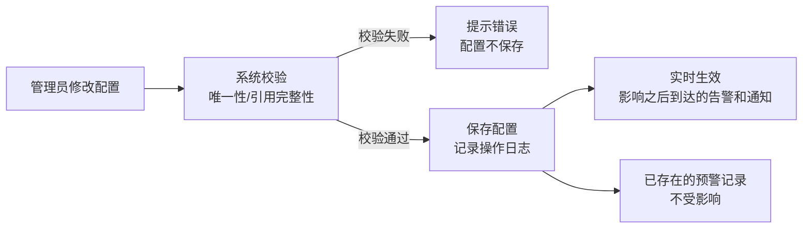

# PRD — 预警管理 · 预警规则配置

| 项 | 内容 |
|---|---|
| 文档版本 | V1.0 |
| 编制日期 | 2026-09-26 |
| 所属产品 | 中石油尼日尔公司上游油田项目 — 数智安防应急指挥中心（平台） |
| 所属端 | PC 后台 |
| 所属模块 | 业务应用 → 预警管理 → 预警规则配置 |
| 页面架构 | 单页 Tab 结构（六个 Tab，内容见第 5 章） |
| 上游依据 | `PRD-预警管理-预警工作台.md`、2026-09-26 设计访谈 Q4、Q5、Q9、Q17、Q20、Q22、Q34、Q36、Q39、Q40、Q42、Q51、Q52 |
| 状态 | 待评审 |

---

## 1. 文档元数据与边界

### 1.1 需求背景

预警工作台依赖一批可运营调整的参数：哪些三方告警要转为预警、几分钟内的同类告警算同一件事、值班员超时未处理要通知谁。这些参数如果硬编码在系统里，每次调整都需要开发介入；做成配置页面后，安保系统管理员可以根据实际运营情况随时调整，不依赖发版。

本模块是预警工作台的「参数中台」，所有配置变更只影响**之后**到达的告警和**之后**触发的通知，已存在的预警记录不受影响。

### 1.2 与既有模块的依赖关系

| 关联模块 | 关系方向 | 具体内容 |
|---|---|---|
| 预警工作台 | 本模块**被依赖** | 工作台读取本模块的全部配置项，实时生效 |
| 人员管理 – 用户信息 | 本模块**读取** | 通知配置的「固定人员」选项来自用户列表 |
| 人员管理 – 排班管理 | 本模块**读取** | 通知配置的「今日值班」选项从排班管理推算 |
| 系统管理 – 消息中心 | 本模块**写入** | 配置变更本身不触发消息，但「通知配置」Tab 定义了消息中心的预警相关路由规则 |

### 1.3 权限边界

| 编号 | 边界 |
|---|---|
| PB-01 | 只有具备 `alert.rule.config` 权限的用户可以修改配置；只有具备 `alert.notify.config` 权限的用户可以修改通知配置 |
| PB-02 | 所有配置变更记录操作日志（操作人、操作时间、变更前后的值），日志只读，不可删除 |
| PB-03 | 具备 `alert.view` 权限的用户可以**只读查看**规则配置，不可修改 |

### 1.4 本期范围（In Scope）

| 编号 | 能力 |
|---|---|
| IS-01 | 预警类型字典维护（7 大类 + 具体类型的增删改） |
| IS-02 | 三方告警映射配置（三方系统 + 告警类型 → 预警类型的映射关系） |
| IS-03 | 合并规则配置（窗口 N、距离 M，按具体类型设置） |
| IS-04 | 紧急程度预置（每个具体类型的默认紧急档） |
| IS-06 | 研判参数配置（研判半径、高点摄像头有效距离、历史回溯时间窗、疑似己方判定参数） |
| IS-07 | 误报原因 / 解除原因字典维护 |
| IS-08 | 通知配置（各通知节点的接收人） |

### 1.5 本期范围外（Out of Scope）

| 编号 | 内容 |
|---|---|
| OS-01 | 系统管理 → 角色管理中的权限点分配（属于系统管理模块） |
| OS-02 | 三方系统的接入配置（属于系统管理 → 数据源管理） |
| OS-03 | 反无实时轨迹落库的存储配置（属于系统管理 → 存储管理） |

---

## 2. 业务概念与术语

| 术语 | 精确定义 |
|---|---|
| **预警大类** | 7 个顶层分类（入侵 / 设备告警 / 无人机威胁 / 人员求助 / 车辆异常 / 自然灾害 / 治安事件），固定不可删除，可以新增 |
| **预警具体类型** | 大类下的二级类型，例如「无人机威胁 → 无人机入侵」。具体类型可以增删改，但被引用中的类型（已有预警记录或正在生效的映射）不可直接删除，须先停用再处理引用 |
| **三方告警映射** | 「三方系统 + 三方告警事件类型」到「预警具体类型」的配置规则。一条映射代表「当 X 系统推送 Y 类型告警时，转为 Z 类预警」。**「三方系统 + 三方告警类型」的组合必须唯一**，不允许一条原始告警同时触发两条映射规则 |
| **合并窗口 N** | 时间维度的合并条件：同设备、同类型的告警在最后一次触发时间起 N 分钟内的新告警，自动并入已有预警 |
| **合并距离 M** | 空间维度的合并条件：新告警的位置与已有预警的位置距离 ≤ M 米，才允许合并。告警不带位置时降级为只判断设备和时间 |
| **紧急程度预置** | 每个具体类型的默认紧急档（紧急 / 一般），值班员在工作台可以手动修正单条预警的紧急程度，但字典中的预置值影响所有新生成的预警 |

---

## 3. 核心流程

### 3.1 配置生效流程



### 3.2 类型字典与映射的联动约束

- 具体类型被停用时，关联的映射规则同步停用（不删除，状态改为「已停用」）
- 具体类型被删除时，系统检查是否存在历史预警记录引用该类型；存在引用时禁止删除，提示「该类型已有 xx 条预警记录引用，无法删除，可以停用」
- 映射规则与具体类型绑定，修改类型名称后映射规则自动跟随

---

## 4. 核心功能矩阵

| 功能 | 触发位置 | 前置条件 | 业务结果 | 所需权限点 |
|---|---|---|---|---|
| 新增预警大类 | 类型与映射 Tab | — | 大类列表增加一项，可在其下添加具体类型 | `alert.rule.config` |
| 新增/编辑具体类型 | 类型与映射 Tab | — | 类型字典更新，新类型立即可用于映射和预置 | `alert.rule.config` |
| 停用具体类型 | 类型与映射 Tab | 类型当前为启用状态 | 该类型的映射规则同步停用；已有预警记录保留该类型标签 | `alert.rule.config` |
| 新增/编辑映射规则 | 类型与映射 Tab | 「三方系统+三方告警类型」组合唯一 | 之后到达的符合条件告警自动转为预警 | `alert.rule.config` |
| 停用映射规则 | 类型与映射 Tab | — | 符合该规则的新告警只写日志，不生成预警 | `alert.rule.config` |
| 查看未映射类型清单 | 类型与映射 Tab | — | 显示近 7 天出现但未配置映射的三方告警类型，提示管理员处理 | `alert.view` |
| 配置合并规则 | 合并与紧急度 Tab | — | 指定类型的窗口 N 和距离 M 更新 | `alert.rule.config` |
| 配置紧急程度预置 | 合并与紧急度 Tab | — | 指定类型的默认紧急档更新，影响之后生成的预警 | `alert.rule.config` |
| 配置研判半径 | 研判参数 Tab | — | 各类型研判半径更新，影响之后打开的研判页 | `alert.rule.config` |
| 配置高点有效距离 | 研判参数 Tab | — | 研判页高点摄像头筛选范围更新 | `alert.rule.config` |
| 配置历史回溯时间窗 | 研判参数 Tab | — | 研判页历史回溯图层的时间范围更新 | `alert.rule.config` |
| 配置疑似己方参数 | 研判参数 Tab | — | 己方比对的距离和时间判定条件更新 | `alert.rule.config` |
| 维护误报原因字典 | 字典 Tab | — | 标记误报时的可选原因更新 | `alert.rule.config` |
| 维护解除原因字典 | 字典 Tab | — | 解除预警时的可选原因更新 | `alert.rule.config` |
| 配置通知接收人 | 通知配置 Tab | — | 指定通知节点的接收人更新，即时生效 | `alert.notify.config` |
| 查看配置操作日志 | 每个 Tab 底部「操作日志」 | — | 只读显示该 Tab 下的变更历史 | `alert.view` |

---

## 5. 页面布局与交互逻辑

### 5.1 整体结构

```
┌─────────────────────────────────────────────────────────────┐
│  预警规则配置                                               │
├─────────────────────────────────────────────────────────────┤
│  [类型与映射] [合并与紧急度] [时限与复核] [研判参数] [字典] [通知配置] │
├─────────────────────────────────────────────────────────────┤
│  Tab 内容区（见各节详述）                                    │
└─────────────────────────────────────────────────────────────┘
```

页面遵循 `PageContainer + PanelCard` 结构规范。

### 5.2 类型与映射 Tab

```
PanelCard: 预警类型字典
┌────────────────────────────────────────────────┐
│ [+ 新增大类]                                    │
│                                                 │
│ ▼ 入侵                              [+ 新增类型] │
│   ├─ 区域入侵    启用  紧急  [编辑][停用]        │
│   ├─ 越界侦测    启用  紧急  [编辑][停用]        │
│   └─ 周界徘徊    启用  一般  [编辑][停用]        │
│                                                 │
│ ▼ 无人机威胁                        [+ 新增类型] │
│   ├─ 无人机入侵  启用  紧急  [编辑][停用]        │
│   └─ 无人机侦察  启用  一般  [编辑][停用]        │
│                                                 │
│ ▼ 设备告警      ...                             │
│ ▼ 人员求助      ...                             │
│ ▼ 车辆异常      ...                             │
│ ▼ 自然灾害      ...                             │
│ ▼ 治安事件      ...                             │
└────────────────────────────────────────────────┘

PanelCard: 三方告警映射
┌──────────────────────────────────────────────────────────────────┐
│ [+ 新增映射规则]   [查看未映射类型 (3)]                            │
├──────────┬──────────────────┬────────────┬──────┬───────────────┤
│ 三方系统 │ 三方告警类型     │ 映射到预警类型│ 状态 │ 操作         │
├──────────┼──────────────────┼────────────┼──────┼───────────────┤
│ 反无设备 │ alarm (入侵告警) │ 无人机入侵  │ 启用 │ [编辑][停用]  │
│ 反无设备 │ detect (探测)    │ 无人机侦察  │ 启用 │ [编辑][停用]  │
│ 高点摄像头│ 越界侦测        │ 越界侦测    │ 启用 │ [编辑][停用]  │
│ 高点摄像头│ 区域入侵        │ 区域入侵    │ 启用 │ [编辑][停用]  │
│ 高点摄像头│ 烟雾检测        │ 自然灾害-烟雾│ 启用 │ [编辑][停用] │
│ 高点摄像头│ 火点检测        │ 自然灾害-火情│ 启用 │ [编辑][停用] │
│ CCTV     │ 人员识别        │ 治安事件-异常人员│ 停用│[编辑][启用] │
│ CCTV     │ 明火烟雾        │ 自然灾害-烟雾│ 启用 │ [编辑][停用] │
│ CCTV     │ 夜间异常光源    │ 治安事件    │ 启用 │ [编辑][停用]  │
│ C类无人机 │ 侦查事件        │ 无人机侦察  │ 启用 │ [编辑][停用]  │
│ 车辆系统  │ 出围栏         │ 车辆异常-出围栏│ 启用│ [编辑][停用] │
│ 车辆系统  │ 超速           │ 车辆异常-超速 │ 启用│ [编辑][停用]  │
│ App上报   │ 人工上报       │ （按上报时选择的类型）│ — │ —      │
└──────────┴──────────────────┴────────────┴──────┴───────────────┘
```

**新增/编辑映射规则表单：**

| 字段 | 规则 |
|---|---|
| 三方系统 | 下拉，固定选项：反无设备 / 高点摄像头 / CCTV / C类无人机 / 车辆系统 |
| 三方告警类型 | 文本，精确匹配三方系统推送的事件类型字段值 |
| 映射到预警类型 | 两级下拉，选择已启用的预警具体类型 |
| 保存校验 | 「三方系统 + 三方告警类型」组合唯一，冲突时提示「该三方告警类型已映射到 [xx]，请先停用再修改」 |

**未映射类型清单弹窗：**

显示近 7 天出现过但没有映射规则的三方告警类型，含系统名、类型值、首次出现时间、出现次数。管理员可以直接从此弹窗「新增映射」或「标记忽略」（标记忽略后该类型不再出现在未映射清单里）。

### 5.3 合并与紧急度 Tab

```
PanelCard: 合并规则配置（按预警具体类型设置）

说明文字：自动合并只在「待核实」阶段生效。同设备、同类型、窗口N内、距离M内的新告警
自动并入已有预警。人工上报不参与自动合并。

筛选：[大类 ▼]  [搜索类型名称]

┌──────────────┬────────────────────┬───────────────────┐
│ 预警类型      │ 合并窗口 N（分钟）  │ 合并距离 M（米）   │
├──────────────┼────────────────────┼───────────────────┤
│ ▼ 入侵                                                  │
│   区域入侵   │   10               │  500              │
│   越界侦测   │   5                │  300              │
│   周界徘徊   │   30               │  200              │
│ ▼ 无人机威胁                                            │
│   无人机入侵 │   3                │  1000             │
│   无人机侦察 │   10               │  2000             │
│ ...          │   ...              │  ...              │
└──────────────┴────────────────────┴───────────────────┘

[批量编辑选中行]   每行可直接编辑数值，失焦自动保存并记录日志

说明：合并距离设为 0 表示只按时间窗合并，不做空间限制（适用于固定位置设备如单台摄像头）
```

```
PanelCard: 紧急程度预置（与合并规则同表，追加一列）

┌──────────────┬────────────┬──────────┬──────────────┐
│ 预警类型      │ 窗口 N     │ 距离 M   │ 默认紧急程度  │
├──────────────┼────────────┼──────────┼──────────────┤
│   区域入侵   │ 10         │ 500      │ 🔴 紧急       │
│   越界侦测   │ 5          │ 300      │ 🔴 紧急       │
│   周界徘徊   │ 30         │ 200      │ ⚪ 一般       │
│   无人机入侵 │ 3          │ 1000     │ 🔴 紧急       │
│   设备告警   │ 60         │ 0        │ ⚪ 一般       │
│ ...          │ ...        │ ...      │ ...           │
└──────────────┴────────────┴──────────┴──────────────┘
```

### 5.4 时限与复核 Tab

```
PanelCard: 状态时限（分钟）

┌────────────────────┬────────────────┬────────────────┐
│ 状态                │ 紧急档时限      │ 一般档时限      │
├────────────────────┼────────────────┼────────────────┤
│ 待核实              │  5 分钟        │  30 分钟       │
│ 待决策              │  10 分钟       │  60 分钟       │
└────────────────────┴────────────────┴────────────────┘

说明：时限从进入该状态的时刻起算。超时后列表标红并触发通知，不自动改变预警状态。
待核实时限不因自动合并而重置。

PanelCard: 持续跟踪复核周期

复核周期：[ 24 ] 小时    （范围：1–168 小时）

说明：持续跟踪中的预警每隔此周期提醒负责人复核一次。
复核时间从上次复核（或进入跟踪状态）时刻起算。

PanelCard: 超时后通知间隔

```

**TBD-08、TBD-09 说明：** 上表中的初始值（5/30/10/60 分钟、24 小时复核周期）为设计建议值，需客户根据现场实际响应能力确认后填入。

### 5.5 研判参数 Tab

```
PanelCard: 研判半径（按预警大类配置，单位：米）

┌──────────────────┬─────────────┐
│ 预警大类          │ 研判半径     │
├──────────────────┼─────────────┤
│ 入侵             │ 1000        │
│ 无人机威胁       │ 3000        │
│ 设备告警         │ 500         │
│ 人员求助         │ 1000        │
│ 车辆异常         │ 1500        │
│ 自然灾害         │ 1000        │
│ 治安事件         │ 1000        │
└──────────────────┴─────────────┘
说明：值班员在研判页可以临时调整当前预警的半径，不影响此处配置。

PanelCard: 高点摄像头有效监视距离

可见光通道：[ 3000 ] 米    热成像通道：[ 5000 ] 米    （初始值待厂家确认，TBD-02）

说明：研判页据此判断高点摄像头是否「理论可视」预警点，标注「已对准 / 需转向」。
距离为理论值，不考虑地形遮挡。

PanelCard: 历史回溯时间窗

预警发生时刻前 [ 30 ] 分钟  后 [ 10 ] 分钟    （初始值待确认，TBD-03）

说明：研判页历史回溯图层加载此时间范围内的历史记录。

PanelCard: 疑似己方判定参数

空间距离阈值：[ 200 ] 米      时间差阈值：[ 10 ] 秒

说明：反无识别到的目标，若与我方无人机（有新鲜实时位置，≤3个通信周期）的距离
≤ 空间距离阈值 且 位置时间差 ≤ 时间差阈值，则标注「疑似己方」。
只作展示参考，不参与自动误报判定，最终结论由值班员下。

PanelCard: 反无实时轨迹保留时长

保留 [ 30 ] 天    （范围：7–90 天）

说明：平台落库的反无实时 WS 推送轨迹数据，超出保留天数后自动清理。
存储容量影响需系统管理员评估（TBD-XX 存储容量评估）。
```

### 5.6 字典 Tab

```
PanelCard: 误报原因字典

┌────────────────────────┬──────┬────────────────────────────┐
│ 原因名称                │ 状态 │ 操作                       │
├────────────────────────┼──────┼────────────────────────────┤
│ 设备误识别              │ 启用 │ [编辑] [停用]              │
│ 己方目标                │ 启用 │ [编辑] [停用]              │
│ 白名单目标              │ 启用 │ [编辑] [停用]              │
│ 动物或天气干扰          │ 启用 │ [编辑] [停用]              │
│ 其他（必填说明）        │ 启用 │ [编辑]（不可停用）         │
└────────────────────────┴──────┴────────────────────────────┘
[+ 新增原因]

PanelCard: 解除原因字典

┌────────────────────────┬──────┬────────────────────────────┐
│ 原因名称                │ 状态 │ 操作                       │
├────────────────────────┼──────┼────────────────────────────┤
│ 已劝离                  │ 启用 │ [编辑] [停用]              │
│ 自然消失                │ 启用 │ [编辑] [停用]              │
│ 风险已消除              │ 启用 │ [编辑] [停用]              │
│ 其他（必填说明）        │ 启用 │ [编辑]（不可停用）         │
└────────────────────────┴──────┴────────────────────────────┘
[+ 新增原因]
```

**字典约束：**
- 「其他」条目不可停用，保证值班员在其他原因不适用时有兜底选项
- 已被历史预警记录引用的原因不可删除，只能停用（停用后不出现在新建表单中，历史记录保留原值）
- 每条原因名称最多 20 个字符

### 5.7 通知配置 Tab

```
PanelCard: 通知接收人配置

说明：每个通知节点独立配置接收人。「今日值班」选项从排班管理中按预警所属营地推算。
「新预警待核实」节点的接收人不能为空，否则禁止保存（系统顶部显示红色警告直到配置完成）。

┌────────────────────────┬──────────────────────────────────────────────────┐
│ 通知节点                │ 接收人                                            │
├────────────────────────┼──────────────────────────────────────────────────┤
│ 🔴 新预警待核实（必填）  │ [今日值班（指挥中心值班）✓] [+ 添加固定人员]     │
│ 待决策                  │ [今日值班（安保负责人）✓] [+ 添加固定人员]       │
│ 核实任务已回填          │ [任务下发人（自动）]                              │
└────────────────────────┴──────────────────────────────────────────────────┘

[保存]

兜底规则：
- 如果「今日值班」当天无排班人员，自动兜底给该节点的「固定人员」
- 如果「今日值班」和「固定人员」均为空，顶部显示 ⚠️ 警告「[通知节点名称] 接收人未配置，预警将无人收到通知」
```

**通知接收人选择器规则：**

| 选项类型 | 说明 |
|---|---|
| 今日值班（值班职责） | 从排班管理读取当日值班人员，按值班职责筛选；一个节点可以添加多个值班职责条件 |
| 固定人员 | 从用户列表中多选，指定具体人员；用户注销后自动从接收人列表移除，并在配置页提示「xx 已注销，已自动移除」 |
| 任务下发人（自动） | 系统自动通知下发该核实任务的值班员，不需要手动配置 |

---

## 6. 边界情况与异常处理

### 6.1 空状态处理

| 场景 | 展示文案 |
|---|---|
| 映射规则列表为空 | 「尚未配置任何映射规则，所有三方告警将只写入日志而不生成预警。点击「新增映射规则」开始配置。」|
| 未映射类型清单为空 | 「近 7 天内所有三方告警类型均已配置映射，无待处理项」 |
| 通知配置某节点接收人为空（非必填节点） | 该节点行以灰色斜体显示「未配置，将不发送通知」 |

### 6.2 数据校验

| 规则 | 说明 |
|---|---|
| 「三方系统 + 三方告警类型」唯一性 | 新增/编辑映射时实时校验，冲突则禁止保存 |
| 数值范围 | 合并窗口 N：1–1440 分钟；合并距离 M：0–50000 米；研判半径：100–50000 米；疑似己方距离：50–5000 米；疑似己方时间差：1–300 秒 |
| 「新预警待核实」接收人不为空 | 保存通知配置时强制校验；违反时禁止保存，整个 Tab 顶部显示红色提示 |
| 原因名称最多 20 个字符 | 超长时输入框底部显示计数红字 |
| 字典条目「其他」不可停用/删除 | 操作按钮置灰，Tooltip 提示「「其他」条目不可停用，以保证操作总有兜底选项」 |

### 6.3 网络异常

| 场景 | 处理方式 |
|---|---|
| 保存失败 | Toast 错误提示，表单内容不清空，可以重试 |
| 页面加载配置失败 | 每个 PanelCard 单独显示「加载失败，点击重试」，不影响其他 Card |

### 6.4 引用完整性

| 场景 | 处理方式 |
|---|---|
| 停用有历史引用的具体类型 | 允许停用，弹确认框提示「停用后该类型的 X 条映射规则同步停用，已有 Y 条预警记录不受影响，确认停用？」 |
| 删除有历史引用的具体类型 | 禁止删除，提示「该类型已有 X 条预警记录引用，无法删除，可以停用」 |
| 被引用的原因字典条目 | 同上，禁止删除，可以停用 |

### 6.5 权限拦截

| 场景 | 处理方式 |
|---|---|
| 无配置权限访问页面 | 页面正常显示，所有编辑入口（按钮、行内编辑）禁用，顶部提示「只读模式，如需修改请联系系统管理员」 |
| 有配置权限但无通知配置权限 | 「通知配置」Tab 对应的编辑入口禁用 |

---

## 附录 A：配置项完整清单（含默认值和范围）

| 配置项 | 所在 Tab | 默认值 | 允许范围 | TBD |
|---|---|---|---|---|
| 合并窗口 N（分钟） | 合并与紧急度 | 按类型设置，初始值见 5.3 | 1–1440 | — |
| 合并距离 M（米） | 合并与紧急度 | 按类型设置，初始值见 5.3 | 0–50000 | — |
| 默认紧急程度 | 合并与紧急度 | 按类型预置，初始值见 5.3 | 紧急 / 一般 | — |
| 研判半径·入侵（米） | 研判参数 | 1000 | 100–50000 | — |
| 研判半径·无人机威胁（米） | 研判参数 | 3000 | 100–50000 | — |
| 研判半径·其他大类（米） | 研判参数 | 1000 | 100–50000 | — |
| 高点可见光有效距离（米） | 研判参数 | 待定 | 100–20000 | TBD-02 |
| 高点热成像有效距离（米） | 研判参数 | 待定 | 100–30000 | TBD-02 |
| 历史回溯前向时间窗（分钟） | 研判参数 | 30 | 1–1440 | TBD-03 |
| 历史回溯后向时间窗（分钟） | 研判参数 | 10 | 1–60 | TBD-03 |
| 疑似己方空间距离阈值（米） | 研判参数 | 200 | 50–5000 | — |
| 疑似己方时间差阈值（秒） | 研判参数 | 10 | 1–300 | — |
| 反无实时轨迹保留天数 | 研判参数 | 30 | 7–90 | — |

---

## 附录 B：待确认事项

| 编号 | 事项 | 当前处理方式 |
|---|---|---|
| TBD-02 | 高点摄像头有效监视距离（可见光 / 热成像）由厂家提供实测值 | 配置项保留，初始值空置，待填入后生效 |
| TBD-03 | 历史回溯时间窗的合理默认值（与现场响应时长相关） | 提供配置项，初始值 30/10 分钟为设计建议值 |
| TBD-XX | 反无实时轨迹落库的存储容量评估（按保留天数和推送频率估算） | 存储管理属系统管理模块，此处只提供保留天数配置项 |
